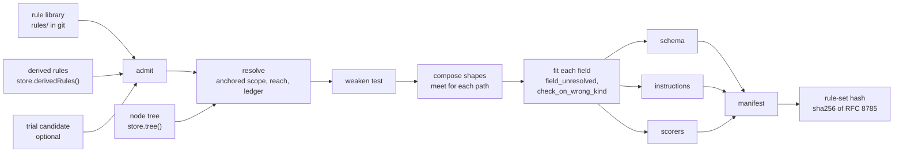

# The rule compiler `compile`

Status. Spec of 2026-11-02 for `plan.compiler`. Built by [Ronitron007/product-eval-harness#19](https://github.com/Ronitron007/product-eval-harness/pull/19), and the section `compile.reconciliation` lists where the code differs. This spec matches the code of `main` at `803301a`, in `src/rules/`, `src/store/store.ts`, and `package.json`. Terms are in [glossary.md](../glossary.md).

Source. Claude wrote this spec from the architect run of 2026-11-02 ([the record](../research/2026-11-02-compiler-architect/README.md)). The design of the Opus runner is the base. The synthesis of the run changes that base, and the synthesis wins each conflict. Each choice is a row in [decisions.tsv](../decisions.tsv), for Rohan to review.

Review. Two adversaries then interrogated this spec on 2026-11-02, and the coordinator ran each repro again. The spec folds in their eight fixes, and one more fix from the verify round. Their repros are in [the interrogate folder](../research/2026-11-02-compiler-architect/interrogate/) of the record.

## The idea `compile.idea`

The compiler, `compile`, reads the rules in scope of one stage run at one node. It makes these things:

- The output schema, from the `shape` rules. The drafter decodes its output into this schema.

- The instruction text, from the `strict` and `soft` rules.

- One scorer for each rule. A code scorer checks a `shape` rule or a `code_check` rule. A judge scorer asks a model about a `judgement` rule.

- The rule-set hash. The store writes it into `stage_runs.rule_set_hash`.

Shape is data, a check is code with types, and a judgement is text. One order table for each parameter decides two things. It decides how two rules on one field compose, and what "weaken" means. Each scope starts at the node that owns the rule (an anchored scope). Each inherited rule always applies, and a child rule never overrides it. The hash comes from the compiled artifacts, not from a list of inputs.

## The flow `compile.flow`



Each step adds its problems to one list. When the list has a problem, the compiler returns all problems in one round. It never throws on rule data. The compile is pure and sync, so a caller can compile again at each step.

## Usage `compile.usage`

### Rule files `compile.usage.files`

A shape rule at the domain node `skincare`, as an author writes it:

```yaml
# rules/skincare/units.label_unit.yaml
id: units.label_unit
version: 1
kind: shape
shape: { type: text, values: [mg, mcg, g] }   # the compiler prints these values. The statement must not.
statement: Write the amount in the unit that the label prints.
reason: A grade must rest on what the label states.
scope: { nodes: subtree, stages: [create_node], fields: ['criteria[].attributes[].unit'] }
binding: strict                                # a shape rule is always strict
examples:
  - { output: mg, expected: pass }
  - { output: IU, expected: fail, note: IU is not a unit of mass. }
provenance: { record_id: rec_label_units }
owner: skincare
status: active
```

A code check names a template of the check registry, with typed parameters:

```yaml
# rules/skincare/quotes.from_label.yaml
id: quotes.from_label
version: 1
kind: code_check
check: { name: quote_in_source, params: { source: label, case_sensitive: true } }
statement: Back each attribute value with a quote from the source text.
reason: A judge and a reader must find the words that the value rests on.
scope: { nodes: subtree, stages: [create_node], fields: ['criteria[].attributes[].quote'] }  # a shape rule defines this field
binding: strict
examples:
  - { input: { sources: { label: 'Each capsule has 500 mg.' } }, output: '500 mg', expected: pass }
  - { input: { sources: { label: 'Each capsule has 500 mg.' } }, output: '600 mg', expected: fail }
  - { output: '500 mg', expected: cannot_verify, note: The run has no label text. }
provenance: { record_id: rec_label_quotes }
owner: skincare
status: active
```

A judgement rule keeps its judge question in its own field, as today:

```yaml
# rules/skincare/criteria.attribute_is_product.yaml (the other fields as above)
kind: judgement
judge: { question: 'Does the attribute describe a property of the product itself? Answer yes, no, or unknown.' }
```

A rule at the child node `sunscreen` that restates the unit rule more loosely:

```yaml
# rules/sunscreen/units.allow_iu.yaml (the other fields as above)
id: units.allow_iu
kind: shape
shape: { type: text, values: [mg, mcg, g, IU] }
scope: { nodes: subtree, stages: [create_node], fields: ['criteria[].attributes[].unit'] }
binding: strict
owner: sunscreen
```

The compile at `sunscreen` refuses it, with all other problems in the same round:

```
weakens units.allow_iu@1 units.label_unit@1 criteria[].attributes[].unit
  sunscreen units.allow_iu@1 allows IU, which skincare units.label_unit@1 forbids.
  Change the skincare rule, or drop the value.
```

Take an inherited `number` rule with `min: 0` on `criteria[].attributes[].amount`. A child rule that sets only `max: 5000` on that field adds a constraint. The compiler accepts it.

### Call sites `compile.usage.calls`

```ts
import { auditLibrary, compileStage } from '../compiler'

// Call site: the stage workflow (plan.stage_workflow). Each step that needs the plan compiles
// again and refuses a hash that differs from the hash of the run.
async function planFor(run: { runId: string; stage: Stage; nodeId: NodeId; ruleSetHash?: string }): Promise<StagePlan> {
  const [tree, derived] = await Promise.all([store.tree(), store.derivedRules()])
  const compiled = compileStage({ stage: run.stage, node: run.nodeId, library: loadRuleLibrary('rules'), derived, tree })
  if (!compiled.ok) throw new RulesRefused(compiled.problems) // all problems, before any model call
  if (run.ruleSetHash !== undefined && run.ruleSetHash !== compiled.plan.ruleSetHash) {
    throw new Error(`The rules changed during run ${run.runId}. Start a new run.`)
  }
  return compiled.plan
}

// context step
const plan = await planFor({ runId, stage: 'create_node', nodeId: 'sunscreen' })
await store.recordStageRun({ runId, stage: plan.stage, nodeId: plan.node, ruleSetHash: plan.ruleSetHash })

// draft step: plan.instructions reaches the agent through request context (mastra.table).
// errorStrategy 'warn' keeps a draft that breaks the schema: object and error are undefined, and
// text holds the raw reply. The default 'strict' throws and loses the draft (verified, ran with
// createMockModel on @mastra/core 1.79.0). Never use 'fallback' (mastra.not_used).
const draft = await drafter.generate(prompt, { structuredOutput: { schema: plan.schema, errorStrategy: 'warn' }, requestContext })
// The one decode gate (scorers.closed_output). 'warn' gives no error for a reply that breaks the
// schema, such as one with an extra key that no rule owns. plan.decode parses a string as JSON
// and runs plan.schema.safeParse on it.
const decoded = plan.decode(draft.object !== undefined ? draft.object : draft.text)
const output: unknown = decoded.ok ? decoded.output : decoded.raw // the parsed JSON, or the raw string

// judge step (plan.judge_step owns the rest): code scorers first, judges only when the output
// decoded and each strict code verdict passed
const rows: ItemVerdict[] = []
for (const s of plan.scorers.code) rows.push(...(await s.verify(output, evidence))) // a broken shape gives fail rows
if (decoded.ok && rows.every(r => r.binding !== 'strict' || r.verdict === 'pass')) {
  for (const s of plan.scorers.judges(judgeModel)) rows.push(...(await s.verify(output, evidence)))
} else {
  rows.push(...plan.scorers.skippedJudges('The output broke the schema or a strict code check, so no judge ran.')) // no model
}
await store.writeVerdicts(rows.map(r => ({ ...r, runId })))
// A failed decode is a strict failure of the stage. Its issues, such as an extra key or a missing
// field, go into the problems of the stage run, which the workflow keeps. The next step is a repair
// round with the issues, or the person step when the budget is spent. acceptOutput never sees it.
if (!decoded.ok) stageRunProblems.push(...decoded.issues)

// Call site: CI, inside `npm run rules:check`. No tree, no database, no model.
const problems = await auditLibrary({ library: loadRuleLibrary('rules'), derived: [], tree: 'unknown' })

// Call site: the change trial (plan.change_process). One candidate compiles as watch.
const trial = compileStage({ stage: 'create_node', node: 'sunscreen', library, derived, tree, trial: candidate })
```

| Call site | Call | What it gets |
|---|---|---|
| Stage workflow (`planFor`, the context step, the judge step) | `compileStage` in each step that needs the plan | The schema, the instructions, the scorers, and the hash. A resume after a rule change gets another hash and refuses. Nothing that JSON cannot hold sits in a workflow snapshot. A draft that breaks the schema still reaches the code scorers, but never the judges or the graph. |
| CI golden gate (`rules:check`) | `auditLibrary` with `tree: 'unknown'` | The problems that need no tree. The golden examples of each shape rule and each code check run through the real scorer path. |
| Change trial (`plan.change_process`) | `compileStage` with `trial` | The live plan plus one watch scorer for the candidate. Its hash differs from the live hash. |

## The public API `compile.api`

Code outside `src/compiler/` imports `src/compiler/index.ts` only. A test fails when another file imports an internal file (`boundary.internals_unreachable`).

```ts
// src/compiler/index.ts (new): the public surface.
import type { z } from 'zod'
import type { MastraScorer } from '@mastra/core/evals'
import type { MastraModelConfig } from '@mastra/core/llm'
import type { RuleLibrary } from '../rules/load'
import type { Binding, NodeId, RuleRecord, Stage } from '../rules/schema'
import type { Json, RunEvidence } from '../rules/checks/define'
import type { DerivedRule, GraphNode, VerdictInput } from '../store/store'

export type Sha256 = string & { readonly __brand: 'sha256' }
export type TreeNode = Pick<GraphNode, 'id' | 'parentId' | 'level'>

// Pure and sync. Never throws on rule data: every problem comes back in one round.
export declare function compileStage(input: CompileInput): CompileResult
// Offline. Async, because the golden examples run through the scorers.
export declare function auditLibrary(input: AuditInput): Promise<readonly CompileProblem[]>

export interface CompileInput {
  readonly stage: Stage
  readonly node: NodeId
  readonly library: RuleLibrary // loadRuleLibrary('rules'). It must have zero problems.
  readonly derived: readonly DerivedRule[] // store.derivedRules(): every version
  readonly tree: readonly TreeNode[] // store.tree(): every node
  readonly trial?: RuleRecord // one candidate version. It compiles as watch (compile.ledger).
}

export type CompileResult =
  | { readonly ok: true; readonly plan: StagePlan }
  | { readonly ok: false; readonly problems: readonly CompileProblem[] }

export interface StagePlan {
  readonly stage: Stage
  readonly node: NodeId
  readonly ruleSetHash: Sha256 // sha256(RFC 8785(manifest)), for store.recordStageRun
  readonly schema: z.ZodType // structuredOutput.schema of the drafter
  readonly instructions: string // strict and soft rules. Watch rules and judge questions never print.
  readonly scorers: {
    readonly code: readonly RuleScorer[] // one for each applied shape or code_check rule
    judges(model: JudgeModel): readonly RuleScorer[] // the only door for a model
    // No model. One cannot_verify row for each field of each judgement rule (scorers.skipped_judges).
    skippedJudges(reason: string): readonly ItemVerdict[]
  }
  // The one decode gate (scorers.closed_output). It parses a string as JSON, then runs plan.schema.safeParse.
  decode(raw: unknown): DecodeResult
  readonly ledger: readonly LedgerEntry[] // one entry for each input rule version
  readonly manifest: Manifest // exactly what the hash covers (compile.hash)
}

export type ItemVerdict = Omit<VerdictInput, 'runId'> // plus runId, a row for store.writeVerdicts

export interface DecodeIssue {
  readonly path: string // such as criteria[0].attributes[0].grade
  readonly message: string // from the Zod issue
}
export type DecodeResult =
  | { readonly ok: true; readonly output: Json }
  | { readonly ok: false; readonly issues: readonly DecodeIssue[]; readonly raw: unknown } // raw: the parsed JSON, or the string

export interface RuleScorer {
  readonly id: `${string}@${number}` // rule.id@version, also the Mastra scorer id
  readonly rule: { readonly id: string; readonly version: number; readonly hash: Sha256; readonly binding: Binding; readonly kind: RuleRecord['kind'] }
  readonly decider: VerdictInput['decider']
  readonly fields: readonly string[]
  readonly scorer: MastraScorer<string, RunEvidence, unknown, any> // for runEvals and experiments
  // Takes the raw output, which may break the schema (scorers.decode_failure_rows). Never throws, never
  // returns []. A throw, a judge error, an unknown answer, or missing evidence gives cannot_verify.
  verify(output: unknown, evidence: RunEvidence): Promise<readonly ItemVerdict[]>
}

export interface JudgeModel {
  readonly id: string // provider/model, written into the decider of each verdict
  readonly model: MastraModelConfig
}

export type RuleOrigin = 'git' | 'store' | 'trial'
export type ExclusionReason =
  | 'draft' | 'retired' | 'superseded' // status
  | 'owner_not_on_path' | 'stage_not_named' | 'selector_misses_node' // scope
export type Disposition =
  | { readonly kind: 'applied'; readonly binding: Binding }
  | { readonly kind: 'trial' } // always watch
  | { readonly kind: 'excluded'; readonly reason: ExclusionReason }
export interface LedgerEntry {
  readonly rule: string
  readonly version: number
  readonly origin: RuleOrigin
  readonly disposition: Disposition
}

export type ProblemCode =
  | 'library_invalid' | 'derived_invalid' | 'derived_hash_mismatch' | 'id_collision' // compile.admit
  | 'draft_shadows_active' | 'trial_shape_refused' // compile.admit
  | 'owner_unknown' | 'rule_inert' | 'trial_not_applied' | 'stage_not_at_level' | 'node_unknown' // compile.scope
  | 'weakens' | 'slot_conflict' // compile.weaken
  | 'no_output_fields' | 'shape_conflict' | 'list_without_items' // compile.shape
  | 'field_unresolved' | 'check_on_wrong_kind' // compile.shape, compile.checks
  | 'golden_mismatch' // auditLibrary only

export interface CompileProblem {
  readonly code: ProblemCode
  readonly rules: readonly string[] // id@version, one or two
  readonly field?: string
  readonly message: string // what is wrong, and the fix
}

export interface AuditInput {
  readonly library: RuleLibrary
  readonly derived: readonly DerivedRule[]
  readonly tree: readonly TreeNode[] | 'unknown' // 'unknown' in CI: the tree lives in the database
}
```

`Manifest` is in `compile.hash`. `RunEvidence` is in `compile.checks`.

## The rule record `compile.record`

The record changes, because today a `shape` rule cannot say its shape, and a `code_check` rule cannot pass parameters to its check. The folder `rules/` and `rules/rules.lock.json` hold no rule yet, so no rule migrates.

| Part | Today | After this unit |
|---|---|---|
| Record type | One object. Its `superRefine` tests tie `judge` and `check` to `kind`. | A Zod discriminated union on `kind`. A `judge` field on a `code_check` rule cannot exist. |
| `shape` | None | A `shape` rule carries `shape: Shape`, from a closed shape language (`compile.shape`). |
| `check` | A function name | A `code_check` rule carries `check: { name, params }`. The registry types the params of each name (`compile.checks`). |
| `binding` of a shape rule | Any binding | Always `strict`. The decoder enforces a shape, so a soft or a watch shape rule would not be true. |
| `scope.nodes` | `{ node, descendants }` or `{ level }` | `owner`, `subtree`, or `{ level }`, relative to the owner (`compile.scope`) |
| `owner` | A node id | A node id, or the virtual owner `all` |
| `examples[].input` | Any value | `RunEvidence`, so the loader checks golden inputs |
| `ruleHash` | Covers `check` as a name. It leaves out `owner`. | Also covers `owner`, `shape`, and the structured `check`. The owner decides where an anchored rule applies, so a move of the owner changes the hash. |
| `FieldPath` | Any name segment | Refuses the segments `__proto__`, `constructor`, `prototype`, and each segment that starts with `__` |

```ts
// src/rules/schema.ts (changed)

// The virtual owner above every domain node. rules/all/ holds the rules for every domain.
// store.addNode refuses a node with this id.
export const OWNER_ALL = 'all'

// The levels where each stage runs (graph.stages).
export const STAGE_LEVELS: Readonly<Record<Stage, readonly NodeLevel[]>> = {
  define_criteria: ['domain'],
  create_node: ['inner', 'leaf'],
  create_pack: ['leaf'],
  create_layout: ['leaf'],
  evaluate_product: ['leaf'], // inferred: the product evaluation reads the pack of a leaf
}

// Anchored at the owner. No node id, so a rule cannot reach a parent or a sibling.
export const NodeSelector = z.union([z.literal('owner'), z.literal('subtree'), z.object({ level: NodeLevel }).strict()])
// A segment that an object prototype owns would make a key that a plain object drops (record.reserved_names).
const RESERVED = new Set(['__proto__', 'constructor', 'prototype'])
export const SafeFieldPath = FieldPath.refine(
  p => p.split('.').every(seg => { const name = seg.replace(/\[\]$/, ''); return !RESERVED.has(name) && !name.startsWith('__') }),
  'Rename the field. A path segment cannot be __proto__, constructor, prototype, or start with __.',
)
export const RuleScope = z
  .object({ nodes: NodeSelector, stages: z.array(Stage).min(1), fields: z.array(SafeFieldPath).min(1) })
  .strict()

// The shape language. Closed: no refine, no transform. Containers come from the path syntax.
export const TextShape = z
  .object({
    type: z.literal('text'),
    values: z.array(z.string().min(1)).min(1).optional(),
    min_length: z.number().int().min(1).optional(),
    max_length: z.number().int().min(1).optional(),
  })
  .strict()
export const NumberShape = z
  .object({ type: z.literal('number'), min: z.number().optional(), max: z.number().optional(), integer: z.literal(true).optional() })
  .strict()
export const FlagShape = z.object({ type: z.literal('flag') }).strict()
// At path `x`: the list itself. Rules on `x[]` give the shape of its items. No `unique`: Zod cannot
// print it, so uniqueness is the check template unique_by (shape.no_unique).
export const ListShape = z
  .object({ type: z.literal('list'), min_items: z.number().int().min(0).optional(), max_items: z.number().int().min(1).optional() })
  .strict()
export const Shape = z.discriminatedUnion('type', [TextShape, NumberShape, FlagShape, ListShape])

export const Example = z
  .object({ input: RunEvidence.optional(), output: z.unknown(), expected: Verdict, note: z.string().optional() })
  .strict()

const RuleBase = {
  id: RuleId,
  version: z.number().int().min(1),
  statement: z.string().min(1),
  reason: z.string().min(1),
  scope: RuleScope,
  binding: Binding,
  examples: z.array(Example).min(1),
  provenance: Provenance,
  owner: NodeId, // a node id, or OWNER_ALL
  status: RuleStatus,
  supersedes: z.number().int().min(1).optional(),
}

export const RuleRecord = z
  .discriminatedUnion('kind', [
    z.object({ ...RuleBase, kind: z.literal('shape'), shape: Shape, binding: z.literal('strict') }).strict(),
    z.object({ ...RuleBase, kind: z.literal('code_check'), check: CheckRef }).strict(),
    z.object({ ...RuleBase, kind: z.literal('judgement'), judge: Judge }).strict(),
  ])
  .superRefine(recordLint) // the loader problems below
export type RuleRecord = z.infer<typeof RuleRecord>
```

The record lint (`recordLint`) gives these loader problems. Each problem names the field and the fix.

- The version and `supersedes` do not agree, as today.

- The owner is `all` and the selector is `owner`. That rule selects no node.

- The selector is `{ level }`, and a named stage never runs at that level (`STAGE_LEVELS`).

- The shape parameters contradict each other. Examples are `min` above `max`, `min_length` above `max_length`, and a value that occurs two times.

- The statement or the reason holds a parameter literal as a whole word. The literals are `shape.values` and the `literals(params)` of the check template. This literal lint keeps one copy of each parameter, in the params object.

- A shape rule has a binding other than `strict`. The message says that the decoder enforces each shape rule.

- The statement or the reason of a shape rule or a code check holds a numeral, a digit character. Each number of the rule lives in its `shape` or `check.params`, so that the compiler prints one copy. A judgement rule has no parameters, so its words may hold a number (`record.no_numerals`).

The loader also reports an unknown check name at `check.name`, and a bad parameter at `check.params.<key>`. So `rules:check` exits 1 before any run.

The rule hash (`ruleHash`) covers `owner` (`record.owner_in_hash`). With an anchored scope, the owner decides where a rule applies. So a move of the owner under a locked version fails `rules:check` with the message "The words changed under version N". The author raises the version instead (`hash.rule_hash_covers_owner`).

A field path refuses a reserved segment (`record.reserved_names`). The trie and the Zod object builder also keep their keys in a `Map` or in an object with no prototype. So no key can reach the prototype of an object (`shape.reserved_names`).

## Admission `compile.admit`

Admission (`admit`) is the first step of each compile. Only `admit` makes the branded value `Admitted`, so internal code cannot get a rule that nobody checked. Admission refuses these inputs:

- A rule library with any loader problem or lock problem gives `library_invalid`.

- A derived row whose record fails `RuleRecord` gives `derived_invalid`. The same code covers a row whose `id`, `version`, or `owner` column differs from its record.

- A derived row whose recomputed `ruleHash` differs from its `hash` column gives `derived_hash_mismatch`.

- A derived rule of kind `shape` gives `derived_invalid`. Only Rohan changes an output shape (the decisions row of 2026-10-24 on what an editor may change). A stage rule in git changes an output shape through a PR.

- A derived rule with the id of a stage rule gives `id_collision`.

- A stage rule file with status `draft` and a version above 1 gives `draft_shadows_active`. The library keeps one file for each id, so that draft would hide the active version in silence. A candidate version enters only as the `trial` input, from the PR branch.

- A trial candidate of kind `shape` gives `trial_shape_refused`. A trial runs as watch, and a shape rule is always strict (`compile.ledger`).

For a derived rule, the newest version of each id counts. Each older version gets the ledger reason `superseded`.

## Scope `compile.scope`

A rule applies at node N and stage S when each of these holds:

- Its status is `active`, or it is the trial candidate.

- Its owner is on the path from N to the root, or its owner is `all`.

- Its `scope.stages` names S.

- Its selector matches N. The selector `owner` matches the owner only. The selector `subtree` matches the owner and each descendant. The selector `{ level }` matches each node of that level in the subtree of the owner.

N must be a node of the tree, or the compile gives `node_unknown`. The level of N must be in `STAGE_LEVELS[S]`, or the compile gives `stage_not_at_level`. Each rule that does not apply gets one ledger reason (`compile.ledger`).

A scope holds no node id. So a rule at `sunscreen` cannot reach `skincare` or the sibling `moisturizer`. The store refuses a node with the id `all`.

Each compile also checks the reach of the whole admitted pool against the tree (`scope.inert_rule`). These problems block each compile:

- An `active` rule whose owner is not in the tree, and is not `all`, gives `owner_unknown`.

- An `active` rule that applies at no node and stage of the tree gives `rule_inert`. An example is a rule at a domain node with the selector `owner` and the stage `create_node`.

- A trial candidate that does not apply at the compiled node and stage gives `trial_not_applied`. So a trial never compiles to the live hash in silence.

The author keeps such a rule at `draft` until its node exists. With no tree, CI still finds one case. A selector `{ level }` with a stage that never runs at that level is a loader problem (`compile.record`).

## Weaken `compile.weaken`

Each inherited rule keeps its effect, because the rules in scope hold together (conjunction). So a child rule cannot relax a check by an override. A child rule can still restate an inherited rule more loosely. Its instruction then contradicts the inherited rule, and a reader can think that it overrides. The compiler refuses that case with `weakens`.

Two rules share a slot when they check the same thing on the same field:

- Shape slot. Both rules are `shape` rules with the same `shape.type` on one field.

- Check slot. Both rules are `code_check` rules on one field, with the same `check.name` and equal `identity` parameters.

Child rule B weakens inherited rule A when each of these holds:

- The owner of A is a strict ancestor of the owner of B. The owner `all` is a strict ancestor of each real node.

- Both rules apply at the compiled node and stage.

- A and B share a slot.

- At least one dimension makes B looser:

  - A dimension that both rules set is looser in B, by the order table.

  - B is a `code_check` rule with a lower binding than A. The order is `strict`, then `soft`, then `watch`.

A dimension that only B sets is an addition, and the compiler accepts it. A dimension that only A sets stays in force. The binding test applies to `code_check` rules only, because each shape rule is `strict`. The test reads the binding that the author wrote. The forced watch of a trial is never a weakening. Judgement rules share no slot, so they can only add.

Two applied rules can also restate one slot as peers, or a child can restate it more strictly. Then the instruction would print two values for one dimension. So two applied rules in one slot, at any owner relation, must not set a shared dimension to other values, and a code check must not have another binding (`weaken.slot_conflict`). The compiler refuses each such pair with `slot_conflict`. A pair where the child is looser than an inherited rule gives `weakens` instead. A trial version and the live version of the same id are one rule, so they never conflict.

One order table for each parameter drives the weaken test and the meet of `compile.shape`. The order of a parameter is one of these:

| Order | Stricter value | Parameters |
|---|---|---|
| `identity` | None. Two values make two slots. | `quote_in_source.source`, `unique_by.by` |
| `higher_is_stricter` | The higher number | `number.min`, `list.min_items`, `text.min_length` |
| `lower_is_stricter` | The lower number | `number.max`, `list.max_items`, `text.max_length` |
| `subset_is_stricter` | The smaller set | `text.values` |
| `superset_is_stricter` | The bigger set | None yet. For required keys or forbidden words. |
| `true_is_stricter` | `true` | `number.integer`, `quote_in_source.case_sensitive` |

`SHAPE_ORDERS` holds the table of each shape type. Each check template holds its own table in `order`. The type of `order` has one key for each parameter, so the build fails when the parameters and the table disagree.

A test proves that each order table is sound (`weaken.order_is_sound`). It takes two vector parameters a and b of one template. The table must say that a is at least as strict as b. Then each vector item that passes under a must also pass under b.

## Shape `compile.shape`

Each `shape` rule is `strict`, so each shape rule shapes the decoding schema. The shape language has four types:

| Type | Dimensions | Zod |
|---|---|---|
| `text` | `values`, `min_length`, `max_length` | `z.enum` of the sorted values, or `z.string` with its limits |
| `number` | `min`, `max`, `integer` | `z.number` with its limits |
| `flag` | None | `z.boolean` |
| `list` | `min_items`, `max_items` | `z.array` with its limits. The rules on `x[]` give the items. |

The path syntax makes the containers. A path `a.b` makes `a` an object. A path `a[]` makes `a` a list. The compiler puts the shape rules in scope into a tree of paths (a trie). At each path, it takes the meet of the parameters of all shape rules there. The meet is the strictest set of parameters that satisfies each rule.

The meet is joint, not one dimension at a time (`shape.joint_meet`). The composed shape must be exactly the set of values that the printed schema decodes. A `text` shape with `values` prints as `z.enum`, which cannot carry a length limit. So these rules apply:

- A `text` shape with `values` and with `min_length` or `max_length` is a conflict. One rule or two rules can cause it.

- A `number` shape with `integer` is empty when no integer lies between `min` and `max`. The test is `ceil(min) > floor(max)`.

- A `list` shape has no `unique` dimension (`shape.no_unique`). Zod cannot print it, and the hash cannot see a refine. The check template `unique_by` is the one way to test uniqueness.

The compiler refuses these conflicts with `shape_conflict`, and names each rule:

- Two leaf types on one path, such as `text` and `number`

- A leaf and a container on one path, such as `criteria[]` as `text` and `criteria[].name`

- An empty meet, such as `values: [mg]` and `values: [g]`, or `min` above `max`

- A joint conflict of the list above

A list shape at `x` with no rule on `x[]` gives `list_without_items`. A stage with no shape rule gives `no_output_fields`, because an empty schema accepts any output.

The printer (`printSchema`) makes strict objects, and each object requires each of its keys. Keys and enum values sort by code unit. The printer uses only constructs that `z.toJSONSchema` shows in full. That function drops a `.refine()` in silence (verified, the Opus probe `zod-probe.mjs`), and the hash reads its output. The same trie feeds `describe`, which writes the shape line of the instruction.

A test proves the meet for each composed fixture shape (`shape.joint_meet_agrees`). It takes the boundary values of each dimension. The printed schema and the rules' own scorers together must accept and reject the same values.

After the meet, each field of each applied rule must resolve in the trie, or the compile gives `field_unresolved`. The extra paths of a check template must also resolve, such as `x[].name` for `unique_by` with `by: name`.

## Checks `compile.checks`

A `code_check` rule names a check template and gives it values, as a Constraint does in OPA Gatekeeper. The template is code with a strict parameter schema. The rule gives the parameter values. The registry `CHECKS` is one list, and the type `CheckRef` comes from it.

```ts
// src/rules/checks/define.ts (new)
import { z } from 'zod'
import type { DimensionOrder } from '../strictness'

export type Json = null | boolean | number | string | Json[] | { [key: string]: Json }

// The evidence that a stage run gives to its checks and judges. Golden examples carry it in `input`.
export const RunEvidence = z
  .object({
    sources: z.record(z.string().regex(/^[a-z][a-z0-9_]*$/), z.string()).optional(), // full texts by name, such as label
    attribute_keys: z.array(z.string()).optional(), // the attribute registry of the node
    record_ids: z.array(z.string()).optional(), // the research records that exist
  })
  .strict()
export type RunEvidence = z.infer<typeof RunEvidence>
export type EvidenceKey = keyof RunEvidence

// The closed list of facts that code may decide (enforce.deciders). No grade, score, match,
// or similarity. A new member is a code change under rules.harness, so it needs Rohan's yes.
export const FactKind = z.enum(['substring', 'membership', 'reference', 'uniqueness'])

// A check returns a verdict and text only (checks.outcome_type). The scorer runtime, not the check,
// attaches the observed value from the output. The runtime parses each outcome with a strict Zod
// schema, so an extra field gives cannot_verify.
export type CheckOutcome =
  | { readonly verdict: 'pass' }
  | { readonly verdict: 'fail'; readonly fix: string } // a fail gives the fix
  | { readonly verdict: 'cannot_verify'; readonly why: string }

// A test vector. Vectors are tests, not hash inputs.
export interface CheckVector<P> {
  readonly params: P
  readonly value: Json
  readonly evidence: RunEvidence
  readonly expected: 'pass' | 'fail' | 'cannot_verify'
}

export interface CheckTemplate<N extends string = string, P extends z.ZodObject = z.ZodObject, E extends EvidenceKey = EvidenceKey> {
  readonly name: N
  readonly version: number // raise it when check() or render() changes. code.lock.json proves it.
  readonly fact: FactKind
  readonly target: 'text' | 'object' | 'list' // the trie node kind that the check reads (fits)
  readonly params: P // a strict object with no defaults
  readonly order: { readonly [K in keyof z.infer<P>]-?: DimensionOrder } // one order for each parameter
  readonly needs: readonly E[]
  render(params: z.infer<P>): string // the instruction line, from the same params as check()
  literals(params: z.infer<P>): readonly string[] // words that the statement and the reason must not hold
  requires(params: z.infer<P>, field: string): readonly string[] // extra paths that must resolve
  // Called only with a present value and with each key of `needs` present.
  check(params: z.infer<P>, value: Json, evidence: { readonly [K in E]-?: NonNullable<RunEvidence[K]> }): CheckOutcome
  readonly vectors: readonly CheckVector<z.infer<P>>[]
}

export declare function defineCheck<N extends string, P extends z.ZodObject, E extends EvidenceKey>(t: CheckTemplate<N, P, E>): CheckTemplate<N, P, E>
```

The first templates:

| Template | Fact | Target | Parameters | Needs | Instruction line |
|---|---|---|---|---|---|
| `quote_in_source` | `substring` | `text` | `source` (identity), `case_sensitive` (true is stricter) | `sources` | "Copy each quote word for word from the label text, with the same letter case." |
| `key_in_registry` | `membership`, exact match only | `text` | None | `attribute_keys` | "Use only attribute keys of this node." |
| `record_exists` | `reference` | `text` | None | `record_ids` | "Cite only research records that exist." |
| `unique_by` | `uniqueness` | `list` | `by` (identity) | None | "No two items share the same name." |

The rules of the registry:

- The fit test (`fits`) compares the `target` of a template with the kind of the trie node at its field. A mismatch gives `check_on_wrong_kind`, such as `unique_by` on a `text` field.

- A parameter schema has no default value. So the authored parameters equal the parsed parameters, and one meaning has one hash (`params.no_defaults`).

- Each template has test vectors. They include a pass and a fail. When `needs` is not empty, they also include a `cannot_verify` with a key of `needs` absent.

- A template file imports only `zod` and `./define`. A test reads the imports (`hash.template_imports`). So the fingerprint of the file covers all of its behavior (`compile.hash`).

- Membership compares exact strings only. A fuzzy normalizer would make a check into a matcher (`compile.limits`).

- An outcome has no field for a number, a score, or a chosen candidate. TypeScript refuses an extra field in an object literal that a check returns. The strict parse of the runtime refuses an extra field that a check adds in another way. The `fix` and `why` fields are free text, so the types cannot stop a check that writes a match there. Review under `rules.harness` guards that (`checks.outcome_type`).

## Instructions `compile.instructions`

The instruction text lists the fields in path order, by code unit. For each field, it prints these lines:

1. The shape line of the field, from `describe` of the composed trie node. An example is "text, one of: g, mcg, mg".

2. Each `strict` rule on the field, then each `soft` rule, each group in id order. A rule prints as "strict `id@v`. Statement. Why: reason."

3. For a code check, the `render(params)` line of its template.

4. The golden examples of the rule, as canonical JSON.

Each field that a printed rule names gets its own composed shape line (`instructions.shape_line_each_field`). A rule on more than one field prints in full under its first field, with "Also on" and the other fields. Under each other field, it prints one pointer line, such as "strict `units.label_unit@1`, as under criteria[].attributes[].unit." A judgement rule prints its statement and its reason, but never its judge question. A `watch` rule never prints and never shapes the schema. So "watch changes nothing" holds in full. A watch rule from an editor cannot steer a draft without the promotion gate.

The statement holds no parameter literal (`compile.record`). So the only words about a parameter come from the params object, through `describe` and `render`.

## Scorers `compile.scorers`

The compiler makes one Mastra scorer for each applied rule. Its id is `rule.id@version`. Mastra accepts the dot and the at sign in an id (verified, the Opus probe `scorer-probe.mjs`).

A code scorer serves a `shape` rule or a `code_check` rule. It has function steps only, so it runs with no model. Its `preprocess` step walks the output to the targets of each field. Its `analyze` step gives one outcome for each target, under the policy below. Its `generateScore` step gives 1 when each item passes.

The three-way verdict of each item lives in `analyzeStepResult`. The `verify` function reads it and returns `ItemVerdict` rows. For each row, the runtime writes the observed value at the target into `evidence.quote`, as canonical JSON, with `evidence.source` set to `output`. The check itself never writes it (`checks.outcome_type`).

A code scorer takes the raw output as `unknown`, and never assumes that it passed the schema (`scorers.decode_failure_rows`). The decisions row of 2026-10-24 on shape fails sets the outcome. A value that breaks its shape rule gives `fail` for that rule, with the raw text kept. Mastra `structuredOutput` throws on a schema failure by default (verified, the interrogate repro `decode-bad-value.mjs`). So the stage call site sets `errorStrategy: 'warn'` and passes the parsed raw reply to the scorers (`compile.usage.calls`).

Each broken shape rule then gives a `fail` row, with the raw value in `evidence.quote`. A reply that is not JSON reaches the scorers as a string, so each shape rule gives `fail`.

A shape scorer checks only the field of its own rule. So no rule owns an extra key, and a reply with an extra key gives no `fail` row. Under `errorStrategy: 'warn'`, Mastra gives no error for that reply either (verified, the verify repro `warn-extra-key.mjs`). That output could reach the judges and the graph, which would hide a failure as `fallback` does (`mastra.not_used`).

So the plan has one decode gate, `plan.decode(raw)` (`scorers.closed_output`). It parses a string as JSON, then runs `plan.schema.safeParse`. When the result is not `ok`, these rules apply:

- The output never reaches the judges or `acceptOutput`.

- The stage counts a strict failure. It sends the issues to a repair round, or to the person step when the budget is spent.

- The shape scorers still run on the raw value, so each broken shape rule gets its `fail` row (`scorers.decode_failure_rows`).

- The problems of the stage run keep each issue that no rule owns. Examples are an extra key and a missing field.

No template can bypass this policy:

| Case at a target | Shape rule | Code check |
|---|---|---|
| A key on the path is absent | `fail`, with the fix "Add the field" and its path | `cannot_verify`. The shape rule of the field reports the absence. |
| A list on the path exists and is empty | `pass`, with the observed value `[]` | `pass`, with the observed value `[]` |
| A key of `needs` is absent from the evidence | Not applicable | `cannot_verify`. The check does not run. |
| The check throws | Not applicable | `cannot_verify` |
| The value is present | `pass` or `fail`, from the Zod schema of the rule's own shape | The outcome of the template |

The walk (`targets`) never returns an empty list. So each rule gives at least one verdict row (`rules.harness`).

A judge scorer serves a `judgement` rule. Only `plan.scorers.judges(model)` makes judge scorers, because Mastra binds the judge model when it makes the scorer. The compile itself takes no model. The `analyze` step of a judge scorer is a prompt object. Its prompt has two parts:

- A static part from `judgePrompt`, made at compile time. It holds the fixed system text, the question, the policy, the reason, the boundary examples, and the answer format. Its hash enters the manifest.

- A run part, added in each run. It holds the targets and the full source texts from `evidence.sources`, never a summary.

The answer maps to a verdict. A yes gives `pass`, and a no gives `fail`. An unknown answer gives `cannot_verify`. An absent target or a model error also gives `cannot_verify`.

The judges run only when each strict code verdict passed (`enforce.deciders`). When a judge does not run, each judgement rule still needs a row (`mastra.stage_workflow`). So the plan has `plan.scorers.skippedJudges(reason)`, which needs no model (`scorers.skipped_judges`). It gives one `cannot_verify` row for each field of each judgement rule in the plan. The decider of the row is `code`, and the reason is the given text. The stage call site writes these rows when a strict code check fails.

Tests make no model call. The new `vitest.config.ts` has a setup file that replaces `fetch` with a stub that throws. Judge tests use `createMockModel` from `@mastra/core/test-utils/llm-mock` (verified offline, the Opus probe `judge-probe.mjs`).

## The rule-set hash `compile.hash`

The rule-set hash is `sha256(canonicalize(manifest))`, with RFC 8785 canonical JSON. The manifest is the set of compiled artifacts:

```ts
export interface Manifest {
  readonly format: 1 // the layout of the manifest
  readonly code: {
    readonly runtime: number // RUNTIME_VERSION
    readonly checks: Readonly<Record<string, number>> // the version of each template in use
    readonly deps: { readonly zod: string; readonly '@mastra/core': string } // exact pins
  }
  readonly stage: Stage
  readonly rules: readonly { id: string; version: number; hash: Sha256; binding: Binding; origin: RuleOrigin }[] // applied and trial, by id and version
  readonly schema: Json // z.toJSONSchema(plan.schema)
  readonly instructions: string // the full text
  readonly scorers: readonly {
    id: `${string}@${number}`
    decider: 'code' | 'judge'
    fields: readonly string[]
    shape?: Shape
    check?: CheckRef
    judgePromptHash?: Sha256
  }[] // by id
}
```

The hash comes from the artifacts, not from a list of inputs. So each input that changes an artifact changes the hash. Examples are the rule order, the stage, the status filter, and a change in the compiler data. Equal artifacts give one hash. Each list in the manifest has a total order, and no `Map` or `Set` order reaches it.

The node id is not in the hash, so two nodes with the same artifacts share a hash. The column `stage_runs.node_id` keeps them apart.

Code that is not data has a declared version:

- `RUNTIME_VERSION` covers `paths.ts`, `shape.ts`, `scorers.ts`, and `checks/define.ts`. These files hold the walk, the per-rule shape check, the outcome policy, and the run part of the judge prompt.

- Each check template has its own `version`.

- `src/compiler/code.lock.json` maps each declared version to a fingerprint of its transpiled source. The file only grows, as `rules.lock.json` does. A test fails when a fingerprint moves under an unchanged version (`hash.code_lock`). The command `npm run compiler:lock` adds a new version and never rewrites an old one.

- The lock also holds the exact pins of `zod` and `@mastra/core`. A test fails when they differ from `package.json`.

The runtime hash reads the declared versions, never source text. So `tsx` and a `mastra build` bundle compute the same hash.

The hash reads `z.toJSONSchema(plan.schema)`, so a refine in the schema would escape it. The test `hash.schema_round_trip` guards that. It embeds each golden value in a minimal valid full output, and it adds the boundary values of `shape.joint_meet_agrees`. Then `plan.schema` and `z.fromJSONSchema(manifest.schema)` must accept and reject the same outputs. A golden value alone is not enough. A bad value fails both schemas for the same reason (verified, the interrogate repro `round-trip-vacuous.mjs`).

## The ledger `compile.ledger`

The ledger has one entry for each input rule version. The inputs are the library, each version of each derived rule, and the trial candidate. The entries make a partition. The applied entries, the trial entry, and the excluded entries together equal the input, and each version occurs once (`status.ledger_partition`).

| Disposition | When |
|---|---|
| `applied` with its binding | The rule applies at the node and stage (`compile.scope`) |
| `trial` | The trial candidate applies. It compiles as watch. A candidate that does not apply gives the problem `trial_not_applied`. |
| `excluded`, `draft` | Status `draft`, and not the trial candidate |
| `excluded`, `retired` | Status `retired` |
| `excluded`, `superseded` | An older version of a derived rule |
| `excluded`, `owner_not_on_path` | The owner is not on the path to the root, and is not `all` |
| `excluded`, `stage_not_named` | The scope does not name the stage |
| `excluded`, `selector_misses_node` | The selector does not match the node |

A trial (`trial`) is the one door for a rule that is not active. The candidate compiles as watch. It gets a scorer, but no part of the schema and no instruction line. So a trial does not change the drafts that it measures. Its entry in `manifest.rules` has origin `trial`, so the trial hash differs from the live hash.

A candidate of kind `shape` gives `trial_shape_refused`, because a shape rule is always strict. A shape change goes through a PR and Rohan's yes.

## Hazards `compile.hazards`

Each hazard has a mechanism, and tests that fail when the mechanism breaks. The name of each test starts with the name of its hazard. `compile.tests` says what each test asserts.

| Hazard | Mechanism | Tests |
|---|---|---|
| `noop`. A rule or the schema applies nowhere, in silence | Each applied field and each path of `requires()` resolves in the trie, with a kind that fits. A stage with no shape rule fails. The walk never returns an empty list. An active rule with an unknown owner or with no reach blocks each compile. A trial that does not apply fails, and the ledger lists each rule. The decode gate refuses an output that breaks the schema. | `noop.field_typo`, `noop.requires_typo`, `noop.no_shape_rule`, `noop.owner_unknown`, `noop.rule_inert`, `noop.trial_not_applied`, `noop.level_stage_lint`, `noop.ci_field_guard`, `noop.closed_output_refused`, `noop.node_unknown` |
| `drift`. The instruction and the check read two copies of a parameter | Each parameter lives once, in the params object. `render`, `describe`, `check`, and the printer read it. The literal lint keeps parameters out of the statement and the reason. | `drift.values_move_both`, `drift.case_sensitive_moves_both`, `drift.literal_in_statement`, `drift.numeral_in_statement`, `drift.shape_line_each_field` |
| `weaken`. A child rule restates an inherited rule more loosely | The weaken test of `compile.weaken`. Anchored scopes. One order table for the meet and the weaken test. | `weaken.bigger_values`, `weaken.lower_min`, `weaken.lower_binding`, `weaken.addition_accepted`, `weaken.parent_compiles`, `weaken.foreign_owner`, `weaken.trial_not_weaker`, `weaken.order_is_sound`, `weaken.peer_restatement` |
| `hash`. Other artifacts with one hash, or one set of artifacts with two hashes | The manifest of artifacts. A total order in each list. Declared code versions and the code lock. The rule hash covers the owner. | `hash.same_inputs`, `hash.shuffled_inputs`, `hash.changes`, `hash.draft_no_change`, `hash.node_not_in_hash`, `hash.fixture_literal`, `hash.code_lock`, `hash.template_imports`, `hash.schema_round_trip`, `hash.rule_hash_covers_owner` |
| `status`. A draft or retired rule applies, or an active rule drops out with no trace | The ledger partition. The trial is the only door for a rule that is not active, and it runs as watch. | `status.ledger_partition`, `status.ids_agree`, `status.never_draft_or_retired`, `status.derived_superseded`, `status.retired_drops`, `status.trial_is_watch`, `status.trial_shape_refused` |
| `admit`. An unlocked or invalid rule reaches the compile | `admit` and the `Admitted` brand. Derived rows get a new parse and a new hash. | `admit.library_problem`, `admit.derived_hash_mismatch`, `admit.derived_invalid`, `admit.derived_columns`, `admit.derived_shape`, `admit.id_collision`, `admit.draft_shadows_active`, `admit.brand` |
| `verify`. Code gives a grade or a match, or a pass with no evidence | `CheckOutcome` holds a verdict and text only. The runtime attaches the observed value and parses each outcome strictly. The closed `FactKind`. The outcome policy of the code scorer. | `verify.outcome_types`, `verify.outcome_strict_parse`, `verify.observed_from_runtime`, `verify.no_pass_without_evidence`, `verify.wrong_type`, `verify.throw`, `verify.empty_list`, `verify.vectors_complete` |
| `params`. An unknown check or bad parameters reach a run | `CheckRef` inside `RuleRecord`. The fit test. No defaults. | `params.unknown_check`, `params.bad_key`, `params.derived_faults`, `params.no_defaults`, `params.check_on_wrong_kind` |
| `shape`. Two shape rules disagree, the schema accepts a bad output, or a bad output leaves no fail row | The joint meet over the order tables, in the trie. Shape rules are strict only. No `unique` in a list shape. Reserved path segments fail. The scorers take raw output. | `shape.two_leaf_types`, `shape.empty_meet`, `shape.leaf_and_container`, `shape.list_without_items`, `shape.not_strict`, `shape.schema_rejects_bad_output`, `shape.joint_meet_values_and_length`, `shape.joint_meet_integer`, `shape.joint_meet_agrees`, `shape.list_unique_refused`, `shape.reserved_names`, `shape.decode_failure_rows` |
| `judge`. A test calls a model, or a skipped judgement rule leaves no row | Judge scorers come only from `plan.scorers.judges(model)`. The setup file stubs `fetch`. Skipped judges give rows with no model. | `judge.no_network`, `judge.mock_model_verdicts`, `judge.skipped_rows` |

### What each test asserts `compile.tests`

The fixture tree is `skincare` (domain), `sunscreen` and `moisturizer` (inner, children of `skincare`), and `mineral_sunscreen` (leaf). The tests live in `tests/compiler/`, one file for each hazard.

- `noop.field_typo`. A code check on `criteria[].atributes[]` gives `field_unresolved`.

- `noop.requires_typo`. A `unique_by` with `by: nmae` gives `field_unresolved`.

- `noop.no_shape_rule`. A stage with no shape rule gives `no_output_fields`.

- `noop.owner_unknown`. An active rule owned by an absent node gives `owner_unknown` at each compile. The same rule as a draft gives no problem.

- `noop.rule_inert`. An active rule at `skincare` with the selector `owner` and the stage `create_node` gives `rule_inert` at each compile.

- `noop.trial_not_applied`. A trial candidate whose scope does not name the compiled stage gives `trial_not_applied`, not a trial with the live hash.

- `noop.level_stage_lint`. With no tree, a selector `{ level: domain }` with the stage `create_pack` gives a loader problem.

- `noop.node_unknown`. A compile at a node that is not in the tree gives `node_unknown`, and does not throw.

- `noop.closed_output_refused`. A mock reply with the extra keys `grade` and `best_match` gives `decode.ok === false` under `errorStrategy: 'warn'`. The judge step does not run, and the stage run keeps the issues.

- `noop.ci_field_guard`. With no tree, `rules:check` refuses a field that no shape rule of that stage defines.

- `drift.values_move_both`. A change of `shape.values` from `[mg, mcg]` to `[mg]` changes `plan.instructions`. It also changes the verdict of `verify` on `mcg` from pass to fail.

- `drift.case_sensitive_moves_both`. A change of `quote_in_source.case_sensitive` changes the instruction line and the verdict on a quote with other letter case.

- `drift.literal_in_statement`. A statement that holds `mg`, with `values: [mg]`, gives a loader problem.

- `drift.numeral_in_statement`. A shape rule whose statement holds `12`, and a code check whose reason holds `3`, give loader problems. A judgement rule with a numeral passes.

- `drift.shape_line_each_field`. A rule on `unit` and `unit_alt` prints a shape line under each field.

- `weaken.bigger_values`. At `sunscreen`, a child rule with `values: [mg, mcg, g, IU]` gives `weakens`.

- `weaken.lower_min`. At `sunscreen`, a child `number.min` below the inherited `min` gives `weakens`.

- `weaken.lower_binding`. At `sunscreen`, a child code check with binding `watch` in the slot of an inherited `strict` code check gives `weakens`.

- `weaken.addition_accepted`. At `sunscreen`, a child rule that adds `max` to an inherited `number` rule with `min` compiles.

- `weaken.parent_compiles`. At `skincare`, the same library compiles, because the child rules do not apply there.

- `weaken.foreign_owner`. A rule owned by `sunscreen` gets `owner_not_on_path` at `skincare` and at `moisturizer`.

- `weaken.trial_not_weaker`. A strict child candidate in a trial compiles as watch and gives no `weakens`.

- `weaken.peer_restatement`. Two rules of one owner on the slot of `quote_in_source`, with another `case_sensitive` and another binding, give `slot_conflict`. A stricter child gives `slot_conflict` too. A looser child gives `weakens`.

- `weaken.order_is_sound`. Take two vector parameters a and b of one template, where a is at least as strict as b. Each item that passes under a passes under b.

- `hash.same_inputs`. Two compiles of the same input give one hash.

- `hash.shuffled_inputs`. Seeded shuffles of the library, the derived rows, and the tree give one hash.

- `hash.changes`. A change of the binding, a parameter, the statement, the stage, or the trial changes the hash.

- `hash.draft_no_change`. A new draft rule leaves the hash unchanged.

- `hash.node_not_in_hash`. Two nodes with the same applied rules give one hash.

- `hash.fixture_literal`. A fixture library gives a pinned hash literal.

- `hash.code_lock`. A fingerprint that moves under an unchanged version fails the test.

- `hash.template_imports`. A template file that imports a module other than `zod` and `./define` fails the test.

- `hash.schema_round_trip`. Embed each golden value in a minimal valid full output, and add the boundary values of `shape.joint_meet_agrees`. On each of these outputs, `z.fromJSONSchema(manifest.schema)` and `plan.schema` agree. This test finds a refine that the hash cannot see.

- `hash.rule_hash_covers_owner`. A move of the owner of a locked rule, with no new version, makes `rules:check` exit 1.

- `status.ledger_partition`. Over a generated pool, the applied, trial, and excluded entries equal the input, and each version occurs once.

- `status.ids_agree`. The applied and trial ids, the scorer ids, and the ids of `manifest.rules` are equal.

- `status.never_draft_or_retired`. A draft or a retired rule never applies.

- `status.derived_superseded`. Derived version 1 gets `superseded` when version 2 exists.

- `status.retired_drops`. A retired version 3 drops the rule, with the ledger reason `retired`.

- `status.trial_is_watch`. The trial candidate gets a watch scorer, no schema part, and no instruction line.

- `status.trial_shape_refused`. A trial candidate of kind `shape` gives `trial_shape_refused`.

- `admit.library_problem`. A library with a lock problem gives `library_invalid`.

- `admit.derived_hash_mismatch`. A derived record that someone edited gives `derived_hash_mismatch`.

- `admit.derived_invalid`. A derived record with bad parameters gives `derived_invalid`.

- `admit.derived_columns`. A derived row whose `owner` column differs from its record gives `derived_invalid`.

- `admit.derived_shape`. A derived rule of kind `shape` gives `derived_invalid`.

- `admit.id_collision`. A derived id equal to a stage rule id gives `id_collision`.

- `admit.draft_shadows_active`. A stage rule file with status `draft` and version 2 gives `draft_shadows_active`.

- `admit.brand`. A line under `@ts-expect-error` passes raw rules to an internal step. The type check fails if that line starts to compile.

- `verify.outcome_types`. Lines under `@ts-expect-error` make three bad templates. One check returns a number. One check returns an extra field, such as `observed` or `score`. One template names the fact `similarity`. The type check fails if one of them starts to compile.

- `verify.outcome_strict_parse`. A check that adds an extra field to an outcome object that it built earlier gives `cannot_verify`.

- `verify.observed_from_runtime`. For each row, `evidence.quote` holds the value at the target of the output, as canonical JSON.

- `verify.no_pass_without_evidence`. For each template in `CHECKS`, an absent value never gives a pass. For a template with keys in `needs`, empty evidence never gives a pass.

- `verify.wrong_type`. A number given to a text check gives `cannot_verify`.

- `verify.throw`. A check that throws gives `cannot_verify`.

- `verify.empty_list`. An existing empty list gives `pass`, with `[]` as the observed value.

- `verify.vectors_complete`. Each template has a pass vector and a fail vector. A template with keys in `needs` also has a `cannot_verify` vector.

- `params.unknown_check`. The check name `min_itemz` gives a loader problem at `check.name`, so `rules:check` exits 1.

- `params.bad_key`. A bad `by` gives a loader problem at `check.params.by`.

- `params.derived_faults`. A derived row with the same faults gives `derived_invalid`.

- `params.no_defaults`. For each vector of each template, the parsed parameters deep-equal the authored parameters.

- `params.check_on_wrong_kind`. A `unique_by` on a `text` field gives `check_on_wrong_kind`.

- `shape.two_leaf_types`. A `text` rule and a `number` rule on one path give `shape_conflict`, with both rules named.

- `shape.empty_meet`. The values `[mg]` and `[g]` on one path give `shape_conflict`.

- `shape.leaf_and_container`. A `text` rule on `criteria[]` and a rule on `criteria[].name` give `shape_conflict`.

- `shape.list_without_items`. A list shape at `x` with no rule on `x[]` gives `list_without_items`.

- `shape.not_strict`. A shape rule with binding `soft` gives a loader problem.

- `shape.joint_meet_values_and_length`. A `text` shape with `values` and `max_length` gives `shape_conflict`, in one rule and across a parent and a child rule.

- `shape.joint_meet_integer`. A `number` meet with `integer`, `min: 1.2`, and `max: 1.8` gives `shape_conflict`.

- `shape.joint_meet_agrees`. Take each composed fixture shape and the boundary values of each dimension. The schema `plan.schema` and the rules' own scorers together accept and reject the same values.

- `shape.list_unique_refused`. A `list` shape with `unique: true` gives a loader problem.

- `shape.reserved_names`. A field path with the segment `__proto__`, `constructor`, `prototype`, or `__x` gives a loader problem.

- `shape.decode_failure_rows`. The raw output with the unit `IU` gives a `fail` row for `units.label_unit`, with `IU` in `evidence.quote`. A raw reply that is not JSON gives a `fail` row for each shape rule.

- `shape.schema_rejects_bad_output`. The compiled schema rejects three outputs. One has an extra key, one has a value outside the enum, and one has no unit.

- `judge.no_network`. With `fetch` stubbed to throw, the compile and the code scorers pass.

- `judge.mock_model_verdicts`. With `createMockModel`, the answers yes, no, and unknown give pass, fail, and `cannot_verify`. An absent target and a model error also give `cannot_verify`.

- `judge.skipped_rows`. With `fetch` stubbed to throw, `plan.scorers.skippedJudges` gives one `cannot_verify` row for each field of each judgement rule.

Two more tests guard the design. The test `boundary.internals_unreachable` fails when a file outside `src/compiler/` imports a file of `src/compiler/` other than `index.ts`. The test `checks.conformance` runs the `verify`, `params`, and `weaken.order_is_sound` tests over each entry of `CHECKS`.

## The checks of the plan `compile.plan_checks`

The plan names three checks that can fail for `plan.compiler` ([the plan](../plans/2026-10-24-harness-plan.md), `plan.units`). These tests close them:

| Check of the plan | Tests |
|---|---|
| The compiler refuses a child rule that weakens an inherited rule. | `weaken.bigger_values`, `weaken.lower_min`, `weaken.lower_binding`, with `weaken.addition_accepted` and `weaken.parent_compiles` as the controls |
| A change to a shared parameter, such as an allowed unit, changes both its instruction and its check. | `drift.values_move_both`, `drift.case_sensitive_moves_both` |
| A compiled schema rejects a bad output. | `shape.schema_rejects_bad_output` |

## Modules `compile.modules`

| File | Status | What it owns |
|---|---|---|
| `src/rules/schema.ts` | changed | `RuleRecord` by kind, the anchored `RuleScope`, `SafeFieldPath`, `Shape`, `SHAPE_ORDERS`, `STAGE_LEVELS`, `OWNER_ALL`, `Example.input`, the record lint |
| `src/rules/hash.ts` | changed | `ruleHash` also covers `owner`, `shape`, and the structured `check` |
| `src/rules/strictness.ts` | new | `DimensionOrder`, `looserDimensions`, `sameIdentity`, `meetParams`, `BINDING_STRENGTH` |
| `src/rules/checks/define.ts` | new | `CheckTemplate`, `defineCheck`, `CheckOutcome`, `CheckVector`, `FactKind`, `RunEvidence` |
| `src/rules/checks/index.ts` | new | `CHECKS`, `CheckRef`, `checkTemplate` |
| `src/rules/checks/<name>.ts` | new | `quote_in_source`, `key_in_registry`, `record_exists`, `unique_by`, each with its vectors |
| `src/rules/cli.ts` | changed | `rules:check` also awaits `auditLibrary` with `tree: 'unknown'` |
| `src/compiler/index.ts` | new | `compileStage`, `auditLibrary`, the public types, the instructions, `decode`, the manifest, and the hash |
| `src/compiler/scope.ts` | new | `admit`, `indexTree`, `resolve`, the ledger, `weakenings` |
| `src/compiler/shape.ts` | new | `composeShapes`, `lookup`, `printSchema`, `printShape`, `describe` |
| `src/compiler/paths.ts` | new | `parsePath`, `targets`, `embed` |
| `src/compiler/scorers.ts` | new | `codeScorer`, `judgeScorer`, `judgePrompt`, `skippedJudges`, the outcome policy, the strict parse of each outcome, the observed value of each row, `RUNTIME_VERSION` |
| `src/compiler/code.lock.json` | new | The fingerprints of the runtime version and of each template version, and the dependency pins |
| `scripts/compiler-lock.ts` | new | `npm run compiler:lock` |
| `package.json` | changed | The script `compiler:lock` |
| `src/store/store.ts` | changed | `tree()`, `derivedRules()`, and a refusal of the node id `all` |
| `vitest.config.ts` | new | `setupFiles: ['tests/setup/no-network.ts']` |
| `tests/setup/no-network.ts` | new | The `fetch` stub that throws |
| `tests/compiler/` | new | One test file for each hazard, `boundary.test.ts`, and `checks.conformance.test.ts` |
| `rules/README.md` | changed | How to write the `shape` and `check` fields |

The longest chain is the workflow, then `compiler/index.ts`, then `scope.ts`, `shape.ts`, or `scorers.ts`, then `rules/checks/`.

## Limits `compile.limits`

Known limits that stay as risks:

- A child judgement rule has no parameters, so the compiler cannot compare it with a parent judgement rule. Rohan's approval of the rule PR is the guard.

- Types limit what a check returns, not what it does inside. A fuzzy `membership` check is a matcher. The guards are the closed `FactKind`, the review under `rules.harness`, and the rule that code never decides a match.

- A provider can reject `minItems` above 1, or numeric limits, in structured output. The schema-compat layer of Mastra was not checked. The code scorers check each constraint again after decoding.

- Zod gives "Invalid input" for a bad member of a union, such as a bad `scope.nodes` (verified, the Opus probe `record-probe.ts`). The loader needs its own messages that name the fix.

Tradeoffs that this design accepts:

- An existing empty list gives a `pass`, with `[]` as the observed value. A list that must not be empty needs a list shape with `min_items: 1`.

- Watch rules stay out of the instruction. The improvement loop cannot steer drafts with a watch rule.

- A shape rule is always strict, so a shape change cannot run as a trial. It goes through a PR.

- An active rule with no reach blocks each compile. An example is a rule owned by a node that does not exist yet. Another is a rule for a level with no node yet. The author writes it as a draft first.

- A `text` shape with `values` cannot also limit the length.

- A list shape cannot require unique items. A `unique_by` check does that.

- A Zod or Mastra upgrade changes each rule-set hash.

- An edit to a template file that changes no behavior, such as a new vector, still needs a version bump.

- CI audits without the tree, because the tree lives in the database. Each run compile refuses its own problems.

- The plan holds a Zod schema and functions, so a workflow snapshot cannot hold it. Each step compiles again and compares the hash.

- The word lint can refuse an innocent statement.

- The shape language has no optional field yet.

## Rejected designs `compile.rejected`

- One owner for each shape field, from the Sonnet runner. A child could narrow a field with a check only. The schema and the instruction would then show the wide shape while the check enforces the narrow one. The meet keeps one shape that prints and decodes.

- A digest of check behavior over the vectors in the hash, from the Sonnet runner. It covers only what the vectors reach. The fingerprint lock covers all code of a template.

- JSON Schema as the shape language. Both runners rejected it. The Sonnet probe `probe2.mjs` shows that `z.fromJSONSchema` of an `allOf` of two closed objects accepts `{a, b}`.

- Override cascades, as in ESLint and CSS. Both runners rejected them, because they make a weaker child rule win.

- One registry for shape rules and checks. The meet and the weaken test would become code in each template. The closed shape language makes both a lookup in one table.

- A hash over a list of inputs. Each new input would need a manual edit of that list. A hash of the artifacts covers each input by construction.

- Scopes that name a node, as today, plus an ancestry test. That keeps an illegal state that a test must catch. Anchored scopes remove it.

## Implementation reconciliation `compile.reconciliation`

The code of [Ronitron007/product-eval-harness#19](https://github.com/Ronitron007/product-eval-harness/pull/19) builds this spec. This section lists each place where the code differs from the text above, and why. Mastra APIs are those of `@mastra/core` 1.79.0, from its embedded doc `reference-evals-create-scorer.md` and its type definitions.

### Changes that the spec text did not foresee `compile.reconciliation.changes`

| Spec text | Code | Why |
|---|---|---|
| "TypeScript refuses an extra field in an object literal that a check returns" (`compile.checks`) | `CheckTemplate` has a fourth type parameter, `R`, the return type of `check`. `defineCheck` adds the constraint `NoExtraOutcomeField<R>`. | TypeScript 6.0.3 does no check of extra fields in an object that an arrow function returns. A spike with the plain union compiled a check that returns `{ verdict: 'pass', score: 0.9 }`. With the constraint, the three bad templates of `verify.outcome_types` fail the type check. |
| `boundary.internals_unreachable` reads each file outside `src/compiler/` | The test reads `src/` and `scripts/`. It does not read `tests/`. | The test `admit.brand` must pass raw rules to an internal step. So `tests/compiler/admit.test.ts` imports `src/compiler/scope.ts`. All other tests use `src/compiler/index.ts`. |
| Each step adds its problems to one list | An admission problem stops `compileStage` after `admit`. `auditLibrary` goes on with the rules that passed admission. | Later steps would report noise about rules that admission refused. The audit still runs the golden examples of a rule that is not locked yet. |
| The problem codes of a trial | A trial candidate that is not a valid record, or that has no canonical form, gives `library_invalid`. A trial with the id and version of an existing rule gives `id_collision`. | The candidate comes from the rule library of a PR branch. Two entries with one version would break the ledger partition. |
| `CheckRef` problems name the fix | The loader gives its own message for a missing `shape`, `check`, or `judge` field. It also does so for an unknown `kind` or check, a bad `scope.nodes`, and `unique` in a list shape. | Zod gives "Invalid input" for a bad union member (`compile.limits`). |
| `targets` gives `present`, `absent`, or `empty_list` | An `absent` target also has `why`. It has `found` when a value on the path is not the container that the path needs. | A reply that is not JSON reaches the shape scorers as a string. The fail row then keeps that string in `evidence.quote`. A key that is missing gives no evidence. |
| The policy table covers shape rules and code checks | A judgement rule on an existing empty list gives `pass`, decided by code. An absent target gives `cannot_verify`, decided by code. Only the rows that the model answered have the decider `judge`. | This follows the empty list tradeoff of `compile.limits`. Code never answers a judge question. |
| The judge returns a quote for each item | The row of a judge keeps the observed value at the target in `evidence.quote`, with `source: output`. The quote of the judge goes into the reason. | Each row then holds the same kind of evidence, so `verify.observed_from_runtime` holds for all rows. |
| `literals(params)` of each template | `quote_in_source` gives `[source]`. `unique_by` gives `[by]`. The other two templates give `[]`. | The spec does not name them. A statement that names the source or the key would hold a second copy of a parameter. |

### Changes from the review of #19 `compile.reconciliation.review`

The review of 2026-11-02 found four faults. The text above now holds each fix, and the decisions trail holds a row for each.

- Each field of a rule on two fields gets its own shape line (`compile.instructions`).

- The words of a shape rule or a code check hold no numeral (`compile.record`).

- Two applied rules that restate one slot with other values give `slot_conflict`, peers included (`compile.weaken`).

- A node that is not in the tree gives `node_unknown`, and the compile never throws for it (`compile.scope`).

### Parts that the spec left open `compile.reconciliation.open_parts`

- The code lock is `{ lock_version, deps, runtime, checks }`. A fingerprint is the sha256 of the source after `typescript.transpileModule` with `removeComments`. TypeScript is an exact devDependency pin, so each machine gives the same fingerprint. A TypeScript upgrade can move each fingerprint. Then raise each version.

- `CODE_DEPS` in `src/compiler/index.ts` holds the pins of `zod` and `@mastra/core` for the manifest. The runtime never reads `package.json`. The test `hash.code_lock` compares `CODE_DEPS`, `package.json`, and the lock.

- `src/compiler/index.ts` also exports `CODE_DEPS` and `RUNTIME_VERSION`, for `scripts/compiler-lock.ts`.

- The audit with no tree compares the fields of each rule with the shape rules of the same stage. A path counts when a shape rule names it or names a path below it. An active rule reads active shape rules. A draft reads draft shape rules too. The audit with no tree does no shape or weaken test, because it does not know which owners share a node.

- The golden gate skips retired rules. It puts each example at the first field of the rule, in code-unit order. Then it reads the rows at that target.

- `plan.decode` gives one issue for each extra key, with the key in its path, such as `criteria[0].attributes[0].grade`.

- The tests use `fast-check` 4.10.2, an exact devDependency pin. It makes the pool of `status.ledger_partition` and the seeded shuffles of `hash.shuffled_inputs`.

- The docs commit of this PR has no `[skip ci]`, because it is the head commit of a code PR.

## Open items `compile.open`

- Each decision of this spec is Claude's, from the architect synthesis of 2026-11-02. Rohan reviews the rows in [decisions.tsv](../decisions.tsv).

- In the store, a newer derived version with status `draft` makes the older active version `superseded`. The ledger shows it, but the rule stops. The `draft_shadows_active` refusal covers git only.
