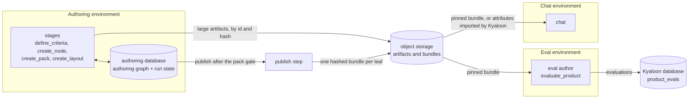

# Data layers `data`

Status. Design of 2026-10-25. Rohan accepted the split into layers on 2026-10-25. The concrete stores, the bundle format, and the public read endpoints are open (`data.open`). The scaffold (`plan.scaffold`) uses only the run state layer. Terms are in [glossary.md](../glossary.md).

## The question `data.question`

Rohan asked on 2026-10-25 what `HARNESS_DATABASE_URL` really stores. In Kyaloon v3, each step runs on its own. The pack author runs in one environment, and the eval author runs in another. How do the steps fit into the harness?

## What v3 does today `data.v3`

Each v3 step is its own process. It hands its work to the next step as an artifact that never changes ([the Kyaloon patterns](../research/2026-10-24-kyaloon-patterns.md)). Verified.

- Research writes immutable record files to object storage.

- The pack author reads the rubric blobs, the record projection, and the FSSAI corpus. It writes a pack JSON file. A person gates the pack into `composer_registry`.

- The eval author reads the gated pack and writes `product_evals`. Each eval pins the pack by `pack_artifact_id`.

The isolation works because each handoff is a hashed artifact.

## What the harness database holds today `data.today`

`HARNESS_DATABASE_URL` holds only the run state of Mastra: workflow runs and their snapshots. Verified (the scaffold test writes a run through one harness and reads it back through a second harness).

## The layers `data.layers`

The harness keeps each step isolated. It changes only what the steps hand to each other.

| Layer | Who writes it | What it holds | Where it lives |
|---|---|---|---|
| `data.authoring_graph` | `define_criteria`, `create_node`, `create_pack`, `create_layout` | Nodes, criteria, node criteria, additions, attributes, record metadata, derived rules, verdicts, rule versions | The authoring database: one shared, persistent database, not a local file |
| `data.run_state` | Mastra | Suspended person gates, traces, scores, golden datasets, trials | The authoring database. A suspended gate can resume only against the database that holds its snapshot. |
| `data.artifacts` | Research and each stage | Research results, source captures, model transcripts | Object storage. The graph refers to each artifact by its id and its hash. |
| `data.bundles` | A publish step after the pack gate | One hashed bundle for each leaf: the pack, the layout, the attributes, and the rule versions that they passed | Object storage. Each consumer pins the hash of a bundle. |
| `data.evaluations` | The eval author (`evaluate_product`) | The levels, the facts, and the scores of each product | The Kyaloon database (`product_evals`), not the authoring database |

## How each step fits `data.steps`

- **Node creation, pack authoring, and layout authoring** become stages. They share the authoring database, because they form one chain. Their lineage and their verdict logs belong in one place.

- **The eval author** stays in its own environment. It never connects to the authoring database. It reads one published bundle and pins its hash, as v3 pins `pack_artifact_id`.

- **The chat** reads the same bundle, or the attributes that Kyaloon imports from it.

- **A rule change** reaches a consumer only through a new bundle. An eval batch that runs keeps the bundle that it pinned.

## Why not the two extremes `data.extremes`

- **One database for all environments.** The eval runner, the chat worker, and local authoring would each need its credentials and its uptime. A rule change could also reach an eval batch while it runs.

- **One database for each authoring environment.** A suspended gate and the verdict log would split across machines. A gate could not resume on another machine.

## What is open `data.open`

Rohan said on 2026-10-25 that he is not yet sure what lives where, and that it is a major piece of work. These choices stay open:

- The store of the authoring database. Decided on 2026-10-29: the Kyaloon Supabase Postgres database, in the schemas `harness` and `mastra` ([graph-store.md](graph-store.md)).

- The object storage, for example R2, and whether its read endpoints are public.

- The format of a bundle, and how a consumer checks its hash.

- Where the held-out suite lives (`improve.boundaries.firewall`).

Whatever is in this repo stays public (Rohan, 2026-10-25). These choices block `plan.graph_store` and `plan.publish_bundle`. They do not block `plan.rule_record`.
