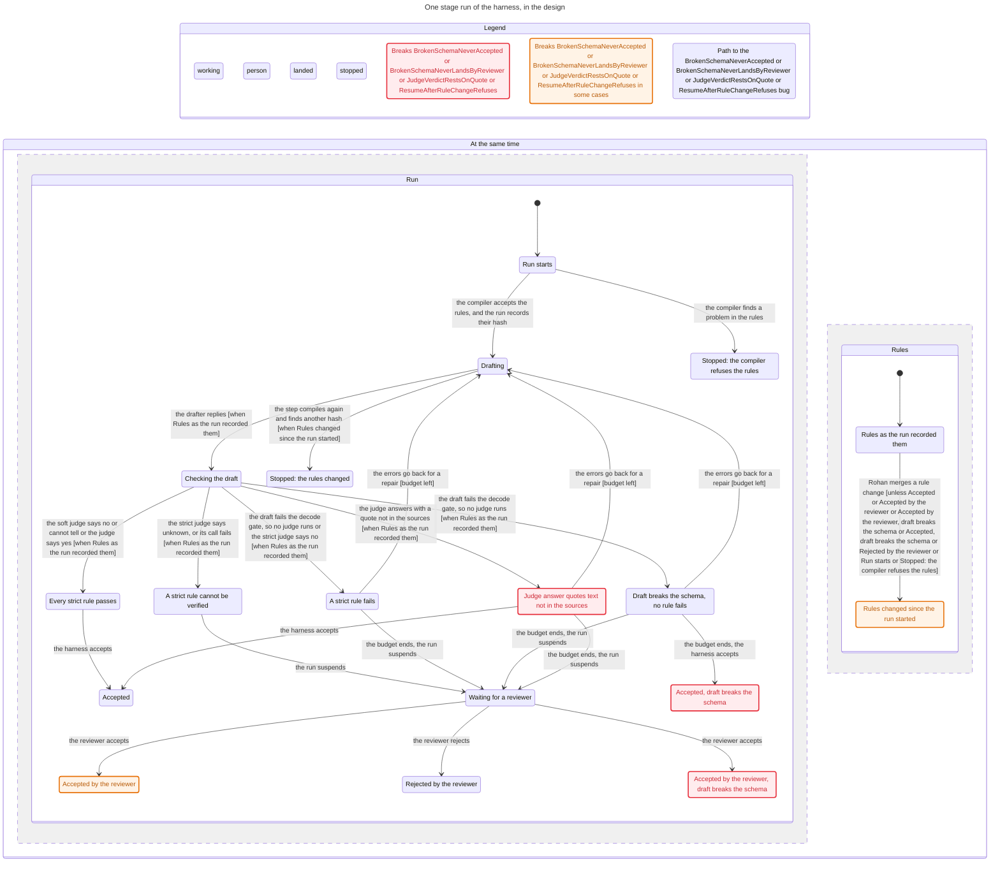

# Formal checks `formal`

Status. Evergreen. Verified against `main` at `edaa9d5` on 2026-11-02, by [#17](https://github.com/Ronitron007/product-eval-harness/pull/17). The section `formal.harness_run` is verified against [#24](https://github.com/Ronitron007/product-eval-harness/pull/24) at `9c5e3af` on 2026-11-08. Code paths: `formal/`, `.claude/skills/harness-invariants/`, and the formal step of `.github/workflows/ci.yml`. Terms are in [glossary.md](../glossary.md).

A test checks the cases that a person wrote. A formal check covers each case in a stated scope. This doc says what the formal checks of the harness cover, and how they run. The procedure for an agent is in the project skill `harness-invariants`. The findings of the first run are in [the formal check of 2026-11-02](../research/2026-11-02-formal-check.md).

## What the checks cover `formal.scope`

The checks cover the code where a bug costs the most and where tests reach least:

- The migrations run on the live Kyaloon database. A gap in their guard can give another role access to the harness schemas.

- The verdict log and the rule lock are the audit trail of each accepted output. A break there makes an old verdict mean other words.

- The node tree sets the scope of each rule. A wrong path makes a rule miss a node with no error.

## The parts `formal.parts`

| Part | Tool | What it does |
|---|---|---|
| `formal.models` | TLA+, checked by TLC 1.7.4 | Four models in `formal/models/`. TLC tries each order of steps in each model, within small bounds. |
| `formal.sweep` | Vitest and a real local Postgres | Applies `db/migrations/` to 72 pre-states of the database in 2 ways, and checks each end state with `formal.oracle`. |
| `formal.oracle` | SQL in `formal/sql/migration.ts` | Asks Postgres what PUBLIC, `anon`, and `authenticated` can do. It also counts owners, members, and rights of `harness_app` outside its schemas. A probe makes a harness table, reads its rights, and rolls it back. |
| `formal.replays` | Vitest and a real local Postgres | Runs each bug path of the models on the real code, one call or one statement for each step. |
| `formal.expectations` | `formal/expectations.ts`, and `FINDINGS` in the sweep | Gives the expected result of each rule: holds or breaks. |

## The models `formal.model_list`

| Model | Config | The code that it describes |
|---|---|---|
| `NodeTree` | `NodeTree`, `NodeTree_owner` | `harness.nodes`, its checks and its path trigger. `addNode()` and `subtree()` of the store. |
| `VerdictLog` | `VerdictLog` | `harness.stage_runs`, `harness.outputs`, `harness.verdicts`. `recordStageRun()`, `writeVerdicts()`, `acceptOutput()`. |
| `RuleVersions` | `RuleVersions`, `RuleVersions_derived` | The rule schema, `ruleHash()`, the loader, the lock, `rules:check` in CI, `harness.derived_rules`, and `addDerivedRule()`. |
| `MigrationApply` | `MigrationApply` | The three migration files, the guard of `0003_harness_role.sql`, and the two ways to run the files. |
| `HarnessRun` | `HarnessRun` | The design of one stage run, not code: the draft step, the decode gate, the code checks, the judges, the repair loop, the person step, and a rule change during the run. |

Each action of a model is one SQL statement or one call of the store. The models do not cover two transactions at the same time.

## One stage run `formal.harness_run`

`HarnessRun` is the only model of a design that has no code yet. It starts with the compile of the rules, which can refuse them before any model call. It follows the stage workflow in [mastra-mapping.md](mastra-mapping.md) (`mastra.stage_workflow`) and the call site in [compiler.md](compiler.md) (`compile.usage.calls`). It also uses the judge scorer in `src/compiler/scorers.ts`, which exists in code. The model has one strict shape rule and one judgement rule. The judgement rule is strict in some runs and soft in others.

| Rule | Result | Finding |
|---|---|---|
| `NoModelCallOnRefusedRules` | holds | |
| `RepairBudget` | holds | |
| `JudgeOnlyAfterCode` | holds | |
| `EveryRuleHasARow` | holds | |
| `SoftNeverBlocks` | holds | |
| `AutoAcceptOnlyWhenStrictPass` | holds | |
| `BrokenSchemaNeverAccepted` | breaks | `harness_run.extra_key_accepted` |
| `BrokenSchemaNeverLandsByReviewer` | breaks | `harness_run.reviewer_lands_broken_schema` |
| `JudgeVerdictRestsOnQuote` | breaks | `harness_run.quote_unchecked` |
| `ResumeAfterRuleChangeRefuses` | breaks | `harness_run.resume_after_rule_change` |

The findings:

- `harness_run.extra_key_accepted`. A draft with a key that no rule owns fails the decode gate, but it gives no `fail` row. After the last repair round, the person step looks only at the verdict rows. So it does not stop the run, and assimilate writes the draft.

- `harness_run.reviewer_lands_broken_schema`. A reviewer can accept a draft that fails the decode gate. The compiler spec says that such a draft never reaches `acceptOutput`.

- `harness_run.quote_unchecked`. The judge scorer puts the quote of the judge in the reason text. No code looks for the quote in the sources. A replay with a mock judge model shows that a "yes" with a quote that no source holds gives `pass`.

- `harness_run.resume_after_rule_change`. A step compiles the rules again only when it needs the plan. The person step and assimilate do not need the plan. So a reviewer can accept a run after a rule change, and no step refuses it.

The chart hides two kinds of steps. The first kind is the steps that stay in an end state. The second kind is the refusal in the judge step after a rule change, because the draft step shows the same refusal.

## The two ways to run the migrations `formal.apply_modes`

The sweep runs the three files in two ways:

- In one transaction. This is the way of one RealDose migration file ([db/README.md](../../db/README.md)).

- Each file in its own transaction. This is the way of `applyMigrations()` in `tests/db.ts`.

The guard of `0003_harness_role.sql` rolls back its own file only. So the result of a stop depends on the way.

## Model and code agree `formal.agreement`

The models are a design-level abstraction, so a model can be wrong. Two checks find a wrong model:

- TLC dumps each end state of `MigrationApply`. The sweep compares each real end state with it. A difference fails the sweep.

- Each bug path of a model has a replay on the real code. If the replay does not break the rule, the model is wrong.

Some rules of the models hold because the model copies a guard of the code. A code change does not change those TLC results. Only the sweep and the replays see a change of the code.

## How the checks run `formal.run`

1. CI runs `npm run formal` after the tests, on the Postgres service of the job.

2. `npm run formal:tla` checks each rule of each model in its own TLC run.

3. `npm run formal:sql` runs the sweep and the replays.

A check fails when a result differs from `formal.expectations`. A rule that held and now breaks is a new bug or a wrong model. A finding that no longer breaks needs its expected result changed in the same PR as its fix.

## Bounds `formal.bounds`

- `HarnessRun` has a budget of 3 drafts, one strict shape rule, and one judgement rule.

- `NodeTree` has 3 node ids. `VerdictLog` has one run, one rule, and two verdict rows. `RuleVersions` has 3 versions of the stage rule and 2 of the derived rule.

- The sweep has 6 states of the role `harness_app` and 6 states of schema `harness`. It runs each with and without the Supabase default privileges, in both ways. That gives 144 cases.

- No check covers Mastra storage, `service_role`, column grants, or the GitHub merge flow. `main` has no branch protection, so the models assume that each merge waits for its CI check.
