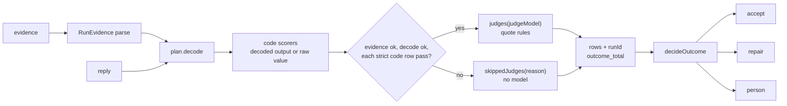

# The judge step `judge`

Status. Spec of 2026-11-07, not built. It is the spec of the unit `plan.judge_step` ([the plan](../plans/2026-10-24-harness-plan.md)). Verified against `main` at `f0bfed8` on 2026-11-08. Code paths: `src/compiler/scorers.ts`, `src/compiler/index.ts`, `src/store/store.ts`, `tests/compiler/judge.test.ts`. Terms are in [glossary.md](../glossary.md).

Source. This spec builds on three docs:

- The bindings of [rule-enforcement.md](rule-enforcement.md) (`enforce.binding`, `enforce.repair`, `enforce.audit`).

- The stage sketch of [mastra-mapping.md](mastra-mapping.md) (`mastra.stage_workflow`).

- The scorers of [compiler.md](compiler.md) (`compile.scorers`, `compile.usage.calls`).

The board is [judge.canvas](../canvas/judge.canvas). Each decision is a row in [decisions.tsv](../decisions.tsv), for Rohan to review.

Review. Two adversaries interrogated this spec at `a8f71fb` on 2026-11-08, and the coordinator ran each repro again. The spec folds in their seven fixes. The repros are in [the interrogate folder](../research/2026-11-08-judge-interrogate/README.md).

Version. Each Mastra claim is for `@mastra/core` 1.79.0. Claude read these embedded docs of the installed package: `reference-workflows-step.md`, `docs-workflows-suspend-and-resume.md`, `docs-workflows-human-in-the-loop.md`, and `reference-evals-run-evals.md`.

## The idea `judge.idea`

The judge step is the code of the ruleset judge. It is the part `judge` of one stage run (`graph.stage`). It runs the compiled scorers of one plan on one draft. It returns one judge outcome: `accept`, `repair`, or `person`. It also returns the verdict rows of the draft.

The judge step decides the outcome from the bindings. It does not act on the outcome. The repair budget, the repair round, and the suspend for a person belong to `plan.stage_workflow`.

## Usage `judge.usage`

```ts
import { judgeDraft, judgeStep } from '../judge'
// Call site: the nested draft-and-judge workflow of plan.stage_workflow.
const draftAndJudge = createWorkflow({ id: 'draft-and-judge', inputSchema: Round, outputSchema: Round })
  .then(draft) // gives the raw reply: draft.object, else draft.text (errorStrategy 'warn')
  .then(judgeStep({ store, planFor, judgeModel })) // writes the rows, returns the outcome
  .then(toRound) // plan.stage_workflow: the outcome becomes the next Round
  .commit()
// Call site: a test, or any caller that has a plan. No store, no workflow.
const outcome = await judgeDraft({ runId, plan, reply, evidence, judgeModel })
await store.writeVerdicts([...outcome.rows]) // all rows or none
switch (outcome.kind) {
  case 'accept': return assimilate(outcome.output, outcome.warnings) // plan.stage_workflow
  case 'repair': return nextRound(outcome.errors) // or the person step when the budget is spent
  case 'person': return suspendFor(outcome.open) // plan.stage_workflow
  default: { const never: never = outcome; return never }
}
```

| Call site | Call | What it gets |
|---|---|---|
| The draft-and-judge workflow | `judgeStep(deps)` | A Mastra step. It compiles again, runs `judgeDraft`, writes the rows, and returns the outcome as JSON. |
| A test, a trial, a replay of a stored reply | `judgeDraft(input)` | The outcome and the rows. It writes nothing. Its only effect is the judge call through the model that it gets. |
| A test of the binding table | `decideOutcome(input)` | The outcome from given rows. It is pure and sync, and it calls no model. |

## Types `judge.types`

```ts
// src/judge/step.ts (new). It imports src/compiler/index.ts only (boundary.internals_unreachable).
import type { DecodeResult, JudgeModel, StagePlan } from '../compiler'
import type { Json, RunEvidence } from '../rules/checks/define'
import type { VerdictInput } from '../store/store'
export type RuleRef = `${string}@${number}` // rule.id@version
export interface JudgeInput {
  readonly runId: string
  readonly plan: StagePlan // from planFor: compiled again, same hash as the run
  readonly reply: unknown // draft.object, else draft.text
  readonly evidence: unknown // parsed with RunEvidence at the boundary (judge.evidence_parsed)
  readonly judgeModel: JudgeModel // provider/model id and the model config
}
// One error for the next repair round, with its fix (enforce.repair).
export interface RepairError {
  readonly from: RuleRef | 'decode'
  readonly target: string // an output path, or (output) for a reply that is not JSON
  readonly fix: string
}
// A soft verdict that is not pass. It stays with the output (enforce.binding).
export interface Warning {
  readonly rule: RuleRef
  readonly target: string
  readonly kind: 'warning' | 'note' // warning: a soft fail. note: a soft cannot_verify.
  readonly text: string
}
interface Judged {
  readonly rows: readonly VerdictInput[] // every row of this draft, watch rows too
  readonly warnings: readonly Warning[]
}
export type JudgeOutcome =
  | (Judged & { readonly kind: 'accept'; readonly output: Json })
  | (Judged & { readonly kind: 'repair'; readonly errors: readonly RepairError[] })
  | (Judged & { readonly kind: 'person'; readonly open: readonly VerdictInput[] })
// Runs the order of judge.order. Never writes. Throws RowsIncomplete only on a bug (judge.outcome_total).
export declare function judgeDraft(input: JudgeInput): Promise<JudgeOutcome>
export interface DecideInput {
  readonly decoded: DecodeResult
  readonly rows: readonly VerdictInput[]
  readonly statements: ReadonlyMap<RuleRef, string> // from RuleScorer.rule.statement (judge.fail_fix)
}
// The binding table of judge.bindings. Pure and sync. No model, no store.
export declare function decideOutcome(input: DecideInput): JudgeOutcome
export declare class RowsIncomplete extends Error {
  readonly missing: readonly RuleRef[] // applied, with no row
  readonly extra: readonly RuleRef[] // a row for a rule that the plan does not apply
}
```

```ts
// src/judge/mastra.ts (new): the thin Mastra wrapper.
import { createStep } from '@mastra/core/workflows'
export function judgeStep(deps: { store: GraphStore; planFor: PlanFor; judgeModel: JudgeModel }) {
  return createStep({
    id: 'judge',
    inputSchema: JudgeStepInput, // runId, stage, nodeId, ruleSetHash, reply, evidence
    outputSchema: JudgeStepOutput, // kind, output, errors, open, warnings: plain JSON
    // No retries option. A retry would call each judge again, and a judge call is paid.
    execute: async ({ inputData }) => {
      const plan = await deps.planFor(inputData) // refuses a hash that differs from the run
      const outcome = await judgeDraft({ ...inputData, plan, judgeModel: deps.judgeModel })
      await deps.store.writeVerdicts([...outcome.rows]) // one statement, all rows or none
      return toStepOutput(outcome) // drops rows: the store holds them
    },
  })
}
```

The plan holds a Zod schema and functions, so a workflow snapshot cannot hold it (`compile.limits`). The wrapper compiles again in each round, as `compile.usage.calls` says. The step output holds JSON only.

## The order `judge.order`

`judgeDraft` runs these parts, in this order, each time:

1. Evidence. Parse `evidence` with `RunEvidence` (`judge.evidence_parsed`). Bad evidence becomes `{}` for the code scorers, and it shuts the gate.

2. Decode. Run `plan.decode(reply)` (`scorers.closed_output`).

3. Code scorers. Run each scorer of `plan.scorers.code` on the decoded output, or on the raw value when the decode failed (`scorers.decode_failure_rows`).

4. The strict-code gate. The gate opens when the evidence parsed, the decode is `ok`, and each `strict` code row is `pass`.

5. Judges. If the gate opens, run each scorer of `plan.scorers.judges(judgeModel)`. If the gate stays shut, take the rows of `plan.scorers.skippedJudges(reason)`. These rows need no model.

6. Rows. Add `runId` to each row, as `VerdictInput`. Check the rows against the plan (`judge.outcome_total`).

7. Outcome. Call `decideOutcome` with the decode result, the rows, and the rule statements.

The reason for skipped judges names the cause:

- After bad evidence, the reason is "The run evidence is not valid, so no judge ran."

- After a failed decode, the reason is "The output broke the schema, so no judge ran."

- After a strict code row that is not pass, the reason is "A strict code check did not pass."

A scorer `verify` never throws by its contract. If it throws, `judgeDraft` writes one `cannot_verify` row for each field of that scorer. The row has the decider of the scorer and the reason "The scorer threw". So a bug in one scorer never removes the rows of a rule.



## Bindings `judge.bindings`

`decideOutcome` reads the rows by binding and verdict. The first line that applies decides the outcome.

| Condition | Outcome | What the outcome carries |
|---|---|---|
| The decode failed, or a `strict` row is `fail` | `repair` | Each decode issue and each `strict` fail, with its fix, in one list |
| No `strict` fail, and a `strict` row is `cannot_verify` | `person` | Each `strict` row that is not pass, in `open` |
| Each `strict` row is `pass` | `accept` | The decoded output |

| Binding | `fail` | `cannot_verify` |
|---|---|---|
| `strict` | Its error and fix go into `errors`. The outcome is `repair`. | The outcome is `person`, when no strict fail exists. |
| `soft` | A `warning` in `warnings`. The outcome does not change. | A `note` in `warnings`. The outcome does not change. |
| `watch` | The row only. | The row only. |

The rules of the list of errors:

- `errors` holds all strict errors of the draft in one round (`enforce.repair`).

- Decode issues come first, in path order. Then the strict fail rows come, in rule order and then target order.

- A decode issue at a target that a strict fail row also names drops out. So one error does not show twice.

- The fix of a strict fail row from code is the `reason` of the row. A code scorer writes its fix there (`compile.scorers`).

- The fix of a strict fail row from a judge names the rule and adds the judge reason (`judge.fail_fix`).

- The fix of a decode issue is the `message` of the issue, such as "No rule defines the key grade. Remove it."

Each outcome carries `warnings`, also `repair` and `person`. A row of a `watch` rule never enters `errors`, `open`, or `warnings` (`judge.watch_inert`).

The repair outcome wins over the person outcome. Two reasons support this order:

- When a strict code check fails, the judges do not run. So each strict judgement rule gets a skipped `cannot_verify` row. If that row sent the run to a person, a strict code fail would never get a repair.

- A model can fix a fail with no cost to a person. A `cannot_verify` that stays after the repair rounds still reaches a person.

An `accept` comes only when each strict row is `pass`. The formal finding `verdicts.accept_without_pass` says that the store reads no verdict before `acceptOutput` ([the formal check](../research/2026-11-02-formal-check.md)). So the judge step holds this rule, and the test `outcome_table.each_binding_each_verdict` guards it.

## Decisions `judge.decisions`

Each decision below has a mechanism and a test that fails when the mechanism breaks. Each has a row in [decisions.tsv](../decisions.tsv):

- Claude took `judge.decider_recorded`, `judge.outcome_total`, `judge.watch_inert`, and `judge.cost_cap_deferred` for Rohan on 2026-11-07. It also took `judge.quote_verified` then. `judge.quote_rules` now replaces it.

- Claude took `judge.outcome_precedence` on 2026-11-08, while it wrote this spec.

- Claude took `judge.quote_rules`, `judge.one_answer`, `judge.runtime_pinned`, `judge.no_network`, `judge.evidence_parsed`, and `judge.fail_fix` on 2026-11-08, from the interrogate run. The row of `judge.quote_rules` supersedes the two rows on `judge.quote_verified`.

- Claude took `judge.quote_plain_span` on 2026-11-08, from the verify round of the interrogate run.

- `judge.decode_repairs` uses the existing decisions row of 2026-11-02 on the decode gate.

### Quote rules `judge.quote_rules`

Decision. This decision replaces `judge.quote_verified` of 2026-11-07. A judge `pass` or `fail` must carry a quote that code finds in a permitted text. If code does not find it, the verdict becomes `cannot_verify`. Code only verifies the quote. It never grades.

Why `judge.quote_verified` failed, verified (the coordinator ran the repros again):

- An honest "no" that quoted the draft item went to a person. The rule searched the sources only, and the reason for a fail is often in the item itself.

- A junk quote, such as "." or "a" or a zero-width space, passed the check. A "no" with the quote "." then gave a repair.

What the code does today, verified (read `src/compiler/scorers.ts` at `f0bfed8`):

- `JudgeAnswer` already has a `quote` string for each item.

- The prompt asks for "a quote from the item or the sources".

- `verify` adds the quote to the reason text only. No code compares it with a source.

The rules, all in `verify` of `src/compiler/scorers.ts`:

1. Normalize the quote and each text that code searches. Apply Unicode NFKC. Remove the zero-width characters U+200B, U+200C, U+200D, U+2060, and U+FEFF. Change each run of white space to one space, and trim the ends.

2. Count the letters and digits of the normalized quote (`\p{L}` and `\p{N}`). If there are fewer than 2, give `cannot_verify` with the reason "Quote too short."

3. For a `pass`, search the normalized source texts of `evidence.sources`, in name order. Never search the draft output.

4. For a `fail`, search the plain text of the judged item first. Then search the source texts. The plain text of a string item is the string itself. For an object or a list, it is each string leaf value, in path order, searched one at a time. Code never searches escaped JSON, so a quote with `"` or a line break can match (`judge.quote_plain_span`).

5. Use an exact, case-sensitive substring test. No fuzzy match.

6. If no permitted text holds the quote, give `cannot_verify`. The reason starts with the words "Quote not found in source". Then it gives the answer, the reason, and the quote of the judge.

7. If a permitted text holds the quote, keep the verdict. Set `evidence.quote` to the matched span, exactly as it is in the raw text, not the quote of the judge. Set `evidence.source` to where the span came from (`judge.quote_plain_span`).

8. An answer of unknown needs no quote.

The answer-format line of `judgePrompt` changes too. For yes, the judge copies a quote word for word from one source. For no, the judge copies a quote from the item or from one source. When no text supports an answer, the judge answers unknown.

The rules live in the scorer, not in the judge step. So each caller of `verify` gets them, such as a trial or a golden run.

Effect on versions:

- `scorers.ts` is a file of `RUNTIME_VERSION`. So `RUNTIME_VERSION` goes from 1 to 2.

- `npm run compiler:lock` adds the entry `"2"` to `runtime` in `code.lock.json`. The entry `"1"` stays, because the lock only grows (`compile.hash`).

- The static part of each judge prompt changes. So each `judgePromptHash` changes, and each rule-set hash changes with `manifest.code.runtime`. The pinned literal of `hash.fixture_literal` changes. Inferred: no stage run exists yet, so no stored hash goes stale.

- The answers of the mock judge in `tests/compiler/judge.test.ts` must carry a quote from `GOOD_EVIDENCE`, such as `500 mg`.

Effect on rows. A judged `pass` or `fail` row now keeps the matched span in `evidence`, not the observed value of the item. This changes one line of `compile.reconciliation.changes`, which said that a judge row keeps the observed value. A judge row that gives `cannot_verify` still keeps the observed value, with `source: output`. The test `verify.observed_from_runtime` reads code rows only, so it does not change.

Tests: `fake_quote.not_in_source`, `fake_quote.too_short`, `fake_quote.normalized_match`, `fake_quote.pass_from_the_draft`, `fake_quote.fail_from_the_item`, `fake_quote.fail_from_a_source`, `fake_quote.fail_quote_plain_text`, `fake_quote.stored_span_raw`, `fake_quote.case_differs`, `fake_quote.no_sources`, `fake_quote.unknown_needs_none`.

### Plain text and raw span `judge.quote_plain_span`

Decision. The quote rules match against plain text and store the raw span. This decision came from the verify round of the interrogate run.

Why, verified (the coordinator ran the verify of `c359187`):

- Code matched the item as canonical JSON. So an honest `fail` quote with `"` or a line break did not match the escaped text, and gave `cannot_verify`.

- The evidence kept the raw quote of the judge. After the normalize step, that quote can differ from the text, for example at a no-break space.

Mechanism, in `verify` of `src/compiler/scorers.ts`:

- Each searched text is a string. It is a source text, a string item, or one string leaf of an object or list item. Code never builds JSON text to search.

- For each searched text, the normalize step keeps a map. It maps each normalized character to its raw offset. Code normalizes each raw code point, so the map stays exact.

- A match gives a range in the normalized text. The map turns it into a range in the raw text. `evidence.quote` is that raw slice.

- `evidence.source` names where the slice came from. It is `sources.<name>` for a source. For the item, it is `item` for a string item, or `item.` and the leaf path, such as `item.key`.

Tests: `fake_quote.fail_quote_plain_text`, `fake_quote.stored_span_raw`.

### One answer `judge.one_answer`

Decision. Two answers for one item that disagree give `cannot_verify`. They disagree when the answer or the normalized quote differs. The order of the answers never decides.

Why. Today `verify` gives `cannot_verify` for two answers with two verdicts. For two answers with one verdict and two quotes, it keeps the first answer, verified (repro `sonnet/p1.repro.ts`, F2). So the order decided the evidence.

Mechanism. `verify` groups the answers by target. It removes exact copies, by answer and normalized quote. More than one answer after that gives `cannot_verify`, with the reason "The judge gave two answers for this item."

Tests: `order_decides.verdict_differs`, `order_decides.quote_differs`, `order_decides.reversed_same_rows`, `order_decides.copy_counts_once`.

### Decider recorded `judge.decider_recorded`

Decision. Each judge row carries the judge model id and the judge prompt hash in `decider`.

Mechanism. The store already has the columns, verified (read `store.ts` and `db/migrations/0001_harness_tables.sql`). The type `Decider` and the check on `harness.verdicts.decider` accept `{ by: 'judge', model, promptHash }`. The function `judgeScorer` already writes it on each row that the model answered. A judge row gets its verdict from an answer of the model, or from a failed judge call.

A row that `judge.quote_rules` turns into `cannot_verify` keeps the judge decider, so the log shows which judge gave the quote. A row that code decides alone keeps `{ by: 'code' }`. Examples are an absent target, an empty list, and a skipped judge.

Tests: `decider_lost.judge_rows_name_model`, `decider_lost.code_rows_say_code`.

### Outcome total `judge.outcome_total`

Decision. Each applied rule in the plan gets at least one row in each run of the judge step. A judge, a skipped judge, or a failed decode can give the row.

Mechanism. After the rows, `judgeDraft` compares two sets. The first is the set of `rule.id@version` in the rows. The second is the set of `id@version` in `plan.manifest.rules`, which holds the applied rules and the trial.

If the sets differ, `judgeDraft` throws `RowsIncomplete` with the missing and the extra refs. The wrapper does not catch it, so the run fails and nothing reaches the store. A missing row is a bug, so the step stops. It never fills the gap with an invented row.

Tests: `missing_row.applied_ids_judged`, `missing_row.applied_ids_skipped`, `missing_row.applied_ids_decode_failed`, `missing_row.scorer_dropped_refused`, `missing_row.verify_throw_keeps_rows`.

### Watch inert `judge.watch_inert`

Decision. Watch verdicts never change the outcome or the repair errors.

Mechanism. `decideOutcome` filters the rows by binding before it reads a verdict. Only `strict` rows reach the outcome, `errors`, and `open`. Only `soft` rows reach `warnings`. A `watch` row stays in `rows`, so the store logs it.

Tests: `watch_leak.fail_changes_nothing`, `watch_leak.cannot_verify_changes_nothing`, `watch_leak.trial_changes_nothing`.

### Cost cap deferred `judge.cost_cap_deferred`

Decision. A cost cap for the judges of one run waits for `plan.improve_ledger`. This spec records it as a limit (`judge.limits`).

Mechanism until then. Each round makes one judge call for each judgement rule, for all its items (`enforce.deciders`). The repair budget of `plan.stage_workflow` limits the rounds. So one run makes at most one call for each judgement rule in each round of the budget. A cap in money waits for `budget_ledger`.

Test: `model_call.one_call_per_rule`.

### Repair before person `judge.outcome_precedence`

Decision. When a draft has a strict fail and a strict `cannot_verify`, the outcome is `repair`. A `cannot_verify` that stays after the repairs reaches a person (`judge.bindings`).

Mechanism. The first line of the binding table that applies decides. The strict fail line comes before the strict `cannot_verify` line.

Tests: `outcome_table.repair_before_person`, `outcome_table.skipped_judge_rows_repair`.

### Decode failure repairs `judge.decode_repairs`

Decision. A failed decode gives `repair`, with the decode issues in `errors`. This follows the decisions row of 2026-11-02 on the decode gate. That row says that a failed decode counts as a strict failure of the stage. The brief of this spec asked for `person` on a failed decode. The decisions trail outranks the brief, so this spec keeps `repair` (`judge.conflicts`).

Mechanism. `decideOutcome` reads `decoded.ok` first. A failed decode never gives `accept`, and the judges never run on it.

Tests: `decode_bypass.never_accepts`, `decode_bypass.no_judge_call`, `decode_bypass.issues_in_errors`.

### Runtime pinned `judge.runtime_pinned`

Decision. The code lock covers the decode gate and the binding table. A change to either moves a lock fingerprint.

Why. `RUNTIME_FILES` holds `paths.ts`, `shape.ts`, `scorers.ts`, and `checks/define.ts`. The decode gate lives in `src/compiler/index.ts`. A repro changed the gate and kept the same rule-set hash and the same fingerprint, verified (repro `opus/probe2.repro.ts`).

Mechanism. `RUNTIME_FILES` in `scripts/compiler-lock.ts` adds `src/compiler/index.ts` and `src/judge/step.ts`. The new list applies from `RUNTIME_VERSION` 2. The transpile removes types and comments, so only runtime code of these files moves the fingerprint. A change to `decideOutcome` or to the gate then needs a new `RUNTIME_VERSION`, and so a new rule-set hash.

Tests: `stale_pin.runtime_files_cover_gate`, `stale_pin.step_change_moves_fingerprint`.

### No network `judge.no_network`

Decision. Each judge test asserts zero calls of `fetch`. A test with a judge model that is not a mock fails. It never passes as `person`.

Why. A real model id reached `judgeDraft` in a test. The `fetch` stub threw, `verify` gave `cannot_verify`, and the test saw a valid `person` outcome, verified (repro `sonnet/p7.repro.ts`).

Mechanism. The stub in `tests/setup/no-network.ts` counts each call. The same setup file adds an `afterEach` hook. The hook fails the test when the count is above zero, and then sets the count to zero.

A test that calls `fetch` on purpose takes the count with the helper `takeFetchCalls()`. The tests `judge.no_network` and `model_call.fetch_throws` do this. The existing compiler test `judge.no_network` has the same name as this decision, because it guards the same rule.

Tests: `model_call.zero_fetch_each_test`, `model_call.unmocked_model_fails`.

### Evidence parsed `judge.evidence_parsed`

Decision. The judge step parses the run evidence at its boundary, with `RunEvidence`. Bad evidence gives `cannot_verify` before any judge call.

Why. A source that was a number reached `verify`. The model call ran and cost money, and then the quote search threw, verified (repro `sonnet/p4.repro.ts`).

Mechanism:

- `judgeDraft` parses `evidence` with `RunEvidence.safeParse`. Each source must be a string.

- On a parse failure, the code scorers get `{}`, so a check that needs evidence gives `cannot_verify` by the policy of `compile.scorers`. The gate stays shut, and `skippedJudges` gives the judgement rows.

- `verify` of a judge scorer also parses the evidence before the model call. On a failure, it gives `cannot_verify` with no call. So `verify` never throws on evidence, and a trial gets the same guard.

Tests: `bad_evidence.step_skips_judges`, `bad_evidence.verify_no_call`.

### Fail fix `judge.fail_fix`

Decision. A repair error for a judge `fail` carries a fix. The fix is "Change the item so that: " and the rule statement, then the reason of the judge.

Why. A judge reason says what is wrong, but not what to do. `enforce.repair` asks for an error that names the fix.

Mechanism. `RuleScorer.rule` in `src/compiler/index.ts` gets the field `statement`. `judgeDraft` gives `decideOutcome` a map from each rule ref to its statement. For a strict fail row with a judge decider, `decideOutcome` writes the fix from the statement and the row reason. A fail row from code keeps its own fix.

Tests: `bare_fix.judge_fail_names_rule`, `bare_fix.code_fail_unchanged`.

## Hazards `judge.hazards`

Each hazard has a mechanism and tests that fail when the mechanism breaks. The name of each test starts with the name of its hazard, as in `compile.hazards`. The tests live in `tests/judge/`, one file for each hazard. Each judge test uses `createMockModel`. The setup file `tests/setup/no-network.ts` makes `fetch` throw, and each test asserts zero calls of `fetch` (`judge.no_network`).

| Hazard | Mechanism | Tests |
|---|---|---|
| `missing_row`. A rule in the plan has no row for a draft | `judgeDraft` compares the rule refs of the rows with `plan.manifest.rules`. A difference throws `RowsIncomplete`. A scorer that throws still gives rows. | `missing_row.applied_ids_judged`, `missing_row.applied_ids_skipped`, `missing_row.applied_ids_decode_failed`, `missing_row.scorer_dropped_refused`, `missing_row.verify_throw_keeps_rows` |
| `watch_leak`. A watch verdict changes the outcome, the errors, or the warnings | `decideOutcome` filters by binding before it reads a verdict. | `watch_leak.fail_changes_nothing`, `watch_leak.cannot_verify_changes_nothing`, `watch_leak.trial_changes_nothing` |
| `error_pass`. A judge error counts as a pass | Each judge failure gives `cannot_verify`. A failure is a model error, no answer, two answers that disagree, or a bad answer. A strict `cannot_verify` gives `person`, never `accept`. | `error_pass.model_error`, `error_pass.no_answer`, `error_pass.two_answers`, `error_pass.bad_answer_shape` |
| `fake_quote`. A judge backs a verdict with a junk quote, or a quote that no permitted text holds | `judge.quote_rules` in `verify` | `fake_quote.not_in_source`, `fake_quote.too_short`, `fake_quote.normalized_match`, `fake_quote.pass_from_the_draft`, `fake_quote.fail_from_the_item`, `fake_quote.fail_from_a_source`, `fake_quote.fail_quote_plain_text`, `fake_quote.stored_span_raw`, `fake_quote.case_differs`, `fake_quote.no_sources`, `fake_quote.unknown_needs_none` |
| `order_decides`. The order of two answers for one item decides the row | `judge.one_answer` | `order_decides.verdict_differs`, `order_decides.quote_differs`, `order_decides.reversed_same_rows`, `order_decides.copy_counts_once` |
| `soft_block`. A soft fail blocks the output or enters the repair errors | `decideOutcome` sends `soft` rows to `warnings` only. | `soft_block.fail_accepts_with_warning`, `soft_block.cannot_verify_accepts_with_note`, `soft_block.fail_not_in_errors` |
| `decode_bypass`. A draft that fails the decode gate reaches a judge or an accept | The gate needs `decoded.ok`. `decideOutcome` reads `decoded.ok` before any row. | `decode_bypass.never_accepts`, `decode_bypass.no_judge_call`, `decode_bypass.issues_in_errors` |
| `model_call`. A test calls a real model, or passes after a failed call | The `fetch` stub counts calls. An `afterEach` hook fails a test with a call (`judge.no_network`). | `model_call.fetch_throws`, `model_call.mock_only`, `model_call.one_call_per_rule`, `model_call.zero_fetch_each_test`, `model_call.unmocked_model_fails` |
| `stale_pin`. A change to the gate or the binding table keeps the old hash | `judge.runtime_pinned` | `stale_pin.runtime_files_cover_gate`, `stale_pin.step_change_moves_fingerprint` |
| `bad_evidence`. Bad evidence reaches a paid call, or makes `verify` throw | `judge.evidence_parsed` | `bad_evidence.step_skips_judges`, `bad_evidence.verify_no_call` |
| `bare_fix`. A judge fail reaches the repair with no fix | `judge.fail_fix` | `bare_fix.judge_fail_names_rule`, `bare_fix.code_fail_unchanged` |
| `decider_lost`. A row hides who decided it | `judge.decider_recorded` | `decider_lost.judge_rows_name_model`, `decider_lost.code_rows_say_code` |
| `outcome_table`. An outcome breaks the binding table | `decideOutcome` follows `judge.bindings`, first line wins. | `outcome_table.each_binding_each_verdict`, `outcome_table.repair_before_person`, `outcome_table.skipped_judge_rows_repair`, `outcome_table.errors_in_one_round`, `outcome_table.no_duplicate_error` |

### What each test asserts `judge.tests`

The fixture is the library of `tests/compiler/rules.ts`, with `GOOD_OUTPUT` and `GOOD_EVIDENCE`. A test that needs a soft or a watch rule copies a fixture rule with another binding.

- `missing_row.applied_ids_judged`. With a mock judge that answers yes with the quote `500 mg`, the rule refs of the rows equal the refs of `plan.manifest.rules`.

- `missing_row.applied_ids_skipped`. A draft that fails a strict code check gives rows whose refs equal the refs of the plan. The judgement rule has a skipped row.

- `missing_row.applied_ids_decode_failed`. A reply that is not JSON gives rows whose refs equal the refs of the plan.

- `missing_row.scorer_dropped_refused`. A plan copy with one code scorer removed makes `judgeDraft` throw `RowsIncomplete`, with that ref in `missing`.

- `missing_row.verify_throw_keeps_rows`. A plan copy with a scorer whose `verify` throws gives one `cannot_verify` row for each field of that scorer.

- `watch_leak.fail_changes_nothing`. A watch code check and a watch judgement rule that both fail give `accept`, with empty `warnings`. Their rows are in `rows`.

- `watch_leak.cannot_verify_changes_nothing`. A watch rule with `cannot_verify` gives `accept`, not `person`.

- `watch_leak.trial_changes_nothing`. A trial candidate that fails gives the same outcome as the live plan with no trial.

- `error_pass.model_error`. A mock model that throws gives `cannot_verify` for the strict judgement rule, and the outcome `person`.

- `error_pass.no_answer`. A mock answer for another target gives `cannot_verify`, and the outcome `person`.

- `error_pass.two_answers`. A yes and a no for one target give `cannot_verify`, and the outcome `person`.

- `error_pass.bad_answer_shape`. A mock answer that `JudgeAnswer` refuses gives `cannot_verify`.

- `fake_quote.not_in_source`. A yes with the quote `600 mg` gives `cannot_verify`. The reason starts with "Quote not found in source".

- `fake_quote.too_short`. Take a yes or a no with one of these quotes: ".", "a", a zero-width space, or an empty quote. Each gives `cannot_verify` with "Quote too short."

- `fake_quote.normalized_match`. A source with a no-break space and a zero-width space inside "500 mg" matches the quote `500 mg`. A full-width "５００ mg" quote matches too.

- `fake_quote.pass_from_the_draft`. A yes that quotes only the draft item gives `cannot_verify`.

- `fake_quote.fail_from_the_item`. A no that quotes the key of the judged item gives `fail`, with `evidence.source` set to `item.key`. The outcome is `repair`, not `person`.

- `fake_quote.fail_quote_plain_text`. An item with the string value `Use "daily"` and a line break before `SPF 50` gives two honest no answers. One quotes `Use "daily"`, and one quotes the text across the line break. Each gives `fail`, not `cannot_verify`.

- `fake_quote.stored_span_raw`. The label holds `500` and a no-break space and `mg`. A yes with the quote `500 mg` gives `pass`. `evidence.quote` equals the raw label slice with the no-break space, and `evidence.source` is `sources.label`.

- `fake_quote.fail_from_a_source`. A no with the quote `500 mg` gives `fail`, with `evidence.source` set to `sources.label`.

- `fake_quote.case_differs`. A yes with the quote `500 MG` gives `cannot_verify`.

- `fake_quote.no_sources`. With no `sources`, a yes with the quote `500 mg` gives `cannot_verify`. A no that quotes the item still gives `fail`.

- `fake_quote.unknown_needs_none`. An unknown with an empty quote gives `cannot_verify`, and its reason does not say "Quote not found in source."

- `order_decides.verdict_differs`. A yes and a no for one target give `cannot_verify`.

- `order_decides.quote_differs`. Two yes answers with two valid quotes give `cannot_verify`.

- `order_decides.reversed_same_rows`. Each set of answers, in order and in reverse order, gives the same rows.

- `order_decides.copy_counts_once`. Two equal answers give the verdict of one answer.

- `soft_block.fail_accepts_with_warning`. A soft judgement rule that fails, with each strict row `pass`, gives `accept` and one `warning`.

- `soft_block.cannot_verify_accepts_with_note`. A soft rule with `cannot_verify` gives `accept` and one `note`.

- `soft_block.fail_not_in_errors`. A soft fail beside a strict fail gives `repair`. The soft fail is in `warnings` and not in `errors`.

- `decode_bypass.never_accepts`. A reply with an extra key, whose code rows all pass, gives `repair`, never `accept`.

- `decode_bypass.no_judge_call`. On a failed decode, the spy of the mock model counts zero calls.

- `decode_bypass.issues_in_errors`. Each decode issue is in `errors`, with `from: 'decode'`.

- `model_call.fetch_throws`. With no mock, a call of `fetch` throws "A test called fetch".

- `model_call.mock_only`. A full `judgeDraft` run with the mock model ends with no call of `fetch`.

- `model_call.zero_fetch_each_test`. Each test of `tests/judge/` ends with a count of zero calls of `fetch`. The `afterEach` hook asserts it.

- `model_call.unmocked_model_fails`. A `judgeDraft` run with the model id `openai/gpt-4o-mini` and no mock leaves one call in the count. The guard of the hook then throws.

- `stale_pin.runtime_files_cover_gate`. `RUNTIME_FILES` holds `src/compiler/index.ts` and `src/judge/step.ts`.

- `stale_pin.step_change_moves_fingerprint`. Make two copies of the repo. Change one line of `decideOutcome` in the first, and one line of the decode gate in the second. Each copy gives a new runtime fingerprint. The function `lockProblems` reports each change under the unchanged `RUNTIME_VERSION`.

- `bad_evidence.step_skips_judges`. Evidence with the source `label: 500` gives skipped judge rows with "The run evidence is not valid". The spy of the mock model counts zero calls.

- `bad_evidence.verify_no_call`. A direct call of `verify` with the same evidence gives `cannot_verify`, does not throw, and makes no model call.

- `bare_fix.judge_fail_names_rule`. A strict judge fail gives an error whose fix starts with "Change the item so that: " and the statement that `criteria.attribute_is_product` holds. The fix ends with the judge reason.

- `bare_fix.code_fail_unchanged`. A strict code fail gives an error whose fix equals the reason of its row.

- `model_call.one_call_per_rule`. A draft with three items under one judgement rule makes one call of the mock model. A plan with two judgement rules makes two calls.

- `decider_lost.judge_rows_name_model`. Each row that the model answered, and each row that the quote check turned into `cannot_verify`, has `{ by: 'judge', model: 'mock/judge', promptHash }`. `promptHash` equals `judgePromptHash` of the manifest.

- `decider_lost.code_rows_say_code`. Each code row, each skipped row, and each row for an absent target has `{ by: 'code' }`.

- `outcome_table.each_binding_each_verdict`. For each binding and each verdict, `decideOutcome` on one row gives the outcome of `judge.bindings`. `accept` comes only when each strict row is `pass`.

- `outcome_table.repair_before_person`. A strict fail and a strict `cannot_verify` give `repair`.

- `outcome_table.skipped_judge_rows_repair`. A strict code fail with a strict judgement rule gives `repair`, not `person`.

- `outcome_table.errors_in_one_round`. Three strict fails on three targets give one `repair` with three errors.

- `outcome_table.no_duplicate_error`. At one target, a bad unit gives a decode issue and a strict shape fail. The list `errors` holds one entry for that target.

## The checks of the plan `judge.plan_checks`

The plan names two checks for `plan.judge_step` ([the plan](../plans/2026-10-24-harness-plan.md), `plan.units`). These tests close them:

| Check of the plan | Tests |
|---|---|
| Tests with mocked judges, one for each binding and each verdict | `outcome_table.each_binding_each_verdict`, `soft_block.fail_accepts_with_warning`, `soft_block.cannot_verify_accepts_with_note`, `watch_leak.fail_changes_nothing`, `watch_leak.cannot_verify_changes_nothing` |
| A judge with no result gives `cannot_verify`, never pass | `error_pass.model_error`, `error_pass.no_answer`, `error_pass.two_answers`, `error_pass.bad_answer_shape` |

## Modules `judge.modules`

| File | Status | What it owns |
|---|---|---|
| `src/judge/step.ts` | new | `judgeDraft`, `decideOutcome`, `RowsIncomplete`, `JudgeOutcome`, `RepairError`, `Warning`, the order, and the row-total check |
| `src/judge/mastra.ts` | new | `judgeStep`, `JudgeStepInput`, `JudgeStepOutput`, `toStepOutput` |
| `src/judge/index.ts` | new | The public surface of the judge step |
| `src/compiler/scorers.ts` | changed | The new answer-format line in `judgePrompt`. The quote rules and the one-answer rule in `verify`. The evidence parse in `verify`. The evidence that a judged row keeps. The value 2 of `RUNTIME_VERSION`. |
| `src/compiler/index.ts` | changed | The field `statement` of `RuleScorer.rule` |
| `scripts/compiler-lock.ts` | changed | `RUNTIME_FILES` adds `src/compiler/index.ts` and `src/judge/step.ts` |
| `tests/setup/no-network.ts` | changed | The call count, the `afterEach` hook, and `takeFetchCalls()` |
| `tests/compiler/boundary.test.ts` | changed | The list of files that import `src/compiler/index.ts` adds `src/judge/step.ts` |
| `src/compiler/code.lock.json` | changed | The runtime entry `"2"`, from `npm run compiler:lock` |
| `tests/compiler/judge.test.ts` | changed | The mock answers quote `500 mg` from `GOOD_EVIDENCE`. The reason assertion follows. |
| `tests/compiler/hash.test.ts` | changed | The new literal of `FIXTURE_HASH` |
| `tests/judge/` | new | One test file for each hazard of `judge.hazards` |

In `src/judge/`, only `step.ts` imports `src/compiler/index.ts`. The file `mastra.ts` imports its compiler types through `./step`. The test `boundary.internals_unreachable` reads `src/`, so it covers the new files. It also pins the list of files that import the compiler, so that list gets `src/judge/step.ts`.

The docs PR of the build changes `compile.reconciliation.changes` for the judge row evidence, `compile.hash` for `RUNTIME_FILES`, and the board.

## Mastra parts that do not fit `judge.not_used`

| Part | Why the judge step does not use it |
|---|---|
| The `scorers` option of `createStep` | It runs after the step, does not block the workflow, and cannot gate an outcome. Verified (read `reference-workflows-step.md`). |
| `runEvals` with `gates` | It averages numeric scores over data items, and it drops `notScorable` runs from the verdict. It has no three-way verdict for each item and no binding order. Verified (read `reference-evals-run-evals.md`). It still fits `plan.golden_sync`. |
| The `retries` option of `createStep` | A retry runs `execute` again and calls each judge again, which costs money. Verified (read `reference-workflows-step.md`). |
| `suspend` and `bail` in the judge step | The judge step returns `person`. The person step of `plan.stage_workflow` suspends (`mastra.stage_workflow`). |

The quote check is our code. The Instructor citation pattern and the linkml reference validator also test a quote as a substring of the source. Instructor also has a fuzzy match that rewrites the quote. A fuzzy match is a code matcher, so `rules.harness` forbids it. The research notes are in the scratchpad of the session, as `rules.agents` asks.

## Limits `judge.limits`

Known limits that stay as risks:

- No cost cap for the judges of one run exists (`judge.cost_cap_deferred`). One judge call runs for each judgement rule in each round. `plan.improve_ledger` adds `budget_ledger`.

- The rows of each round share one run id. No column names the round or the draft (the formal finding `verdicts.no_round`).

- The store still accepts an output with no pass verdict (the formal finding `verdicts.accept_without_pass`). The judge step and `plan.stage_workflow` hold the rule. The store does not.

- A judgement rule whose run has no source text gives `cannot_verify` for each `pass`. When the rule is strict, such a run goes to a person. The stage must give the sources that a judge needs (`enforce.risks`, context gaps).

- Code cannot check that a quote is relevant. A quote such as "Each", or an echo of a label quote that the draft copied, can pass. The quote rules prove only that the quote is in a permitted text.

- A `fail` can quote the judged item. So a judge can always back a `fail` with a quote. A `fail` gives a repair, never an accept.

- The quote check is case-sensitive after the normalize step of `judge.quote_rules`. A judge that changes the letter case or a word of a quote gives `cannot_verify`. This errs to the safe side, because `cannot_verify` is never a pass.

- When two sources hold the quote, `evidence.source` names the first in name order. For a `fail`, the item comes before the sources. In the item, the first string leaf in path order wins.

- The normalize step works on each code point alone. NFKC of a combining sequence can then differ from NFKC of the whole text. Such a quote gives `cannot_verify`, which is never a pass.

- A judged `pass` or `fail` row keeps the source quote, not the observed value of the item. The target path finds the item in the reply. `plan.stage_workflow` keeps each reply (`enforce.repair`).

- The judges of one round run one after another, in rule order. Parallel calls would be faster, but the order of the rows would then need a sort.

- The judge step does not check that the judge model comes from another provider than the drafter (`mastra.models`). `plan.stage_workflow` sets both models.

## Conflicts `judge.conflicts`

- The brief of this spec asked for `person` on a failed decode. Four sources say that a failed decode is a strict failure that gets a repair. They are the decisions row of 2026-11-02 on the decode gate, `compile.usage.calls`, `compile.scorers`, and the board. This spec follows the trail (`judge.decode_repairs`). Rohan can rule otherwise.

- The brief said that a strict `cannot_verify` gives `person`. With a strict judgement rule, that reading sends each strict code fail to a person. The cause is the skipped judge row, which is `cannot_verify`. This spec puts `repair` first (`judge.outcome_precedence`).

- `compile.reconciliation.changes` says that a judge row keeps the observed value of the item. `judge.quote_rules` changes that for a judged `pass` or `fail` row.

## Implementation reconciliation `judge.reconciliation`

The code of the build PR of `plan.judge_step` builds this spec. This section lists each place where the code differs from the text above, and why. Mastra APIs are those of `@mastra/core` 1.79.0, from `reference-workflows-step.md`.

| Spec text | Code | Why |
|---|---|---|
| An unmocked judge model leaves one call of `fetch` in the count (`judge.no_network`) | `tests/setup/no-network.ts` sets each `apiKeyEnvVar` of `PROVIDER_REGISTRY` (`@mastra/core/llm`) to a placeholder value. | With no provider key, Mastra throws before it calls `fetch`. The count then stays at zero, and the run still gives `person`. With the placeholder, each unmocked model reaches the counting stub. No real key reaches a test. |
| `src/judge/mastra.ts` owns `toStepOutput` (`judge.modules`) | `toStepOutput` lives in `src/judge/step.ts`. | `step.ts` is a runtime file. A change that turns one outcome kind into another kind in the wrapper then moves the lock fingerprint. |
| `RUNTIME_VERSION` goes from 1 to 2 (`judge.quote_rules`) | `RUNTIME_VERSION` is 3. The lock holds the entries 1, 2, and 3. | The review of the build moved `toStepOutput` into `step.ts` after the branch locked version 2. The lock only grows, so the version went up again. No stage run used version 2. |
| The reason of a row from a scorer that throws is "The scorer threw" | The reason is "The scorer threw: " and the message of the error. | The message names the bug to fix. |
| `evidence.source` is `item.` and the leaf path, such as `item.key` | A leaf in a list has a path with an index, such as `item[0]` or `item.tags[1]`. | The path uses the format of the decode issues, so one path syntax names each place. |
| The string leaves of an item are in path order | The walk takes the keys of an object in code-unit order, and the items of a list in index order. | This order is the same on each run, and it gives `item[2]` before `item[10]`. |
| Exact copies by answer and normalized quote count once (`judge.one_answer`) | Of two copies, the copy with the first canonical JSON stays. | Two copies can have two reasons. The order of the answers must not choose the reason. |
| `planFor` refuses a hash that differs from the run | `judgeStep` also compares `plan.ruleSetHash` with the hash of its input. It throws before any judge call, and it writes no row. | `planFor` comes from the caller. The step must not trust it for the rule. |
| The tests live in `tests/judge/`, one file for each hazard | `tests/judge/mastra_step.test.ts` tests `judgeStep` in a workflow: each outcome kind, the rows that it writes, and no model call when the hash differs. `tests/judge/helpers.ts` holds the shared mock parts. The test `soft_block.code_fail_keeps_gate_open` is new. | No hazard test ran the Mastra wrapper. A soft code fail must not shut the strict-code gate. |
| `tests/compiler/hash.test.ts` changes only `FIXTURE_HASH` | The tests `hash.manifest_plain_json` and `hash.code_lock` read `RUNTIME_VERSION`, not the literal 1. | The lock holds version 2 now. So the old test step that adds version 2 would get a refusal. |
| The list of `RUNTIME_FILES` applies from `RUNTIME_VERSION` 2 | The script has one list. The lock entry of version 1 keeps the fingerprint of the first four files. | `lockProblems` reads only the current version, so an old entry never needs the old list. |
