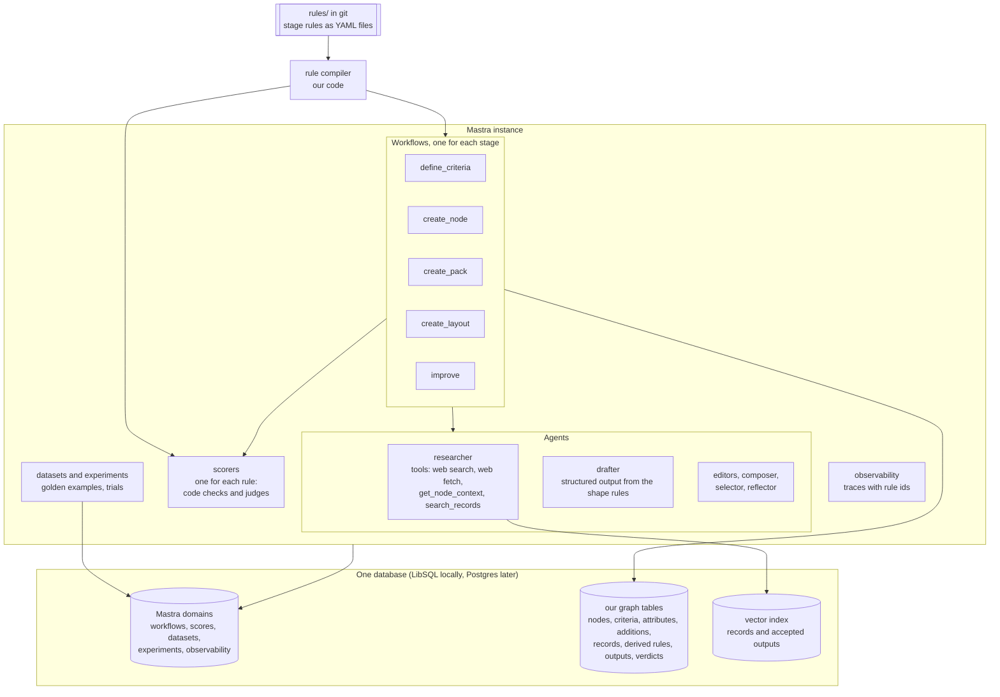

# The Mastra mapping `mastra`

Status. Design of 2026-10-24. The Mastra scaffold exists (`plan.scaffold`, [#5](https://github.com/Ronitron007/product-eval-harness/pull/5)). No harness stage exists yet. This doc maps three designs onto the Mastra framework. They are the rule graph ([rule-graph.md](rule-graph.md)), rule enforcement ([rule-enforcement.md](rule-enforcement.md)), and self-improvement ([self-improvement.md](self-improvement.md)).

Version. Each Mastra claim is for `@mastra/core` 1.79.0 and the packages in [the Mastra reference](../research/2026-10-24-mastra-primitives.md). A research agent read the embedded docs of the installed packages and type-checked the APIs. The type-check files are in [the probes](../research/2026-10-24-mastra-probes/README.md). The `mastra` agent skill (mastra-ai/skills, v2.4.0) set the method: embedded docs first, then type definitions, then remote docs (`rules.mastra`).

Labels. "Verified" means that the Mastra reference verified the claim or that a probe type-checked it. "Decision" marks a choice that Claude took for Rohan. Each decision is a row in [decisions.tsv](../decisions.tsv).

## The harness in one picture `mastra.picture`



## Our concept to Mastra `mastra.table`

| Our concept | Mastra part | How we use it | Gap that we build |
|---|---|---|---|
| Stage (`graph.stage`) | `createWorkflow`, `createStep` | One code-defined workflow for each stage. Verified. | None |
| Stage parts: context, research, draft, judge, repair, assimilate | Steps, a nested workflow, `.dountil` | `.dountil` runs the nested draft-and-judge workflow until no strict rule fails or the budget ends. Verified. | None |
| A person decides | `suspend`, `resume`, `bail` | The `person` step suspends with the open verdicts. A reviewer resumes with accept or reject. Verified. | None |
| Research | `Agent` with tools and `maxSteps`, `modelSettings.timeout.totalMs` | One researcher agent for all nodes. Its instructions come from request context. Verified. | None |
| Web research | `createTool`, `webFetchTool` | Our own web search tool, plus `webFetchTool`. | `webSearchTool` uses the search of the model provider, so a model change changes the search engine. Verified. |
| Past relevant work | `createVectorQueryTool`, `LibSQLVector` | Our `search_records` tool calls the vector store with a filter that our code sets from the node, not the model. | The tree walk (`get_node_context`) is our code. GraphRAG ignores our tree. Verified. |
| Node context (`graph.traversal`) | `RequestContext` | It carries the node id, the stage, the resolved rule set hash, and the rule texts. Verified. | None |
| Output shape (`shape` rules) | `structuredOutput: { schema }` | The compiler makes the Zod schema from the shape rules in scope. Verified. | A schema failure throws, with no retry. The repair loop catches it and sends the error. Verified. |
| Code check (`code_check` rules) | `createScorer` with function steps | One scorer for each rule version. The step turns its result into a `VerdictRow`. Verified. | Scores are numbers. The three-way verdict is our `VerdictRow`. |
| LLM judge (`judgement` rules) | `createScorer` with a `judge` and an `analyze` prompt step | The prompt step returns a verdict, a reason, and a quote for each item. Verified. | Same as above |
| "cannot verify" | None | Our `VerdictRow` keeps it. | `notScorable` means "the rule does not apply". `runEvals` drops it from the gates. Verified. So we never use it for "cannot verify". |
| Binding `strict` | `.dountil` in the stage | A strict fail sends the exact errors to the next round. | None |
| Binding `soft` | The judge step | The verdict and a warning go to our store. | None |
| Binding `watch` | The judge step, and experiments | The judge step logs the verdict and nothing else. A trial of a candidate rule runs as an experiment over stored outputs (`mastra.change`). | Live scorers score live runs only, so they cannot score stored outputs. Verified. |
| Cheap guards on an agent | Output processors, `abort(msg, { retry: true })`, `maxProcessorRetries` | Only deterministic guards, such as "the reply is valid JSON". `maxProcessorRetries: 1`. Verified. | Each retry adds the failed reply to the context. Verified. |
| Verdict log (`enforce.audit`) | Workflow state, `tracingOptions.metadata` | The resolved rule set hash goes on the root span. Each judge step adds its rule ids. Verified. | Traces are telemetry. The verdicts of an accepted output go to our table. |
| Golden examples | Datasets, `runEvals` with `gates` | Code synchs the examples of each rule file into a dataset. CI runs each free code check over its dataset, with a gate that compares the verdict with the expected verdict (`mastra.change`). Verified. | A judge golden run calls models, so it is a paid run with a yes. |
| Rule change trial (`enforce.change`) | Experiments with `grouping`, `compareExperiments`, schedules | Two experiments on one pinned dataset version: the current and the candidate rule version. Verified. | No delta, no statistics, no promotion. We build the report and the gate. |
| Held-out suite (`improve.boundaries.firewall`) | Datasets and experiments in a second, private Mastra storage | The held-out cases and the held-out judge prompts live there, never in this repo. | The firewall is ours. |
| Graph store | None | Our own tables, through Drizzle ORM, on the same database client as Mastra. Verified for the shared client. | Mastra storage has 24 fixed domains and refuses a custom one. Verified. |
| Rules | None | YAML files in `rules/`, read by our compiler. | The Mastra editor versions prompt text only. An unpublished block drops out of the instructions with no error. Verified. |
| Self-improvement (`improve.parts`) | Agents with structured output, `.parallel`, `.foreach`, datasets, experiments | See `mastra.improve`. | No optimizer in Mastra. Verified. |

## A stage as a workflow `mastra.stage_workflow`

This sketch of `define_criteria` type-checks against `@mastra/core` 1.79.0 (TypeScript 5.9.3, exit code 0). The full file is [10-stage-workflow.ts](../research/2026-10-24-mastra-probes/10-stage-workflow.ts). It shows the shape only: the rule texts, the database, and the model ids are placeholders.

```ts
// The loop body: draft, then judge. Its input and output share one shape.
const Round = z.object({
  nodeId: z.string(),
  round: z.number(),
  draft: CriteriaOutput.nullable(),
  verdicts: z.array(VerdictRow),
  errors: z.array(z.string()), // exact errors with their fixes, for the next round
})

const draftAndJudge = createWorkflow({ id: 'draft-and-judge', inputSchema: Round, outputSchema: Round })
  .then(draft)   // the drafter agent, structuredOutput from the shape rules
  .then(judge)   // code checks first, then one judge call for each judgement rule
  .commit()

export const defineCriteria = createWorkflow({
  id: 'define_criteria',
  inputSchema: Round,
  outputSchema: z.object({ outputId: z.string(), verdicts: z.array(VerdictRow) }),
})
  .dountil(draftAndJudge, async ({ inputData, iterationCount }) =>
    inputData.errors.length === 0 || iterationCount >= REPAIR_BUDGET)
  .then(person)      // suspends when a strict verdict is not pass; a reviewer resumes
  .then(assimilate)  // writes the output, its records, and its verdicts
  .commit()
```

The judge step in the sketch shows three rules of `enforce.deciders`:

- It runs the code check first. It calls the LLM judge only when the strict code checks pass. For each judgement rule that it skips, it writes "cannot verify", so each rule in scope has a verdict.

- It writes one `VerdictRow` for each item, with the rule id and the version.

- When the judge gives no result, it writes "cannot verify". It never writes a pass and never a fail in that case.

- Only a `strict` fail goes into the errors of the next round, and only a `strict` verdict that is not pass stops at the `person` step. The judge step logs a `soft` or `watch` fail, and the fail changes nothing else.

Decision: the stages are code-defined workflows. A ruleset changes the data that the steps read, not the shape of the workflow. Mastra also has dynamic workflows from JSON definitions, but they are beta and can call registered parts only. Verified.

Decision: the repair loop lives in the workflow (`.dountil`), not in an agent processor. The ruleset judge calls judges outside the drafting agent, and a processor only sees the agent. Processors keep the cheap deterministic guards.

Decision: the repair budget is 3 rounds for each stage run (one draft and two repairs). A stage rule can set a lower budget. harness2 and the Kyaloon pipeline use 2 or 3 attempts.

## The rule compiler in Mastra terms `mastra.compiler`

The compiler (`enforce.compile`) is our code. For one stage run at one node, it does these steps:

1. Resolve the rules in scope: the stage rules from `rules/` and the derived rules from the graph store, through the scope and inheritance of `graph.scope`.

2. Compute the hash of the resolved rule set. The workflow puts it in request context and on the root span.

3. Make the Zod schema of the output from the `shape` rules. The drafter gets it as `structuredOutput.schema`.

4. Make the instruction text from the statement, the reason, and the visible examples of each rule. The instructions function of each agent reads it from request context.

5. Make one scorer for each `code_check` rule and each `judgement` rule. The scorer id holds the rule id and version, such as `criteria.attribute_is_product@1`.

Decision: the stage rules are YAML files in `rules/`, one rule in each file. Code validates each file with Zod at load time and in CI. The version hash covers the canonical JSON of the statement, the reason, the kind, the scope, the binding, the `judge` field, and the examples (`enforce.rule_record`). We do not use the Mastra editor for rules.

Decision: a rule scope is a typed object (nodes, stages, fields), not a Mastra predicate. Inheritance needs our own resolver anyway. A Mastra predicate returns false on a missing path, so a typo in a scope would make a rule apply nowhere, in silence. Verified.

## Models `mastra.models`

- Each agent and each judge names its model as `provider/model` through the Mastra model router. Before the first use, check each id with the provider registry script of the `mastra` skill (`rules.mastra`).

- A judge uses a model from another provider than the drafter. A held-out judge must use another provider than the editors (`improve.boundaries.firewall`).

- The Mastra classifier needs a decision model, which only some providers give. Its answer has no reason text. So the judges are scorers with a judge model, not classifiers. Verified. A classifier can become a cheap first screen later.

## Storage `mastra.storage`

- One database holds the Mastra domains of the harness and our graph tables. Locally it is a LibSQL file. `LibSQLStore` takes the same client as our own tables. Verified.

- A file URL of the database must be absolute. `mastra dev`, `mastra build`, and `mastra start` each run in another folder, so a relative URL opens a different file in each. Verified (the review of [#5](https://github.com/Ronitron007/product-eval-harness/pull/5) ran the three commands). The code refuses a relative file URL (`resolveDatabaseUrl` in `src/mastra/harness.ts`).

- A second, private Mastra storage holds the held-out suite: its datasets, its experiments, and the prompts of the held-out judges (`improve.boundaries.firewall`).

- Decision: our graph tables use Drizzle ORM. Its team maintains it, it has typed tables and migrations, and it supports both LibSQL and Postgres.

- Each write to our graph tables is append-only. A new stage run writes new rows and never updates an accepted output (`rules.gates`, never overwrite an expensive output).

- The authoring database is one shared, persistent database ([data-layers.md](data-layers.md), `data.layers`). Its store is open (`data.open`). Tests and local development use a LibSQL file or memory.

## Research tools `mastra.research_tools`

| Tool | What it does | Built from |
|---|---|---|
| `web_search` | Search the web through one search API that does not change with the model | `createTool` over a search API. The plan unit picks the API. |
| `web_fetch` | Read one page as text | `webFetchTool` from `@mastra/core/tools`. It blocks private addresses and cuts the text at 100,000 characters. Verified. |
| `get_node_context` | The path to the root, the rules in scope with reasons, the records behind the inherited criteria, and the sibling nodes | `createTool` over our graph tables |
| `search_records` | Find past research records and criteria tables by meaning | `createTool` that calls the vector store with a node filter that our code sets |

Each tool result that comes from the web is data, not instructions. The researcher prompt says so, as harness2 does in each prompt.

## Bindings and the change process `mastra.change`

1. The rule files carry their visible golden examples. A sync step writes them into one Mastra dataset for each rule. A dataset version pins the examples that a rule version passed. Verified.

2. CI runs `runEvals` over each dataset of a code-check rule. The target is a pass-through workflow that returns the stored output of the example. The gate is a scorer that gives 1 when the verdict of the rule check equals the expected verdict in `groundTruth`. So an example whose expected verdict is "fail" passes the gate when the check fails it. These checks call no model, so they are free. Verified for `runEvals`, targets, and gates.

3. A judge rule runs over its dataset only on request, because each judge call costs money (`rules.gates`).

4. A candidate rule version runs as a second experiment on the same dataset version, with one `comparisonId` and two `variantId` values. `compareExperiments` gives the rows. Our report gives the changes. Verified for the rows.

5. A trial of a candidate rule in `watch` binding over recent stored outputs runs as an experiment. Each trial run is a paid run and needs its own yes for its prompt, model, and cost (`rules.gates`). A schedule can prepare a trial, but it never starts one without that yes.

6. The promotion step is a workflow step that suspends with the report. Rohan resumes it with his yes. Verified for suspend and resume.

## Self-improvement in Mastra terms `mastra.improve`

| Part (`improve.parts`) | Mastra host | Our code |
|---|---|---|
| `scoped_editor`, `composer`, `blind_selector`, `reflector` | `Agent` with `structuredOutput` | The prompts and the output schemas |
| k editors at once | `.parallel` | None |
| `proposal_validator` | A code step, with one retry through a `.dountil` of two rounds | The structure checks |
| `stage_rollout` | One run of the stage workflow with a rule set version in request context | The rule set override |
| `improvement_stream` | `.foreach` with `concurrency: 1` for each lane | The order: parents before children |
| `evidence_pack`, `measurement_firewall` | An input processor that aborts on a held-out path or a held-out verdict string | The pack builder and the checks before the agent starts |
| `lesson_library` | None | A table in our graph store, read by node and tree position |
| `budget_ledger` | The workflow `onStart` option as a pre-flight check | The expected counts, the cost estimate, and the paid-run yes. `TokenCostControl` is only approximate. Verified. |
| `run_identity` | Workflow snapshots | Hashes of the rule set and of each call input |
| `held_out_measurement` | Datasets, experiments, `runEvals` | The noise warnings of harness2 |
| `promotion_gate` | `suspend` and `resume` | The regression over the subtree of the rule owner, and the PR with the new rule files |

## What we do not use, and why `mastra.not_used`

| Mastra part | Why not |
|---|---|
| The editor and prompt blocks for rules | It versions text with no binding, scope, or examples. An unpublished block drops out with no error. Part of `@mastra/editor` needs an Enterprise license, and its npm record has no license field. Verified ([the harness2 research](../research/2026-10-24-harness2/abstractions.md), `rule_surface`, read the npm registry record). |
| `notScorable` for "cannot verify" | It means "does not apply", and gates drop it. Verified. |
| `structuredOutput` with `errorStrategy: 'fallback'` | It hides a failure behind a stored value. Verified. |
| Agent skills for strict rules | The model loads a skill only when it chooses to, so a strict rule could stay unread. Verified. Skills can hold optional reference text. |
| `webSearchTool` in a stage | The search engine changes with the model provider. Verified. |
| GraphRAG for the category tree | Its edges come from embedding similarity, not from our tree. Verified. |
| Agent networks | The docs mark them deprecated, in favor of supervisor agents. Verified. |
| Dynamic workflows | Beta, and they call registered parts only. Verified. |

## What the harness builds itself `mastra.builds`

- The rule record, the rule loader, and the rule compiler.

- The graph tables and the tree walk.

- The `VerdictRow` table and the three-way verdict.

- The cost ledger and the paid-run approval.

- The change report, the promotion step, and the measurement firewall.

- The self-improvement parts that `mastra.improve` lists as our code.
