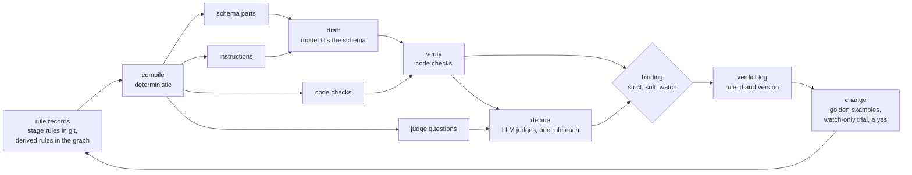

# Rule enforcement `enforce`

Status. Design of 2026-10-24. The Mastra scaffold exists (`plan.scaffold`), but no code implements this design yet. It answers the second half of Rohan's ask: what it takes to enforce each rule of the rule graph ([rule-graph.md](rule-graph.md)). It builds on two research files: [the prior art](../research/2026-10-24-rule-enforcement-prior-art.md) and [the Kyaloon patterns](../research/2026-10-24-kyaloon-patterns.md). Terms are in [glossary.md](../glossary.md).

## The idea in one paragraph `enforce.idea`

Each rule is a record with an id, a version, and a scope. A deterministic compiler turns each rule into the things that enforce it. These things are a part of the output schema, an instruction for the prompt, a code check, and a question for an LLM judge. After a stage drafts its output, the ruleset judge runs each rule in scope. Each check gives pass, fail, or cannot verify. The binding of each rule decides what a fail does. The harness logs each verdict with the rule id and version. A rule changes through a watch-only trial and Rohan's yes.



## The rule record `enforce.rule_record`

Stage rules and derived rules (`graph.rule_kinds`) use the same record.

| Field | What it holds | Why |
|---|---|---|
| `id` | A stable dotted name, such as `criteria.reason_has_record` | Logs, tests, and people refer to the rule by name. |
| `version` | A number, plus a hash of the canonical JSON (RFC 8785) of the statement, the reason, the kind, the scope, the binding, the `judge` field, the `check` field, and the examples. Each new version supersedes the version before it. `rules/rules.lock.json` holds each hash and only grows. | Two runs with the same version used the same words. A changed word gives a new hash. |
| `statement` | The rule in plain words, as one instruction | The prompt prints these words. |
| `judge` | For a `judgement` rule only: the judge question and its short policy. Rohan owns it. | The check stays fixed while the wording of the instruction improves (`improve.boundaries.surface`). |
| `reason` | Why the rule exists | A judge that knows the reason decides edge cases better. A person can see if the rule still makes sense. |
| `kind` | `shape`, `code_check`, or `judgement` | The kind tells the compiler what to make. |
| `check` | For a `code_check` rule only: the name of its check function in the code registry, such as `min_items` | The compiler finds the code that checks the rule. |
| `scope` | Nodes, stages, and output fields (`graph.scope`) | The harness applies the rule only where it belongs. |
| `binding` | `strict`, `soft`, or `watch` | The binding sets what a fail does (`enforce.binding`). |
| `examples` | Golden examples. Each has an input, an output, and the expected verdict. | The change process tests each new version on them. |
| `provenance` | The id of the research record or the decisions row that made the rule | The record system can show why each rule exists. |
| `owner` | The node that owns the rule | One rule has one owner, so two nodes cannot hold two versions of it. |
| `status` | `draft`, `active`, or `retired` | Readers see `active` rules only. A retired rule stays in the store. |
| `supersedes` | The version that this version replaces | The history of a rule stays readable. |

A first sketch of the types. The Mastra mapping turns it into Zod schemas.

```ts
type RuleKind = 'shape' | 'code_check' | 'judgement'
type Binding = 'strict' | 'soft' | 'watch'
type Verdict = 'pass' | 'fail' | 'cannot_verify'

interface RuleScope {
  nodes: { node: string; descendants: boolean } | { level: 'domain' | 'inner' | 'leaf' }
  stages: Array<'define_criteria' | 'create_node' | 'create_pack' | 'create_layout' | 'evaluate_product'>
  fields: string[] // output paths, such as 'criteria[].reason'
}

interface RuleRecord {
  id: string
  version: { n: number; hash: string }
  statement: string
  judge?: { question: string; policy: string } // judgement rules only, owned by Rohan
  reason: string
  kind: RuleKind
  scope: RuleScope
  binding: Binding
  examples: Array<{ input: unknown; output: unknown; expected: Verdict; note: string }>
  provenance: { recordId?: string; decisionRow?: string }
  owner: string // node id
  status: 'draft' | 'active' | 'retired'
  supersedes?: { n: number; hash: string }
}

interface VerdictRow {
  ruleId: string
  ruleVersion: { n: number; hash: string }
  target: string // output path, such as 'criteria[2].attributes[0]'
  verdict: Verdict
  decider: { by: 'code' } | { by: 'judge'; model: string; promptHash: string }
  evidence?: { quote: string; source: string }
  reason: string
  runId: string
  at: string // ISO time
}
```

## From a rule to its checks `enforce.compile`

A deterministic compiler reads the rules in scope of one stage run. It makes four things:

| Made thing | From which kind | Use |
|---|---|---|
| Schema part | `shape` | The output schema of the stage. The model fills only these fields. Decoding can enforce the keys and the enums. Code checks the rest again after decoding. |
| Instruction | Each kind | The prompt prints the statement, the reason, and the examples of each rule. |
| Code check | `code_check`, `shape` | A function that gives pass, fail, or cannot verify for one output item. |
| Judge question | `judgement` | A short policy for one LLM judge call: definitions, criteria, boundary examples, and an "unknown" answer. |

- One record makes both the instruction and the check. Shared parameters, such as the allowed keys and units, feed both, so the prompt and the check cannot drift apart. The Kyaloon pipeline uses this pattern for its layout keys (`layoutFills()`, see [the Kyaloon patterns](../research/2026-10-24-kyaloon-patterns.md)).

- The judge question of a `judgement` rule is its own field. The golden examples test the statement and the judge question together, so a drift between them shows up as a failed example.

- The compiler refuses a rule whose kind does not fit its fields. For example, it refuses a `code_check` that would give a grade or a match.

- The compiler is code, not a model. A model may draft a rule or its examples. Rohan approves each rule change (`rules.gates`).

## The three results `enforce.verdicts`

Each check gives one of three results:

- **pass.** The output follows the rule.

- **fail.** The output breaks the rule. The check gives the exact error and the fix.

- **cannot verify.** The check has no evidence either way. For example, the source text does not say, or a quote does not match because of an OCR error.

The harness never counts "cannot verify" as "fail", and it never counts it as "pass". An empty research result is "cannot verify", not proof that a thing is absent.

## Code checks and LLM judges `enforce.deciders`

| Decider | What it decides | Examples |
|---|---|---|
| Code | Facts that code can test with no judgement | A field has its type and unit. A key exists in the attribute registry. A quote is a substring of the source text. A record id exists. A list has no duplicate names. |
| LLM judge | Questions of meaning | Does this attribute describe the product? Is this wording a treatment claim? Does this record support this criterion? Is this criterion relevant at this node? |

- Code checks run first. The judges run only on output that passes the strict code checks. Code checks cost nothing, and a judge call costs money.

- Each judge call answers one rule. Many rules in one prompt lower the accuracy of a judge ([the prior art](../research/2026-10-24-rule-enforcement-prior-art.md), `rule_prior_art.policy_classifiers`).

- A judge gets the full source text, such as the whole label or the whole record. It never gets a short summary of the source.

- A judge gets the source and the claim. It does not get the reasoning of the model that wrote the claim.

- Code may narrow, gate, and verify. It never gives the final match, the final grade, or the final reject (`rules.harness`).

## Bindings `enforce.binding`

The binding of a rule sets what a fail does.

| Binding | On fail | On cannot verify |
|---|---|---|
| `strict` | The stage sends the exact error back to the model and repairs (`enforce.repair`). | A person decides. |
| `soft` | The graph keeps the output and attaches a warning to it. | The graph keeps the output and attaches a note to it. |
| `watch` | The verdict log records it. Nothing else happens. | The verdict log records it. |

The graph accepts an output when each `strict` rule in scope gives pass. A person decides the rest.

## The repair loop `enforce.repair`

- Send all the problems in one round. A model that sees one problem at a time needs more rounds.

- Each error names the fix and the allowed values, not only the broken rule. The Kyaloon pipeline found that a bare schema message made a model try the same wrong fix three times.

- Stop after a fixed budget of rounds, then hand the output to a person.

- Keep each failed reply. A reply costs money, so the harness never throws one away or overwrites it.

- After a repair, check that the fields outside the errors did not change. The Kyaloon pipeline asks for this in the prompt, but no code checks it.

## The verdict log `enforce.audit`

- The log has one row for each output item and each rule (`VerdictRow` in `enforce.rule_record`). The row holds the verdict, the decider, the evidence, the reason, the run, and the time.

- Each stored output keeps the ids and versions of the rules that it passed.

- The log answers two questions. Why did the graph accept this output? Which outputs passed an old version of this rule?

## How a rule changes `enforce.change`

1. A person or the improvement loop drafts a new rule version with status `draft`. A model may draft it.

2. The new version runs with binding `watch` on its golden examples and on recent outputs. This trial calls models, so it is a paid run and needs a yes.

3. The trial report shows the agreement with the golden examples, and the outputs whose verdicts change. For a draft from the improvement loop, the trial also runs the held-out suite over the subtree of the node that owns the rule (`improve.loop`).

4. Rohan promotes the version to its real binding. This is a live ruleset change, so it needs his yes (`rules.gates`). A stage rule lives in git, so the promotion is a PR that changes the rule file. The version becomes active when the PR merges.

5. New outputs use the new version. Old outputs keep the versions that they passed. A report lists the outputs that passed an older version. A re-run of a stage is a paid run.

A new rule binds new output only. A reader of old output applies the rule versions that the output passed. The Kyaloon pipeline uses this pattern for its stored packs (`parseStoredPack`).

## One rule through each part `enforce.example`

The rule `criteria.attribute_is_product`, at the domain node `skincare`, in the stage `define_criteria`:

| Part | Content |
|---|---|
| Statement | "Each candidate attribute describes a property of the product itself." |
| Reason | "A grade must rest on the product. A property of the market or of public opinion can change while the product stays the same." |
| Kind and binding | `judgement`, `strict` |
| Scope | Nodes: `skincare` and its descendants. Stages: `define_criteria`, `create_node`. Fields: `criteria[].attributes[]`. |
| Schema part | None. A sibling `shape` rule makes `attributes[]` a list of objects with `key`, `value_type`, `unit`, and `reason`. |
| Code check | None. A sibling `code_check` rule checks that `value_type` is one of number, word, list of words, or flag. |
| Judge question | "Here is one candidate attribute and its reason. Does the attribute describe a property of the product itself? Answer yes, no, or unknown, and quote the words that decide it." |
| Golden examples | `fragrance_present` gives pass. `trending_on_social_media` gives fail. `brand_founded_year` gives fail with a note, because it describes the company. |
| On fail | The stage repairs: "Drop `trending_on_social_media`. Social signals never become attributes." |
| Log | One `VerdictRow` for each attribute, with the judge model and the hash of its prompt. |

The same parts enforce a rule on product facts. An example is the rule "Write the amount per serving in the unit of the attribute, and quote the label text". Its `shape` part makes the unit an enum. Its `code_check` part checks that the quote is on the label. It needs no judge.

## Risks `enforce.risks`

- **Judge drift.** A model upgrade changes verdicts with no change to the rules. Run the golden examples again after each model change.

- **Cost.** One judge call for each rule and each item grows fast. Code checks first, and a cheap first judge with a careful second judge on a flag, keep the cost down.

- **Decoding limits.** Some model APIs reject ranges and length limits in a schema. Code must check them again after decoding.

- **Context gaps.** A judge without the context that a rule needs misses cases. The rule record must say what the judge reads.

- **Fixed weights.** A sum of judge verdicts with fixed weights in code would make code set the grade. That is forbidden (`rules.harness`).

- **Criteria drift.** People change rules while they grade. Each verdict keeps its rule version, so old and new verdicts stay apart.

## Choices taken `enforce.choices`

Claude took these choices for Rohan on 2026-10-24. Each is a row in [decisions.tsv](../decisions.tsv).

- Stage rules live as files in git. Derived rules live in the graph store.

- Each judge call answers one rule. One call can judge many items of the same rule.

- An attribute value that breaks its shape rule gives "fail" for that rule. The harness keeps the raw text beside the verdict, and it never stores the value as a typed value.
