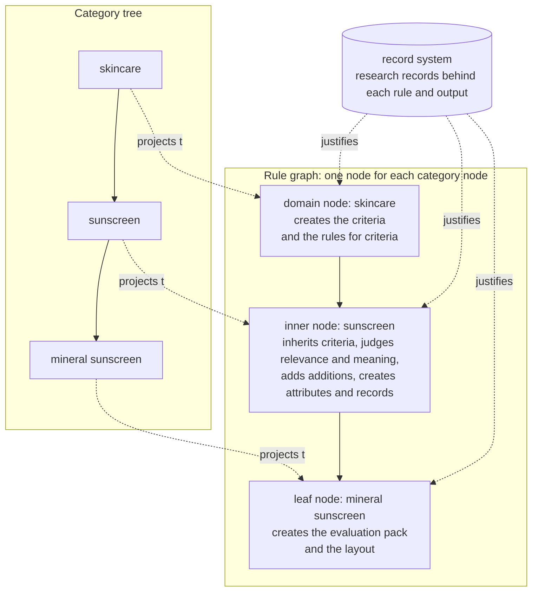
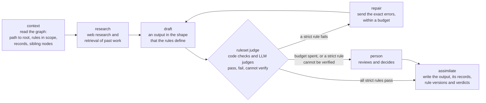

# The rule graph `graph`

Status. Design of 2026-10-24. No code implements it yet. Rohan stated the model on 2026-10-24 (`graph.source`). Claude wrote this doc and took the open decisions for him. Each decision is a row in [decisions.tsv](../decisions.tsv). Terms are in [glossary.md](../glossary.md).

## The problem `graph.problem`

Rohan stated the problem on 2026-10-24:

> today the ai decides what rules constitutes an evaluation of a product based on some meta instruction which are not really enforceable.

Today an LLM decides which rules make up the evaluation of a product. It reads a few general instructions. The rules of an evaluation are not objects in the system, so no code and no judge can check that an output follows them.

## The goal `graph.goal`

- Make each rule an explicit object. Each rule names the nodes, the stages, and the output fields where it applies.

- Put the rules in a graph, not in a linear rule book. The graph follows the category tree, so a rule applies where its category applies.

- For each rule, know what it takes to enforce it. [rule-enforcement.md](rule-enforcement.md) gives that design.

## The source `graph.source`

These quotes are Rohan's words of 2026-10-24. The rest of this doc restates them and fills the gaps.

> So we create a rule graph where nodes are really just a projection of the category nodes. each node level has certain things that are created as a part of that node.

> For now we dont make any distinction between instructions and rules. rules = instructions.

> The outputs of each such stage are also defined in rules and also checked against.

> Mind you, we are constraining the attributes to actually mean things that relate to products.

> the next stage is descending down the node tree and creating a new child node....so here node creation is the step

## The shape of the graph `graph.shape`

The graph has one node for each category node. Each node level creates its own things.

The node names in the diagram are examples. They are not researched.

| Level | Example | What the level creates | Stage |
|---|---|---|---|
| Domain node | skincare, supplements | The criteria that dictate the evaluation, and the rules for how criteria are defined | `define_criteria` |
| Inner node | sunscreen | For each inherited criterion, its relevance and its meaning at this node. Additions: the items that earn or lose points at this node and that no inherited criterion prices. Product attributes and the research records that justify them | `create_node` |
| Leaf node | mineral sunscreen | The same as an inner node, plus the evaluation pack (the kept criteria and attributes, the levels, the adjustments, and the scoring) and the layout | `create_node`, then `create_pack` and `create_layout` |
| All levels | | Research records for each output | Each stage writes them |

A node can have more than one inner level. A leaf is a node with no child. Only a leaf gets a pack, because only a leaf has products to grade.

Only a domain node creates criteria. A lower node judges the relevance and the meaning of each inherited criterion, and it adds additions. So the evaluation grades each product of one domain on the same criteria, and two products stay comparable. A lower node that finds a concern that no criterion covers proposes a change at the domain node. The Kyaloon v3 packs follow the same rule: a concern that fits no criterion goes into the adjustment guidance, never into a new criterion.

## What a node holds `graph.node_contents`

| Item | What it is | Made by | Links |
|---|---|---|---|
| Criterion | One aspect of a product that the evaluation grades, such as "ingredient safety". It has a name, a definition, and a reason. | `define_criteria` at a domain node only | Justified by records. Measured by attributes. |
| Node criterion | A criterion as it applies at one node: its relevance there, what it consists of there, and the attributes that measure it there | `create_node` | Inherits from the node criterion of the parent node |
| Addition | One item that earns or loses points at a node, and that no inherited criterion prices. It names its sign, its attribute, and its reason. | `create_node` | Attached to the node. A pack turns additions into its bonus and subtraction rules. |
| Attribute | One measurable property of a product, such as "SPF printed on the label". Its value is a number, a word, a list of words, or a flag with details. | `define_criteria` proposes. `create_node` creates and refines. | Measures node criteria. Justified by records. |
| Research record | The research or thinking work behind an output: the question, the sources with quotes, the findings, and the run that made it | Each stage | Justifies criteria, attributes, rules, and pack items |
| Evaluation pack | The rules that grade one product at a leaf: the kept criteria and attributes, the levels of each criterion, the bonus and subtraction adjustments, and the scoring | `create_pack` | Built from the node criteria of the leaf |
| Layout | The rules for how an evaluation shows a product: which attributes show, and where | `create_layout` | Built from the pack |
| Derived rule | A rule that a stage made, such as the meaning of a criterion at a node (see `graph.rule_kinds`) | Each stage | Scoped to the node and its descendants |

An attribute describes the product, not the category, the market, or public opinion. Social signals, such as reviews and ratings, never become attributes that a grade uses.

## Two kinds of rules `graph.rule_kinds`

Rules and instructions are the same thing (`graph.source`). Each instruction to a model is a rule, and each rule must have a check. An instruction that no code can check gets a check by an LLM judge.

| Kind | What it governs | Who makes it | Where it lives | Example |
|---|---|---|---|---|
| Stage rule | How a stage works, and the shape of its output | A person writes it. An LLM may draft it, and a person approves it. | Files in git, reviewed by PR | "Each criterion cites at least one research record." |
| Derived rule | How a later stage works at this node and below | A stage makes it as part of its output | The graph store, with a version and a provenance record | "At sunscreen, the criterion `efficacy` consists of the labeled SPF and the labeled UVA mark." |

A criterion is a derived rule for the stages below it, and for the final product evaluation. So the graph stores the rules of each evaluation as objects. The stage rules check each derived rule before the graph accepts it. This is the answer to `graph.problem`.

Both kinds use one rule record. [rule-enforcement.md](rule-enforcement.md) defines the record (`enforce.rule_record`).

## The scope of a rule `graph.scope`

Each rule has a scope with three parts:

- **Nodes.** One node, a node and all its descendants, or one level of the tree.

- **Stages.** The stages that must apply the rule, such as `create_node`.

- **Fields.** The output fields that the rule checks, such as `criteria[].reason`.

A rule on a node applies to the descendants of the node. A child node can add rules. A child node cannot remove or weaken a rule that it inherits. To change an inherited rule, make a new version of the rule at the node that owns it. This keeps one owner for each rule, so two nodes cannot hold two versions of one rule.

## A stage `graph.stage`

Each stage runs the same cycle at one node.

- **Context.** The stage reads the path from the root to its node and the rules in scope. It also reads the records of the criteria and attributes, and the sibling nodes. The graph makes this read cheap and complete, so the model always knows where it works (`graph.traversal`).

- **Research.** The models research under the rules of the stage. They have two kinds of tools: web research, and retrieval of past relevant work. Past work is the criteria tables and the research records that match the question.

- **Draft.** The stage rules define the fields of the output, their types, and their units. The model fills only those fields.

- **Ruleset judge.** The judge runs each rule in scope. Code runs the checks that code can decide. LLM judges answer the questions that need judgement. Each check gives pass, fail, or cannot verify.

- **Repair.** When a strict rule fails, the stage sends the exact errors back to the model. It stops after a fixed number of rounds.

- **Assimilate.** When all strict rules pass, the graph accepts the output. It stores the output with its research records, and with the id, version, and verdict of each rule.

- **Person.** A person decides when the repair budget is spent, or when a strict rule gives "cannot verify". The harness never turns "cannot verify" into a silent accept or a silent reject.

[rule-enforcement.md](rule-enforcement.md) gives the detail of the judge, the bindings, and the repair loop.

## The stages `graph.stages`

| Stage | Node level | Main inputs | Output (its shape is a stage rule) | Example stage rules | Gate after the judge |
|---|---|---|---|---|---|
| `define_criteria` | Domain | The domain name, past criteria tables, the stage rules | Criteria. Each has a name, a definition, a reason with record ids, and candidate product attributes. | Each criterion cites a record. Each candidate attribute describes the product. No two criteria grade the same thing. | The ruleset judge |
| `create_node` | Inner and leaf | The node criteria and attributes of the parent, sibling nodes, records | For each inherited criterion: relevance with a reason, its meaning here, and its measuring attributes. Additions. Attributes with records. | Each "not relevant" has a reason and a record. Each addition names its attribute and says why no inherited criterion prices it. | The ruleset judge |
| `create_pack` | Leaf | The node criteria and attributes of the leaf, records | The evaluation pack: kept criteria and attributes, levels, adjustments, scoring | Each level names the attribute values that reach it. Each adjustment names its attribute. Being tested by a lab is never a bonus by itself. | The ruleset judge, then a person gates the pack before it grades a product |
| `create_layout` | Leaf | The pack | The layout: the attributes that show, and where | Each shown attribute exists in the pack. | The ruleset judge |

The final product evaluation is not a stage of this graph. It reads the pack of a leaf, and the pack rules govern it.

## Skincare from zero `graph.walkthrough`

Rohan asked for this example: the harness starts skincare with no knowledge of good evaluation criteria. The criteria and attributes below are examples of the shape. Nobody researched them.

1. An operator adds the domain node `skincare`. The graph has no criteria for it.

2. `define_criteria` runs at `skincare`. The context gives the stage rules for criteria, and past criteria tables of other domains, such as supplements.

3. The research models search the web and the past records. They propose criteria, for example `efficacy`, `ingredient_safety`, and `label_honesty`. Each criterion has a reason, sources with quotes, and candidate attributes, such as `fragrance_present` (a flag with details).

4. The ruleset judge checks the output. Code checks that each criterion has a record, and that each attribute has a value type. An LLM judge checks that each candidate attribute describes the product and not the market.

5. A rule fails: one attribute is `trending_on_social_media`. The judge returns the exact error: "Social signals never become attributes." The model drops the attribute in the repair round. The judge passes the output.

6. The graph assimilates the criteria, the attributes, the records, and the verdicts.

7. An operator adds the child node `sunscreen`. `create_node` runs there. It gets the criteria of `skincare` as its inherited criteria.

8. For each inherited criterion, the stage researches its relevance and meaning at `sunscreen`. For example, `efficacy` here consists of the labeled SPF and the labeled UVA mark. The stage also proposes additions, for example a subtraction when the label makes a sun claim that the market rules do not allow. Additions are the same kind of thing as the bonus and subtraction points of the Kyaloon v3 packs ([the Kyaloon patterns](../research/2026-10-24-kyaloon-patterns.md)).

9. The judge checks the node and the graph assimilates it. At a leaf, `create_pack` and `create_layout` run next, under their own stage rules.

An operator names each new node in this design. A stage that proposes new nodes is future work.

## How the graph helps the model `graph.traversal`

The graph gives each stage run a context bundle:

- The path from the root to the node, with the node criteria at each step.

- The rules in scope, with the reason for each rule.

- The research records that justify the inherited criteria and attributes.

- The sibling nodes, with their criteria and attributes, so the stage can reuse work.

A model that knows its node, its inherited criteria, and its rules does not invent the rules of an evaluation. This bundle is the main defense against `graph.problem`.

## The record system `graph.records`

- Each output of each stage links to at least one research record.

- A research record holds the question, the method, the tools, the sources with quoted spans, and the findings. It also holds the model, the run id, the date, and the rule versions in scope.

- Records are append-only. A new run writes a new record and never overwrites an old one.

- Each stage rule also links to a record or to a row of [decisions.tsv](../decisions.tsv). The record is the research or thinking work that defined the rule.

- An attribute keeps a reference to the record that justified it. This reference connects the attribute to the records, the product facts, the packs, and the rubrics.

## What is not decided here `graph.not_decided`

- How a stage proposes new nodes for the category tree.

- How the harness imports an existing category tree, such as the Kyaloon tree.

- The storage schema of the graph. The Mastra mapping gives the first choice.
