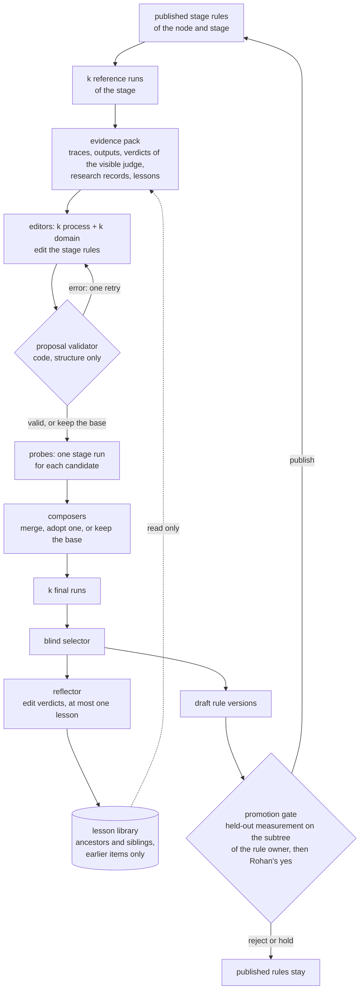

# Self-improvement `improve`

Status. Design of 2026-10-24. The Mastra scaffold exists (`plan.scaffold`), but no code implements this design yet. Rohan asked to take the ideas of recursive self-improvement from google-research/harness2. A research agent read harness2 at commit `1cfe254e` and wrote [the concepts](../research/2026-10-24-harness2/concepts.md), [the abstractions](../research/2026-10-24-harness2/abstractions.md), and [the prior art](../research/2026-10-24-harness2/look-before-you-build.md). This doc decides how the rule graph uses them. Terms are in [glossary.md](../glossary.md).

## What harness2 does `improve.harness2`

harness2 improves the files around a frozen model: the system prompt, the rules, the skills, the scripts. It changes no model weights. For each task, it runs this loop (`concepts.core_loop`):

1. Run the base harness k times on the task. These are the reference runs.

2. Two kinds of editor sessions read the full traces and edit copies of the harness. One kind owns how the agent works (process). The other kind owns what a practitioner knows (domain).

3. Code checks the structure of each edit. A failed check goes back to the editor once, with the exact error. A second failure keeps the current harness.

4. Run each candidate once on the same task. These are the probes.

5. Composer sessions compare the probes with the reference runs. Each composer merges edits, adopts one candidate, or keeps the base. An edit needs a specific moment in a trace as its evidence.

6. A blind selector picks one final output. It does not know which harness made it.

7. A reflector writes one verdict for each edit and at most one lesson, or `NO_ENTRY`. A complete lesson goes into a library that later tasks of the same domain read.

No score enters the loop. The grader of the benchmark runs only after the loop, so the loop cannot tune itself to the grader. harness2 also does not improve its own improver. Its editor prompts and decision rules stay fixed. Only the library grows. Verified (the research agent read `harness2/core/`).

## What changes for a rule graph `improve.differences`

| Point | harness2 | The rule graph harness |
|---|---|---|
| What an improvement changes | The harness of one task. The next task starts again from the base harness. | The stage rules of a node. An adopted change becomes a new rule version that later stage runs use, at each node under the node that owns the rule. |
| A judge inside the loop | None | Each stage ends in a ruleset judge (`graph.stage`). |
| Groups that share lessons | One flat folder for each domain | The category tree: ancestors and siblings |
| A gate before adoption | None, because each task throws its harness away | A promotion gate with a held-out measurement and Rohan's yes |

These differences give the three rules of `improve.boundaries`.

## The loop over one node and one stage `improve.loop`

An operator starts one improvement run for one node and one stage, for example `create_node` at `sunscreen`. Each run is a paid run, so it needs a yes for its prompt, its models, and its cost (`rules.gates`).

The adopted draft enters the normal change process of rules (`enforce.change`). The promotion gate is that process, with the held-out suite, run over the subtree of the node that owns each changed rule. An edit to an inherited rule reaches the siblings of the improved node too, so the subtree of the owner is the test set. Rohan's yes opens a PR with the changed rule files, and the new version becomes active when the PR merges.

## Three boundaries `improve.boundaries`

### The editors see the visible judge only `improve.boundaries.firewall`

- The ruleset judge of the stage is part of the stage. Its verdicts are visible to the editors, as part of the behavior of a run.

- The promotion gate uses a held-out suite: held-out cases and held-out judges. No editor, composer, selector, or reflector ever reads them. Code refuses an evidence pack that holds a held-out path or a held-out verdict string, as harness2 does (`measurement_firewall` in [the abstractions](../research/2026-10-24-harness2/abstractions.md)).

- The held-out judges use a model from another provider than the editors. A firewall does not stop a bias that two models of one family share.

- The held-out cases and the prompts of the held-out judges live outside this public repo, in a second, private Mastra storage. A public file can reach an editor through web research. harness2 saw a run download the rubric of its own task.

- The golden examples of a rule (`enforce.rule_record`) are visible examples. They teach the model and test the rule. They are not held-out cases.

### The editors change a small surface `improve.boundaries.surface`

An editor can make these changes only:

- Add a rule with binding `watch`.

- Change the statement, the reason, or the visible examples of a rule. The `judge` field and the code check of the rule stay as they are.

- Change the stage prompt and the tool guidance of the stage.

Only Rohan makes these changes:

- Delete a rule, or change its binding or its scope.

- Change the `judge` field or the code check of a rule.

- Change an output shape. Later stages and code read the shapes, so a changed shape could make an output pass by a changed contract.

So the loop cannot make its outputs pass by a weaker rule. A rule only changes its strength through the promotion gate and a person.

### Lessons are hypotheses `improve.boundaries.lessons`

- A lesson has a cue, the lesson, the evidence it rests on, and a confidence. The code keeps a lesson only when the cue, the lesson, and the evidence exist.

- An editor at a node reads the lessons of its ancestors and its siblings, from earlier items of the run order only. A parent node runs before its children. Stage runs never read lessons, so a lesson reaches an output only through a promoted rule.

- A lesson from another node is a hypothesis at this node, not a fact. A fact about one product belongs in a research record, never in a lesson or a category rule.

## The parts to build `improve.parts`

The abstractions come from [the harness2 research](../research/2026-10-24-harness2/abstractions.md). [mastra-mapping.md](mastra-mapping.md) gives the Mastra host of each part.

| Part | What it is | From harness2 |
|---|---|---|
| `rule_surface` | The changes that an editor may make (`improve.boundaries.surface`) | The editable surface of a harness |
| `rule_set_version` | An immutable snapshot of the resolved rules of one node and stage, with a content hash and a parent | The fingerprint of a harness tree |
| `edit_proposal` | A change set against one version, with a note and evidence for each change | The edit contract and the decision notes |
| `proposal_validator` | Structure checks, the exact error back to the editor, one retry, then the base | The tree validator and the retry |
| `scoped_editor` | An editor that owns process rules or domain rules, not both | The INV and DOM editors |
| `stage_rollout` | One stage run under one rule version, with no held-out score | Reference runs, probes, finals |
| `evidence_pack` | The files that an editor reads, and a short mission that points to them | The evidence tree |
| `measurement_firewall` | The checks that keep held-out data away from the loop | The answer-free boundary |
| `composer` | Merge, adopt one, or keep the base, from the evidence | Composition |
| `blind_selector` | Pick one of k anonymous final outputs | Blind selection |
| `reflector` | Edit verdicts and at most one lesson | Reflection |
| `lesson_library` | The lessons and adopted versions, scoped by the category tree | The experience library |
| `improvement_stream` | The run order: parents before children, a fixed order in each lane (one lane for each domain) | The task stream |
| `budget_ledger` | The expected runs and sessions, their cost, and the paid-run yes | The ledger of runs and sessions |
| `run_identity` | Hashes, a call cache, and a resume check, so no paid output is lost or reused by mistake | Run marks, the call cache, resume |
| `held_out_measurement` | The held-out suite and its report, with noise warnings | The judge after the sweep, the report |
| `promotion_gate` | The held-out check over the subtree of the rule owner, then Rohan's yes and a PR | None. This is new. |

No maintained package gives the whole loop. Mastra gives the measurement half: datasets, experiments, gates and verdicts. Verified ([the prior art](../research/2026-10-24-harness2/look-before-you-build.md)).

## What this design does not do `improve.not_done`

- It does not improve the improver. The prompts of the editors, the composers, the selector, the reflector, and the judges stay fixed. A loop that changes them needs its own held-out suite and its own gate. Otherwise it grades its own grader.

- It does not run without a person. Each run is a paid run, and each promotion needs Rohan's yes.
