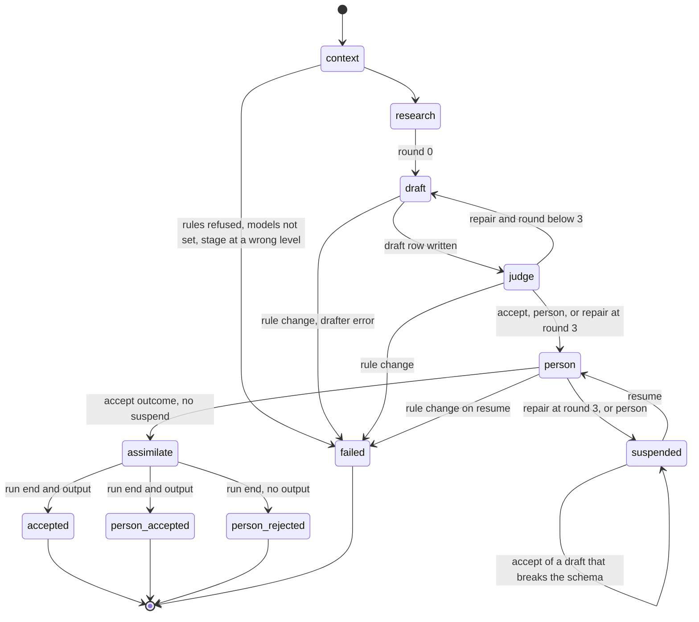

# The stage workflow `stage`

Status. Spec of 2026-11-08 for the unit `plan.stage_workflow` ([the plan](../plans/2026-10-24-harness-plan.md)). No code builds it yet. Written against `main` at `2821755`. An adversarial review runs before the merge. Terms are in [glossary.md](../glossary.md).

Source. This spec builds on these docs:

- The stage cycle of [rule-graph.md](rule-graph.md) (`graph.stage`, `graph.traversal`).

- The bindings, the repair loop, and the verdict log of [rule-enforcement.md](rule-enforcement.md) (`enforce.binding`, `enforce.repair`, `enforce.audit`).

- The sketch, the models, and the storage of [mastra-mapping.md](mastra-mapping.md) (`mastra.stage_workflow`, `mastra.models`, `mastra.storage`).

- The call site of [compiler.md](compiler.md) (`compile.usage.calls`).

- The judge outcome of [judge-step.md](judge-step.md).

- The tables of [graph-store.md](graph-store.md) and the layers of [data-layers.md](data-layers.md).

Each decision is a row in [decisions.tsv](../decisions.tsv), for Rohan to review. The board is [harness.canvas](../canvas/harness.canvas).

Version. Each Mastra claim is for `@mastra/core` 1.79.0 and `@mastra/pg` 1.32.0. Claude read these embedded docs of the installed package:

- `reference-workflows-workflow-methods-dountil.md`

- `docs-workflows-control-flow.md`

- `docs-workflows-suspend-and-resume.md`

- `docs-workflows-human-in-the-loop.md`

- `docs-workflows-snapshots.md`

- `reference-workflows-run.md`

- `reference-workflows-run-methods-resume.md`

- `reference-workflows-run-methods-restart.md`

- `reference-workflows-step.md`

- `reference-workflows-workflow-state-reader.md`

The probes are in [the probe folder](../research/2026-11-08-stage-workflow-probes/README.md).

## The idea `stage.idea`

The stage workflow runs one stage at one node. It is one Mastra workflow for each stage. Its steps are the parts of `graph.stage`:

1. `context` compiles the rules, records the stage run, and reads the node context.

2. `research` gets the run evidence from the research port.

3. The repair loop runs the nested workflow `draft_and_judge` with `.dountil`. Each round writes one draft row, then the judge step writes the verdict rows of that round.

4. `person` passes an accepted draft on. Otherwise it suspends with the person payload, and it waits for accept or reject.

5. `assimilate` writes the run end and, for an accept, the output, in one transaction.

The judge step decides the judge outcome (`judge.idea`). The stage workflow acts on the outcome kind, and on nothing else.

## Usage `stage.usage`

```ts
import { stageWorkflow, type StageDeps } from '../stage'
// Call site: src/mastra/index.ts registers one workflow for each stage (stage.registered).
const deps: StageDeps = { store, planFor, research, drafter, judgeModel }
export const mastra = new Mastra({
  storage,
  workflows: {
    define_criteria: stageWorkflow('define_criteria', deps),
    create_node: stageWorkflow('create_node', deps),
    create_pack: stageWorkflow('create_pack', deps),
    create_layout: stageWorkflow('create_layout', deps),
  },
})

// Call site: an operator, a test, or Studio. The Mastra run id is the stage run id.
const workflow = mastra.getWorkflow('create_node')
const run = await workflow.createRun()
const result = await run.start({ inputData: { nodeId: 'sunscreen' } })
if (result.status === 'success') void result.result.end // accepted, with result.result.outputId
if (result.status === 'suspended') void result.steps.person // its suspendPayload is a PersonPayload

// Later, from a person. The person step compiles again first (stage.hash_on_resume).
const state = await workflow.getWorkflowRunById(runId)
if (state?.status === 'suspended') {
  const again = await workflow.createRun({ runId })
  const ended = await again.resume({
    step: 'person',
    resumeData: { decision: 'reject', reviewer: 'operator', note: 'Two criteria grade the same thing.' },
  })
  if (ended.status === 'success') void ended.result.end // person_rejected, with outputId null
}
```

| Call site | Call | What it gets |
|---|---|---|
| `src/mastra/index.ts` | `stageWorkflow(stage, deps)` for the four stages | Four registered workflows. Studio shows them. A run with no model set fails before any call (`stage.registered`). |
| An operator, a test, Studio | `run.start({ inputData: { nodeId } })` | `success` with a `StageResult`, `suspended` with a `PersonPayload`, or `failed` |
| A person | `run.resume({ step: 'person', resumeData })` | `success` with a `StageResult`, `suspended` again with a `refusal`, or `failed` after a rule change |
| A recovery script | `workflow.getWorkflowRunById(runId)` | The status and the suspend payload, from Mastra storage |

The result of `run.start` and `run.resume` has one of these Mastra statuses:

| Status | When |
|---|---|
| `success` | The run ended. `result.end` is `accepted`, `person_accepted`, or `person_rejected`. |
| `suspended` | The person step waits for a person. |
| `failed` | The rules refused, the models are not set, the rules changed, the drafter or the store threw, or a bug. No run end row exists. |

The stage workflow uses no `bail`, no sleep, and no processor tripwire. So it never gives `bailed` or `tripwire`, inferred (read `reference-workflows-run.md`). A second resume throws `WORKFLOW_RUN_NOT_SUSPENDED` or `WORKFLOW_RESUME_ALREADY_CLAIMED` (`stage.end_once`).

## Types `stage.types`

The probe `sketch.ts` type-checks these types against the real types in `src/` (exit code 0).

```ts
// src/stage/types.ts (new)
export const REPAIR_BUDGET = 3 // rounds: one draft and two repairs (mastra.stage_workflow)
export const Sha256 = z.string().regex(/^[0-9a-f]{64}$/)
export const StageInput = z.object({ nodeId: NodeId }).strict()

// The context bundle of graph.traversal that exists today. Records come with plan.research_tools.
export const NodeContext = z.object({
  path: z.array(z.object({ id: NodeId, label: z.string() })), // from the root down to the node
  siblings: z.array(z.object({ id: NodeId, label: z.string() })),
  instructions: z.string(), // plan.instructions: the strict and soft rules in scope
})

// The loop state. Each field is JSON, so the snapshot holds it (compile.limits).
export const Round = z.object({
  runId: z.string().min(1),
  stage: Stage,
  nodeId: NodeId,
  ruleSetHash: Sha256,
  context: NodeContext,
  evidence: RunEvidence,
  round: z.number().int().min(0).max(REPAIR_BUDGET), // the rounds so far
  last: JudgeStepOutput.nullable(), // the outcome of the last round
})

// What a person sees (stage.person_payload).
export const PersonPayload = z.object({
  runId: z.string().min(1),
  stage: Stage,
  nodeId: NodeId,
  ruleSetHash: Sha256,
  round: z.number().int().min(1).max(REPAIR_BUDGET),
  budget: z.literal(REPAIR_BUDGET),
  why: z.enum(['budget_spent', 'cannot_verify']),
  reply: z.unknown(), // the last draft, as the drafter gave it
  canAccept: z.boolean(), // false when the last draft broke the output schema
  errors: z.array(z.object({ from: z.string(), target: z.string(), fix: z.string() })),
  open: z.array(VerdictInput),
  warnings: z.array(z.object({ rule: z.string(), target: z.string(), kind: z.enum(['warning', 'note']), text: z.string() })),
  refusal: z.string().optional(), // set when a resume asked for what the payload forbids
}).strict()

// What a person sends back.
export const PersonDecision = z.discriminatedUnion('decision', [
  z.object({ decision: z.literal('accept'), reviewer: z.string().min(1), note: z.string().optional() }).strict(),
  z.object({ decision: z.literal('reject'), reviewer: z.string().min(1), note: z.string().min(1) }).strict(),
])

export const RunEnd = z.enum(['accepted', 'person_accepted', 'person_rejected'])
export const StageResult = z.object({ runId: z.string(), end: RunEnd, round: z.number().int().min(1), outputId: z.string().nullable() }).strict()

// The ports (stage.research_port, stage.models_injected).
export interface ResearchInput { readonly runId: string; readonly stage: Stage; readonly nodeId: NodeId; readonly context: NodeContext }
export type ResearchPort = (input: ResearchInput) => Promise<RunEvidence>
export interface DraftInput {
  readonly runId: string
  readonly round: number
  readonly plan: StagePlan
  readonly evidence: RunEvidence
  readonly context: NodeContext
  readonly errors: Extract<JudgeStepOutput, { kind: 'repair' }>['errors'] // the strict errors of the last round
}
export interface Drafter {
  readonly id: string // provider/model, kept on each draft row
  draft(input: DraftInput): Promise<unknown> // the raw reply: draft.object, else draft.text
}

// The store calls of the stage workflow (stage.draft_log, stage.round_rows, stage.end_once).
export type RunEndInput =
  | { readonly runId: string; readonly round: number; readonly end: 'accepted'; readonly output: unknown }
  | { readonly runId: string; readonly round: number; readonly end: 'person_accepted'; readonly reviewer: string; readonly note?: string; readonly output: unknown }
  | { readonly runId: string; readonly round: number; readonly end: 'person_rejected'; readonly reviewer: string; readonly note: string }
export interface DraftRow { runId: string; round: number; reply: unknown; drafter: string }
export interface StageStore extends Pick<GraphStore, 'recordStageRun' | 'pathToRoot' | 'siblings'> {
  stageRun(runId: string): Promise<{ runId: string; ruleSetHash: string } | undefined>
  addDraft(row: DraftRow): Promise<void>
  draftOf(runId: string, round: number): Promise<DraftRow | undefined>
  writeVerdicts(rows: readonly VerdictInput[], round: number): Promise<unknown>
  verdictsOf(runId: string, round: number): Promise<readonly VerdictInput[]>
  endRun(input: RunEndInput): Promise<{ outputId: string | null }> // one transaction
}

export interface StageDeps {
  readonly store: StageStore
  readonly planFor: PlanFor // compile.usage.calls: compiles again, refuses another hash
  readonly research: ResearchPort
  readonly drafter: Drafter
  readonly judgeModel: JudgeModel
}

// src/stage/drafter.ts (new): the adapter for a real drafter. errorStrategy warn keeps a bad reply.
export function agentDrafter(agent: Agent, id: string): Drafter {
  return {
    id,
    async draft({ plan, evidence, context, errors }) {
      const prompt = JSON.stringify({ context, evidence, errors })
      const out = await agent.generate(prompt, { structuredOutput: { schema: plan.schema, errorStrategy: 'warn' } })
      return out.object !== undefined ? out.object : out.text
    },
  }
}
```

## The workflow `stage.workflow`

The probe `sketch.ts` type-checks this sketch (exit code 0). The probe `run-sketch.ts` runs a copy of it with fake ports. The declared functions `planOrThrow`, `checkModels`, and `judgeRound` are the parts that `stage.decisions` defines.

```ts
// src/stage/workflow.ts (new)
export function stageWorkflow(stage: Stage, deps: StageDeps) {
  const context = createStep({
    id: 'context',
    inputSchema: StageInput,
    outputSchema: Round.pick({ runId: true, stage: true, nodeId: true, ruleSetHash: true, context: true }),
    execute: async ({ inputData, runId }) => {
      checkModels(deps.drafter.id, deps.judgeModel.id) // before any compile, write, or model call
      const plan = await planOrThrow(deps, { runId, stage, nodeId: inputData.nodeId })
      const known = await deps.store.stageRun(runId)
      if (known === undefined) await deps.store.recordStageRun({ runId, stage, nodeId: inputData.nodeId, ruleSetHash: plan.ruleSetHash })
      else if (known.ruleSetHash !== plan.ruleSetHash) throw new Error(`The rules changed during run ${runId}. Start a new run.`)
      const [path, siblings] = await Promise.all([deps.store.pathToRoot(inputData.nodeId), deps.store.siblings(inputData.nodeId)])
      const pick = (n: { id: string; label: string }) => ({ id: n.id, label: n.label })
      const context = { path: path.map(pick), siblings: siblings.map(pick), instructions: plan.instructions }
      return { runId, stage, nodeId: inputData.nodeId, ruleSetHash: plan.ruleSetHash, context }
    },
  })

  const research = createStep({
    id: 'research',
    inputSchema: context.outputSchema,
    outputSchema: Round,
    execute: async ({ inputData }) => {
      const evidence = RunEvidence.parse(await deps.research(inputData))
      return { ...inputData, evidence, round: 0, last: null }
    },
  })

  const draft = createStep({
    id: 'draft',
    inputSchema: Round,
    outputSchema: JudgeStepInput, // JudgeStepInput gets round (stage.round_rows)
    execute: async ({ inputData }) => {
      const round = inputData.round + 1
      if (round > REPAIR_BUDGET) throw new Error('The repair budget is spent. The loop must not start another round.')
      const plan = await planOrThrow(deps, inputData)
      const kept = await deps.store.draftOf(inputData.runId, round) // stage.rerun_reuses
      const errors = inputData.last?.kind === 'repair' ? inputData.last.errors : []
      const reply = kept !== undefined ? kept.reply : await deps.drafter.draft({ runId: inputData.runId, round, plan, evidence: inputData.evidence, context: inputData.context, errors })
      if (kept === undefined) await deps.store.addDraft({ runId: inputData.runId, round, reply, drafter: deps.drafter.id }) // stage.draft_log
      return { runId: inputData.runId, stage: inputData.stage, nodeId: inputData.nodeId, ruleSetHash: inputData.ruleSetHash, round, reply, evidence: inputData.evidence }
    },
  })

  const draftAndJudge = createWorkflow({ id: `${stage}.draft_and_judge`, inputSchema: Round, outputSchema: Round })
    .then(draft)
    .then(judgeStep(deps)) // src/judge/mastra.ts: writes the rows of the round (stage.round_rows)
    .map(async ({ inputData, getInitData }) => {
      const before = getInitData<Round>()
      return { ...before, round: before.round + 1, last: inputData }
    })
    .commit()

  const person = createStep({
    id: 'person',
    inputSchema: Round,
    outputSchema: Round.omit({ context: true, evidence: true, last: true }).extend({ decision: PersonDecision.nullable() }),
    suspendSchema: PersonPayload,
    resumeSchema: PersonDecision,
    execute: async ({ inputData, resumeData, suspend }) => {
      const last = inputData.last
      if (last === null) throw new Error('The loop ended with no round.')
      const { context: _c, evidence: _e, last: _l, ...run } = inputData
      if (last.kind === 'accept') return { ...run, decision: null } // stage.loop_on_outcome
      const plan = await planOrThrow(deps, inputData) // stage.hash_on_resume: also on the first pass
      const kept = await deps.store.draftOf(inputData.runId, inputData.round)
      const payload: PersonPayload = {
        runId: inputData.runId, stage: inputData.stage, nodeId: inputData.nodeId, ruleSetHash: inputData.ruleSetHash,
        round: inputData.round, budget: REPAIR_BUDGET, why: last.kind === 'repair' ? 'budget_spent' : 'cannot_verify',
        reply: kept?.reply, canAccept: kept !== undefined && plan.decode(kept.reply).ok,
        errors: last.kind === 'repair' ? last.errors : [], open: last.kind === 'person' ? last.open : [], warnings: last.warnings,
      }
      if (resumeData === undefined) return await suspend(payload)
      if (resumeData.decision === 'accept' && !payload.canAccept) {
        return await suspend({ ...payload, refusal: 'The last draft breaks the output schema, so a person cannot accept it. Reject it.' })
      }
      return { ...run, decision: resumeData }
    },
  })

  const assimilate = createStep({
    id: 'assimilate',
    inputSchema: person.outputSchema,
    outputSchema: StageResult,
    execute: async ({ inputData }) => {
      const plan = await planOrThrow(deps, inputData)
      const kept = await deps.store.draftOf(inputData.runId, inputData.round)
      const d = inputData.decision
      if (d?.decision === 'reject') {
        await deps.store.endRun({ runId: inputData.runId, round: inputData.round, end: 'person_rejected', reviewer: d.reviewer, note: d.note })
        return { runId: inputData.runId, end: 'person_rejected' as const, round: inputData.round, outputId: null }
      }
      const decoded = plan.decode(kept?.reply)
      if (!decoded.ok) throw new Error('The draft breaks the output schema. It never reaches acceptOutput.')
      const ended = d === null
        ? await deps.store.endRun({ runId: inputData.runId, round: inputData.round, end: 'accepted', output: decoded.output })
        : await deps.store.endRun({ runId: inputData.runId, round: inputData.round, end: 'person_accepted', reviewer: d.reviewer, note: d.note, output: decoded.output })
      return { runId: inputData.runId, end: d === null ? ('accepted' as const) : ('person_accepted' as const), round: inputData.round, outputId: ended.outputId }
    },
  })

  return createWorkflow({ id: stage, description: `The stage ${stage} at one node (graph.stage).`, inputSchema: StageInput, outputSchema: StageResult })
    .then(context)
    .then(research)
    .dountil(draftAndJudge, async ({ inputData, iterationCount }) => inputData.last?.kind !== 'repair' || iterationCount >= REPAIR_BUDGET)
    .then(person)
    .then(assimilate)
    .commit()
}
```

The parts that the sketch declares:

- `planOrThrow(deps, run)` calls `deps.planFor`. It throws `RulesRefused` with all problems when the compile refuses. It throws "The rules changed during run" when the run has a hash and the plan has another hash.

- `checkModels(drafterId, judgeId)` throws when an id is not `provider/model`, or when the two providers are equal (`stage.models_injected`).

- `judgeStep(deps)` is the shipped step of `src/judge/mastra.ts`, with the changes of `stage.round_rows` and `stage.rerun_reuses`.

## States `stage.states`



| State | Mastra status | Rows in the store |
|---|---|---|
| `failed` before `context` writes | `failed` | None |
| `failed` after `context` | `failed` | The stage run, each draft, and the verdicts of each judged round. No run end. |
| `suspended` | `suspended` | The stage run, each draft, and the verdicts of each round |
| `accepted`, `person_accepted` | `success` | Also one run end row and one output |
| `person_rejected` | `success` | Also one run end row. No output. |

## The store changes `stage.store`

The new migration `db/migrations/0004_stage_runs.sql` adds two tables and changes two tables, in schema `harness`. Like each migration, it lives in RealDose and Rohan applies it. It is a live-system change and needs his yes (`rules.gates`).

| Table | Change | Key columns and checks |
|---|---|---|
| `harness.drafts` | New | `run_id` (references `stage_runs`), `round` (1 or more), `reply` (JSON, not null), `drafter` (`provider/model`), `created_at`. Primary key `(run_id, round)`. |
| `harness.run_ends` | New | `run_id` (primary key, references `stage_runs`), `round`, `end` (`accepted`, `person_accepted`, `person_rejected`), `reviewer`, `note`, `created_at`. `(run_id, round)` references `drafts`, and it is unique, so that `outputs` can reference it. A person end needs a `reviewer`. `person_rejected` needs a `note`. |
| `harness.verdicts` | Adds `round` (not null) | `(run_id, round)` references `drafts`. |
| `harness.outputs` | Adds `round` (not null) and a unique key on `run_id` | `(run_id, round)` references `run_ends`. |

Two triggers hold the accept rules in the database:

- An insert of a `run_ends` row with `end` `accepted` needs at least one verdict row of that run and round. It also needs each `strict` row of that round to be `pass`.

- An insert of an `outputs` row needs a `run_ends` row of the same run and round, with `end` `accepted` or `person_accepted`.

The migration follows `store.safety`. It adds the append-only triggers, row level security with a policy for `harness_app` (select and insert), and the revokes from `PUBLIC`, `anon`, and `authenticated`. It ends with the guard block of `0003_harness_role.sql`, so the guard also covers the new tables. Each statement is idempotent. Before the first stage run, `verdicts` and `outputs` are empty. So the new not-null columns need no default. Inferred: nobody applied the #12 migration yet.

The store gets these calls:

| Call | Status | What it does |
|---|---|---|
| `stageRun(runId)` | New | Reads one stage run, or `undefined` |
| `addDraft(row)` | New | Inserts one draft row. A second row for one round fails on the primary key. |
| `draftOf(runId, round)` | New | Reads one draft row, or `undefined` |
| `writeVerdicts(rows, round)` | Changed | Adds `round` to each row. One statement, all rows or none. |
| `verdictsOf(runId, round)` | New | Reads the rows of one round, as `VerdictInput` |
| `endRun(input)` | New | One transaction: the `run_ends` row, then the output for an accepting end. It returns the output id, or `null`. |
| `acceptOutput(input)` | Changed | It takes `round`. Only `endRun` calls it, inside the transaction. |

## Decisions `stage.decisions`

Claude took each decision below for Rohan on 2026-11-08, while it wrote this spec. Each has a mechanism and tests that fail when the mechanism breaks. Each has a row in [decisions.tsv](../decisions.tsv).

### The draft log `stage.draft_log`

Decision. Each draft lives in the new append-only table `harness.drafts`, one row for each round. Failed drafts and the accepted draft live there.

Why. `enforce.repair` says that the harness never throws a reply away or overwrites it. The three places compare like this:

| Place | Fit | Result |
|---|---|---|
| The Mastra snapshot | Mastra updates one snapshot row for each run. In schema `mastra`, `harness_app` can update and delete rows (`store.safety`). | Rejected. It is not append-only. |
| Object storage (`data.artifacts`) | Not built (`data.open`). A draft is small JSON, and its verdicts need a foreign key to it. | Rejected for now. A large reply can move there later, with its hash in the row. |
| A new table `harness.drafts` | The append-only triggers, row level security, and the guard of `store.safety` apply. The verdicts of a round can reference it. | Chosen |

Mechanism:

- The draft step writes the reply with `addDraft` before it returns. So the reply is in the store before the judge step runs.

- The foreign key from `verdicts (run_id, round)` to `drafts` refuses a verdict row whose draft is not stored.

- The primary key `(run_id, round)` and the append-only trigger refuse a second reply for one round.

- The store keeps a reply that breaks the output schema as it came: the object, else the text.

Tests: `lost_draft.each_round_kept`, `lost_draft.verdict_needs_draft`, `lost_draft.no_overwrite`, `lost_draft.broken_reply_kept`.

### Rows of each round `stage.round_rows`

Decision. The verdict rows of each round go to `harness.verdicts` in that round, with the round number. The assimilate step writes no verdict.

Why. The brief of this spec says that the store writes verdicts only with an accepted output. The code differs, verified (read `src/judge/mastra.ts` at `2821755`): `judgeStep` writes the rows of each draft in each round. The formal finding `verdicts.no_round` says that no column names the round ([the formal check](../research/2026-11-02-formal-check.md)). So the rows of a failed round and the rows of the accepted round look the same.

Mechanism:

- `JudgeStepInput` gets `round`. The draft step gives it.

- `judgeStep` calls `store.writeVerdicts(rows, round)`. The store adds `round` to each row.

- `VerdictInput` does not change, so `judgeDraft`, `decideOutcome`, and the runtime fingerprint do not change (`judge.runtime_pinned`). Only `src/judge/mastra.ts` changes, which is not a runtime file.

- The foreign key to `drafts` ties each row to its draft.

- An output keeps its round. So the rules that it passed are the verdict rows of its run and round (`enforce.audit`).

Tests: `no_round.rows_name_round`, `no_round.output_finds_its_rows`.

### The research port `stage.research_port`

Decision. The research step calls an injected `ResearchPort`. The port returns `RunEvidence`. Tests use a stub that returns fixed evidence and makes no network call.

Why. `plan.research_tools` is not built. The judge step already reads `RunEvidence` (`judge.evidence_parsed`), so the port returns that type.

Mechanism:

- The research step parses the result with `RunEvidence.parse`. Bad evidence fails the step before any draft.

- The stub `stubResearch(evidence)` lives in `tests/stage/helpers.ts`. It returns its evidence and counts its calls.

- Until `plan.research_tools` ships, `src/mastra/index.ts` uses `unbuiltResearch`. It throws "The research tools are not built (plan.research_tools)". So a real run stops before the drafter.

- `plan.research_tools` replaces `unbuiltResearch` with a port over `get_node_context`, `search_records`, `web_fetch`, and `web_search`. It also writes the research records.

Tests: `model_call.stub_research_only`, `model_call.unbuilt_research_stops`.

### Injected models `stage.models_injected`

Decision. `StageDeps` injects the drafter and the judge model. Tests use `createMockModel` for both. A real run is a paid run, and it needs Rohan's yes for its prompt, model, and cost (`rules.gates`).

How a real run picks them (`mastra.models`):

- `src/mastra/index.ts` reads `HARNESS_DRAFTER_MODEL` and `HARNESS_JUDGE_MODEL`. Each value is a `provider/model` id.

- Before the first use of an id, check it with the provider registry script of the `mastra` skill (`rules.mastra`).

- The default drafter is a `ClaudeSDKAgent` on the Claude CLI, through `agentDrafter`. The judge uses another provider than the drafter.

- `@mastra/claude` is not in `package.json` yet. The unit that makes the first real run, `plan.define_criteria`, pins it.

Mechanism:

- `checkModels` runs first in the context step. It refuses an id that is not `provider/model`, and two ids with one provider. An unset variable gives an empty id, so the run fails before any compile, write, or model call.

- Tests build the drafter as `agentDrafter(new Agent({ model: createMockModel(...) }), 'drafter/mock')`. The judge model is `mockModel` of `tests/judge/helpers.ts`, with the id `mock/judge`. The two providers differ.

- The setup file `tests/setup/no-network.ts` fails each test that calls `fetch` (`judge.no_network`).

Tests: `model_call.stage_zero_fetch`, `model_call.mock_drafter_only`, `model_call.unset_model_refuses`, `self_judge.same_provider_refused`.

### Hash on resume `stage.hash_on_resume`

Decision. Each step that needs the plan compiles again and refuses another rule-set hash. This includes the person step on each pass and the assimilate step. So a resume after a rule change fails, for accept and for reject.

Why. `compile.usage.calls` says that a resume after a rule change gets another hash and refuses. PR [#24](https://github.com/Ronitron007/product-eval-harness/pull/24) shows the gap of the old sketch (`harness_run.resume_after_rule_change`). In that sketch, neither the person step nor assimilate compiled. So a person could accept an output under old rules.

Mechanism:

- `planOrThrow` compares `plan.ruleSetHash` with the hash of the run. The person step calls it before it builds the payload. Mastra runs the person step from its top on each resume, verified (ran `mastra-semantics.ts`). So each resume compiles first.

- The run then has the status `failed`. A failed run cannot resume. The drafts and verdicts stay. No run end row exists.

- A reject also refuses. One rule for each resume is simpler, and a reject after a rule change has no rules to name. The person starts a new run.

Tests: `rule_drift.resume_accept_refused`, `rule_drift.resume_reject_refused`, `rule_drift.context_rerun_refused`.

### Reject `stage.reject_end`

Decision. A reject writes one `harness.run_ends` row with `end` `person_rejected`, the reviewer, and the note. It writes no output. The run ends at the assimilate step, with the Mastra status `success` and `result.end` `person_rejected`.

Why. A reject is a decision of a person, so the log must keep it (`enforce.audit`). A run that ends with no row would look like a run that is still open. The run does not use `bail`, so that each write of a run end happens in one step.

Mechanism:

- `PersonDecision` needs a non-empty `note` for a reject. Mastra refuses other resume data and keeps the run suspended, verified (ran `suspend-schemas.ts`).

- `endRun` writes no output for `person_rejected`. The outputs trigger refuses an output without an accepting run end.

- The drafts and the verdicts of each round stay.

Tests: `reject_writes.no_output`, `reject_writes.end_row_with_note`, `reject_writes.note_required`, `reject_writes.output_trigger_refuses`.

### One end `stage.end_once`

Decision. A run ends once. A second resume writes nothing, and the database refuses a second run end or a second output.

Why. The same run id can come back twice, for example from a button that a person presses twice. Two writes of one output would break `verdicts.outputs_per_run`.

Mechanism, in three layers:

- Mastra. A resume claims the run by an atomic move from `suspended` to `running`. A second caller at the same time gets `WORKFLOW_RESUME_ALREADY_CLAIMED`, and a later caller gets `WORKFLOW_RUN_NOT_SUSPENDED`. Verified (ran `mastra-semantics.ts` on `InMemoryStore`). `@mastra/pg` 1.32.0 reports `supportsConcurrentUpdates()` as true, verified (read `dist/index.js`).

- The person step writes nothing. It only reads and suspends. So a body that runs again has no effect in the store.

- The database. `run_ends.run_id` is a primary key, and `outputs.run_id` is unique. `endRun` writes both in one transaction. So a second call fails, and it leaves no row.

Tests: `double_write.second_resume_refused`, `double_write.concurrent_resume_one_end`, `double_write.end_run_twice_refused`, `double_write.person_body_writes_nothing`.

### A step that runs again `stage.rerun_reuses`

Decision. A step that runs again for the same run reuses what the store holds. It never calls a model again for a stored round.

Why. Mastra runs a suspended step from its top on resume. `run.restart()` runs the last active step again after a lost connection. `timeTravel` runs a step again from a snapshot. A second model call costs money, and a second row would break the log.

Mechanism:

- Context. `stageRun(runId)` returns the stored run. The same hash reuses it. Another hash refuses.

- Draft. `draftOf(runId, round)` returns the stored reply. The drafter is not called.

- Judge. `judgeStep` reads `verdictsOf(runId, round)` first. If rows exist, it runs `plan.decode` on the reply and `decideOutcome` on the stored rows. It calls no judge and writes nothing.

- Person. It writes nothing (`stage.end_once`).

- Assimilate. `endRun` fails on the second call (`stage.end_once`).

Tests: `double_write.context_rerun_one_run_row`, `double_write.draft_reused_on_rerun`, `double_write.judge_reused_on_rerun`.

### The person payload `stage.person_payload`

Decision. The person step suspends with a `PersonPayload`, and it resumes with a `PersonDecision`.

What a person sees:

- The run: `runId`, `stage`, `nodeId`, and `ruleSetHash`.

- `why`: `budget_spent` when the last outcome was `repair` at round 3, or `cannot_verify` when it was `person`.

- `round` and `budget`.

- `reply`: the last draft, as the drafter gave it.

- `errors`: the strict errors of the last round, with their fixes.

- `open`: the strict rows that are not pass.

- `warnings`: the soft fails and soft notes.

- `canAccept`: `false` when the last draft breaks the output schema.

- `refusal`: set when a resume asked for what the payload forbids.

What a person sends back:

- `{ decision: 'accept', reviewer, note? }`.

- `{ decision: 'reject', reviewer, note }`.

`reviewer` is a handle of the operator. It goes into the database only, never into this repo.

Mechanism:

- `suspendSchema: PersonPayload`. A suspend with a payload that breaks it fails the run, verified (ran `suspend-schemas.ts`). So a run never suspends with no payload.

- `resumeSchema: PersonDecision`. Other resume data throws `WORKFLOW_SCHEMA_VALIDATION_FAILED`, and the run stays suspended. Verified (ran `suspend-schemas.ts`).

- An accept with `canAccept` false suspends again with a `refusal`. A step can suspend again after a resume, verified (ran `mastra-semantics.ts`). This closes the PR #24 finding `harness_run.reviewer_lands_broken_schema`. The decode gate is the only door to the graph (`scorers.closed_output`).

- A person can accept a draft that decodes but has strict fails. A person decides when the budget is spent (`enforce.binding`). The run end `person_accepted` records that decision.

Tests: `empty_payload.schema_refuses`, `empty_payload.payload_holds_draft`, `broken_accept.resuspends_with_refusal`, `broken_accept.never_reaches_store`.

### Loop on the outcome `stage.loop_on_outcome`

Decision. The loop and the person step read only the kind of the judge outcome. They never read a verdict row.

Why. The sketch of `mastra.stage_workflow` stops the loop on an empty error list, and the person step reads the strict verdicts. PR #24 shows two gaps of that sketch. A draft with an extra key gives no fail row, so it could pass at round 3 (`harness_run.extra_key_accepted`). A watch rule must also never block. The judge step already holds both rules in `decideOutcome` (`judge.decode_repairs`, `judge.watch_inert`).

Mechanism:

- The `.dountil` condition is `last.kind !== 'repair' || iterationCount >= REPAIR_BUDGET`. On `@mastra/core` 1.79.0 the first condition call has `iterationCount` 1, verified (ran `mastra-semantics.ts`). So the loop makes at most 3 rounds.

- The person step passes only `accept` through. `repair` at round 3 and `person` suspend.

- The draft step refuses round 4. `Round.round` has the maximum `REPAIR_BUDGET`.

- The `run_ends` trigger refuses `accepted` when a strict row of the round is not pass. So the database also holds `verdicts.accept_without_pass`.

Tests: `extra_key.budget_spent_suspends`, `watch_block.fail_accepts`, `watch_block.cannot_verify_accepts`, `budget_overrun.three_drafts_max`, `budget_overrun.draft_refuses_round_four`, `budget_overrun.accepted_end_needs_pass`.

### Registration `stage.registered`

Decision. `src/mastra/index.ts` registers one workflow for each stage: `define_criteria`, `create_node`, `create_pack`, and `create_layout`. `evaluate_product` is not a stage of the graph (`graph.stages`). So it has no workflow.

Mechanism:

- The deps come from the environment, as `stage.models_injected` says. With no model set, Studio shows each workflow, and a run fails in the context step before any call.

- The workflow id is the stage name. The nested workflow id is `<stage>.draft_and_judge`.

- A stage at a level where it must not run fails in the context step. `compileStage` gives the problem `stage_not_at_level` (`compile.scope`). Then `planOrThrow` throws before `recordStageRun`.

Tests: `wrong_level.refused_before_any_call`, `flow.registered_four_stages`.

## Hazards `stage.hazards`

Each hazard has a mechanism and tests that fail when the mechanism breaks. The name of each test starts with the name of its hazard, as in `judge.hazards`. The tests live in `tests/stage/`, one file for each hazard. They run on the test Postgres of CI, with Mastra storage on the same pool. Each model is a `createMockModel`.

| Hazard | Mechanism | Tests |
|---|---|---|
| `flow`. A run ends in the wrong state | The workflow of `stage.workflow` | `flow.first_round_accepts`, `flow.repair_then_accepts`, `flow.budget_spent_suspends`, `flow.cannot_verify_suspends`, `flow.resume_accept_writes_output`, `flow.resume_reject_ends`, `flow.registered_four_stages` |
| `lost_draft`. A draft is lost or overwritten | `stage.draft_log` | `lost_draft.each_round_kept`, `lost_draft.verdict_needs_draft`, `lost_draft.no_overwrite`, `lost_draft.broken_reply_kept` |
| `double_write`. A resume or a step that runs again writes twice, or calls a model twice | `stage.end_once`, `stage.rerun_reuses` | `double_write.second_resume_refused`, `double_write.concurrent_resume_one_end`, `double_write.end_run_twice_refused`, `double_write.person_body_writes_nothing`, `double_write.context_rerun_one_run_row`, `double_write.draft_reused_on_rerun`, `double_write.judge_reused_on_rerun` |
| `rule_drift`. A resume after a rule change writes an end | `stage.hash_on_resume` | `rule_drift.resume_accept_refused`, `rule_drift.resume_reject_refused`, `rule_drift.context_rerun_refused` |
| `budget_overrun`. A run makes more than 3 rounds, or an auto accept skips a strict row | `stage.loop_on_outcome` | `budget_overrun.three_drafts_max`, `budget_overrun.draft_refuses_round_four`, `budget_overrun.accepted_end_needs_pass` |
| `reject_writes`. A reject writes an output | `stage.reject_end` | `reject_writes.no_output`, `reject_writes.end_row_with_note`, `reject_writes.note_required`, `reject_writes.output_trigger_refuses` |
| `watch_block`. A watch rule blocks a run | `stage.loop_on_outcome` | `watch_block.fail_accepts`, `watch_block.cannot_verify_accepts` |
| `model_call`. A test calls a real model | `stage.models_injected`, `stage.research_port` | `model_call.stage_zero_fetch`, `model_call.mock_drafter_only`, `model_call.unset_model_refuses`, `model_call.stub_research_only`, `model_call.unbuilt_research_stops` |
| `empty_payload`. A run suspends with no person payload | `stage.person_payload` | `empty_payload.schema_refuses`, `empty_payload.payload_holds_draft` |
| `wrong_level`. A stage runs at a level where it must not | `stage.registered` | `wrong_level.refused_before_any_call` |
| `broken_accept`. A person accepts a draft that breaks the schema | `stage.person_payload` | `broken_accept.resuspends_with_refusal`, `broken_accept.never_reaches_store` |
| `extra_key`. A draft with an extra key passes at a spent budget | `stage.loop_on_outcome` | `extra_key.budget_spent_suspends` |
| `self_judge`. The judge comes from the provider of the drafter | `stage.models_injected` | `self_judge.same_provider_refused` |
| `no_round`. A verdict row does not name its round | `stage.round_rows` | `no_round.rows_name_round`, `no_round.output_finds_its_rows` |

### What each test asserts `stage.tests`

The fixture is the library of `tests/compiler/rules.ts`, with `GOOD_OUTPUT` and `GOOD_EVIDENCE`, at the node `sunscreen` of `TREE`. The mock judge answers yes with the quote `500 mg` for a pass, and no for a fail. A bad draft is `GOOD_OUTPUT` with a value that a strict code check fails.

- `flow.first_round_accepts`. A good draft gives `success`, `end` `accepted`, round 1, one draft row, one run end, and one output.

- `flow.repair_then_accepts`. A bad draft and then a good draft give `accepted` at round 2. The drafter gets the errors of round 1 in round 2.

- `flow.budget_spent_suspends`. Three bad drafts give `suspended`, with `why` `budget_spent` and round 3.

- `flow.cannot_verify_suspends`. A judge answer of unknown on a strict rule gives `suspended` at round 1, with `why` `cannot_verify`.

- `flow.resume_accept_writes_output`. A resume with accept gives `person_accepted`, one run end with the reviewer, and one output whose `round` is 3.

- `flow.resume_reject_ends`. A resume with reject gives `person_rejected` and `outputId` `null`.

- `flow.registered_four_stages`. The Mastra instance in `src/mastra/index.ts` lists the four stage workflows, and no `evaluate_product`.

- `lost_draft.each_round_kept`. After three rounds, `harness.drafts` holds rounds 1, 2, and 3, each with its reply.

- `lost_draft.verdict_needs_draft`. `writeVerdicts(rows, 2)` for a run with no draft at round 2 fails on the foreign key.

- `lost_draft.no_overwrite`. A second `addDraft` for one round fails, and the first reply stays.

- `lost_draft.broken_reply_kept`. The store keeps a reply that is text, not JSON, as that text.

- `double_write.second_resume_refused`. A second resume after `success` throws `WORKFLOW_RUN_NOT_SUSPENDED`. The store holds one run end.

- `double_write.concurrent_resume_one_end`. Two resumes at the same time give one `success` and one `WORKFLOW_RESUME_ALREADY_CLAIMED`. The store holds one run end and one output.

- `double_write.end_run_twice_refused`. A second `endRun` for one run fails. The store holds one run end and one output.

- `double_write.person_body_writes_nothing`. A store spy counts zero writes from the person step over a suspend and two resumes.

- `double_write.context_rerun_one_run_row`. The context step that runs twice for one run id leaves one stage run row.

- `double_write.draft_reused_on_rerun`. The draft step that runs twice for one round calls the drafter once.

- `double_write.judge_reused_on_rerun`. Run the judge step twice for one round. It makes one judge call and writes the rows once. It gives the same output twice.

- `rule_drift.resume_accept_refused`. Change the rule library while the run waits at the person step. A resume with accept gives `failed`, with no run end and no output.

- `rule_drift.resume_reject_refused`. The same with reject gives `failed`, with no run end.

- `rule_drift.context_rerun_refused`. A stored stage run with another hash makes the context step fail.

- `budget_overrun.three_drafts_max`. The spy counts 3 calls of a drafter that always gives a bad draft.

- `budget_overrun.draft_refuses_round_four`. The draft step with `round` 3 in its input throws, and it does not call the drafter.

- `budget_overrun.accepted_end_needs_pass`. An `endRun` with `accepted` for a round with a strict fail row fails on the trigger.

- `reject_writes.no_output`. After a reject, `harness.outputs` has no row for the run.

- `reject_writes.end_row_with_note`. The run end row holds `person_rejected`, the reviewer, and the note.

- `reject_writes.note_required`. A reject with no note throws `WORKFLOW_SCHEMA_VALIDATION_FAILED`, and the run stays suspended.

- `reject_writes.output_trigger_refuses`. A direct insert of an output for a run with `person_rejected` fails.

- `watch_block.fail_accepts`. A watch judgement rule that fails, with each strict row pass, gives `accepted` at round 1 with no suspend.

- `watch_block.cannot_verify_accepts`. A watch rule with `cannot_verify` gives `accepted`.

- `model_call.stage_zero_fetch`. Each test of `tests/stage/` ends with zero calls of `fetch`.

- `model_call.mock_drafter_only`. A full run with mock models ends with no call of `fetch`, and the spy of the drafter counts the rounds.

- `model_call.unset_model_refuses`. An empty drafter id gives `failed` in the context step, with no stage run row.

- `model_call.stub_research_only`. The spy counts one call of the research stub for each run. The judge gets its evidence.

- `model_call.unbuilt_research_stops`. `unbuiltResearch` gives `failed` before any drafter call.

- `empty_payload.schema_refuses`. A copy of the person step that suspends with `{}` gives `failed`.

- `empty_payload.payload_holds_draft`. The payload of a suspended run parses with `PersonPayload`. Its `reply` equals the stored draft of its round.

- `wrong_level.refused_before_any_call`. `create_pack` at the inner node `sunscreen` gives `failed`, with no stage run row and no drafter call.

- `broken_accept.resuspends_with_refusal`. A last draft that breaks the schema gives `canAccept` `false`. An accept gives `suspended` again, with a `refusal`.

- `broken_accept.never_reaches_store`. After that accept, no run end and no output exist.

- `extra_key.budget_spent_suspends`. Three drafts with an extra key, whose code rows all pass, give `suspended`, never `accepted`.

- `self_judge.same_provider_refused`. A drafter `anthropic/a` and a judge `anthropic/b` give `failed` in the context step.

- `no_round.rows_name_round`. After two rounds, each verdict row has round 1 or 2. The rows of each round cover the rules of the plan (`judge.outcome_total`).

- `no_round.output_finds_its_rows`. The verdict rows of the run and the round of an output are the rows of the accepted draft.

## The checks of the plan `stage.plan_checks`

The plan names these checks for `plan.stage_workflow` ([the plan](../plans/2026-10-24-harness-plan.md), `plan.units`):

| Check of the plan | Tests |
|---|---|
| A pass on the first round | `flow.first_round_accepts` |
| A pass after a repair | `flow.repair_then_accepts` |
| A spent budget that suspends | `flow.budget_spent_suspends`, `budget_overrun.three_drafts_max` |
| A resume with accept | `flow.resume_accept_writes_output` |
| A resume with reject | `flow.resume_reject_ends`, `reject_writes.no_output` |

## Modules `stage.modules`

| File | Status | What it owns |
|---|---|---|
| `src/stage/types.ts` | new | The schemas and the ports of `stage.types` |
| `src/stage/workflow.ts` | new | `stageWorkflow`, the five steps, the nested `draft_and_judge`, `planOrThrow`, `checkModels` |
| `src/stage/drafter.ts` | new | `agentDrafter` |
| `src/stage/ports.ts` | new | `unbuiltResearch`, and `stageDepsFromEnv` for `src/mastra/index.ts` |
| `src/stage/index.ts` | new | The public surface of the stage workflow |
| `src/judge/mastra.ts` | changed | `round` in `JudgeStepInput`, `writeVerdicts(rows, round)`, and the reuse of stored rows |
| `src/store/store.ts` | changed | The calls of `stage.store` |
| `src/store/schema.ts` | changed | `drafts`, `runEnds`, and the new columns |
| `db/migrations/0004_stage_runs.sql` | new | The tables, keys, triggers, security, and guard of `stage.store` |
| `src/mastra/index.ts` | changed | The four registered workflows |
| `tests/stage/` | new | One test file for each hazard, and `helpers.ts` |
| `tests/judge/mastra_step.test.ts` | changed | `round` in the input, and the rows that the store gets with it |
| `tests/store/store.test.ts`, `tests/store/migrations.test.ts` | changed | A draft before each verdict, and the new tables in the migration checks |
| `formal/` | changed | The `VerdictLog` model gets the new store calls. The findings `verdicts.no_round`, `verdicts.outputs_per_run`, and `verdicts.accept_without_pass` move in `formal/expectations.ts` only when the model shows that they hold. |

`src/stage/` imports the compiler through `src/compiler/index.ts` only (`boundary.internals_unreachable`). It imports the judge through `src/judge/index.ts`.

## Mastra facts `stage.mastra_facts`

Each fact is for `@mastra/core` 1.79.0, verified (ran the probes on `InMemoryStore`, with no model):

| Fact | Probe output |
|---|---|
| The first `.dountil` condition call has `iterationCount` 1. | `cond iter=1 round=1`, then `cond iter=2 round=2` |
| A resume runs only the suspended step and the steps after it. | The draft count stays 2 after the resume. |
| A resume runs the suspended step from its top. | The person body runs for the suspend and again for each resume. |
| A step can suspend again after a resume. | `resume bad -> suspended` |
| Two resumes at the same time give one run. | `concurrent fulfilled success`, and `rejected WORKFLOW_RESUME_ALREADY_CLAIMED` |
| A resume of a run that is not suspended throws. | `WORKFLOW_RUN_NOT_SUSPENDED This workflow run was not suspended` |
| `bail` ends with `success`, and `getWorkflowRunById` stores `success`. | `reject via bail -> success`, `bailed stored status success` |
| A suspend payload that breaks `suspendSchema` fails the run. | `Step suspend data validation failed` |
| Resume data that breaks `resumeSchema` throws, and the run stays suspended. | `WORKFLOW_SCHEMA_VALIDATION_FAILED`, then `stored status suspended` |
| `getInitData` in the nested loop body gives the input of that round. | `run-sketch.ts`: rounds 1, 2, 3 |

## Mastra parts that do not fit `stage.not_used`

| Part | Why the stage workflow does not use it |
|---|---|
| The snapshot as the draft store | It is mutable, one row for each run (`stage.draft_log`). |
| `bail` for a reject | The store must keep the run end. One step writes each run end (`stage.reject_end`). |
| The `retries` option of a step | A retry calls the drafter or each judge again, which costs money (`judge.not_used`). |
| `run.restart()` and `timeTravel` as normal paths | They run a step again. `stage.rerun_reuses` makes that safe, but no operator path uses them. |
| Workflow state (`stateSchema`) for the evidence | `Round` carries the evidence. A nested workflow then needs no shared state. |
| `.dowhile` | `.dountil` runs the body once before the condition, as the first draft needs. |

## Prior art `stage.prior_art`

PR [#24](https://github.com/Ronitron007/product-eval-harness/pull/24) holds `HarnessRun`, a TLA+ statechart of one stage run (branch `rohan/statechart-harness`, not merged). This spec is a source of parts for it, and it is a source of parts for this spec.

| `HarnessRun` | This spec |
|---|---|
| The phases `context`, `draft`, `judge`, `decide`, `suspended` | Same steps. `decide` is the loop condition and the person step. |
| A budget of 3 drafts (`RepairBudget`) | Same (`stage.loop_on_outcome`) |
| `CompileRefused` before the run records a hash | Same: the context step compiles before `recordStageRun`. |
| `DraftRefused`, `JudgeRefused` on a rule change | Same: each step compiles again. |
| `Suspend` when a strict verdict is not pass | Differs. The person step reads the outcome kind (`stage.loop_on_outcome`). This closes `harness_run.extra_key_accepted`. |
| `ReviewerAccepts` from each suspended state | Differs. An accept needs a draft that decodes (`stage.person_payload`). This closes `harness_run.reviewer_lands_broken_schema`. |
| No step compiles on the resume path | Differs. The person step and assimilate compile again (`stage.hash_on_resume`). This closes `harness_run.resume_after_rule_change`. |
| The terminals `accepted`, `accepted_by_reviewer`, `rejected`, `refused`, `rules_refused` | The run ends `accepted`, `person_accepted`, `person_rejected`. `refused` and `rules_refused` are the Mastra status `failed` with no run end. |
| `JudgeVerdictRestsOnQuote` breaks | Closed by `judge.quote_rules` in #26 |

The research notes of Look Before You Build are in the scratchpad of the session, as `rules.agents` asks. No outside package gives an append-only draft log with verdict rounds on Postgres. The tables follow `store.safety`.

## Conflicts `stage.conflicts`

- The brief of this spec said that the store writes verdicts only with an accepted output. The code differs. `judgeStep` writes the rows of each round, verified (read `src/judge/mastra.ts`). This spec keeps that and adds the round (`stage.round_rows`).

- The brief said that assimilate means `recordStageRun`, `acceptOutput`, and `writeVerdicts`. But `harness.verdicts.run_id` references `harness.stage_runs`. So the stage run must exist before the first judge step writes. `compile.usage.calls` also puts `recordStageRun` in the context step. So the context step records the run, the judge step writes the verdicts, and assimilate calls `endRun`, which calls `acceptOutput`.

- The sketch of `mastra.stage_workflow` ends the loop on an empty error list, and its person step reads the strict verdicts. This spec replaces both with the outcome kind (`stage.loop_on_outcome`).

- `mastra.stage_workflow` says that a stage rule can set a lower budget. No rule kind holds a budget, so this spec keeps 3 for each stage (`stage.limits`).

- `judge.limits` says that the rows of each round share one run id. `stage.round_rows` closes that limit.

- No row of `decisions.tsv` conflicts with this spec, verified (read each row to 2026-11-08).

## Limits `stage.limits`

- The budget is 3 rounds for each stage. A stage rule cannot set a lower budget yet.

- The research step runs again after `run.restart()`. When `plan.research_tools` ships, that is a second paid call. That unit stores research records and can reuse them.

- If the store fails after the drafter returns, the step fails and the harness loses the reply. The window is one insert.

- The database keeps each reply as JSON. A very large reply belongs in object storage (`data.artifacts`), with its hash in the row.

- A run that fails has no run end row. Its stage run row stays open in the store. Mastra keeps the status `failed`.

- The judge step does not check `round` against the draft that it judges. The draft step gives both, and the foreign key refuses a round with no draft.

- A run verified `errorStrategy: 'warn'` for `Agent` with `createMockModel` (`compile.usage.calls`). Nobody verified it for `ClaudeSDKAgent`. The unit of the first real run checks it.

- No cost cap for one run exists (`judge.cost_cap_deferred`). The budget limits the rounds. `plan.improve_ledger` adds `budget_ledger`.

- The person payload holds the whole last draft. Mastra keeps it in the snapshot until the run ends.

- The new migration needs Rohan's yes. It comes after [Ronitron007/RealDose#470](https://github.com/Ronitron007/RealDose/pull/470).
