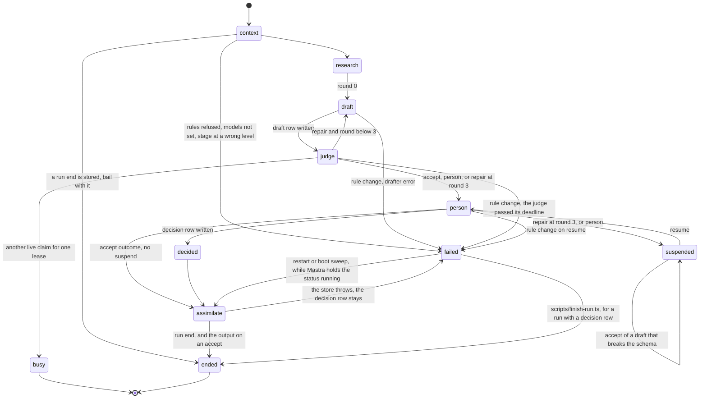

# The stage workflow `stage`

Status. Spec of 2026-11-08 for the unit `plan.stage_workflow` ([the plan](../plans/2026-10-24-harness-plan.md)). Shipped 2026-11-08 in [#29](https://github.com/Ronitron007/product-eval-harness/pull/29), at `main` `718a0c1`. The code differs from the sketches in the items of `stage.reconciliation`. Nobody applied the migration `0004_stage_runs.sql` to the live database yet. Written against `main` at `2821755`. Terms are in [glossary.md](../glossary.md).

Review. Two adversaries interrogated this spec at `7fb8f87` on 2026-11-08. Claude ran each repro again on a local Postgres 18, with no model call. The spec folds in each fix whose repro reproduced. `stage.interrogate` lists each finding and its result. The repros are in [the interrogate folder](../research/2026-11-08-stage-interrogate/README.md).

Source. This spec builds on these docs:

- The stage cycle of [rule-graph.md](rule-graph.md) (`graph.stage`, `graph.traversal`).

- The bindings, the repair loop, and the verdict log of [rule-enforcement.md](rule-enforcement.md) (`enforce.binding`, `enforce.repair`, `enforce.audit`).

- The sketch, the models, and the storage of [mastra-mapping.md](mastra-mapping.md) (`mastra.stage_workflow`, `mastra.models`, `mastra.storage`).

- The call site of [compiler.md](compiler.md) (`compile.usage.calls`).

- The judge outcome of [judge-step.md](judge-step.md).

- The tables of [graph-store.md](graph-store.md) and the layers of [data-layers.md](data-layers.md).

Each decision is a row in [decisions.tsv](../decisions.tsv), for Rohan to review. The board is [harness.canvas](../canvas/harness.canvas).

Version. Each Mastra claim is for `@mastra/core` 1.79.0 and `@mastra/pg` 1.32.0. Claude read these embedded docs of the installed package:

- `reference-workflows-workflow-methods-dountil.md`

- `docs-workflows-control-flow.md`

- `docs-workflows-suspend-and-resume.md`

- `docs-workflows-human-in-the-loop.md`

- `docs-workflows-snapshots.md`

- `reference-workflows-run.md`

- `reference-workflows-run-methods-resume.md`

- `reference-workflows-run-methods-restart.md`

- `reference-workflows-step.md`

- `reference-workflows-workflow-state-reader.md`

- `docs-workflows-overview.md` (`restartAllActiveWorkflowRuns`, `autoRestartActiveRuns`)

Claude also read the type `MastraRecoveryConfig` in `dist/mastra/index.d.ts`. It ran the function `parseModelString` of `@mastra/core/llm`.

The probes are in [the probe folder](../research/2026-11-08-stage-workflow-probes/README.md).

## The idea `stage.idea`

The stage workflow runs one stage at one node. It is one Mastra workflow for each stage. Its steps are the parts of `graph.stage`:

1. `context` compiles the rules, records the stage run, and reads the node context.

2. `research` gets the run evidence from the research port.

3. The repair loop runs the nested workflow `draft_and_judge` with `.dountil`. Each round writes one draft row, then the judge step writes the verdict rows of that round.

4. `person` passes an accepted draft on. Otherwise it suspends with the person payload, and it waits for accept or reject. A valid resume writes the person decision first.

5. `assimilate` reads the decision row and writes the run end and, for an accept, the output, in one transaction. It can run again with the same result.

Each top-level step reads the run end first. If the run ended, the step returns the stored end (`stage.reuse_end`).

The judge step decides the judge outcome (`judge.idea`). The stage workflow acts on the outcome kind, and on nothing else.

## Usage `stage.usage`

```ts
import { stageWorkflows, type StageDeps } from '../stage'
// Call site: src/mastra/index.ts. The registry needs no database (stage.registry_no_db).
const deps: StageDeps = { store, planFor, research, drafter, judgeModel }
export const mastra = new Mastra({ storage, workflows: stageWorkflows(deps) })

// Call site: an operator, a test, or Studio. The Mastra run id is the stage run id.
const workflow = mastra.getWorkflow('create_node')
const run = await workflow.createRun()
const result = await run.start({ inputData: { nodeId: 'sunscreen' } })
if (result.status === 'success' && 'busy' in result.result) void result.result.retryAfterMs // start the run id again later
if (result.status === 'success' && 'end' in result.result) void result.result.end // accepted, with result.result.outputId
if (result.status === 'suspended') void result.steps.person // its suspendPayload is a PersonPayload

// Later, from a person. The person step compiles again first (stage.hash_on_resume).
const state = await workflow.getWorkflowRunById(runId)
if (state?.status === 'suspended') {
  const again = await workflow.createRun({ runId })
  const ended = await again.resume({
    step: 'person',
    resumeData: { decision: 'reject', reviewer: 'operator', note: 'Two criteria grade the same thing.' },
  })
  if (ended.status === 'success' && 'end' in ended.result) void ended.result.end // person_rejected, with outputId null
}

// Call site: the operator script, for a run with a decision row and no run end (stage.decision_first).
await finishRun(deps, { runId, stage: 'create_node', nodeId: 'sunscreen', ruleSetHash, round })
```

| Call site | Call | What it gets |
|---|---|---|
| `src/mastra/index.ts` | `stageWorkflows(deps)` of `src/stage/registry.ts` | Four registered workflows. Studio shows them. A run with no model set fails before any call (`stage.registered`). |
| An operator, a test, Studio | `run.start({ inputData: { nodeId } })` | `success` with a `StageResult`, `suspended` with a `PersonPayload`, or `failed`. A start on an ended run id gives the stored end (`stage.reuse_end`). |
| A person | `run.resume({ step: 'person', resumeData })` | `success` with a `StageResult`, `suspended` again with a `refusal`, or `failed` after a rule change |
| A recovery script | `workflow.getWorkflowRunById(runId)` | The status and the suspend payload, from Mastra storage |
| `run.restart()`, the boot sweep | `restartAllActiveWorkflowRuns()` | The last active step runs again. A stored end comes back as `success` (`stage.reuse_end`). |
| `scripts/finish-run.ts` | `finishRun(deps, run)` | The run end of a run that has a decision row and no run end (`stage.decision_first`) |

The result of `run.start` and `run.resume` has one of these Mastra statuses:

| Status | When |
|---|---|
| `success` | The run ended. `result.end` is `accepted`, `person_accepted`, or `person_rejected`. Or the result is `StageBusy`: the judge of the round runs in another process. Start the run id again after `retryAfterMs` (`stage.judge_wait`). |
| `suspended` | The person step waits for a person. |
| `failed` | The rules refused, the models are not set, the rules changed, the drafter or the store threw, or a bug. No run end row exists. A decision row can exist: `scripts/finish-run.ts` ends that run. |

The stage workflow uses `bail` only to return a stored end. `bail` gives `success`, verified (ran `mastra-semantics.ts`). It uses no sleep and no processor tripwire, so it never gives `tripwire`, inferred (read `reference-workflows-run.md`). A second resume throws `WORKFLOW_RUN_NOT_SUSPENDED` or `WORKFLOW_RESUME_ALREADY_CLAIMED` (`stage.end_once`).

## Types `stage.types`

The probe `sketch.ts` type-checks these types against the real types in `src/` (exit code 0).

```ts
// src/stage/types.ts (new), src/stage/drafter.ts (new)
export const REPAIR_BUDGET = 3 // rounds: one draft and two repairs (mastra.stage_workflow)
export const Sha256 = z.string().regex(/^[0-9a-f]{64}$/)

export const StageInput = z.object({ nodeId: NodeId }).strict()

// stage.claim_lease, stage.judge_wait: the claim lease is longer than the judge deadline.
export interface Timing { readonly claimLeaseMs: number; readonly judgeDeadlineMs: number; readonly pollMs: number }
export const TIMING: Timing = { claimLeaseMs: 15 * 60_000, judgeDeadlineMs: 10 * 60_000, pollMs: 2_000 }

// stage.judge_wait: the outcome of a round whose judge runs in another process, after one lease.
export const Busy = z.object({ kind: z.literal('busy'), retryAfterMs: z.number().int().min(0) }).strict()
export const RoundOutcome = z.union([JudgeStepOutput, Busy])
export type RoundOutcome = z.infer<typeof RoundOutcome>

// The context bundle of graph.traversal that exists today. Records come with plan.research_tools.
export const NodeContext = z.object({
  path: z.array(z.object({ id: NodeId, label: z.string() })), // from the root down to the node
  siblings: z.array(z.object({ id: NodeId, label: z.string() })),
  instructions: z.string(), // plan.instructions: the strict and soft rules in scope
})
export type NodeContext = z.infer<typeof NodeContext>

// The loop state. Each field is JSON, so the snapshot holds it (compile.limits).
export const Round = z.object({
  runId: z.string().min(1),
  stage: Stage,
  nodeId: NodeId,
  ruleSetHash: Sha256,
  context: NodeContext,
  evidence: RunEvidence,
  round: z.number().int().min(0).max(REPAIR_BUDGET), // the rounds so far
  last: RoundOutcome.nullable(), // the outcome of the last round
})
export type Round = z.infer<typeof Round>

export const PersonPayload = z.object({
  runId: z.string().min(1),
  stage: Stage,
  nodeId: NodeId,
  ruleSetHash: Sha256,
  round: z.number().int().min(1).max(REPAIR_BUDGET),
  budget: z.literal(REPAIR_BUDGET),
  why: z.enum(['budget_spent', 'cannot_verify']),
  reply: z.unknown(), // the last draft, as the drafter gave it
  canAccept: z.boolean(), // false when the last draft broke the output schema
  errors: z.array(z.object({ from: z.string(), target: z.string(), fix: z.string() })),
  open: z.array(VerdictInput),
  warnings: z.array(z.object({ rule: z.string(), target: z.string(), kind: z.enum(['warning', 'note']), text: z.string() })),
  refusal: z.string().optional(), // set when a resume asked for what the payload forbids
}).strict()
export type PersonPayload = z.infer<typeof PersonPayload>

// stage.person_payload: a reviewer or a note that is blank after a trim is refused.
const Filled = z.string().trim().min(1)
export const PersonDecision = z.discriminatedUnion('decision', [
  z.object({ decision: z.literal('accept'), reviewer: Filled, note: Filled.optional() }).strict(),
  z.object({ decision: z.literal('reject'), reviewer: Filled, note: Filled }).strict(),
])
export type PersonDecision = z.infer<typeof PersonDecision>

export const RunEnd = z.enum(['accepted', 'person_accepted', 'person_rejected'])
export const StageResult = z.object({ runId: z.string(), end: RunEnd, round: z.number().int().min(1), outputId: z.string().nullable() }).strict()
export type StageResult = z.infer<typeof StageResult>
// A retryable result: start the run id again after retryAfterMs. It is never failed (stage.judge_wait).
export const StageBusy = z.object({ runId: z.string(), busy: z.literal(true), round: z.number().int().min(1), retryAfterMs: z.number().int().min(0) }).strict()
export const StageRunResult = z.union([StageResult, StageBusy])

// ---- ports ----
export interface ResearchInput {
  readonly runId: string
  readonly stage: Stage
  readonly nodeId: NodeId
  readonly context: NodeContext
}
export type ResearchPort = (input: ResearchInput) => Promise<RunEvidence>

export interface DraftInput {
  readonly runId: string
  readonly round: number
  readonly plan: StagePlan
  readonly evidence: RunEvidence
  readonly context: NodeContext
  readonly errors: Extract<JudgeStepOutput, { kind: 'repair' }>['errors'] // the strict errors of the last round, as JSON
}
export interface Drafter {
  readonly id: string // provider/model, kept on each draft row
  draft(input: DraftInput): Promise<unknown> // the raw reply: draft.object, else draft.text
}

export type RunEndInput =
  | { readonly runId: string; readonly round: number; readonly end: 'accepted'; readonly output: unknown }
  | { readonly runId: string; readonly round: number; readonly end: 'person_accepted'; readonly reviewer: string; readonly note?: string; readonly output: unknown }
  | { readonly runId: string; readonly round: number; readonly end: 'person_rejected'; readonly reviewer: string; readonly note: string }
export interface DraftRow { runId: string; round: number; reply: unknown; drafter: string } // reply: JSON.parse of reply_text (stage.reply_lossless)
// stage.decision_first: one row for each run, written before assimilate runs.
export type DecisionRow = { readonly runId: string; readonly round: number } & PersonDecision
export interface StageStore extends Pick<GraphStore, 'recordStageRun' | 'pathToRoot' | 'siblings'> {
  stageRun(runId: string): Promise<{ runId: string; ruleSetHash: string } | undefined>
  addDraft(row: DraftRow): Promise<void>
  draftOf(runId: string, round: number): Promise<DraftRow | undefined>
  // The judge step: the rows of one round. writeVerdicts of GraphStore gets the round (stage.round_rows).
  writeVerdicts(rows: readonly VerdictInput[], round: number): Promise<unknown>
  verdictsOf(runId: string, round: number): Promise<readonly VerdictInput[]>
  // stage.judge_claim, stage.claim_lease: the new attempt number, or null. It inserts attempt max + 1 only when
  // the latest claim is older than leaseMs and the round has no verdict row.
  claimJudge(runId: string, round: number, leaseMs: number): Promise<number | null>
  // stage.decision_first: an equal row again is a no-op. Another row for the run throws.
  addDecision(row: DecisionRow): Promise<void>
  decisionOf(runId: string): Promise<DecisionRow | undefined>
  // stage.reuse_end: the stored end of a run, or undefined.
  runEndOf(runId: string): Promise<StageResult | undefined>
  // One transaction: the run_ends row, then the output for an accepting end (stage.end_once).
  // An equal end that is stored already returns the stored result. Another end throws.
  endRun(input: RunEndInput): Promise<StageResult>
}

export interface StageDeps {
  readonly store: StageStore
  readonly planFor: PlanFor
  readonly research: ResearchPort
  readonly drafter: Drafter
  readonly judgeModel: JudgeModel
  readonly timing?: Timing // tests give short times. Default TIMING.
}

// The agent adapter for a real drafter (plan.stage_workflow). errorStrategy warn keeps a bad reply.
export function agentDrafter(agent: Agent, id: string): Drafter {
  return {
    id,
    async draft({ plan, evidence, context, errors }) {
      const prompt = JSON.stringify({ context, evidence, errors })
      const out = await agent.generate(prompt, { structuredOutput: { schema: plan.schema, errorStrategy: 'warn' } })
      return out.object !== undefined ? out.object : out.text
    },
  }
}
```

## The workflow `stage.workflow`

The probe `sketch.ts` type-checks this sketch (exit code 0). The probe `run-sketch.ts` runs a copy of it with fake ports. The declared functions `planOrThrow`, `judgeOnce`, and `outcomeOf` are the parts that `stage.decisions` defines.

```ts
// src/stage/workflow.ts (new), src/stage/registry.ts (new)
// ---- the workflow (src/stage/workflow.ts) ----
declare function planOrThrow(deps: StageDeps, run: { runId: string; stage: Stage; nodeId: NodeId; ruleSetHash?: string }): Promise<StagePlan>
// stage.models_by_vendor: the vendor behind a model id. A gateway id, such as openrouter/anthropic/x, names its vendor first in the model part.
export function vendorOf(id: string): string {
  const { provider, modelId } = parseModelString(id)
  if (!provider || !modelId) throw new Error(`The model id ${JSON.stringify(id)} is not provider/model. Set HARNESS_DRAFTER_MODEL and HARNESS_JUDGE_MODEL.`)
  return modelId.includes('/') ? modelId.split('/')[0]! : provider
}
export function checkModels(drafterId: string, judgeId: string): void {
  if (vendorOf(drafterId) === vendorOf(judgeId)) throw new Error(`The judge ${judgeId} and the drafter ${drafterId} have one vendor. Use a judge from another vendor (mastra.models).`)
}

// judgeStep with the round in its input (src/judge/mastra.ts, changed): the shape of the changed step.
export const JudgeStepInput = z.object({ runId: z.string().min(1), stage: Stage, nodeId: NodeId, ruleSetHash: Sha256, round: z.number().int().min(1), reply: z.unknown(), evidence: z.unknown() })
// judgeDraft with the judge model, with no write (src/judge/step.ts).
declare function judgeOnce(deps: StageDeps, input: z.infer<typeof JudgeStepInput>, plan: StagePlan): Promise<{ rows: readonly VerdictInput[]; output: JudgeStepOutput }>
// decideOutcome on stored rows and plan.decode of the reply. No model.
declare function outcomeOf(plan: StagePlan, input: z.infer<typeof JudgeStepInput>, rows: readonly VerdictInput[]): JudgeStepOutput
const sleep = (ms: number) => new Promise(r => setTimeout(r, ms))

// stage.rerun_reuses, stage.judge_claim, stage.claim_lease, stage.judge_wait
export async function judgeRound(deps: StageDeps, input: z.infer<typeof JudgeStepInput>): Promise<RoundOutcome> {
  const plan = await planOrThrow(deps, input)
  const t = deps.timing ?? TIMING
  const stored = await deps.store.verdictsOf(input.runId, input.round)
  if (stored.length > 0) return outcomeOf(plan, input, stored) // reuse: no call, no write
  let attempt = await deps.store.claimJudge(input.runId, input.round, t.claimLeaseMs)
  if (attempt === null) {
    // Another attempt holds a live claim. Wait up to one lease for its rows, or for its claim to expire.
    for (const until = Date.now() + t.claimLeaseMs; attempt === null && Date.now() < until; ) {
      await sleep(t.pollMs)
      const rows = await deps.store.verdictsOf(input.runId, input.round)
      if (rows.length > 0) return outcomeOf(plan, input, rows)
      attempt = await deps.store.claimJudge(input.runId, input.round, t.claimLeaseMs)
    }
    if (attempt === null) return { kind: 'busy', retryAfterMs: t.claimLeaseMs }
  }
  const started = Date.now()
  const judged = await judgeOnce(deps, input, plan)
  if (Date.now() - started > t.judgeDeadlineMs) throw new Error(`The judge of round ${input.round} passed its deadline, so its claim may have expired. It writes nothing.`)
  try {
    await deps.store.writeVerdicts(judged.rows, input.round)
  } catch (e) {
    const rows = await deps.store.verdictsOf(input.runId, input.round) // the unique key: another attempt wrote first
    if (rows.length === 0) throw e
    return outcomeOf(plan, input, rows)
  }
  return judged.output
}
function judgeStep(deps: StageDeps) {
  return createStep({ id: 'judge', inputSchema: JudgeStepInput, outputSchema: RoundOutcome, execute: async ({ inputData }) => judgeRound(deps, inputData) })
}

// stage.decision_first: the body of assimilate, and the operator path of scripts/finish-run.ts.
// It is idempotent: a stored end comes back unchanged.
export async function finishRun(deps: StageDeps, run: { runId: string; stage: Stage; nodeId: NodeId; ruleSetHash: string; round: number }): Promise<StageResult> {
  const ended = await deps.store.runEndOf(run.runId)
  if (ended !== undefined) return ended
  const plan = await planOrThrow(deps, run)
  const kept = await deps.store.draftOf(run.runId, run.round)
  const d = await deps.store.decisionOf(run.runId)
  if (d !== undefined && d.round !== run.round) throw new Error(`The decision of run ${run.runId} is for round ${d.round}, not ${run.round}.`)
  if (d?.decision === 'reject') return deps.store.endRun({ runId: run.runId, round: run.round, end: 'person_rejected', reviewer: d.reviewer, note: d.note })
  const decoded = plan.decode(kept?.reply)
  if (!decoded.ok) throw new Error('The draft breaks the output schema. It never reaches acceptOutput.')
  return d === undefined
    ? deps.store.endRun({ runId: run.runId, round: run.round, end: 'accepted', output: decoded.output })
    : deps.store.endRun({ runId: run.runId, round: run.round, end: 'person_accepted', reviewer: d.reviewer, note: d.note, output: decoded.output })
}

export function stageWorkflow(stage: Stage, deps: StageDeps) {
  const context = createStep({
    id: 'context',
    inputSchema: StageInput,
    outputSchema: Round.pick({ runId: true, stage: true, nodeId: true, ruleSetHash: true, context: true }),
    execute: async ({ inputData, runId, bail }) => {
      const ended = await deps.store.runEndOf(runId) // stage.reuse_end: a second start, a restart, or the boot sweep
      if (ended !== undefined) return bail(ended)
      checkModels(deps.drafter.id, deps.judgeModel.id) // before any compile, write, or model call
      const plan = await planOrThrow(deps, { runId, stage, nodeId: inputData.nodeId })
      const known = await deps.store.stageRun(runId)
      if (known === undefined) await deps.store.recordStageRun({ runId, stage, nodeId: inputData.nodeId, ruleSetHash: plan.ruleSetHash })
      else if (known.ruleSetHash !== plan.ruleSetHash) throw new Error(`The rules changed during run ${runId}. Start a new run.`)
      const [path, siblings] = await Promise.all([deps.store.pathToRoot(inputData.nodeId), deps.store.siblings(inputData.nodeId)])
      const pick = (n: { id: string; label: string }) => ({ id: n.id, label: n.label })
      const context = { path: path.map(pick), siblings: siblings.map(pick), instructions: plan.instructions }
      return { runId, stage, nodeId: inputData.nodeId, ruleSetHash: plan.ruleSetHash, context }
    },
  })

  const research = createStep({
    id: 'research',
    inputSchema: context.outputSchema,
    outputSchema: Round,
    execute: async ({ inputData, bail }) => {
      const ended = await deps.store.runEndOf(inputData.runId)
      if (ended !== undefined) return bail(ended)
      const evidence = RunEvidence.parse(await deps.research(inputData))
      return { ...inputData, evidence, round: 0, last: null }
    },
  })

  const draft = createStep({
    id: 'draft',
    inputSchema: Round,
    outputSchema: JudgeStepInput,
    execute: async ({ inputData }) => {
      const round = inputData.round + 1
      if (round > REPAIR_BUDGET) throw new Error('The repair budget is spent. The loop must not start another round.')
      const plan = await planOrThrow(deps, inputData)
      const kept = await deps.store.draftOf(inputData.runId, round)
      const errors = inputData.last?.kind === 'repair' ? inputData.last.errors : []
      const reply = kept !== undefined ? kept.reply : await deps.drafter.draft({ runId: inputData.runId, round, plan, evidence: inputData.evidence, context: inputData.context, errors })
      if (kept === undefined) await deps.store.addDraft({ runId: inputData.runId, round, reply, drafter: deps.drafter.id })
      return { runId: inputData.runId, stage: inputData.stage, nodeId: inputData.nodeId, ruleSetHash: inputData.ruleSetHash, round, reply, evidence: inputData.evidence }
    },
  })

  const draftAndJudge = createWorkflow({ id: `${stage}.draft_and_judge`, inputSchema: Round, outputSchema: Round })
    .then(draft)
    .then(judgeStep(deps))
    .map(async ({ inputData, getInitData }) => {
      const before = getInitData<Round>()
      return { ...before, round: before.round + 1, last: inputData }
    })
    .commit()

  const person = createStep({
    id: 'person',
    inputSchema: Round,
    outputSchema: Round.omit({ context: true, evidence: true, last: true }).extend({ decision: PersonDecision.nullable() }),
    suspendSchema: PersonPayload,
    resumeSchema: PersonDecision,
    execute: async ({ inputData, resumeData, suspend, bail }) => {
      const ended = await deps.store.runEndOf(inputData.runId)
      if (ended !== undefined) return bail(ended)
      const last = inputData.last
      if (last === null) throw new Error('The loop ended with no round.')
      if (last.kind === 'busy') return bail({ runId: inputData.runId, busy: true, round: inputData.round, retryAfterMs: last.retryAfterMs }) // stage.judge_wait
      const { context: _c, evidence: _e, last: _l, ...run } = inputData
      if (last.kind === 'accept') return { ...run, decision: null }
      const plan = await planOrThrow(deps, inputData) // stage.hash_on_resume: also on the first pass
      const kept = await deps.store.draftOf(inputData.runId, inputData.round)
      const payload: PersonPayload = {
        runId: inputData.runId, stage: inputData.stage, nodeId: inputData.nodeId, ruleSetHash: inputData.ruleSetHash,
        round: inputData.round, budget: REPAIR_BUDGET, why: last.kind === 'repair' ? 'budget_spent' : 'cannot_verify',
        reply: kept?.reply, canAccept: kept !== undefined && plan.decode(kept.reply).ok,
        errors: last.kind === 'repair' ? last.errors : [], open: last.kind === 'person' ? last.open : [], warnings: last.warnings,
      }
      if (resumeData === undefined) return await suspend(payload)
      if (resumeData.decision === 'accept' && !payload.canAccept) {
        return await suspend({ ...payload, refusal: 'The last draft breaks the output schema, so a person cannot accept it. Reject it.' })
      }
      await deps.store.addDecision({ runId: inputData.runId, round: inputData.round, ...resumeData }) // stage.decision_first
      return { ...run, decision: resumeData }
    },
  })

  const assimilate = createStep({
    id: 'assimilate',
    inputSchema: person.outputSchema,
    outputSchema: StageResult,
    // It reads the decision row, not its input, so a retry gives the same end (stage.decision_first).
    execute: async ({ inputData }) => finishRun(deps, inputData),
  })

  return createWorkflow({ id: stage, description: `The stage ${stage} at one node (graph.stage).`, inputSchema: StageInput, outputSchema: StageRunResult })
    .then(context)
    .then(research)
    .dountil(draftAndJudge, async ({ inputData, iterationCount }) => inputData.last?.kind !== 'repair' || iterationCount >= REPAIR_BUDGET)
    .then(person)
    .then(assimilate)
    .commit()
}

// ---- the registry (src/stage/registry.ts): no database, no environment (stage.registry_no_db) ----
export const STAGE_WORKFLOWS = ['define_criteria', 'create_node', 'create_pack', 'create_layout'] as const
export function stageWorkflows(deps: StageDeps) {
  return {
    define_criteria: stageWorkflow('define_criteria', deps),
    create_node: stageWorkflow('create_node', deps),
    create_pack: stageWorkflow('create_pack', deps),
    create_layout: stageWorkflow('create_layout', deps),
  }
}
```

The parts that the sketch declares:

- `planOrThrow(deps, run)` calls `deps.planFor`. It throws `RulesRefused` with all problems when the compile refuses. It throws "The rules changed during run" when the run has a hash and the plan has another hash.

- `judgeOnce(deps, input, plan)` runs `judgeDraft` with the judge model and writes nothing.

- `outcomeOf(plan, input, rows)` runs `plan.decode` on the reply and `decideOutcome` on stored rows. It calls no model.

- `judgeRound` replaces the body of the shipped step of `src/judge/mastra.ts`. Its order is in `stage.judge_claim`, `stage.claim_lease`, and `stage.judge_wait`.

## States `stage.states`



`ended` is one of the run ends `accepted`, `person_accepted`, and `person_rejected`.

| State | Mastra status | Rows in the store |
|---|---|---|
| `failed` before `context` writes | `failed` | None |
| `failed` after `context` | `failed` | The stage run, each draft, the judge claim and the verdicts of each judged round. No run end. |
| `suspended` | `suspended` | The stage run, each draft, and the verdicts of each round |
| `decided`, then a crash or a store error | `running` or `failed` | Also one decision row. A restart, the boot sweep, or `scripts/finish-run.ts` ends the run. |
| `accepted`, `person_accepted` | `success` | Also one run end row and one output |
| `person_rejected` | `success` | Also one decision row and one run end row. No output. |
| A second start, a restart, or the boot sweep after an end | `success` | No new row. The result is the stored end. |
| `busy` | `success`, with a `StageBusy` result | The rows that existed. No judge call. The boot sweep does not restart it. The caller starts the run id again. |
| A crash after a judge claim | `running` | One claim row and no verdict row. After the claim lease, the boot sweep takes attempt 2 and finishes the run. |

Mastra runs the boot sweep `restartAllActiveWorkflowRuns()` by default. `MastraRecoveryConfig.workflows` has the default `auto`, verified (read `dist/mastra/index.d.ts`). The sweep restarts each run with the status `running` or `waiting`, after the lease of its process lapses. The lease was 15 seconds in the repros (`stage.interrogate`).

## The store changes `stage.store`

The new migration `db/migrations/0004_stage_runs.sql` adds five tables and changes two tables, in schema `harness`. Like each migration, it lives in RealDose and Rohan applies it. It is a live-system change and needs his yes (`rules.gates`). The prototype [0004_stage_runs.sql](../research/2026-11-08-stage-workflow-probes/0004_stage_runs.sql) holds the text. The probe `migration.ts` applies it twice and then `0003_harness_role.sql` again, and tests each rule below as `harness_app`, verified (ran, exit code 0).

| Table | Change | Key columns and checks |
|---|---|---|
| `harness.drafts` | New | `run_id` (references `stage_runs`), `round` (1 to 3), `reply_text` (text, null only with an error), `reply` (JSON, may be null), `error` (such as `drafter deadline`, not blank), `drafter` (`provider/model`), `created_at`. Primary key `(run_id, round)`. |
| `harness.draft_claims` | New | `run_id` (references `stage_runs`), `round` (1 to 3), `attempt` (1 or more), `claimed_at`. Primary key `(run_id, round, attempt)`. |
| `harness.judge_claims` | New | `run_id`, `round`, `attempt` (1 or more), `claimed_at`. Primary key `(run_id, round, attempt)`. `(run_id, round)` references `drafts`. |
| `harness.person_decisions` | New | `run_id` (primary key), `round`, `decision` (`accept`, `reject`), `reviewer`, `note`, `created_at`. `(run_id, round)` references `drafts`. The reviewer and a note are not blank after a trim. A reject needs a note. |
| `harness.run_ends` | New | `run_id` (primary key, references `stage_runs`), `round`, `end` (`accepted`, `person_accepted`, `person_rejected`), `reviewer`, `note`, `created_at`. `(run_id, round)` references `drafts`, and it is unique, so that `outputs` can reference it. Only a person end has a `reviewer`. `person_rejected` needs a `note`. |
| `harness.verdicts` | Adds `round` (not null, 1 to 3) and a unique key | `(run_id, round)` references `drafts`. The unique key is `(run_id, round, rule_id, rule_version, target)`. |
| `harness.outputs` | Adds `round` (not null) and a unique key on `run_id` | `(run_id, round)` references `run_ends`. |

Four triggers and one function hold the other rules in the database:

- An insert of a `verdicts` row fails when the run has a run end (`stage.round_closed`).

- An insert of a `person_decisions` row fails when the run has a run end (`stage.decision_closed`).

- An insert of a `run_ends` row with `end` `accepted` needs at least one `strict` verdict row of that run and round. Each `strict` row of that round must be `pass`. The run must have no decision row. A person end needs the equal decision row: the same round, decision, reviewer, and note.

- An insert of an `outputs` row needs a `run_ends` row of the same run and round, with `end` `accepted` or `person_accepted`.

- `harness.try_jsonb(text)` gives the JSON value of a text, or null when JSON refuses it (`stage.reply_lossless`). `harness_app` has the right to run it.

The database cannot know the plan. So it cannot check that each rule of the plan has a row. Only code holds that rule (`judge.outcome_total`). The database holds only "at least one strict row, and each strict row is pass".

The migration follows `store.safety`. It adds the append-only triggers, row level security with a policy for `harness_app` (select and insert), and the revokes from `PUBLIC`, `anon`, and `authenticated`. It ends with the guard block of `0003_harness_role.sql`, so the guard also covers the new tables and functions. Each statement is idempotent. Before the first stage run, `verdicts` and `outputs` are empty. So the new not-null columns need no default. Inferred: nobody applied the #12 migration yet.

The store gets these calls:

| Call | Status | What it does |
|---|---|---|
| `stageRun(runId)` | New | Reads one stage run, or `undefined` |
| `addDraft(row)` | New | Inserts one draft row: `reply_text` is `JSON.stringify(reply)`, and `reply` is `harness.try_jsonb(reply_text)`. A second row for one round fails on the primary key. |
| `draftOf(runId, round)` | New | Reads one draft row. `reply` is `JSON.parse(reply_text)`, so it equals the reply of the drafter. |
| `claimDraft(runId, round, leaseMs)` | New | Inserts the draft claim of attempt max + 1 in one statement, as `claimJudge`. It inserts only when the latest claim is older than `leaseMs` and the round has no draft row. It gives the attempt number, or `null` (`stage.draft_claim`). |
| `claimJudge(runId, round, leaseMs)` | New | Inserts the claim of attempt max + 1 in one statement. It inserts only when the latest claim is older than `leaseMs` and the round has no verdict row. It gives the attempt number, or `null`. The SQL is in `pg-env.ts`. |
| `writeVerdicts(rows, round)` | Changed | Adds `round` to each row. One statement, all rows or none. |
| `verdictsOf(runId, round)` | New | Reads the rows of one round, as `VerdictInput` |
| `addDecision(row)` | New | Inserts the decision row. An equal row that exists is not an error. Another row for the run fails. |
| `decisionOf(runId)` | New | Reads the decision row, or `undefined` |
| `runEndOf(runId)` | New | Reads the run end as a `StageResult`, or `undefined` |
| `endRun(input)` | New | One transaction: the `run_ends` row, then the output for an accepting end. An equal end that exists gives the stored result. Another end fails. |
| `acceptOutput(input)` | Changed | It takes `round`. Only `endRun` calls it, inside the transaction. |

## Decisions `stage.decisions`

Claude took each decision below for Rohan on 2026-11-08, while it wrote this spec. Each has a mechanism and tests that fail when the mechanism breaks. Each has a row in [decisions.tsv](../decisions.tsv).

### The draft log `stage.draft_log`

Decision. Each draft lives in the new append-only table `harness.drafts`, one row for each round. Failed drafts and the accepted draft live there.

Why. `enforce.repair` says that the harness never throws a reply away or overwrites it. The three places compare like this:

| Place | Fit | Result |
|---|---|---|
| The Mastra snapshot | Mastra updates one snapshot row for each run. In schema `mastra`, `harness_app` can update and delete rows (`store.safety`). | Rejected. It is not append-only. |
| Object storage (`data.artifacts`) | Not built (`data.open`). A draft is small JSON, and its verdicts need a foreign key to it. | Rejected for now. A large reply can move there later, with its hash in the row. |
| A new table `harness.drafts` | The append-only triggers, row level security, and the guard of `store.safety` apply. The verdicts of a round can reference it. | Chosen |

Mechanism:

- The draft step writes the reply with `addDraft` before it returns. So the reply is in the store before the judge step runs.

- The foreign key from `verdicts (run_id, round)` to `drafts` refuses a verdict row whose draft is not stored.

- The primary key `(run_id, round)` and the append-only trigger refuse a second reply for one round.

- The store keeps a reply that breaks the output schema as it came: the object, else the text.

Tests: `lost_draft.each_round_kept`, `lost_draft.verdict_needs_draft`, `lost_draft.no_overwrite`, `lost_draft.broken_reply_kept`.

### Rows of each round `stage.round_rows`

Decision. The verdict rows of each round go to `harness.verdicts` in that round, with the round number. The assimilate step writes no verdict.

Why. The brief of this spec says that the store writes verdicts only with an accepted output. The code differs, verified (read `src/judge/mastra.ts` at `2821755`): `judgeStep` writes the rows of each draft in each round. The formal finding `verdicts.no_round` says that no column names the round ([the formal check](../research/2026-11-02-formal-check.md)). So the rows of a failed round and the rows of the accepted round look the same.

Mechanism:

- `JudgeStepInput` gets `round`. The draft step gives it.

- `judgeStep` calls `store.writeVerdicts(rows, round)`. The store adds `round` to each row.

- `VerdictInput` does not change, so `judgeDraft`, `decideOutcome`, and the runtime fingerprint do not change (`judge.runtime_pinned`). Only `src/judge/mastra.ts` changes, which is not a runtime file.

- The foreign key to `drafts` ties each row to its draft.

- An output keeps its round. So the rules that it passed are the verdict rows of its run and round (`enforce.audit`).

Tests: `no_round.rows_name_round`, `no_round.output_finds_its_rows`.

### The research port `stage.research_port`

Decision. The research step calls an injected `ResearchPort`. The port returns `RunEvidence`. Tests use a stub that returns fixed evidence and makes no network call.

Why. `plan.research_tools` is not built. The judge step already reads `RunEvidence` (`judge.evidence_parsed`), so the port returns that type.

Mechanism:

- The research step parses the result with `RunEvidence.parse`. Bad evidence fails the step before any draft.

- The stub `stubResearch(evidence)` lives in `tests/stage/helpers.ts`. It returns its evidence and counts its calls.

- Until `plan.research_tools` ships, `src/mastra/index.ts` uses `unbuiltResearch`. It throws "The research tools are not built (plan.research_tools)". So a real run stops before the drafter.

- `plan.research_tools` replaces `unbuiltResearch` with a port over `get_node_context`, `search_records`, `web_fetch`, and `web_search`. It also writes the research records.

Tests: `model_call.stub_research_only`, `model_call.unbuilt_research_stops`.

### Injected models `stage.models_injected`

Decision. `StageDeps` injects the drafter and the judge model. Tests use `createMockModel` for both. A real run is a paid run, and it needs Rohan's yes for its prompt, model, and cost (`rules.gates`).

How a real run picks them (`mastra.models`):

- `src/mastra/index.ts` reads `HARNESS_DRAFTER_MODEL` and `HARNESS_JUDGE_MODEL`. Each value is a `provider/model` id.

- Before the first use of an id, check it with the provider registry script of the `mastra` skill (`rules.mastra`).

- The default drafter is a `ClaudeSDKAgent` on the Claude CLI, through `agentDrafter`. The judge uses another provider than the drafter.

- `@mastra/claude` is not in `package.json` yet. The unit that makes the first real run, `plan.define_criteria`, pins it.

Mechanism:

- `checkModels` runs in the context step, before any compile, write, or model call. It refuses an id that is not `provider/model`, and two ids with one vendor (`stage.models_by_vendor`). An unset variable gives an empty id, so the run fails.

- Tests build the drafter as `agentDrafter(new Agent({ model: createMockModel(...) }), 'drafter/mock')`. The judge model is `mockModel` of `tests/judge/helpers.ts`, with the id `mock/judge`. The two providers differ.

- The setup file `tests/setup/no-network.ts` fails each test that calls `fetch` (`judge.no_network`).

Tests: `model_call.stage_zero_fetch`, `model_call.mock_drafter_only`, `model_call.unset_model_refuses`, `self_judge.same_provider_refused`, `self_judge.gateway_same_vendor_refused`.

### Hash on resume `stage.hash_on_resume`

Decision. Each step that needs the plan compiles again and refuses another rule-set hash. This includes the person step on each pass and the assimilate step. So a resume after a rule change fails, for accept and for reject.

Why. `compile.usage.calls` says that a resume after a rule change gets another hash and refuses. PR [#24](https://github.com/Ronitron007/product-eval-harness/pull/24) shows the gap of the old sketch (`harness_run.resume_after_rule_change`). In that sketch, neither the person step nor assimilate compiled. So a person could accept an output under old rules.

Mechanism:

- `planOrThrow` compares `plan.ruleSetHash` with the hash of the run. The person step calls it before it builds the payload. Mastra runs the person step from its top on each resume, verified (ran `mastra-semantics.ts`). So each resume compiles first.

- The run then has the status `failed`. A failed run cannot resume. The drafts and verdicts stay. No run end row exists.

- A reject also refuses. One rule for each resume is simpler, and a reject after a rule change has no rules to name. The person starts a new run.

Tests: `rule_drift.resume_accept_refused`, `rule_drift.resume_reject_refused`, `rule_drift.context_rerun_refused`.

### Reject `stage.reject_end`

Decision. A reject writes one `harness.run_ends` row with `end` `person_rejected`, the reviewer, and the note. It writes no output. The run ends at the assimilate step, with the Mastra status `success` and `result.end` `person_rejected`.

Why. A reject is a decision of a person, so the log must keep it (`enforce.audit`). A run that ends with no row would look like a run that is still open. The person step does not `bail` on a reject, so that one function, `finishRun`, writes each run end.

Mechanism:

- `PersonDecision` needs a `note` for a reject that is not blank after a trim. Mastra refuses other resume data and keeps the run suspended, verified (ran `suspend-schemas.ts`).

- The person step writes the decision row first (`stage.decision_first`). Then assimilate writes the run end from that row.

- `endRun` writes no output for `person_rejected`. The outputs trigger refuses an output without an accepting run end.

- The drafts and the verdicts of each round stay.

Tests: `reject_writes.no_output`, `reject_writes.end_row_with_note`, `reject_writes.note_required`, `reject_writes.blank_note_refused`, `reject_writes.output_trigger_refuses`.

### One end `stage.end_once`

Decision. A run ends once. A second resume writes nothing, and the database refuses a second decision, a second run end, or a second output.

Why. The same run id can come back twice, for example from a button that a person presses twice. Two writes of one output would break `verdicts.outputs_per_run`.

Mechanism, in three layers:

- Mastra. A resume claims the run by an atomic move from `suspended` to `running`. A second caller at the same time gets `WORKFLOW_RESUME_ALREADY_CLAIMED`, and a later caller gets `WORKFLOW_RUN_NOT_SUSPENDED`. Verified (ran `mastra-semantics.ts` on `InMemoryStore`). `@mastra/pg` 1.32.0 reports `supportsConcurrentUpdates()` as true, verified (read `dist/index.js`).

- The person step writes only the decision row, and only on a valid resume. An equal row again is not an error, so a body that runs again changes nothing.

- The database. `person_decisions.run_id` and `run_ends.run_id` are primary keys, and `outputs.run_id` is unique. `endRun` writes the run end and the output in one transaction. A second equal call gives the stored end (`stage.reuse_end`). Another end fails and leaves no row.

Tests: `double_write.second_resume_refused`, `double_write.concurrent_resume_one_end`, `double_write.end_run_twice_one_end`, `double_write.person_body_one_decision`.

### A step that runs again `stage.rerun_reuses`

Decision. A step that runs again for the same run reuses what the store holds. It never calls a model again for a stored round.

Why. Mastra runs a suspended step from its top on resume. `run.restart()` and the boot sweep run the last active step again after a crash (`stage.states`). `timeTravel` runs a step again from a snapshot. A second model call costs money, and a second row would break the log.

Mechanism:

- Context. `stageRun(runId)` returns the stored run. The same hash reuses it. Another hash refuses.

- Draft. `draftOf(runId, round)` returns the stored reply. The drafter is not called. Two draft steps of one round at the same time are `stage.draft_claim`.

- Judge. `judgeStep` reads `verdictsOf(runId, round)` first. If rows exist, it runs `plan.decode` on the reply and `decideOutcome` on the stored rows. It calls no judge and writes nothing. Two judge steps of one round at the same time are `stage.judge_claim`.

- Person. It writes one decision row at most (`stage.end_once`).

- Assimilate. `finishRun` gives the stored end (`stage.reuse_end`).

Tests: `double_write.context_rerun_one_run_row`, `double_write.draft_reused_on_rerun`, `double_write.judge_reused_on_rerun`.

### The person payload `stage.person_payload`

Decision. The person step suspends with a `PersonPayload`, and it resumes with a `PersonDecision`.

What a person sees:

- The run: `runId`, `stage`, `nodeId`, and `ruleSetHash`.

- `why`: `budget_spent` when the last outcome was `repair` at round 3, or `cannot_verify` when it was `person`.

- `round` and `budget`.

- `reply`: the last draft, as the drafter gave it.

- `errors`: the strict errors of the last round, with their fixes.

- `open`: the strict rows that are not pass.

- `warnings`: the soft fails and soft notes.

- `canAccept`: `false` when the last draft breaks the output schema.

- `refusal`: set when a resume asked for what the payload forbids.

What a person sends back:

- `{ decision: 'accept', reviewer, note? }`.

- `{ decision: 'reject', reviewer, note }`.

`reviewer` is a handle of the operator. It goes into the database only, never into this repo. `PersonDecision` and the checks of `person_decisions` and `run_ends` refuse a reviewer or a note that is blank after a trim. The interrogate run showed that `z.string().min(1)` took a single space (`stage.interrogate`).

Mechanism:

- `suspendSchema: PersonPayload`. A suspend with a payload that breaks it fails the run, verified (ran `suspend-schemas.ts`). So a run never suspends with no payload.

- `resumeSchema: PersonDecision`. Other resume data throws `WORKFLOW_SCHEMA_VALIDATION_FAILED`, and the run stays suspended. Verified (ran `suspend-schemas.ts`).

- An accept with `canAccept` false suspends again with a `refusal`. A step can suspend again after a resume, verified (ran `mastra-semantics.ts`). This closes the PR #24 finding `harness_run.reviewer_lands_broken_schema`. The decode gate is the only door to the graph (`scorers.closed_output`).

- A person can accept a draft that decodes but has strict fails. A person decides when the budget is spent (`enforce.binding`). The run end `person_accepted` records that decision.

Tests: `empty_payload.schema_refuses`, `empty_payload.payload_holds_draft`, `empty_payload.blank_reviewer_refused`, `broken_accept.resuspends_with_refusal`, `broken_accept.never_reaches_store`.

### Loop on the outcome `stage.loop_on_outcome`

Decision. The loop and the person step read only the kind of the judge outcome. They never read a verdict row.

Why. The sketch of `mastra.stage_workflow` stops the loop on an empty error list, and the person step reads the strict verdicts. PR #24 shows two gaps of that sketch. A draft with an extra key gives no fail row, so it could pass at round 3 (`harness_run.extra_key_accepted`). A watch rule must also never block. The judge step already holds both rules in `decideOutcome` (`judge.decode_repairs`, `judge.watch_inert`).

Mechanism:

- The `.dountil` condition is `last.kind !== 'repair' || iterationCount >= REPAIR_BUDGET`. On `@mastra/core` 1.79.0 the first condition call has `iterationCount` 1, verified (ran `mastra-semantics.ts`). So the loop makes at most 3 rounds.

- The person step passes only `accept` through. `repair` at round 3 and `person` suspend.

- The draft step refuses round 4. `Round.round` has the maximum `REPAIR_BUDGET`. The database also refuses round 4 (`stage.budget_in_db`).

- The `run_ends` trigger refuses `accepted` with no strict row, or with a strict row that is not pass. This holds only part of `verdicts.accept_without_pass`. The database cannot know the plan, so only code checks that each rule of the plan has a row (`judge.outcome_total`). An earlier text of this spec said that the database holds the whole rule. That was wrong (`stage.interrogate`).

Tests: `extra_key.budget_spent_suspends`, `watch_block.fail_accepts`, `watch_block.cannot_verify_accepts`, `budget_overrun.three_drafts_max`, `budget_overrun.draft_refuses_round_four`, `budget_overrun.accepted_end_needs_pass`, `budget_overrun.accepted_end_needs_strict_row`.

### Registration `stage.registered`

Decision. `src/mastra/index.ts` registers one workflow for each stage: `define_criteria`, `create_node`, `create_pack`, and `create_layout`. `evaluate_product` is not a stage of the graph (`graph.stages`). So it has no workflow.

Mechanism:

- `src/stage/registry.ts` builds the four workflows from given deps (`stage.registry_no_db`). `src/mastra/index.ts` gives it the deps from the environment, as `stage.models_injected` says. With no model set, Studio shows each workflow, and a run fails in the context step before any call.

- The workflow id is the stage name. The nested workflow id is `<stage>.draft_and_judge`.

- A stage at a level where it must not run fails in the context step. `compileStage` gives the problem `stage_not_at_level` (`compile.scope`). Then `planOrThrow` throws before `recordStageRun`.

Tests: `wrong_level.refused_before_any_call`, `flow.registered_four_stages`.

### Decision first `stage.decision_first`

Decision. A valid resume first writes the decision of the person into the new append-only table `harness.person_decisions`, one row for each run. Only then does assimilate run. Assimilate reads that row, and it can always run again with the same result. The operator script `scripts/finish-run.ts` ends a run that has a decision row and no run end. So no accept or reject is lost.

Why. The repro `opus/probe-a.ts` (A1) made `endRun` fail once after a resume with accept. The run became `failed`. A second resume threw `WORKFLOW_RUN_NOT_SUSPENDED`, and no row kept the accept. Reproduced (ran).

Mechanism:

- The person step calls `addDecision` after the checks of `stage.person_payload` and before it returns.

- `finishRun(deps, run)` is the body of assimilate. It reads the run end first, and gives it back when it exists. Else it compiles with the hash of the run, reads the draft and the decision row, and calls `endRun`.

- `scripts/finish-run.ts <runId>` reads the stage run and the decision row, and calls `finishRun`. A rule change since the decision makes it refuse, as `stage.hash_on_resume` says.

- The `run_ends` trigger needs the equal decision row for a person end.

Tests: `lost_accept.decision_kept_on_store_error`, `lost_accept.finish_run_ends_it`, `lost_accept.finish_run_twice_one_end`, `lost_accept.person_end_needs_decision`.

### Reuse the end `stage.reuse_end`

Decision. Each top-level step reads the run end first. When a run end exists, the step returns it with `bail`, and the run gives `success`. A second `start()` on an ended run id, a restart, and the boot sweep get the stored end. They never call research or the drafter again, and they never give `failed`.

Why. Two repros reproduced (ran):

- `opus/probe-a.ts` (A2). A second `start()` on an ended run id called research again, and then failed on the primary key of `run_ends`. The stored Mastra status changed from `success` to `failed`.

- `sonnet/p9_lease.ts` and `sonnet/p9b_lease.ts`. A process died after `endRun` committed. After the lease of 15 seconds lapsed, `run.restart()` and the boot sweep `restartAllActiveWorkflowRuns()` ran assimilate again. Each gave `failed` on the primary key of `run_ends`.

Mechanism:

- `context`, `research`, and `person` call `runEndOf(runId)` first, and `bail` with the stored `StageResult` when it exists.

- `finishRun` gives the stored end when it exists. `endRun` gives the stored end for an equal end.

- The nested steps reuse the stored draft and rows (`stage.rerun_reuses`).

Tests: `double_write.start_on_ended_run`, `double_write.restart_after_end_commit`, `double_write.boot_sweep_after_end_commit`.

### Judge claim `stage.judge_claim`

Decision. Before it calls a judge, the judge step writes a claim row into the new append-only table `harness.judge_claims`. Its primary key is `(run_id, round, attempt)`. Only the caller whose insert wins calls the judge. A caller that loses waits, and then reuses the rows of the round (`stage.judge_wait`). A claim has a lease (`stage.claim_lease`). `harness.verdicts` gets the unique key `(run_id, round, rule_id, rule_version, target)`.

Why. The repro `sonnet/p10_dup.ts` ran two recoveries of one round at the same time. The judge ran twice, and round 1 got 20 rows for 10 rules. Reproduced (ran). The repro `sonnet/p2_migration.ts` wrote two equal rows for one rule, target, and round. Reproduced (ran).

Mechanism:

- `judgeStep` reads `verdictsOf(runId, round)`. Rows that exist give the outcome with no call.

- Else it calls `claimJudge(runId, round, leaseMs)`. The winner calls the judges and writes the rows.

- When `writeVerdicts` fails and the round has rows, another attempt wrote first. The step reuses those rows.

- The unique key refuses a second row for one rule and target in one round. A scorer that gives two rows for one target is a bug, and the write fails.

Tests: `double_write.concurrent_judge_one_call`, `double_write.verdict_row_unique`.

### Draft claim `stage.draft_claim`

Decision. Before it calls the drafter, the draft step writes a claim row into the new append-only table `harness.draft_claims`, with the key `(run_id, round, attempt)`. Only the caller whose insert wins calls the drafter. The claim has the lease of `stage.claim_lease`.

A caller that loses waits up to one lease. It reuses the stored draft, takes a new attempt when the claim expires, or gives `busy`. The run then ends with `StageBusy`, as `stage.judge_wait` says. A loser never ends as `failed`.

Why. The review of `885eb99` ran two starts of a new run id at the same time. One start failed on a primary key, and the drafter got 2 calls. A first fix held a session advisory lock across the drafter call. It held one connection while the draft needed a second connection. 12 runs at the same time on a pool of 10 connections then hung.

Mechanism:

- `claimDraft` is one statement, as `claimJudge`. It inserts nothing while the latest claim is younger than the lease, or when the round has a draft row.

- No connection stays open across the model call. Each claim is a row, not a session lock. So a transaction pooler works for the claims.

- When `addDraft` of a winner fails and the round has a draft, a later attempt wrote first. The step reuses that draft.

- No code renews a claim. A claim stays live for one lease from its insert. A holder that stops loses its claim after one lease, and the next caller then drafts. A caller gets `busy` only when new claims keep the round claimed for its whole wait, as the test `busy_loser.draft_claim_live_gives_busy` does with a second process.

- The drafter call ends at `draftDeadlineMs`, inside the lease (`stage.draft_deadline`). So a live winner always writes the draft row before its claim expires, and no other attempt calls the drafter for that round. Only a crash of the winner lets a later attempt call the drafter again.

Tests: `double_write.concurrent_start_one_draft`, `double_write.pool_twelve_runs`, `busy_loser.draft_claim_live_gives_busy`, `busy_loser.draft_claim_expired_takes_over`.

### Drafter deadline `stage.draft_deadline`

Decision. The drafter has a hard deadline, `draftDeadlineMs` in `TIMING`, shorter than the claim lease. It is 10 minutes inside a lease of 15 minutes, as for the judge. The draft step aborts the call at the deadline with an `AbortSignal`. It keeps the round, and it writes a draft row with no reply and the error `drafter deadline`. The round then fails the decode, so the loop repairs it within the budget. The step never calls the drafter twice for one round.

Why. The verify of `0a540a9` ran a drafter of 2.5 seconds with a lease of 1 second. The claim expired during the call, a second caller took attempt 2, and the drafter ran twice for one round.

Mechanism:

- `DraftInput` gets `abortSignal`. `agentDrafter` gives it to `agent.generate`. The step also stops at the deadline when a drafter does not read the signal. It keeps no late reply.

- `harness.drafts` gets the column `error`. A check needs `reply_text` null exactly when `error` is set. `draftOf` gives `reply` undefined and the error.

Tests: `double_write.drafter_deadline_one_call`.

### Claim lease `stage.claim_lease`

Decision. A judge claim has a lease. A new attempt can claim a round only when the latest claim is older than the lease and the round has no verdict row. The lease is longer than the judge deadline. The times are in `TIMING`:

| Time | Value | Use |
|---|---|---|
| `judgeDeadlineMs` | 10 minutes | A winner that judged for longer writes nothing, and its step fails. |
| `draftDeadlineMs` | 10 minutes | The draft step aborts the drafter call at this time, and it writes a draft row with the error `drafter deadline` (`stage.draft_deadline`). |
| `claimLeaseMs` | 15 minutes | A new attempt can take a claim older than this. A loser waits at most this long. |
| `pollMs` | 2 seconds | A loser reads the rows at this interval. |

Why. The verify of `12053b7` killed a process after `claimJudge` (`opus-verify/crash.ts`). After the boot sweep, and after a new start, the run failed with "The judge of round 1 runs elsewhere and wrote no rows". The run could never end. Reproduced (ran).

Mechanism:

- `claimJudge` inserts attempt max + 1 in one statement, with `on conflict do nothing`. The primary key lets one caller win each attempt.

- The statement inserts nothing while the latest claim is younger than the lease, or when the round has a verdict row.

- The winner measures its judge time. Past `judgeDeadlineMs`, it throws before `writeVerdicts`. A late write that still lands fails on the unique key of `verdicts`, so the rows of one attempt stay.

- A test gives short times through `StageDeps.timing`. The probe `pg-crash.ts` used a lease of 8 seconds. After the kill, the boot sweep took attempt 2 and ended the run, verified (ran).

Tests: `stuck_claim.sweep_finishes_after_lease`, `stuck_claim.no_claim_while_live`, `stuck_claim.no_claim_with_rows`, `stuck_claim.late_winner_writes_nothing`.

### The wait of a loser `stage.judge_wait`

Decision. A judge step that loses the claim never ends as `failed`. It reads the rows every `pollMs`, for at most one `claimLeaseMs`. If the rows come, it reuses them. If the claim expires first, it tries a new attempt. If neither happens, it returns `{ kind: 'busy', retryAfterMs }`. The person step then ends the run with `StageBusy`, through `bail`. A busy run is a retryable result: the caller starts the run id again.

Why. The verify of `12053b7` ran two starts of one round with a judge that took 3 seconds (`opus-verify/slow.ts`). The loser waited 1 second, and its run ended as `failed` with "runs elsewhere and wrote no rows". Reproduced (ran).

Mechanism:

- The loop in `judgeRound` of `stage.workflow`.

- `RoundOutcome` is `JudgeStepOutput` or `Busy`. The loop ends on `busy`, because its kind is not `repair`.

- The workflow output is `StageRunResult`: a `StageResult` or a `StageBusy`.

- The boot sweep does not restart a busy run, because Mastra stores it as `success`. The caller retries.

- The probe `pg-slow.ts` ran two starts with a judge of 3 seconds and a lease of 8 seconds. Both gave `success`, with one judge call, verified (ran).

Tests: `busy_loser.slow_judge_reused`, `busy_loser.live_claim_gives_busy`, `busy_loser.never_failed`.

### Decision closed `stage.decision_closed`

Decision. A trigger refuses each insert into `harness.person_decisions` for a run that has a run end.

Why. The verify of `12053b7` wrote a reject decision after an accepted end (`opus-verify/inproc.ts`, X1). The store then held an accepted output and a reject decision for one run. Reproduced (ran).

Mechanism. The trigger `person_decisions_open` reads `run_ends` before each insert. The person step also reads the run end first (`stage.reuse_end`).

Tests: `late_row.decision_after_end_refused`.

### Round closed `stage.round_closed`

Decision. A trigger refuses each insert into `harness.verdicts` for a run that has a run end.

Why. The repro `opus/run-d1.ts` (D1) wrote a strict fail row for the accepted round after the run end. The store then showed an accepted output with a strict fail in its round. Reproduced (ran).

Mechanism. The trigger `verdicts_open` reads `run_ends` before each insert.

Tests: `late_row.verdict_after_end_refused`.

### Budget in the database `stage.budget_in_db`

Decision. `harness.drafts.round` and `harness.verdicts.round` have the check "between 1 and 3".

Why. The repro `opus/run-d1.ts` (D2) stored a draft at round 4. Reproduced (ran).

Mechanism. The two checks. `REPAIR_BUDGET` and the checks must change together. A change of the budget needs a new migration.

Tests: `budget_overrun.db_refuses_round_four`.

### Lossless reply `stage.reply_lossless`

Decision. The draft log keeps the raw reply as `JSON.stringify(reply)` in the text column `reply_text`. The JSON column `reply` holds the parsed value, or null when JSON refuses it. The store keeps a reply that JSON refuses.

Why. The repro `sonnet/p2_migration.ts` stored a reply with a NUL character and a reply with a lone surrogate. JSON refused both, so the reply was lost. Reproduced (ran).

Mechanism:

- `JSON.stringify` writes NUL and a lone surrogate as escapes, so a text column takes them.

- `harness.try_jsonb(reply_text)` fills `reply`. It gives null when the cast fails.

- `draftOf` gives `JSON.parse(reply_text)`. The probe `migration.ts` read both replies back unchanged, verified (ran).

Tests: `lost_draft.nul_and_surrogate_kept`, `lost_draft.unparsed_reply_kept`.

### Registry with no database `stage.registry_no_db`

Decision. `src/stage/registry.ts` holds `stageWorkflows(deps)` and `STAGE_WORKFLOWS`. It needs no database and no environment variable. `src/mastra/index.ts` imports it. A test imports the registry, never `index.ts`.

Why. The repro `sonnet/p14_registry.ts` imported `src/mastra/index.ts` with no `HARNESS_DATABASE_URL`. The import threw. Reproduced (ran).

Mechanism. The registry takes the deps as an argument. The test gives fake deps.

Tests: `flow.registry_needs_no_db`, `flow.registered_four_stages`.

### Models by vendor `stage.models_by_vendor`

Decision. `checkModels` compares the vendor behind each model id, not the first segment. It parses each id with `parseModelString` of `@mastra/core/llm`. When the model part holds a slash, as in a gateway id, its first segment is the vendor. So `openrouter/anthropic/claude-sonnet` counts as `anthropic`.

Why. The repro `sonnet/p13_models.ts` accepted `anthropic/claude-opus` as the drafter with `openrouter/anthropic/claude-sonnet` as the judge. Reproduced (ran).

Mechanism. `vendorOf(id)` in `src/stage/workflow.ts`. An id with no provider or no model part throws. `parseModelString` gives `{ provider: 'openrouter', modelId: 'anthropic/claude-opus-4-5' }` for a gateway id, verified (ran).

Tests: `self_judge.gateway_same_vendor_refused`, `self_judge.unknown_id_refused`.

## Hazards `stage.hazards`

Each hazard has a mechanism and tests that fail when the mechanism breaks. The name of each test starts with the name of its hazard, as in `judge.hazards`. The tests live in `tests/stage/`, one file for each hazard. They run on the test Postgres of CI, with Mastra storage on the same pool. Each model is a `createMockModel`.

| Hazard | Mechanism | Tests |
|---|---|---|
| `flow`. A run ends in the wrong state | The workflow of `stage.workflow` | `flow.first_round_accepts`, `flow.repair_then_accepts`, `flow.budget_spent_suspends`, `flow.cannot_verify_suspends`, `flow.resume_accept_writes_output`, `flow.resume_reject_ends`, `flow.registered_four_stages`, `flow.registry_needs_no_db` |
| `lost_draft`. A draft is lost or overwritten | `stage.draft_log`, `stage.reply_lossless` | `lost_draft.each_round_kept`, `lost_draft.verdict_needs_draft`, `lost_draft.no_overwrite`, `lost_draft.broken_reply_kept`, `lost_draft.nul_and_surrogate_kept`, `lost_draft.unparsed_reply_kept` |
| `lost_accept`. A decision of a person is lost after a failure | `stage.decision_first` | `lost_accept.decision_kept_on_store_error`, `lost_accept.finish_run_ends_it`, `lost_accept.finish_run_twice_one_end`, `lost_accept.person_end_needs_decision` |
| `double_write`. A resume, a second start, a restart, or a step that runs again writes twice, calls a model twice, or turns an end into `failed` | `stage.end_once`, `stage.rerun_reuses`, `stage.reuse_end`, `stage.judge_claim`, `stage.draft_claim` | `double_write.second_resume_refused`, `double_write.concurrent_resume_one_end`, `double_write.end_run_twice_one_end`, `double_write.person_body_one_decision`, `double_write.context_rerun_one_run_row`, `double_write.draft_reused_on_rerun`, `double_write.judge_reused_on_rerun`, `double_write.start_on_ended_run`, `double_write.restart_after_end_commit`, `double_write.boot_sweep_after_end_commit`, `double_write.concurrent_judge_one_call`, `double_write.verdict_row_unique` |
| `late_row`. A verdict row or a decision arrives after the run end | `stage.round_closed`, `stage.decision_closed` | `late_row.verdict_after_end_refused`, `late_row.decision_after_end_refused` |
| `stuck_claim`. A crash after a judge claim blocks the run | `stage.claim_lease` | `stuck_claim.sweep_finishes_after_lease`, `stuck_claim.no_claim_while_live`, `stuck_claim.no_claim_with_rows`, `stuck_claim.late_winner_writes_nothing` |
| `busy_loser`. A judge step that loses the claim ends as `failed` | `stage.judge_wait` | `busy_loser.slow_judge_reused`, `busy_loser.live_claim_gives_busy`, `busy_loser.never_failed` |
| `rule_drift`. A resume after a rule change writes an end | `stage.hash_on_resume` | `rule_drift.resume_accept_refused`, `rule_drift.resume_reject_refused`, `rule_drift.context_rerun_refused` |
| `budget_overrun`. A run makes more than 3 rounds, or an auto accept skips a strict row | `stage.loop_on_outcome`, `stage.budget_in_db` | `budget_overrun.three_drafts_max`, `budget_overrun.draft_refuses_round_four`, `budget_overrun.db_refuses_round_four`, `budget_overrun.accepted_end_needs_pass`, `budget_overrun.accepted_end_needs_strict_row` |
| `reject_writes`. A reject writes an output | `stage.reject_end` | `reject_writes.no_output`, `reject_writes.end_row_with_note`, `reject_writes.note_required`, `reject_writes.blank_note_refused`, `reject_writes.output_trigger_refuses` |
| `watch_block`. A watch rule blocks a run | `stage.loop_on_outcome` | `watch_block.fail_accepts`, `watch_block.cannot_verify_accepts` |
| `model_call`. A test calls a real model | `stage.models_injected`, `stage.research_port` | `model_call.stage_zero_fetch`, `model_call.mock_drafter_only`, `model_call.unset_model_refuses`, `model_call.stub_research_only`, `model_call.unbuilt_research_stops` |
| `empty_payload`. A run suspends with no person payload | `stage.person_payload` | `empty_payload.schema_refuses`, `empty_payload.payload_holds_draft`, `empty_payload.blank_reviewer_refused` |
| `wrong_level`. A stage runs at a level where it must not | `stage.registered` | `wrong_level.refused_before_any_call` |
| `broken_accept`. A person accepts a draft that breaks the schema | `stage.person_payload` | `broken_accept.resuspends_with_refusal`, `broken_accept.never_reaches_store` |
| `extra_key`. A draft with an extra key passes at a spent budget | `stage.loop_on_outcome` | `extra_key.budget_spent_suspends` |
| `self_judge`. The judge comes from the vendor of the drafter | `stage.models_injected`, `stage.models_by_vendor` | `self_judge.same_provider_refused`, `self_judge.gateway_same_vendor_refused`, `self_judge.unknown_id_refused` |
| `no_round`. A verdict row does not name its round | `stage.round_rows` | `no_round.rows_name_round`, `no_round.output_finds_its_rows` |

### What each test asserts `stage.tests`

The fixture is the library of `tests/compiler/rules.ts`, with `GOOD_OUTPUT` and `GOOD_EVIDENCE`, at the node `sunscreen` of `TREE`. The mock judge answers yes with the quote `500 mg` for a pass, and no for a fail. A bad draft is `GOOD_OUTPUT` with a value that a strict code check fails.

- `flow.first_round_accepts`. A good draft gives `success`, `end` `accepted`, round 1, one draft row, one run end, and one output.

- `flow.repair_then_accepts`. A bad draft and then a good draft give `accepted` at round 2. The drafter gets the errors of round 1 in round 2.

- `flow.budget_spent_suspends`. Three bad drafts give `suspended`, with `why` `budget_spent` and round 3.

- `flow.cannot_verify_suspends`. A judge answer of unknown on a strict rule gives `suspended` at round 1, with `why` `cannot_verify`.

- `flow.resume_accept_writes_output`. A resume with accept gives `person_accepted`, one run end with the reviewer, and one output whose `round` is 3.

- `flow.resume_reject_ends`. A resume with reject gives `person_rejected` and `outputId` `null`.

- `flow.registered_four_stages`. `stageWorkflows(fakeDeps)` of `src/stage/registry.ts` gives the four stage workflows, and no `evaluate_product`.

- `flow.registry_needs_no_db`. With no `HARNESS_DATABASE_URL`, an import of `src/stage/registry.ts` does not throw. No test imports `src/mastra/index.ts`.

- `lost_draft.each_round_kept`. After three rounds, `harness.drafts` holds rounds 1, 2, and 3, each with its reply.

- `lost_draft.verdict_needs_draft`. `writeVerdicts(rows, 2)` for a run with no draft at round 2 fails on the foreign key.

- `lost_draft.no_overwrite`. A second `addDraft` for one round fails, and the first reply stays.

- `lost_draft.broken_reply_kept`. The store keeps a reply that is text, not JSON, as that text.

- `lost_draft.nul_and_surrogate_kept`. A reply with a NUL character and a reply with a lone surrogate come back from `draftOf` unchanged. Their `reply` column is null.

- `lost_draft.unparsed_reply_kept`. A reply that JSON refuses still gets a draft row, and its round still gets verdict rows.

- `lost_accept.decision_kept_on_store_error`. Make `endRun` fail once after a resume with accept. The run gives `failed`, and the decision row exists.

- `lost_accept.finish_run_ends_it`. `scripts/finish-run.ts` on that run writes `person_accepted` and one output.

- `lost_accept.finish_run_twice_one_end`. A second `finishRun` gives the same end and writes no row.

- `lost_accept.person_end_needs_decision`. A direct insert of `person_accepted` with no decision row fails on the trigger.

- `double_write.second_resume_refused`. A second resume after `success` throws `WORKFLOW_RUN_NOT_SUSPENDED`. The store holds one run end.

- `double_write.concurrent_resume_one_end`. Two resumes at the same time give one `success` and one `WORKFLOW_RESUME_ALREADY_CLAIMED`. The store holds one run end and one output.

- `double_write.end_run_twice_one_end`. A second equal `endRun` gives the stored end. Another end fails. The store holds one run end and one output.

- `double_write.person_body_one_decision`. Run a suspend, a refused accept, and a valid resume. A store spy counts one decision write from the person step.

- `double_write.start_on_ended_run`. A second `start()` on an ended run id gives `success` with the stored end. The research stub and the drafter get no call. The stored Mastra status stays `success`.

- `double_write.restart_after_end_commit`. A child process dies after `endRun` commits. After the lease lapses, `run.restart()` gives `success` with the stored end.

- `double_write.boot_sweep_after_end_commit`. The same with `mastra.restartAllActiveWorkflowRuns()` leaves the status `success`.

- `double_write.concurrent_judge_one_call`. Two judge steps of one round at the same time make one judge call and write one set of rows. Both give the same outcome.

- `double_write.verdict_row_unique`. A second row for one rule, target, and round fails on the unique key.

- `late_row.verdict_after_end_refused`. A verdict insert for a run with a run end fails on the trigger.

- `late_row.decision_after_end_refused`. A decision insert for a run with a run end fails on the trigger.

- `stuck_claim.sweep_finishes_after_lease`. A child process dies after `claimJudge`. After the Mastra lease and the claim lease, `restartAllActiveWorkflowRuns()` ends the run. The round has two claim rows and one set of verdict rows.

- `stuck_claim.no_claim_while_live`. A second `claimJudge` inside the lease gives `null`.

- `stuck_claim.no_claim_with_rows`. A `claimJudge` after the lease, for a round with rows, gives `null`.

- `stuck_claim.late_winner_writes_nothing`. A judge that takes longer than `judgeDeadlineMs` makes the step fail with no row written.

- `busy_loser.slow_judge_reused`. Two starts of one round, with a judge of about 3 seconds, both give `success`. The judge gets one call.

- `busy_loser.live_claim_gives_busy`. A claim that stays live for one lease gives `StageBusy`, with Mastra status `success`.

- `busy_loser.never_failed`. In both tests above, no run gives `failed`.

- `double_write.context_rerun_one_run_row`. The context step that runs twice for one run id leaves one stage run row.

- `double_write.draft_reused_on_rerun`. The draft step that runs twice for one round calls the drafter once.

- `double_write.judge_reused_on_rerun`. Run the judge step twice for one round. It makes one judge call and writes the rows once. It gives the same output twice.

- `rule_drift.resume_accept_refused`. Change the rule library while the run waits at the person step. A resume with accept gives `failed`, with no run end and no output.

- `rule_drift.resume_reject_refused`. The same with reject gives `failed`, with no run end.

- `rule_drift.context_rerun_refused`. A stored stage run with another hash makes the context step fail.

- `budget_overrun.three_drafts_max`. The spy counts 3 calls of a drafter that always gives a bad draft.

- `budget_overrun.draft_refuses_round_four`. The draft step with `round` 3 in its input throws, and it does not call the drafter.

- `budget_overrun.accepted_end_needs_pass`. An `endRun` with `accepted` for a round with a strict fail row fails on the trigger.

- `budget_overrun.accepted_end_needs_strict_row`. An `endRun` with `accepted` for a round with only soft rows fails on the trigger.

- `budget_overrun.db_refuses_round_four`. A draft row and a verdict row at round 4 fail on the checks.

- `reject_writes.no_output`. After a reject, `harness.outputs` has no row for the run.

- `reject_writes.end_row_with_note`. The run end row holds `person_rejected`, the reviewer, and the note.

- `reject_writes.note_required`. A reject with no note throws `WORKFLOW_SCHEMA_VALIDATION_FAILED`, and the run stays suspended.

- `reject_writes.blank_note_refused`. A reject with the note " " throws `WORKFLOW_SCHEMA_VALIDATION_FAILED`. A direct insert of that note fails on the check.

- `reject_writes.output_trigger_refuses`. A direct insert of an output for a run with `person_rejected` fails.

- `watch_block.fail_accepts`. A watch judgement rule that fails, with each strict row pass, gives `accepted` at round 1 with no suspend.

- `watch_block.cannot_verify_accepts`. A watch rule with `cannot_verify` gives `accepted`.

- `model_call.stage_zero_fetch`. Each test of `tests/stage/` ends with zero calls of `fetch`.

- `model_call.mock_drafter_only`. A full run with mock models ends with no call of `fetch`, and the spy of the drafter counts the rounds.

- `model_call.unset_model_refuses`. An empty drafter id gives `failed` in the context step, with no stage run row.

- `model_call.stub_research_only`. The spy counts one call of the research stub for each run. The judge gets its evidence.

- `model_call.unbuilt_research_stops`. `unbuiltResearch` gives `failed` before any drafter call.

- `empty_payload.schema_refuses`. A copy of the person step that suspends with `{}` gives `failed`.

- `empty_payload.payload_holds_draft`. The payload of a suspended run parses with `PersonPayload`. Its `reply` equals the stored draft of its round.

- `empty_payload.blank_reviewer_refused`. A resume with the reviewer " " throws `WORKFLOW_SCHEMA_VALIDATION_FAILED`, and the run stays suspended.

- `wrong_level.refused_before_any_call`. `create_pack` at the inner node `sunscreen` gives `failed`, with no stage run row and no drafter call.

- `broken_accept.resuspends_with_refusal`. A last draft that breaks the schema gives `canAccept` `false`. An accept gives `suspended` again, with a `refusal`.

- `broken_accept.never_reaches_store`. After that accept, no run end and no output exist.

- `extra_key.budget_spent_suspends`. Three drafts with an extra key, whose code rows all pass, give `suspended`, never `accepted`.

- `self_judge.same_provider_refused`. A drafter `anthropic/a` and a judge `anthropic/b` give `failed` in the context step.

- `self_judge.gateway_same_vendor_refused`. A drafter `anthropic/a` and a judge `openrouter/anthropic/b` give `failed` in the context step.

- `self_judge.unknown_id_refused`. A judge id with no model part gives `failed` in the context step.

- `no_round.rows_name_round`. After two rounds, each verdict row has round 1 or 2. The rows of each round cover the rules of the plan (`judge.outcome_total`).

- `no_round.output_finds_its_rows`. The verdict rows of the run and the round of an output are the rows of the accepted draft.

## The checks of the plan `stage.plan_checks`

The plan names these checks for `plan.stage_workflow` ([the plan](../plans/2026-10-24-harness-plan.md), `plan.units`):

| Check of the plan | Tests |
|---|---|
| A pass on the first round | `flow.first_round_accepts` |
| A pass after a repair | `flow.repair_then_accepts` |
| A spent budget that suspends | `flow.budget_spent_suspends`, `budget_overrun.three_drafts_max` |
| A resume with accept | `flow.resume_accept_writes_output` |
| A resume with reject | `flow.resume_reject_ends`, `reject_writes.no_output` |

## Modules `stage.modules`

| File | Status | What it owns |
|---|---|---|
| `src/stage/types.ts` | new | The schemas and the ports of `stage.types` |
| `src/stage/workflow.ts` | new | `stageWorkflow`, the five steps, the nested `draft_and_judge`, `finishRun`, `planOrThrow`, `checkModels`, `vendorOf` |
| `src/stage/registry.ts` | new | `stageWorkflows`, `STAGE_WORKFLOWS`. It needs no database. |
| `scripts/finish-run.ts` | new | The operator path of `stage.decision_first` |
| `src/stage/drafter.ts` | new | `agentDrafter` |
| `src/stage/ports.ts` | new | `unbuiltResearch`, and `stageDepsFromEnv` for `src/mastra/index.ts` |
| `src/stage/index.ts` | new | The public surface of the stage workflow |
| `src/judge/mastra.ts` | changed | `round` in `JudgeStepInput`, `writeVerdicts(rows, round)`, the reuse of stored rows, and the judge claim |
| `src/store/store.ts` | changed | The calls of `stage.store` |
| `src/store/schema.ts` | changed | `drafts`, `judgeClaims`, `personDecisions`, `runEnds`, and the new columns |
| `db/migrations/0004_stage_runs.sql` | new | The tables, keys, triggers, security, and guard of `stage.store` |
| `src/mastra/index.ts` | changed | The deps from the environment, given to `stageWorkflows` |
| `tests/stage/` | new | One test file for each hazard, and `helpers.ts` |
| `tests/judge/mastra_step.test.ts` | changed | `round` in the input, and the rows that the store gets with it |
| `tests/store/store.test.ts`, `tests/store/migrations.test.ts` | changed | A draft before each verdict, and the new tables in the migration checks |
| `formal/` | changed | The `VerdictLog` model gets the new store calls. The findings `verdicts.no_round`, `verdicts.outputs_per_run`, and `verdicts.accept_without_pass` move in `formal/expectations.ts` only when the model shows that they hold. |

`src/stage/` imports the compiler through `src/compiler/index.ts` only (`boundary.internals_unreachable`). It imports the judge through `src/judge/index.ts`.

## Mastra facts `stage.mastra_facts`

Each fact is for `@mastra/core` 1.79.0, verified (ran the probes on `InMemoryStore`, with no model):

| Fact | Probe output |
|---|---|
| The first `.dountil` condition call has `iterationCount` 1. | `cond iter=1 round=1`, then `cond iter=2 round=2` |
| A resume runs only the suspended step and the steps after it. | The draft count stays 2 after the resume. |
| A resume runs the suspended step from its top. | The person body runs for the suspend and again for each resume. |
| A step can suspend again after a resume. | `resume bad -> suspended` |
| Two resumes at the same time give one run. | `concurrent fulfilled success`, and `rejected WORKFLOW_RESUME_ALREADY_CLAIMED` |
| A resume of a run that is not suspended throws. | `WORKFLOW_RUN_NOT_SUSPENDED This workflow run was not suspended` |
| On `@mastra/pg` 1.32.0, two resumes from two instances give one run. | `opus/probe-b.ts`: `fulfilled success`, `rejected WORKFLOW_RESUME_ALREADY_CLAIMED` |
| After a crash, `restart` and the boot sweep run the last active step again, after a lease of 15 seconds. Before that, `restart` throws `WORKFLOW_RESTART_RUN_OWNED`. | `sonnet/p9_crash.ts` (3.5 seconds) and `sonnet/p9_lease.ts` (17 seconds) |
| `bail` ends with `success`, and `getWorkflowRunById` stores `success`. | `reject via bail -> success`, `bailed stored status success` |
| A suspend payload that breaks `suspendSchema` fails the run. | `Step suspend data validation failed` |
| Resume data that breaks `resumeSchema` throws, and the run stays suspended. | `WORKFLOW_SCHEMA_VALIDATION_FAILED`, then `stored status suspended` |
| `getInitData` in the nested loop body gives the input of that round. | `run-sketch.ts`: rounds 1, 2, 3 |

## Mastra parts that do not fit `stage.not_used`

| Part | Why the stage workflow does not use it |
|---|---|
| The snapshot as the draft store | It is mutable, one row for each run (`stage.draft_log`). |
| `bail` for a reject | The store must keep the run end. One function writes each run end (`stage.reject_end`). `bail` returns only a stored end (`stage.reuse_end`). |
| The `retries` option of a step | A retry calls the drafter or each judge again, which costs money (`judge.not_used`). |
| `autoRestartActiveRuns: false` | The boot sweep is a recovery path. `stage.reuse_end` and `stage.rerun_reuses` make it safe, so the stage workflows keep it. |
| `timeTravel` as a normal path | It runs a step again from a snapshot. `stage.rerun_reuses` makes that safe, but no operator path uses it. |
| Workflow state (`stateSchema`) for the evidence | `Round` carries the evidence. A nested workflow then needs no shared state. |
| `.dowhile` | `.dountil` runs the body once before the condition, as the first draft needs. |

## Prior art `stage.prior_art`

PR [#24](https://github.com/Ronitron007/product-eval-harness/pull/24) holds `HarnessRun`, a TLA+ statechart of one stage run (branch `rohan/statechart-harness`, not merged). This spec is a source of parts for it, and it is a source of parts for this spec.

| `HarnessRun` | This spec |
|---|---|
| The phases `context`, `draft`, `judge`, `decide`, `suspended` | Same steps. `decide` is the loop condition and the person step. |
| A budget of 3 drafts (`RepairBudget`) | Same (`stage.loop_on_outcome`) |
| `CompileRefused` before the run records a hash | Same: the context step compiles before `recordStageRun`. |
| `DraftRefused`, `JudgeRefused` on a rule change | Same: each step compiles again. |
| `Suspend` when a strict verdict is not pass | Differs. The person step reads the outcome kind (`stage.loop_on_outcome`). This closes `harness_run.extra_key_accepted`. |
| `ReviewerAccepts` from each suspended state | Differs. An accept needs a draft that decodes (`stage.person_payload`). This closes `harness_run.reviewer_lands_broken_schema`. |
| No step compiles on the resume path | Differs. The person step and assimilate compile again (`stage.hash_on_resume`). This closes `harness_run.resume_after_rule_change`. |
| The terminals `accepted`, `accepted_by_reviewer`, `rejected`, `refused`, `rules_refused` | The run ends `accepted`, `person_accepted`, `person_rejected`. `refused` and `rules_refused` are the Mastra status `failed` with no run end. |
| `JudgeVerdictRestsOnQuote` breaks | Closed by `judge.quote_rules` in #26 |

The research notes of Look Before You Build are in the scratchpad of the session, as `rules.agents` asks. No outside package gives an append-only draft log with verdict rounds on Postgres. The tables follow `store.safety`.

## The interrogate run `stage.interrogate`

Two adversaries, Opus and Sonnet, interrogated this spec at `7fb8f87` on 2026-11-08. Claude ran each repro again on a local Postgres 18 (`scripts/test-db.sh`), with no model call. The repros are in [the interrogate folder](../research/2026-11-08-stage-interrogate/README.md).

| Finding | Repro | Result | Fix |
|---|---|---|---|
| An accept is lost when assimilate fails once | `opus/probe-a.ts` (A1) | Reproduced | `stage.decision_first` |
| A second start on an ended run calls research and gives `failed` | `opus/probe-a.ts` (A2) | Reproduced | `stage.reuse_end` |
| A restart or the boot sweep after the end commit gives `failed` | `sonnet/p9_crash.ts`, `sonnet/p9b_crash.ts` | Not reproduced as written: after 3.5 seconds the lease still held, and `restart` threw `WORKFLOW_RESTART_RUN_OWNED` | None from these files |
| The same, after the lease lapses | `sonnet/p9_lease.ts`, `sonnet/p9b_lease.ts` (17 seconds) | Reproduced | `stage.reuse_end` |
| Two recoveries of one round call the judge twice | `sonnet/p10_dup.ts` | Reproduced: 2 calls, 20 rows for 10 rules | `stage.judge_claim` |
| Two equal verdict rows for one rule, target, and round | `sonnet/p2_migration.ts` (P2a) | Reproduced | `stage.judge_claim` |
| A strict fail row after an accepted end | `opus/run-d1.ts` (D1) | Reproduced | `stage.round_closed` |
| A draft at round 4 | `opus/run-d1.ts` (D2) | Reproduced | `stage.budget_in_db` |
| JSON refuses a reply with NUL or a lone surrogate | `sonnet/p2_migration.ts` (P2b) | Reproduced | `stage.reply_lossless` |
| A test that imports `src/mastra/index.ts` needs a database | `sonnet/p14_registry.ts` | Reproduced | `stage.registry_no_db` |
| A gateway id hides one vendor for the drafter and the judge | `sonnet/p13_models.ts` | Reproduced | `stage.models_by_vendor` |
| A blank reviewer or note passes | `sonnet/p15_blank.ts` | Reproduced | `stage.person_payload` |
| The database cannot check that each rule has a row | `sonnet/p11_sql.ts` (S13) | Reproduced | `stage.store`, `stage.loop_on_outcome`: the text now says what the database holds |
| Two resumes on `@mastra/pg` | `opus/probe-b.ts`, `sonnet/p1_pg_resume.ts` | No finding: one resume wins | None |
| A crash inside the judge, then `restart` | `opus/probe-c.ts` | No finding on the sketch of `7fb8f87`, which had no judge claim: the run suspended at round 3 with 3 drafter calls. With the claim of `12053b7`, the same crash blocked the run (see `opus-verify/crash.ts` below). | `stage.claim_lease` |
| A crash before `endRun`, then a resume | `sonnet/p8_crash.ts` | Reproduced only while the lease holds: the status stays `running` | `stage.decision_first` keeps the decision. No repro ran after the lease. |
| An accept of a draft that breaks the schema | `sonnet/p12_broken.ts` | No finding: the run suspended again with a refusal | None |

The verify of `12053b7` closed the findings above and found three new ones. Claude ran each verify repro again (ran):

| Finding | Repro | Result | Fix |
|---|---|---|---|
| A crash after `claimJudge` blocks the run, also after the boot sweep and a new start | `opus-verify/crash.ts` | Reproduced | `stage.claim_lease` |
| The loser of two starts ends as `failed` when the judge takes 3 seconds | `opus-verify/slow.ts` | Reproduced | `stage.judge_wait` |
| A decision insert after the run end | `opus-verify/inproc.ts` (X1) | Reproduced | `stage.decision_closed` |

The probes `pg-crash.ts` and `pg-slow.ts` run the same cases on the fixed sketch. Each gave `success`, verified (ran).

Claude wrote `opus/run-d1.ts`, `opus/make-db.ts`, `sonnet/p14_registry.ts`, `sonnet/p15_blank.ts`, and the two `_lease` copies. The other files are as the adversaries wrote them, with relative paths.

## Conflicts `stage.conflicts`

- The brief of this spec said that the store writes verdicts only with an accepted output. The code differs. `judgeStep` writes the rows of each round, verified (read `src/judge/mastra.ts`). This spec keeps that and adds the round (`stage.round_rows`).

- The brief said that assimilate means `recordStageRun`, `acceptOutput`, and `writeVerdicts`. But `harness.verdicts.run_id` references `harness.stage_runs`. So the stage run must exist before the first judge step writes. `compile.usage.calls` also puts `recordStageRun` in the context step. So the context step records the run, the judge step writes the verdicts, and assimilate calls `endRun`, which calls `acceptOutput`.

- The sketch of `mastra.stage_workflow` ends the loop on an empty error list, and its person step reads the strict verdicts. This spec replaces both with the outcome kind (`stage.loop_on_outcome`).

- `mastra.stage_workflow` says that a stage rule can set a lower budget. No rule kind holds a budget, so this spec keeps 3 for each stage (`stage.limits`).

- `judge.limits` says that the rows of each round share one run id. `stage.round_rows` closes that limit.

- The first text of this spec said that the database holds `verdicts.accept_without_pass`, and that no operator path uses `restart`. Both were wrong (`stage.interrogate`).

- No row of `decisions.tsv` conflicts with this spec, verified (read each row to 2026-11-08).

## Limits `stage.limits`

- The budget is 3 rounds for each stage. A stage rule cannot set a lower budget yet.

- The research step runs again after `run.restart()`, and after a second start on a suspended run id, verified (ran `opus/probe-a.ts`, A3). When `plan.research_tools` ships, that is a second paid call. That unit stores research records and can reuse them.

- After a crash after a judge claim, the run waits one claim lease (15 minutes) before the boot sweep can take attempt 2.

- A busy run needs a new start from its caller. The boot sweep does not restart it.

- A judge step that loses the claim holds its Mastra step for up to one lease.

- `scripts/finish-run.ts` refuses after a rule change. The decision row then stays with no run end.

- The boot sweep restarts a run only after the lease of its process lapses (15 seconds in the repros).

- If the store fails after the drafter returns, the step fails and the harness loses the reply. The window is one insert.

- The database keeps each reply as JSON. A very large reply belongs in object storage (`data.artifacts`), with its hash in the row.

- A run that fails has no run end row. Its stage run row stays open in the store. Mastra keeps the status `failed`. A run with a decision row ends through `scripts/finish-run.ts`.

- The database checks only part of `verdicts.accept_without_pass`: at least one strict row, and each strict row is pass. Code checks that each rule of the plan has a row.

- The judge step does not check `round` against the draft that it judges. The draft step gives both, and the foreign key refuses a round with no draft.

- A run verified `errorStrategy: 'warn'` for `Agent` with `createMockModel` (`compile.usage.calls`). Nobody verified it for `ClaudeSDKAgent`. The unit of the first real run checks it.

- No cost cap for one run exists (`judge.cost_cap_deferred`). The budget limits the rounds. `plan.improve_ledger` adds `budget_ledger`.

- The person payload holds the whole last draft. Mastra keeps it in the snapshot until the run ends.

- The new migration needs Rohan's yes. It comes after [Ronitron007/RealDose#470](https://github.com/Ronitron007/RealDose/pull/470).

## Reconciliation `stage.reconciliation`

The code of `plan.stage_workflow` differs from this spec in the items below. Each item keeps the meaning of the spec. Commits `4855ac0`, `7504b27`, and `9284bfd` hold the code.

| Item | Spec | Code | Why |
|---|---|---|---|
| The place of `Timing`, `TIMING`, `Busy`, `RoundOutcome`, and `judgeRound` | `stage.types` and the sketch of `stage.workflow` | `src/judge/mastra.ts`. `src/stage/types.ts` exports them again. | The judge step owns the claim (`stage.modules`). `src/judge/` must not import `src/stage/`. |
| `outcomeOf` | `outcomeOf(plan, input, rows)` | `outcomeOf(deps, plan, input, rows)` | `decideOutcome` needs the statement of each judgement rule (`judge.fail_fix`). The judge scorers give it, and they need the judge model. No model call occurs. |
| The row types and `StageStore` | `src/stage/types.ts` | `DraftRow`, `DecisionRow`, `RunEndInput`, and `RunEndRow` are in `src/store/store.ts`. `StageStore` is a `Pick` of `GraphStore`. | The store must not import the stage code. `src/stage/types.ts` exports the types again. |
| `stageRun(runId)` | It gives the run id and the hash. | It also gives the stage and the node. | `scripts/finish-run.ts` needs them for `finishRun`. |
| `RulesRefused` and `planFor` | The spec names `RulesRefused` and no file. | `src/stage/ports.ts` holds `RulesRefused` and `compilingPlanFor`. | The `planFor` of `compile.usage.calls` needs a home. Tests give a changeable rule library to it. |
| `tests/compiler/boundary.test.ts` | Not in `stage.modules` | Its list of files that import the compiler adds `src/stage/ports.ts`. | `compilingPlanFor` calls `compileStage` through `src/compiler/index.ts`. |
| The real drafter | `agentDrafter` with a `ClaudeSDKAgent` | `stageDepsFromEnv` makes a Mastra `Agent` on the model router, on the first draft only. | The `Agent` constructor throws on an empty model id. A run with no model must fail in the context step (`stage.registered`). `@mastra/claude` is not pinned yet. |
| `stageSteps(stage, deps)` | Not in the spec | `src/stage/workflow.ts` exports the steps. `stageWorkflow` composes them. | `budget_overrun.draft_refuses_round_four` runs the draft step alone. |
| `scripts/finish-run.ts` | It calls `finishRun`. | It exports `finishRunById(deps, runId)`. It refuses a run with no decision row. | A test calls it with test deps. The script ends only a run with a decision row (`stage.decision_first`). |
| `addDraft` of a reply that JSON cannot write | Not in the spec | It throws, and it names the run and the round. | `JSON.stringify(undefined)` gives no text, and `reply_text` is not null. |
| The guard of `0004_stage_runs.sql` | The prototype guard | The full guard of `0003_harness_role.sql`, with the schema checks and the checks of `harness_app` | The guard must cover each case that the guard of 0003 covers. |
| The functions test of `tests/store/migrations.test.ts` | Not in the spec | `harness_app` can execute `harness.try_jsonb(text)` only. | `stage.store` grants that right. |
| `VerdictLog.tla` | The model gets the new store calls. | The model gets drafts, decisions, run ends, and the round of each row. `AcceptedAfterPassOrPerson` now reads the round of the output. | The model has no `latest` or `person` variable now. The tables hold both. |
| The run of TLC | `npm run formal` | Nobody ran TLC on the changed model before the push. This machine has no Java. CI runs it. | `formal:sql` needs TLC too, for the sweep. The replays ran (15 passed). |
| The crash tests | Separate tests | `double_write.restart_after_end_commit` and `double_write.boot_sweep_after_end_commit` are one test, on two databases. | Each case waits for the Mastra lease. The lease is the constant `WORKFLOW_RUN_LEASE_TTL_MS` (15 seconds) of `@mastra/core` 1.79.0, and no option changes it. |
| `double_write.concurrent_resume_one_end` | Two resumes at the same time | The test makes both run objects first, then starts the two resumes. | With `createRun` inside the race, the second resume sometimes came after the first claim, and it got `WORKFLOW_RUN_NOT_SUSPENDED`. |
| Drafters in the tests | `agentDrafter` with `createMockModel` | Most tests use it. `lost_draft` also uses a drafter with no model. | A mock model cannot give a reply with a NUL character or a plain text reply. |

### The fixes of the review of `885eb99` `stage.reconciliation.review`

A fresh reviewer read PR [Ronitron007/product-eval-harness#29](https://github.com/Ronitron007/product-eval-harness/pull/29) at `885eb99`. The code changed as follows:

| Item | Spec | Code | Why |
|---|---|---|---|
| Two starts of a new run id at the same time | `stage.rerun_reuses` | `recordStageRun` inserts with `on conflict do nothing`, then compares the stage, the node, and the hash. Only the winner of the draft claim of the round calls the drafter (`stage.draft_claim`). A loser reuses the draft, or gives `busy`. | One start gave `failed` on the primary key of `stage_runs` or `drafts`, and the drafter got 2 calls. The test `double_write.concurrent_start_one_draft` checks it. |
| The drafter deadline | Not in the spec | `draftDeadlineMs` in `TIMING`, an `AbortSignal`, and a draft row with the error `drafter deadline` (`stage.draft_deadline`) | A claim that expired during a slow drafter call let a second caller call the drafter for the same round. No code renews a claim. |
| The draft claim | Not in the spec | A claim row in `harness.draft_claims`, with the lease and the wait of the judge claim (`stage.draft_claim`). A first fix used a session advisory lock. | The lock held a connection across the drafter call, and 12 runs on a pool of 10 connections hung. A claim row holds no connection. |
| The closed-run triggers | `stage.round_closed`, `stage.decision_closed` | `check_verdict_open`, `check_decision_open`, and `check_run_end` take `pg_advisory_xact_lock(hashtext(run_id))`. `endRun` takes the same lock. | Two open transactions passed each other's checks. The test `late_row.open_transactions_serialized` checks it. |
| The precondition of 0004 | Not in the spec | 0004 stops with a clear message when `harness.verdicts` or `harness.outputs` has rows and no `round` column. | The new column is not null and has no default. A second run, after the column exists, skips the check, so a second run changes nothing. |
| The transaction of 0004 | Not in the spec | `begin` and `commit` wrap the file. | A stop never leaves a new table with no row level security. |
| The drop of a test database | Not in the spec | `drop()` of `tests/db.ts` waits until no other backend uses the database. The stage test pools no longer ignore the error 57P01. | `end()` of pg-pool 3.14 resolves before each client ends. The drop then ended an open client. |
| The default drafter | `ClaudeSDKAgent` through `agentDrafter` | The model-router `Agent` of `stageDepsFromEnv` | The unit `plan.define_criteria` must bring back the `ClaudeSDKAgent` default when it pins `@mastra/claude`. |
