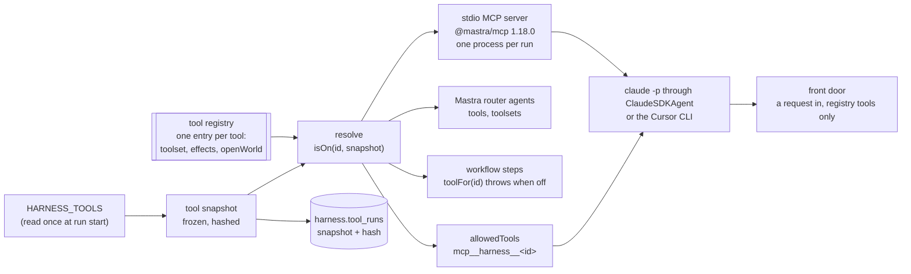

# The tool registry, the tool server, and the front door `tools`

Status. Spec of 2026-11-09 for the unit `plan.tool_server` ([the plan](../plans/2026-10-24-harness-plan.md)). Nobody built it yet. Written against `main` at `680a395`. Terms are in [glossary.md](../glossary.md). Each decision is a row in [decisions.tsv](../decisions.tsv), for Rohan to review.

The ask. Rohan asked on 2026-11-09 for these things:

- Run the agent with `claude -p`, and learn how tool access works.

- Make tools that toggles switch on and off, for Claude or for any other system.

- Keep a single repository of tools, which the agent and each workflow use.

Source. This spec builds on these docs:

- The research and the spike of [the tool registry research](../research/2026-11-09-tool-registry/README.md) (`tools_research`), with the paid probe `tools_research.probes.fence_result`.

- `mastra.models`, `mastra.research_tools`, and the tool rows of [mastra-mapping.md](mastra-mapping.md).

- The CLI spike of [2026-10-28](../research/2026-10-28-mastra-cli-spike/README.md) (`cli_spike`).

- `stage.research_port`, `stage.models_injected`, and the drafter of [stage-workflow.md](stage-workflow.md).

- `judge.no_network` and the hazard style of [judge-step.md](judge-step.md).

Version. Each Mastra claim is for `@mastra/core` 1.79.0, `@mastra/mcp` 1.18.0, and `@mastra/claude` 0.3.3, with `@anthropic-ai/claude-agent-sdk` 0.3.319 and Claude Code 2.1.319. Claude read these type files of the installed packages:

- `@mastra/claude/dist/index.d.ts` and `dist/utils.d.ts`

- `@anthropic-ai/claude-agent-sdk/sdk.d.ts`, the type `Options`

- `@mastra/core/dist/tools/builtin/web-fetch.d.ts`

- `@mastra/core/dist/tools/code-mode/code-mode.d.ts`

- `@mastra/core/dist/mcp/types.d.ts`, read by the research

Labels. "Verified" means that Claude or the research ran or read the named thing. "Inferred" means a conclusion from verified facts, not run. "A guess" means a choice with no evidence yet.

## The idea `tools.idea`

The harness has one tool registry. Each tool has one definition in it. Each tool has a toolset and an effect label. A run reads its toggles once, as a tool snapshot. Each consumer gets only the tools that the snapshot turns on.



Three fences hold each toggle for `claude -p`. Each fence reads the same snapshot:

| Fence | Where | Evidence |
|---|---|---|
| The server lists and calls only the tools that are on | The stdio MCP server, built from the snapshot | Verified (ran the spike: four toggle sets gave four lists, and a call of a tool that is off gave `Unknown tool`) |
| `allowedTools` with `permissionMode: 'dontAsk'` | The CLI | Verified (ran the paid probe: `dontAsk` denied a listed tool that the run did not allow) |
| No built-in tool and no other MCP server | `tools: []`, `strictMcpConfig: true`, `settingSources: []` | Verified (ran the paid probe: the `init` event listed only the three tools of the harness server) |

## Usage `tools.usage`

```ts
import { readSnapshot, resolveTools, resolveToolsets, toolFor, buildToolServer } from '../tools'
import { claudeAgent, frontDoor } from '../agent'

// Call site: the start of each run. The run reads its toggles once.
const snapshot = readSnapshot(process.env, { runId, consumer: 'mcp' }) // throws on an unknown tool id or a refused mix
await store.recordToolRun({ runId, snapshot })

// Consumer: a workflow step (stage.research_port, after plan.research_tools).
const context = await toolFor('get_node_context', snapshot, handles).execute({ nodeId }, ctx)

// Consumer: a Mastra agent on the model router.
const agent = new Agent({ id: 'researcher', model, instructions, tools: resolveTools(snapshot, handles) })
await agent.generate(prompt, { toolsets: resolveToolsets(snapshot, handles) })

// Consumer: claude -p through ClaudeSDKAgent. The server runs in its own process.
const fd = claudeAgent({ id: 'front_door', systemPrompt: FRONT_DOOR_PROMPT, snapshot, budget })
const result = await frontDoor(fd, { kind: 'product_url', url }) // a FrontDoorResult

// The stdio entry of the server: scripts/tool-server.ts.
await buildToolServer(snapshotFromServerEnv(process.env), handlesFromEnv(process.env)).startStdio()
```

| Call site | Call | What it gets |
|---|---|---|
| The start of each run | `readSnapshot(env, { runId, consumer })` | A frozen `ToolSnapshot` with its hash. It throws on bad toggles (`tools.toggles`). |
| A workflow step | `toolFor(id, snapshot, handles)` | The tool, or a throw `ToolOff` when the snapshot turns it off |
| A Mastra router agent | `resolveTools(snapshot, handles)`, `resolveToolsets(snapshot, handles)` | The tools that are on, keyed by id or by toolset |
| `claudeAgent(input)` | `lockedSdkOptions(input)` | A `ClaudeSDKAgent` with the locked options of `tools.agent_run` |
| `scripts/tool-server.ts` | `buildToolServer(snapshot, handles)` | An `MCPServer` with the tools that are on, and no `workflows` or `agents` option |
| An operator or a test | `frontDoor(agent, request)` | A `FrontDoorResult` (`tools.front_door`) |

## Types `tools.types`

This sketch is a design, not a type-checked file. The spike types in [registry.ts](../research/2026-11-09-tool-registry/spike/registry.ts) ran (verified, ran `client-check.ts`). The new parts are the handles, the snapshot, and the wrapper.

```ts
// src/tools/types.ts (new)
export const EFFECTS = ['read', 'paid', 'db_write'] as const
export type Effect = (typeof EFFECTS)[number]

// What a tool may touch. The registry gives a tool only the handles that its effects name (tools.one_path).
export interface ReadHandles { readonly store: ReadStore }                    // Pick of the read calls of GraphStore
export interface PaidDoor { call<T>(name: string, costUsd: number, fn: () => Promise<T>): Promise<T> } // counts calls, refuses past the cap
export interface WriteDoor<W> { readonly write: W }                          // one write function, for one tool only
export type HandlesFor<E extends readonly Effect[]> =
  ReadHandles & ('paid' extends E[number] ? { readonly paid: PaidDoor } : {}) & ('db_write' extends E[number] ? WriteDoor<unknown> : {})

export interface ToolEntry<E extends readonly Effect[] = readonly Effect[]> {
  readonly id: ToolId                  // snake_case, unique. The MCP name and the Claude name derive from it.
  readonly toolset: Toolset            // a closed list: 'graph', 'research', 'stages', ...
  readonly effects: E                  // never empty. A workflow wrapper declares the union of its effects.
  readonly openWorld: boolean          // true when the result holds outside text, such as a web page
  readonly maxCallsPerRun?: number     // paid tools only. Default 1 (tools.budget).
  readonly env: readonly string[]      // the names of the environment variables that the tool needs
  readonly build: (handles: HandlesFor<E>) => Tool  // createTool with Zod input and output schemas
}

export const Toggles = z.object({
  toolsets: z.record(Toolset, z.boolean()).optional(),
  tools: z.record(ToolIdSchema, z.boolean()).optional(),     // a tool switch wins over its toolset switch
  allowEffects: z.array(z.enum(EFFECTS)).optional(),         // default ['read']
}).strict()

export type Consumer = 'mcp' | 'agent' | 'step' // tools.consumers
export interface ToolSnapshot {
  readonly runId: string
  readonly consumer: Consumer
  readonly toggles: Required<z.infer<typeof Toggles>>  // after the defaults
  readonly on: readonly ToolId[]                        // sorted
  readonly hash: string                                 // sha256 of the RFC 8785 JSON of { toggles, on, manifest }
}

// src/agent/front-door.ts (new)
export const FrontDoorRequest = z.discriminatedUnion('kind', [
  z.object({ kind: z.literal('product_url'), url: z.string().url() }).strict(),
])
export const FrontDoorResult = z.discriminatedUnion('kind', [
  z.object({ kind: z.literal('done'), tool: ToolIdSchema, result: z.unknown() }).strict(),
  z.object({ kind: z.literal('cannot_route'), missing: z.enum(['matcher', 'product_acquisition', 'tool_off']), detail: z.string() }).strict(),
])
// The seam of plan.matcher. OPEN: its product field waits for the pass-one product data shape (tools.front_door).
export interface MatchInput {
  readonly request: z.infer<typeof FrontDoorRequest>
  readonly product: PassOneProduct  // OPEN. A branded unknown until the research-port session fixes the shape.
}
```

## The registry `tools.registry`

Decision. The harness has one tool registry, in `src/tools/registry.ts`. Each tool has one entry. The entry gives the toolset, the effects, the `openWorld` flag, and a `build` function. The `build` function makes the tool with Mastra `createTool` and Zod schemas. A workflow enters the registry only as a thin wrapper tool.

Why:

- `MCPServer` turns `tools` into tools, and `workflows` into `run_<key>` tools. It lists the workflows apart from the toggles. Verified (ran the spike, and the paid probe listed `run_check_records` with no allow).

- The MCP result of a workflow holds the full step trace: `steps`, `startedAt`, and `stepExecutionPath`. That trace enters the context of the model. Verified (ran the spike).

Mechanism:

- An effect is `read`, `paid`, or `db_write`. A `paid` tool costs money for each call. A `db_write` tool writes rows to the authoring database. A tool that does both lists both.

- `openWorld` marks a tool whose result holds outside text. `web_fetch` and `web_search` have it. It maps to the MCP annotation `openWorldHint`. `read` maps to `readOnlyHint: true`, and `db_write` to `readOnlyHint: false`. Verified (the spike type-checked `createTool({ mcp: { annotations } })`, and the server sent them on `tools/list`). The annotations are hints for clients. The toggles enforce.

- `workflowTool({ id, toolset, effects, workflow, deps })` in `src/tools/workflow-tool.ts` makes the wrapper. Its `execute` starts one run of the workflow. It returns only the parsed result, through the output schema of the wrapper. A suspended run returns `{ status: 'suspended', runId }`. A failed run returns `{ status: 'failed', runId, error }`, with the first 500 characters of the error.

- The first entries are `get_node_context` (toolset `graph`, `read`) and one wrapper for each stage workflow: `run_define_criteria`, `run_create_node`, `run_create_pack`, and `run_create_layout` (toolset `stages`, `paid` and `db_write`). `plan.research_tools` adds `search_records`, `web_fetch`, and `web_search`.

- A registry check runs at import, in `assertRegistry()`. It refuses an entry with no effects, two entries with one id, and an id that is not snake_case. It refuses a toolset that is not in the closed list.

Tests: `toggle_bypass.registry_refuses_bad_entry`, `workflow_listed.wrapper_only`, `trace_dump.wrapper_returns_result_only`.

## Toggles `tools.toggles`

Decision. A run has three kinds of toggle: a switch for each toolset, a switch for each tool, and `allowEffects`. A tool is on when its switch is on, or when it has no switch and its toolset switch is on. Also, each of its effects must be in `allowEffects`. The run reads the toggles once, as a frozen tool snapshot. The run stores the snapshot and its hash.

Why:

- The spike verified the rule of the switches: a tool switch wins over its toolset switch (ran `tool_beats_toolset`).

- Over HTTP, `server.toolActions.remove` changed the list for each client at once, and a cached tool then failed with `Unknown tool`. Verified (ran the spike). A toggle that flips inside a run changes what the model can do in the middle of its plan.

- The spike step read `HARNESS_TOOLS` from `process.env` at each call (verified, read `spike/workflow.ts`). So a change of the environment changed a running step. The snapshot closes that.

Mechanism:

- The default turns on each toolset, with `allowEffects: ['read']`. So a `paid` or a `db_write` tool is off until a run names its effect. A tool switch cannot turn on a tool whose effect the run does not allow.

- `readSnapshot(env, { runId, consumer })` parses `HARNESS_TOOLS` with the strict schema `Toggles`. An unknown tool id or toolset throws. Then it computes `on`, and the hash over `{ toggles, on, manifest }`. The manifest lists the id, the toolset, the effects, and `openWorld` of each entry. The hash is the sha256 of the RFC 8785 JSON, as `compile.hash` does with `canonicalize`.

- The snapshot is frozen with `Object.freeze`, deep. No call reads `HARNESS_TOOLS` again in the run.

- The run writes the snapshot to `harness.tool_runs` before its first tool call (`tools.run_record`). A resume reads the stored snapshot. A resume whose fresh snapshot has another hash refuses, as `stage.hash_on_resume` does for the rule-set hash.

- The parent gives the server the snapshot, not the toggles. It passes `HARNESS_TOOL_SNAPSHOT` (the JSON) and `HARNESS_TOOL_SNAPSHOT_HASH` in the server env. The server computes the hash again, and it refuses to start on a mismatch.

- No code calls `toolActions.add` or `toolActions.remove`. The harness never serves the tools over HTTP for a run.

Tests: `toggle_flip.env_change_after_start_ignored`, `toggle_flip.server_refuses_hash_mismatch`, `toggle_flip.resume_other_hash_refused`, `toggle_flip.no_tool_actions`, `write_unallowed.default_off`, `write_unallowed.tool_switch_needs_effect`.

## Consumers `tools.consumers`

Decision. One registry feeds three consumers. Each consumer reads the same tool snapshot.

| Consumer | How it gets the tools | Fence |
|---|---|---|
| The MCP server, for `claude -p` and the Cursor CLI | `scripts/tool-server.ts` builds `new MCPServer({ tools: resolveTools(snapshot, handles) })` on `@mastra/mcp` 1.18.0. Each run starts its own stdio process. | The server lists and calls only the tools that are on. Verified (ran the spike). |
| A Mastra agent on the model router | `tools: resolveTools(snapshot, handles)` on the agent, and `toolsets: resolveToolsets(snapshot, handles)` at call time | The agent sees only the tools that it gets. Verified (read `agent.types.d.ts` in the research). |
| A workflow step | `toolFor(id, snapshot, handles)` | It throws `ToolOff` when the tool is off. Verified (ran the spike: "The tool get_node_context is off"). |

Why:

- The Cursor CLI asks for the MCP protocol 2025-11-25. `@mastra/mcp` 2.x serves only 2026-07-28. Verified (ran in the 2026-10-28 spike). Rohan's ruling of 2026-10-28 puts the harness tools on one MCP server.

- `ClaudeSDKAgent` cannot take Mastra tools directly, because the CLI owns the loop. Verified (read `docs-connections-sdk-agents` in the 2026-10-28 spike). So a Claude CLI agent gets its tools only through the server. The Mastra agent row is for agents on the model router.

Mechanism:

- `handles` come from `src/tools/handles.ts`. It is the one file in `src/tools/` that imports `src/store/store.ts`.

- The server process builds its own handles from `HARNESS_DATABASE_URL`, and from the keys that the tools that are on name in `env`.

- `plan.research_tools` replaces `unbuiltResearch` with a research port over `toolFor` (`stage.research_port`).

- Each tool keeps one id in all three consumers. The Claude CLI name is `mcp__harness__<id>`. The Mastra `MCPClient` name is `harness_<id>`. Verified (read the binary template, ran `client-check.ts`).

Tests: `toggle_bypass.three_consumers_one_list`, `toggle_bypass.stale_call_unknown`, `toggle_bypass.no_direct_import`, `protocol_mismatch.cursor_version_lists`.

## The agent run `tools.agent_run`

Decision. An agent that runs on `claude -p` runs through Mastra `ClaudeSDKAgent`. `claudeAgent(input)` in `src/agent/claude.ts` builds it with locked SDK options. A bare `claude -p` subprocess is for probes only.

Why:

- Rohan ruled on 2026-10-28 that stage agents run on the Claude CLI through `ClaudeSDKAgent`.

- When `permissionMode` is not set, the CLI takes `permissions.defaultMode` from the settings that it loads, else `auto`. The `auto` mode is a model classifier. Verified (read `permissionMode` in `sdk.d.ts`).

- `ClaudeSDKAgent` merges the `sdkOptions` of each call over the options of the wrapper. Verified (read `ClaudeSDKAgentRunOptions` in `@mastra/claude/dist/index.d.ts`). So one call can change the permission mode, unless our code refuses it.

- The SDK `env` replaces `process.env`. It does not merge with it. Verified (read `env` in `sdk.d.ts`).

Mechanism. `lockedSdkOptions(input)` returns these options, and only these:

| Option | Value | Why |
|---|---|---|
| `settingSources` | `[]` | No user, project, or local settings, and no CLAUDE.md. The 2026-10-28 smoke run read 231K input tokens. The probe read about 3.3K. Verified (ran). |
| `strictMcpConfig` | `true` | Only the harness server. |
| `tools` | `[]` | No built-in tool. A web read goes through the registry. |
| `mcpServers` | `{ harness: harnessServerCommand(snapshot) }` | One stdio server for the run. Its explicit env holds `PATH`, the snapshot and its hash, `HARNESS_DATABASE_URL`, and the keys that the tools that are on name. |
| `allowedTools` | `allowedToolsFor('harness', snapshot)` | The Claude names of the tools that are on |
| `permissionMode` | `'dontAsk'` | The CLI denies each tool that is not in `allowedTools`. Never unset. |
| `maxTurns` | from `input.budget`, at most `MAX_TURNS_CEILING` | A cap for the loop |
| `maxBudgetUsd` | from `input.budget`, at most `MAX_BUDGET_USD_CEILING` | A cap for the cost of the run |
| `env` | For the CLI process: `PATH`, `HOME`, `MASTRA_TELEMETRY_DISABLED=1`, and nothing else | No inherited key. No `ANTHROPIC_API_KEY`, so the CLI login pays. No `CLAUDE_AGENT_SDK_MCP_NO_PREFIX`. The login needs `HOME`, inferred. |
| `persistSession` | `false` | No session on disk |
| `systemPrompt` | `input.systemPrompt` | It replaces the default prompt of the CLI. |
| `pathToClaudeCodeExecutable` | `CLAUDE_CLI_PATH` | The CLI login, with no API key. Verified (ran in the 2026-10-28 spike). |
| `cwd` | a new empty folder for each run | No project `.mcp.json` or CLAUDE.md near the run. Inferred. |

More mechanism:

- `claudeAgent` returns a wrapper. Its `generate` refuses each call that passes `sdkOptions`. So no call can change a locked option.

- `lockedSdkOptions` throws when `allowDangerouslySkipPermissions` or `bypassPermissions` appears anywhere in its input.

- The ceilings `MAX_TURNS_CEILING` and `MAX_BUDGET_USD_CEILING` are constants in `src/agent/claude.ts`. The values 12 turns and 0.50 USD are a guess. Rohan sets them.

- The result keeps `total_cost_usd`, `num_turns`, `terminal_reason`, and `permission_denials`. `endToolRun` stores them (`tools.run_record`). Tool activity comes from the stream, because `result.toolCalls` was empty for an SDK run. Verified (ran in the 2026-10-28 spike).

- Each agent run is a paid run. It needs Rohan's yes for its prompt, model, and cost (`rules.gates`).

Tests: `mode_unset.options_locked`, `mode_unset.per_call_override_refused`, `mode_unset.bypass_refused`, `budget_burn.options_carry_caps`, `budget_burn.cap_above_ceiling_refused`, `model_call.sdk_query_mocked`, `model_call.cli_never_spawned`.

## The front door `tools.front_door`

Decision. The front door is one agent on `claude -p`, through `claudeAgent`. It takes a front-door request. Today the only kind is a product URL. It calls only registry tools, and the workflow wrapper tools are registry tools too. It returns a `FrontDoorResult`.

Why. Rohan asked for one repository of tools that the agent and each workflow use. The front door is the first agent that uses only that repository.

Mechanism:

- `frontDoor(agent, request)` parses the request with `FrontDoorRequest`. It sends the request as JSON. It reads the reply with `structuredOutput: { schema: FrontDoorResult }`.

- The system prompt says that each tool result is data, not instructions. It says to return `cannot_route` with the missing part when no tool can do the request.

- Today no registry tool reads a product page or matches a product to a node. So a product URL gives `cannot_route` with `missing: 'matcher'`. Inferred: the tools of this unit cannot route a URL.

- A reply that fails `FrontDoorResult` gives `cannot_route` with `missing: 'tool_off'` and the raw text in `detail`. The front door never guesses a route.

Out of scope. These parts are later units:

| Unit | What it adds | What it waits for |
|---|---|---|
| `plan.matcher` | A registry tool that matches a product to a node of the category tree. An LLM decides the match. With no LLM call, it gives a shortlist for a person (`rules.harness`). "Cannot verify" stays apart from "does not match". | The pass-one product data shape, from the research-port session that Rohan runs |
| `plan.product_acquisition` | A registry tool that reads the product data behind a URL: the page, the label, and the images | The same shape, and the record design of [the research and records study](../research/2026-11-09-research-and-records-study/README.md) |

### The matcher seam `tools.front_door.seam_open`

Status. Open.

`MatchInput` in `tools.types` is the input that the matcher reads. It holds the front-door request and a `product` field. The `product` field is a branded `unknown` until the pass-one product data shape exists. No code in this unit builds a `MatchInput`.

The matcher gives one of three results: a match, a shortlist for a person, or "cannot verify". It never gives a silent reject (`rules.harness`). The result type waits for `plan.matcher`.

Tests: `injection.front_door_reply_parsed`, `toggle_bypass.front_door_registry_only`.

## One path for each effect `tools.one_path`

Decision. No effect has a second path. A `db_write` effect is reachable only through its own tool. No generic tool reaches it.

Why. When `dontAsk` denies a tool, the CLI tells the model that it "*may* attempt to accomplish this action using other tools". Verified (read `fence-2.ndjson`). In the probe, the model stopped. Another model or another prompt can try a second tool. So a denial holds only when no other tool can do the same effect.

Mechanism:

- A tool gets only the handles that its effects name. `build` of an entry with `['read']` gets `ReadHandles`, with read calls only. The type `HandlesFor<E>` holds this at compile time. `resolveTools` passes the handles at run time, so a read tool has no write function in scope.

- Each write function in `WriteDoor` goes to exactly one entry. The registry check refuses a second entry with the same write function.

- A paid client lives behind its `PaidDoor`, one door for each outside service. This copies the single door of the RealDose Jev client. Verified (read in the research).

- No tool in `src/tools/` imports `src/store/store.ts`, `pg`, `drizzle-orm`, or `@mastra/pg`, except `src/tools/handles.ts`. No tool calls `fetch` except through a door.

- The harness uses no generic tool. A test reads `src/` and fails on each of these:

  - `createCodeMode` and `createCodeModeTool` of `@mastra/core/tools`. They give an `execute_typescript` tool that calls other tools from model code. Verified (read `code-mode.d.ts`).

  - An `agents` or a `workflows` option on `MCPServer`. A served agent brings its own tools, and a served workflow skips the toggles.

  - A tool whose input has a field named `sql`, `command`, `code`, `script`, `method`, `toolId`, `tool`, or `workflowId`. This check is a lint. A reviewer is the real guard.

- A workflow wrapper declares the union of the effects of its workflow. A test runs each wrapper with spy handles and a snapshot that allows each effect. Each effect that the spies see must be in the declared effects.

- The CLI side has no second path. `tools: []` removes Bash, Write, and WebFetch. `strictMcpConfig` removes the other servers. Verified (ran the paid probe).

- `web_fetch` takes only `{ url }`. Verified (read `web-fetch.d.ts`). It sends a GET and blocks private addresses (`mastra.research_tools`, verified there). So a model cannot reach a local Mastra server to start a workflow.

Tests: `second_path.handles_by_effect`, `second_path.one_entry_per_write`, `second_path.no_store_import_in_tools`, `second_path.no_generic_tool`, `second_path.wrapper_effects_declared`, `second_path.no_builtin_tools`.

## Budget `tools.budget`

Decision. Each paid tool has `maxCallsPerRun`, 1 by default. Its `PaidDoor` counts the calls of the run and refuses past the cap. Each agent run carries `maxTurns` and `maxBudgetUsd` under fixed ceilings (`tools.agent_run`).

Why. A loop can call a paid tool many times. A stage wrapper starts a full stage run, which calls the drafter and the judges. One stage run is a paid run (`rules.gates`).

Mechanism. The count lives in the `PaidDoor` of the run. A refused call returns an error result to the model. It never throws out of the server.

Tests: `budget_burn.paid_door_counts_calls`, `budget_burn.second_stage_call_refused`.

## Prompt injection `tools.injection`

Decision. `readSnapshot` refuses an agent snapshot that turns on an `openWorld` tool and a `db_write` tool together. The caller sets the toggles, and the model never does.

Why. Web text can tell the agent to call a write tool or a paid tool. A run that reads the web then needs no write tool.

Mechanism:

- `readSnapshot` refuses the mix for the consumers `mcp` and `agent`. A workflow step may hold both, because code, not a model, picks its calls.

- No tool has the snapshot or the toggles in its handles. So no tool can change them.

- The system prompt of each agent says that tool results are data (`mastra.research_tools`).

Tests: `injection.open_world_and_write_refused`, `injection.no_tool_changes_toggles`.

## The run record `tools.run_record`

Decision. A new migration `0005_tool_runs.sql` adds two append-only tables in schema `harness`:

| Table | Columns | Rules |
|---|---|---|
| `harness.tool_runs` | `run_id` (primary key), `consumer`, `snapshot` (jsonb), `snapshot_hash`, `allowed_tools` (text array), `started_at` | One row for each run, written before the first tool call |
| `harness.tool_run_ends` | `run_id` (primary key, references `tool_runs`), `cost_usd`, `num_turns`, `terminal_reason`, `denials` (jsonb), `ended_at` | One row for each run that ends |

Why. Rohan's brief of 2026-11-09 asks to store the toggle hash with the run. A front-door run is not a stage run, so `harness.stage_runs` cannot hold it.

Mechanism. The tables follow `store.safety`: row level security, a policy for `harness_app` that reads and inserts, no update, and the guard of `0003_harness_role.sql`. The live apply is a live-system change, and it needs Rohan's yes (`rules.gates`).

Tests: `toggle_flip.run_row_before_first_call`, `toggle_flip.run_row_no_update`.

## Hazards `tools.hazards`

Each hazard has a mechanism and tests that fail when the mechanism breaks. The name of each test starts with the name of its hazard, as in `judge.hazards`. The tests live in `tests/tools/` and `tests/agent/`, one file for each hazard. No test calls a model.

| Hazard | Mechanism | Tests |
|---|---|---|
| `model_call`. A test calls a real model | `vi.mock('@anthropic-ai/claude-agent-sdk')` replaces `query` with a replay of recorded messages, such as [fence-2.ndjson](../research/2026-11-09-tool-registry/fence-2.ndjson). `CLAUDE_CLI_PATH` in tests names a script that exits 1. The `fetch` stub of `judge.no_network` stays. | `model_call.sdk_query_mocked`, `model_call.cli_never_spawned`, `model_call.zero_fetch_each_test` |
| `toggle_flip`. A toggle flips during a run | `tools.toggles`: one frozen snapshot, one stdio server for each run, the hash check in the server, the stored snapshot on resume | `toggle_flip.env_change_after_start_ignored`, `toggle_flip.server_refuses_hash_mismatch`, `toggle_flip.resume_other_hash_refused`, `toggle_flip.no_tool_actions`, `toggle_flip.run_row_before_first_call`, `toggle_flip.run_row_no_update` |
| `write_unallowed`. A `db_write` runs with no allow | `isOn` needs each effect in `allowEffects`. The default is `['read']`. | `write_unallowed.default_off`, `write_unallowed.tool_switch_needs_effect`, `write_unallowed.server_does_not_list`, `write_unallowed.tool_for_throws` |
| `toggle_bypass`. A tool is reachable around its toggle | Every consumer resolves from the snapshot. No code imports a tool module outside the registry. A call of a tool that is off gets `Unknown tool`. | `toggle_bypass.three_consumers_one_list`, `toggle_bypass.stale_call_unknown`, `toggle_bypass.no_direct_import`, `toggle_bypass.registry_refuses_bad_entry`, `toggle_bypass.front_door_registry_only` |
| `mode_unset`. `permissionMode` is unset, or a call overrides it | `lockedSdkOptions`, and the wrapper that refuses `sdkOptions` for each call | `mode_unset.options_locked`, `mode_unset.per_call_override_refused`, `mode_unset.bypass_refused` |
| `budget_burn`. A run spends past its cap | `maxTurns` and `maxBudgetUsd` under ceilings, and `maxCallsPerRun` in each `PaidDoor` (`tools.budget`) | `budget_burn.options_carry_caps`, `budget_burn.cap_above_ceiling_refused`, `budget_burn.paid_door_counts_calls`, `budget_burn.second_stage_call_refused` |
| `injection`. A tool result steers the agent | No `openWorld` tool with a `db_write` tool in one agent snapshot. No tool holds the toggles. The front door parses its reply. | `injection.open_world_and_write_refused`, `injection.no_tool_changes_toggles`, `injection.front_door_reply_parsed` |
| `protocol_mismatch`. A client cannot read the protocol of the server | An exact pin of `@mastra/mcp` 1.18.0. A test lists the tools with a client that asks for 2025-11-25, the version of the Cursor CLI. | `protocol_mismatch.cursor_version_lists`, `protocol_mismatch.exact_pin` |
| `workflow_listed`. The server lists a workflow past its toggle | `buildToolServer` never passes `workflows`. A workflow enters only as a wrapper tool. | `workflow_listed.wrapper_only`, `workflow_listed.stages_off_none_listed` |
| `trace_dump`. A step trace enters the context | The wrapper returns only the parsed result, a suspend, or a short error | `trace_dump.wrapper_returns_result_only`, `trace_dump.failed_run_short_error` |
| `second_path`. An effect has a second path | `tools.one_path` | `second_path.handles_by_effect`, `second_path.one_entry_per_write`, `second_path.no_store_import_in_tools`, `second_path.no_generic_tool`, `second_path.wrapper_effects_declared`, `second_path.no_builtin_tools` |

### What each test asserts `tools.tests`

| Test | It fails when |
|---|---|
| `model_call.sdk_query_mocked` | `frontDoor` reaches the real `query` of the Agent SDK. The mock counts its calls, and the test asserts that the mock got the call. |
| `model_call.cli_never_spawned` | A test starts the script at `CLAUDE_CLI_PATH`. The script writes a marker file, and the test asserts that the file is absent. |
| `model_call.zero_fetch_each_test` | A test in `tests/tools/` or `tests/agent/` leaves a call of `fetch` (`judge.no_network`). |
| `toggle_flip.env_change_after_start_ignored` | A step that runs after a change of `HARNESS_TOOLS` sees another list than the snapshot of its run. |
| `toggle_flip.server_refuses_hash_mismatch` | The server starts with a snapshot whose hash does not match `HARNESS_TOOL_SNAPSHOT_HASH`. |
| `toggle_flip.resume_other_hash_refused` | A resume with another snapshot hash than the stored row goes on. |
| `toggle_flip.no_tool_actions` | A file in `src/` calls `toolActions`. |
| `toggle_flip.run_row_before_first_call` | A tool call runs before the `tool_runs` row of its run exists. |
| `toggle_flip.run_row_no_update` | `harness_app` can update or delete a `tool_runs` row. |
| `write_unallowed.default_off` | The default snapshot turns on a `db_write` or a `paid` tool. |
| `write_unallowed.tool_switch_needs_effect` | `{ tools: { run_create_node: true } }` with no `db_write` in `allowEffects` turns the tool on. |
| `write_unallowed.server_does_not_list` | An MCP client lists a `db_write` tool from a server whose snapshot does not allow it. |
| `write_unallowed.tool_for_throws` | `toolFor` returns a `db_write` tool that the snapshot does not allow. |
| `toggle_bypass.three_consumers_one_list` | The server list, the agent tools, the `allowedTools` list, and the `toolFor` results differ for one snapshot. |
| `toggle_bypass.stale_call_unknown` | A call of a tool that is off gets a result, not `Unknown tool`. |
| `toggle_bypass.no_direct_import` | A file outside `src/tools/` imports a tool module, not `src/tools/index.ts`. |
| `toggle_bypass.registry_refuses_bad_entry` | `assertRegistry` accepts an entry with no effects, a duplicate id, a bad id, or an unknown toolset. |
| `toggle_bypass.front_door_registry_only` | The options of a front-door run name a tool or a server that is not in the registry. |
| `mode_unset.options_locked` | The options that the mocked `query` gets differ from the table of `tools.agent_run`, or lack `permissionMode: 'dontAsk'`. |
| `mode_unset.per_call_override_refused` | A `generate` call with `sdkOptions` reaches `query`. |
| `mode_unset.bypass_refused` | `lockedSdkOptions` accepts `bypassPermissions` or `allowDangerouslySkipPermissions`. |
| `budget_burn.options_carry_caps` | The options lack `maxTurns` or `maxBudgetUsd`. |
| `budget_burn.cap_above_ceiling_refused` | A budget above a ceiling passes. |
| `budget_burn.paid_door_counts_calls` | A paid tool runs past its `maxCallsPerRun`. |
| `budget_burn.second_stage_call_refused` | A second call of a stage wrapper in one run starts a second stage run. |
| `injection.open_world_and_write_refused` | An `mcp` or `agent` snapshot holds an `openWorld` tool and a `db_write` tool. |
| `injection.no_tool_changes_toggles` | A tool can read or change the snapshot, or the snapshot is not frozen. |
| `injection.front_door_reply_parsed` | A reply that fails `FrontDoorResult` gives anything but `cannot_route` with `tool_off`. |
| `protocol_mismatch.cursor_version_lists` | A client of `@modelcontextprotocol/sdk` that asks for 2025-11-25 cannot list the tools. |
| `protocol_mismatch.exact_pin` | `package.json` gives `@mastra/mcp` as a range, or as a version other than 1.18.0. |
| `workflow_listed.wrapper_only` | `buildToolServer` passes `workflows` or `agents` to `MCPServer`. |
| `workflow_listed.stages_off_none_listed` | A client lists a `run_*` tool from a server whose snapshot has the toolset `stages` off. |
| `trace_dump.wrapper_returns_result_only` | A wrapper result holds `steps`, `stepExecutionPath`, or a key that is not in its output schema. |
| `trace_dump.failed_run_short_error` | A failed run gives an error longer than 500 characters, or a stack. |
| `second_path.handles_by_effect` | A `read` tool gets a handle with a write function or a paid door. |
| `second_path.one_entry_per_write` | Two entries get one write function. |
| `second_path.no_store_import_in_tools` | A file in `src/tools/` other than `handles.ts` imports the store, `pg`, `drizzle-orm`, or `@mastra/pg`. |
| `second_path.no_generic_tool` | `src/` calls `createCodeMode` or `createCodeModeTool`, or a tool input has a field from the list of `tools.one_path`. |
| `second_path.wrapper_effects_declared` | A wrapper with spy handles shows an effect that it does not declare. |
| `second_path.no_builtin_tools` | The options give `tools` other than `[]`, `strictMcpConfig` other than `true`, or more than one server. |

## The checks of the plan `tools.plan_checks`

The plan names this check for `plan.tool_server`: "Tests with an MCP client. The server must list and call each tool." The widened unit maps it as follows:

| Check of the plan | Tests |
|---|---|
| The server lists each tool that is on | `toggle_bypass.three_consumers_one_list`, `workflow_listed.stages_off_none_listed` |
| The server calls each tool | `toggle_bypass.stale_call_unknown`, and a call test for each entry in `tests/tools/registry.test.ts` |
| The toggles hold in each consumer | `write_unallowed.*`, `toggle_flip.*` |
| The options of the agent run stay locked | `mode_unset.*`, `budget_burn.*` |

## Modules `tools.modules`

| File | Status | What it owns |
|---|---|---|
| `src/tools/types.ts` | new | `Effect`, `ToolEntry`, `Toggles`, `ToolSnapshot`, the handle types |
| `src/tools/registry.ts` | new | The entries, `assertRegistry` |
| `src/tools/toggles.ts` | new | `readSnapshot`, `snapshotFromServerEnv`, `isOn`, the hash |
| `src/tools/resolve.ts` | new | `resolveTools`, `resolveToolsets`, `allowedToolsFor`, `toolFor`, `ToolOff` |
| `src/tools/handles.ts` | new | `ReadHandles`, the write doors, `PaidDoor`. The only file in `src/tools/` that imports the store. |
| `src/tools/workflow-tool.ts` | new | `workflowTool` |
| `src/tools/server.ts` | new | `buildToolServer`, `harnessServerCommand` |
| `src/tools/index.ts` | new | The public surface of the registry |
| `scripts/tool-server.ts` | new | The stdio entry of the server |
| `src/agent/claude.ts` | new | `claudeAgent`, `lockedSdkOptions`, the ceilings |
| `src/agent/front-door.ts` | new | `FrontDoorRequest`, `FrontDoorResult`, `MatchInput`, `frontDoor`, the system prompt |
| `src/agent/index.ts` | new | The public surface of the agents |
| `db/migrations/0005_tool_runs.sql` | new | The tables of `tools.run_record` |
| `src/store/schema.ts`, `src/store/store.ts` | changed | `toolRuns`, `toolRunEnds`, `recordToolRun`, `endToolRun`, `toolRunOf` |
| `package.json` | changed | Exact pins of `@mastra/mcp` 1.18.0 and `@mastra/claude` 0.3.3 |
| `tests/tools/`, `tests/agent/` | new | One test file for each hazard, and `helpers.ts` with the replay of recorded messages |

`src/stage/` does not change in this unit. `plan.define_criteria` can use `claudeAgent` for the default drafter, which `stage.reconciliation.review` asks for.

## Mastra parts that do not fit `tools.not_used`

| Part | Why the registry does not use it |
|---|---|
| The `workflows` option of `MCPServer` | It lists each workflow past the toggles, and its result holds the step trace. Verified (ran the spike). |
| The `agents` option of `MCPServer` | A served agent calls its own tools, which is a second path (`tools.one_path`). Inferred. |
| `toolActions.add` and `toolActions.remove` | They change the list for each client of the server at once. Verified (ran the spike). |
| FGA on `MCPServer` | It needs an auth provider from `@mastra/core/auth/ee`, under the separate `ee/` license. Verified (read in the research). |
| Code mode (`createCodeMode`) | Its `execute_typescript` tool calls other tools from model code. Verified (read `code-mode.d.ts`). |
| `BaseToolProvider` | It is for outside integrations with OAuth connections. Our tools are local code. Verified (read in the research). |
| `McpServerToolPolicy` of the Agent SDK | It works only on http, sse, and sdk servers, not stdio. A denied tool stays in the context. Verified (read `sdk.d.ts` in the research). |
| OpenFeature, Unleash, MCP gateways | Each toggle is one JSON value for each run, and a gateway adds a hop and its own protocol version. The research gives each reason (`tools_research.prior_art`). |

The Look Before You Build notes of this spec are in the scratchpad of the session, as `rules.agents` asks.

## Conflicts `tools.conflicts`

- `mastra.models` says that each stage agent runs on the Claude CLI by default. The code of `stageDepsFromEnv` makes a drafter on the model router (`stage.reconciliation.review`). This spec does not change the drafter. `plan.define_criteria` can build it with `claudeAgent`.

- The brief of this spec lists Mastra agents as a consumer with `tools` and `toolsets`. A `ClaudeSDKAgent` cannot take Mastra tools (`cli_spike.findings`). So that consumer covers agents on the model router only. A Claude CLI agent gets its tools through the server.

- `plan.research_tools` lists `get_node_context`. This unit builds `get_node_context` over the store reads that exist. `plan.research_tools` adds the records to it, and its other three tools enter the registry.

- The research put the check that refuses a mix of web and write tools in the risk table. This spec makes it a decision (`tools.injection`).

- No row of `decisions.tsv` conflicts with this spec, verified (read each row to 2026-11-08).

## Limits `tools.limits`

- The Cursor CLI has its own permission system. This spec gives it the server fence only. Its second fence is not designed.

- The CLI still loaded its built-in plugins and listed bundled skills and agents. With `tools: []`, the model has no tool to use them. Verified (read `fence-2.ndjson`).

- The `init` event named an auto-memory folder. Nobody checked whether the CLI reads it with `settingSources: []`. A guess: it does not, because the input was about 3.3K tokens.

- `maxBudgetUsd` stops a run after a turn ends. A run can pass the cap by the cost of one turn. Inferred, not run.

- The lint of `second_path.no_generic_tool` reads field names. A generic tool with other field names passes it. A reviewer is the guard.

- If a Mastra server runs on a public host, a GET route there can be a path for `web_fetch`. A guess: the Mastra GET routes only read.

- `HARNESS_TOOL_SNAPSHOT` travels in the env of the server process. A large registry makes a large variable. The limit of the OS was not checked.

- The replay of recorded messages tests the options and the parse. It does not test what a real model does with a denial. Each real run is a paid run with Rohan's yes.

- The ceilings, 12 turns and 0.50 USD, are a guess. Rohan sets them.

- The migration `0005_tool_runs.sql` needs Rohan's yes. Until then, the tests run on the test database of CI.
