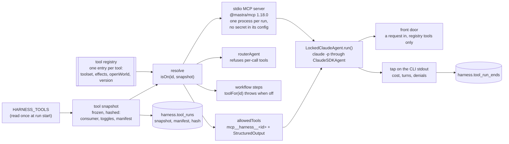

# The tool registry, the tool server, and the front door `tools`

Status. Spec of 2026-11-09 for the unit `plan.tool_server` ([the plan](../plans/2026-10-24-harness-plan.md)). Nobody built it yet. Written against `main` at `680a395`. Terms are in [glossary.md](../glossary.md). Each decision is a row in [decisions.tsv](../decisions.tsv), for Rohan to review.

Review. Two adversaries interrogated this spec at `7a4ced0` on 2026-11-09. The coordinator ran the key repros again, with no model call. The spec folds in each fix whose repro reproduced. `tools.interrogate` lists them. The repros are in [the interrogate folder](../research/2026-11-09-tool-registry/interrogate/README.md).

The ask. Rohan asked on 2026-11-09 for these things:

- Run the agent with `claude -p`, and learn how tool access works.

- Make tools that toggles switch on and off, for Claude or for any other system.

- Keep a single repository of tools, which the agent and each workflow use.

Source. This spec builds on these docs:

- The research and the spike of [the tool registry research](../research/2026-11-09-tool-registry/README.md) (`tools_research`), with the paid probe `tools_research.probes.fence_result`.

- `mastra.models`, `mastra.research_tools`, and the tool rows of [mastra-mapping.md](mastra-mapping.md).

- The CLI spike of [2026-10-28](../research/2026-10-28-mastra-cli-spike/README.md) (`cli_spike`).

- `stage.research_port`, `stage.models_injected`, and the drafter of [stage-workflow.md](stage-workflow.md).

- `judge.no_network` and the hazard style of [judge-step.md](judge-step.md).

- `store.safety` of [graph-store.md](graph-store.md), and the migration `0004_stage_runs.sql`.

Version. Each Mastra claim is for `@mastra/core` 1.79.0, `@mastra/mcp` 1.18.0, and `@mastra/claude` 0.3.3. The other versions are `@anthropic-ai/claude-agent-sdk` 0.3.319, zod 4.6.7, and Claude Code 2.1.319. Claude read these type files of the installed packages:

- `@mastra/claude/dist/index.d.ts`, `dist/utils.d.ts`, and the call of `query` in `dist/index.js`

- `@anthropic-ai/claude-agent-sdk/sdk.d.ts`, the type `Options`, with `spawnClaudeCodeProcess`

- `@mastra/core/dist/tools/builtin/web-fetch.d.ts`

- `@mastra/core/dist/tools/code-mode/code-mode.d.ts`

- `zod/v4/classic/schemas.d.ts`, the function `partialRecord`

- `@mastra/core/dist/mcp/types.d.ts`, read by the research

Labels. "Verified" means that Claude, the research, or the interrogate run ran or read the named thing. "Inferred" means a conclusion from verified facts, not run. "A guess" means a choice with no evidence yet.

## The idea `tools.idea`

The harness has one tool registry. Each tool has one definition in it. Each tool has a toolset and an effect label. A run reads its toggles once, as a tool snapshot. Each consumer gets only the tools that the snapshot turns on. No consumer gets a raw agent or a raw tool map that a caller can widen.



Three fences hold each toggle for `claude -p`. Each fence reads the same snapshot:

| Fence | Where | Evidence |
|---|---|---|
| The server lists and calls only the tools that are on | The stdio MCP server, built from the snapshot | Verified (ran the spike: four toggle sets gave four lists, and a call of a tool that is off gave `Unknown tool`) |
| `allowedTools` with `permissionMode: 'dontAsk'` | The CLI | Verified (ran the paid probe: `dontAsk` denied a listed tool that the run did not allow. The interrogate run `opus/runs/run1`: `dontAsk` denied Bash and a tool of another server.) |
| No built-in tool and no other MCP server | `tools: []`, `strictMcpConfig: true`, `settingSources: []` | Verified (ran the paid probe, and `sonnet/p3.ts` with a project `.mcp.json`, commands, and CLAUDE.md beside the run) |

The fences hold only while no caller can change the options. `tools.locked_agent` and `tools.consumers` close that path.

## Usage `tools.usage`

```ts
import { readSnapshot, resolveTools, toolFor, buildToolServer, snapshotFromServerEnv } from '../tools'
import { lockedClaudeAgent, routerAgent, frontDoor } from '../agent'

// Call site: the start of each run. The run reads its toggles once.
const snapshot = readSnapshot(process.env, { runId, consumer: 'agent' }) // throws on bad toggles or a refused mix
await store.recordToolRun({ runId, snapshot })

// Consumer: a workflow step (stage.research_port, after plan.research_tools).
const context = await toolFor('get_node_context', snapshot, handles).execute({ nodeId }, ctx)

// Consumer: a Mastra agent on the model router. The wrapper refuses per-call tools.
const researcher = routerAgent({ id: 'researcher', model, instructions, snapshot, handles })
const found = await researcher.run(prompt)

// Consumer: claude -p through ClaudeSDKAgent, inside the locked wrapper.
const fd = lockedClaudeAgent({ id: 'front_door', systemPrompt: FRONT_DOOR_PROMPT, snapshot, budget, store })
const result = await frontDoor(fd, { kind: 'product_url', url }) // a FrontDoorResult. It never throws.

// The stdio entry of the server: scripts/tool-server.ts.
const server = buildToolServer(snapshotFromServerEnv(process.env), handlesFromEnvFile(process.env))
await server.startStdio()
```

| Call site | Call | What it gets |
|---|---|---|
| The start of each run | `readSnapshot(env, { runId, consumer })` | A frozen `ToolSnapshot` with its manifest and hash. It throws on bad toggles (`tools.toggles`). |
| A workflow step | `toolFor(id, snapshot, handles)` | The tool, or a throw `ToolOff` when the snapshot turns it off |
| A Mastra router agent | `routerAgent(input).run(prompt)` | The reply. The model sees only the tools that are on (`tools.consumers`). |
| An agent on `claude -p` | `lockedClaudeAgent(input).run(prompt, schema)` | A `RunOutcome`. No caller can change the options (`tools.locked_agent`). |
| `scripts/tool-server.ts` | `buildToolServer(snapshot, handles)` | An `MCPServer` with the tools that are on, and no `workflows` or `agents` option |
| An operator or a test | `frontDoor(agent, request)` | A `FrontDoorResult` (`tools.front_door`) |

## Types `tools.types`

This sketch is a design, not a type-checked file. The spike types in [registry.ts](../research/2026-11-09-tool-registry/spike/registry.ts) ran (verified, ran `client-check.ts`). The new parts are the handles, the snapshot, the wrappers, and the front-door types.

```ts
// src/tools/types.ts (new)
export const EFFECTS = ['read', 'paid', 'db_write'] as const
export type Effect = (typeof EFFECTS)[number]
export const TOOLSETS = ['graph', 'research', 'stages'] as const // a closed list
export const Toolset = z.enum(TOOLSETS)
export const ToolIdSchema = z.enum(TOOL_IDS) // TOOL_IDS: the ids of the registry, as a const tuple

// What a tool may touch. The registry gives a tool only the handles that its effects name (tools.one_path).
export interface ReadHandles { readonly store: ReadStore }                    // Pick of the read calls of GraphStore
export interface PaidDoor { call<T>(name: string, costUsd: number, fn: () => Promise<T>): Promise<T | PaidRefused> } // tools.budget
export interface WriteDoor<W> { readonly write: W }                          // one write function, for one tool only
export type HandlesFor<E extends readonly Effect[]> =
  ReadHandles & ('paid' extends E[number] ? { readonly paid: PaidDoor } : {}) & ('db_write' extends E[number] ? WriteDoor<unknown> : {})

export interface ToolEntry<E extends readonly Effect[] = readonly Effect[]> {
  readonly id: ToolId                  // snake_case, unique. The MCP name and the Claude name derive from it.
  readonly version: number             // a positive integer. A change of the input, the output, or the effect moves it.
  readonly toolset: Toolset
  readonly effects: E                  // never empty. A wrapper declares the union of the effects of its workflow.
  readonly openWorld: boolean          // true when the result gives outside text to the caller (tools.injection_scope)
  readonly inner?: readonly ToolId[]   // wrappers only: the tools of its model steps. Never a db_write tool.
  readonly maxCallsPerRun?: number     // paid tools only. Default 1 (tools.budget).
  readonly env: readonly string[]      // the names of the environment variables that the tool needs
  readonly build: (handles: HandlesFor<E>) => Tool  // createTool with Zod schemas. Its id must equal the entry id.
}

// tools.types: z.partialRecord, so that a run can name some toolsets or tools only. z.record with an enum
// key needs each key (verified, ran sonnet/p5.ts).
export const Toggles = z.object({
  toolsets: z.partialRecord(Toolset, z.boolean()).optional(),
  tools: z.partialRecord(ToolIdSchema, z.boolean()).optional(),   // a tool switch wins over its toolset switch
  allowEffects: z.array(z.enum(EFFECTS)).optional(),              // default ['read']
}).strict()

export type Consumer = 'agent' | 'mcp_client' | 'step' // tools.consumers
export interface ManifestRow { readonly id: ToolId; readonly version: number; readonly toolset: Toolset; readonly effects: readonly Effect[]; readonly openWorld: boolean }
export interface ToolSnapshot {
  readonly runId: string
  readonly consumer: Consumer
  readonly toggles: ResolvedToggles          // after the defaults
  readonly manifest: readonly ManifestRow[]  // the tools that are on, sorted by id
  readonly hash: string                      // sha256 of the RFC 8785 JSON of { consumer, toggles, manifest }
}

// src/agent/claude.ts (new)
export interface RunEnd { readonly costUsd: number | null; readonly numTurns: number | null; readonly terminalReason: string | null; readonly subtype: string | null; readonly denials: readonly unknown[] }
export type RunOutcome =
  | { readonly kind: 'ok'; readonly object: unknown; readonly text: string; readonly end: RunEnd }
  | { readonly kind: 'failed'; readonly reason: string; readonly end: RunEnd } // a throw, such as error_max_budget_usd
export interface LockedClaudeAgent { run(prompt: string, schema?: z.ZodObject): Promise<RunOutcome> } // the one method

// src/agent/front-door.ts (new)
export const FrontDoorRequest = z.discriminatedUnion('kind', [
  z.object({ kind: z.literal('product_url'), url: z.string().url() }).strict(),
])
// The schema that the CLI gets. Its root is type "object", with kind as the discriminator (tools.front_door).
export const FrontDoorReply = z.object({
  kind: z.enum(['done', 'cannot_route']),
  tool: ToolIdSchema.optional(),
  result: z.unknown().optional(),
  missing: z.enum(['matcher', 'product_acquisition', 'tool_off']).optional(),
  detail: z.string().optional(),
}).strict()
// What code returns, after it parses the reply.
export const FrontDoorResult = z.discriminatedUnion('kind', [
  z.object({ kind: z.literal('done'), tool: ToolIdSchema, result: z.unknown() }).strict(),
  z.object({ kind: z.literal('cannot_route'), missing: z.enum(['matcher', 'product_acquisition', 'tool_off', 'reply_unparsed', 'run_failed']), detail: z.string() }).strict(),
])
// The seam of plan.matcher. OPEN: its product field waits for the pass-one product data shape (tools.front_door.seam_open).
export interface MatchInput {
  readonly request: z.infer<typeof FrontDoorRequest>
  readonly product: PassOneProduct  // OPEN. A branded unknown until the research-port session fixes the shape.
}
```

## The registry `tools.registry`

Decision. The harness has one tool registry, in `src/tools/registry.ts`. Each tool has one entry. The entry gives the version, the toolset, the effects, the `openWorld` flag, and a `build` function. The `build` function makes the tool with Mastra `createTool` and Zod schemas. A workflow enters the registry only as a thin wrapper tool.

Why:

- `MCPServer` turns `tools` into tools, and `workflows` into `run_<key>` tools. It lists the workflows apart from the toggles. Verified (ran the spike, and the paid probe listed `run_check_records` with no allow).

- The MCP result of a workflow holds the full step trace: `steps`, `startedAt`, and `stepExecutionPath`. That trace enters the context of the model. Verified (ran the spike).

- A registry key and the id of its built tool can differ. The server then lists one name and runs another tool. Verified (ran `sonnet/p1.ts`, `MODE=mismatch`: a call of `get_node_context` ran a write).

Mechanism:

- An effect is `read`, `paid`, or `db_write`. A `paid` tool costs money for each call. A `db_write` tool writes rows to the authoring database. A tool that does both lists both.

- `openWorld` marks a tool whose result holds outside text. `web_fetch` and `web_search` have it. It maps to the MCP annotation `openWorldHint`. `read` maps to `readOnlyHint: true`, and `db_write` to `readOnlyHint: false`. Verified (the spike type-checked `createTool({ mcp: { annotations } })`, and the server sent them on `tools/list`). The annotations are hints for clients. The toggles enforce.

- `workflowTool({ id, version, toolset, effects, inner, workflow, deps })` in `src/tools/workflow-tool.ts` makes the wrapper. Its `execute` starts one run of the workflow. It returns only the parsed result, through the output schema of the wrapper. A stage wrapper returns structured status only, and a failed run gives an error code, not the error text (`tools.injection_scope`).

- The first entries are `get_node_context` (toolset `graph`, `read`) and one wrapper for each stage workflow: `run_define_criteria`, `run_create_node`, `run_create_pack`, and `run_create_layout` (toolset `stages`, `paid` and `db_write`). `plan.research_tools` adds `search_records`, `web_fetch`, and `web_search`.

- `assertRegistry()` runs at import. It refuses each of these:

  - An entry with no effects, or two entries with one id.

  - An id that is not snake_case, or a toolset that is not in the closed list.

  - An entry whose built tool has another id than the entry.

  - A wrapper with `openWorld: false` whose result schema has a free string, and a wrapper whose `inner` list holds a `db_write` tool (`tools.injection_scope`).

  - A version that is not a positive integer.

- `src/tools/code.lock.json` maps each entry version to a fingerprint of its source, as `compile.hash` does for the compiler. A test fails when a fingerprint moves under an unchanged version.

Tests: `toggle_bypass.registry_refuses_bad_entry`, `toggle_bypass.built_id_matches_entry`, `toggle_bypass.version_moves_with_code`, `workflow_listed.wrapper_only`, `trace_dump.wrapper_returns_result_only`.

## Toggles `tools.toggles`

Decision. A run has three kinds of toggle: a switch for each toolset, a switch for each tool, and `allowEffects`. A tool is on when its switch is on, or when it has no switch and its toolset switch is on. Also, each of its effects must be in `allowEffects`. The run reads the toggles once, as a frozen tool snapshot. The hash covers the consumer, the toggles, and the manifest of the tools that are on. The run stores the snapshot, the manifest, and the hash.

Why:

- The spike verified the rule of the switches: a tool switch wins over its toolset switch (ran `tool_beats_toolset`).

- Over HTTP, `server.toolActions.remove` changed the list for each client at once, and a cached tool then failed with `Unknown tool`. Verified (ran the spike).

- The spike step read `HARNESS_TOOLS` from `process.env` at each call (verified, read `spike/workflow.ts`). So a change of the environment changed a running step.

- The first hash did not cover the consumer. A new tool that is off also moved it. Verified (ran `sonnet/p6.mjs`).

Mechanism:

- The default turns on each toolset, with `allowEffects: ['read']`. So a `paid` or a `db_write` tool is off until a run names its effect. A tool switch cannot turn on a tool whose effect the run does not allow.

- `readSnapshot(env, { runId, consumer })` parses `HARNESS_TOOLS` with the strict schema `Toggles`. Partial toggles parse. An unknown tool id or toolset throws.

- The manifest lists the id, the version, the toolset, the effects, and `openWorld` of each tool that is on, sorted by id. A tool that is off is not in the manifest. So a new entry that is off does not move the hash.

- The hash is the sha256 of the RFC 8785 JSON of `{ consumer, toggles, manifest }`, as `compile.hash` does with `canonicalize`. The run id is not in it.

- The snapshot is frozen with `Object.freeze`, deep. No call reads `HARNESS_TOOLS` again in the run.

- The run writes the snapshot, the manifest, and the hash to `harness.tool_runs` before its first tool call (`tools.run_record`).

- A resume reads the stored row. It makes the manifest again from the stored toggles and the current registry. It goes on only when that manifest equals the stored manifest. Otherwise it refuses, as `stage.hash_on_resume` does for the rule-set hash.

- The parent gives the server the snapshot, not the toggles. It passes `HARNESS_TOOL_SNAPSHOT` (the JSON) and `HARNESS_TOOL_SNAPSHOT_HASH` in the server env. The server makes the manifest again from its own registry. It starts only when its manifest equals the manifest of the snapshot and the hash matches.

- No code calls `toolActions.add` or `toolActions.remove`. The harness never serves the tools over HTTP for a run.

Tests: `toggle_flip.env_change_after_start_ignored`, `toggle_flip.server_refuses_hash_mismatch`, `toggle_flip.server_refuses_manifest_mismatch`, `toggle_flip.resume_other_manifest_refused`, `toggle_flip.hash_covers_consumer`, `toggle_flip.off_entry_keeps_hash`, `toggle_flip.no_tool_actions`, `toggle_flip.partial_toggles_parse`, `write_unallowed.default_off`, `write_unallowed.tool_switch_needs_effect`.

## Consumers `tools.consumers`

Decision. One registry feeds three consumers. Each consumer reads the same tool snapshot. The consumer of a snapshot is `agent`, `mcp_client`, or `step`.

| Consumer | Snapshot consumer | How it gets the tools | Fence |
|---|---|---|---|
| An agent on `claude -p`, through `lockedClaudeAgent` | `agent` | `scripts/tool-server.ts` builds `new MCPServer({ tools: resolveTools(snapshot, handles) })` on `@mastra/mcp` 1.18.0. Each run starts its own stdio process. | The server, `allowedTools` with `dontAsk`, and the locked options |
| The Cursor CLI, or another outside MCP client | `mcp_client` | The same server command | The server only (`tools.limits`) |
| A Mastra agent on the model router, through `routerAgent` | `agent` | The wrapper gives the inner `Agent` its `tools` from the snapshot | The wrapper refuses per-call tools |
| A workflow step | `step` | `toolFor(id, snapshot, handles)` | It throws `ToolOff` when the tool is off. Verified (ran the spike: "The tool get_node_context is off"). |

Why:

- The Cursor CLI asks for the MCP protocol 2025-11-25. `@mastra/mcp` 2.x serves only 2026-07-28. Verified (ran in the 2026-10-28 spike). Rohan's ruling of 2026-10-28 puts the harness tools on one MCP server.

- `ClaudeSDKAgent` cannot take Mastra tools directly, because the CLI owns the loop. Verified (read `docs-connections-sdk-agents` in the 2026-10-28 spike). So a Claude CLI agent gets its tools only through the server.

- A per-call `toolsets` or `clientTools` option gave a router agent a tool that was off. The model saw `save_record`. Verified (ran `sonnet/p8.ts` with `createMockModel`).

Mechanism:

- `routerAgent(input)` in `src/agent/router.ts` holds the inner `Agent` in a private field. It has one method, `run(prompt, schema?)`. It passes no `toolsets`, `clientTools`, or `tools` option per call. A caller cannot pass them, because `run` takes no options object.

- No code registers a harness agent in `new Mastra({ agents })`. The Mastra server API takes per-call options for each registered agent. Inferred (read the agent routes of the Mastra server in the research of 2026-10-24).

- `handles` come from `src/tools/handles.ts`. It is the one file in `src/tools/` that imports `src/store/store.ts`.

- `plan.research_tools` replaces `unbuiltResearch` with a research port over `toolFor` (`stage.research_port`).

- Each tool keeps one id in all consumers. The Claude CLI name is `mcp__harness__<id>`. The Mastra `MCPClient` name is `harness_<id>`. Verified (read the binary template, ran `client-check.ts`).

Tests: `toggle_bypass.three_consumers_one_list`, `toggle_bypass.stale_call_unknown`, `toggle_bypass.no_direct_import`, `toggle_bypass.router_call_tools_refused`, `toggle_bypass.off_tool_never_in_model_list`, `toggle_bypass.no_agent_registered`, `protocol_mismatch.cursor_version_lists`.

## The agent run `tools.agent_run`

Decision. An agent that runs on `claude -p` runs through Mastra `ClaudeSDKAgent`, inside the locked wrapper of `tools.locked_agent`. `lockedSdkOptions(input)` in `src/agent/claude.ts` makes its options. A bare `claude -p` subprocess is for probes only.

Why:

- Rohan ruled on 2026-10-28 that stage agents run on the Claude CLI through `ClaudeSDKAgent`.

- When `permissionMode` is not set, the CLI takes `permissions.defaultMode` from the settings that it loads, else `auto`. The `auto` mode is a model classifier. Verified (read `permissionMode` in `sdk.d.ts`).

- The SDK `env` replaces `process.env`. It does not merge with it. Verified (read `env` in `sdk.d.ts`).

Mechanism. `lockedSdkOptions(input)` refuses a snapshot whose consumer is not `agent`. It checks the mix rule of `tools.injection` again. Then it returns these options, and only these:

| Option | Value | Why |
|---|---|---|
| `settingSources` | `[]` | No user, project, or local settings, and no CLAUDE.md. The 2026-10-28 smoke run read 231K input tokens. The probe read about 3.3K. Verified (ran). |
| `strictMcpConfig` | `true` | Only the harness server. |
| `tools` | `[]` | No built-in tool. A web read goes through the registry. |
| `mcpServers` | `{ harness: harnessServerCommand(snapshot) }` | One stdio server for the run. Its config holds no secret (`tools.secrets_off_argv`). |
| `allowedTools` | `allowedToolsFor('harness', snapshot)`, and `StructuredOutput` when the run has a schema | The Claude names of the tools that are on (`tools.front_door`) |
| `permissionMode` | `'dontAsk'` | The CLI denies each tool that is not in `allowedTools`. Never unset. |
| `maxTurns` | from `input.budget`, at most `MAX_TURNS_CEILING` | A cap for the loop |
| `maxBudgetUsd` | from `input.budget`, at most `MAX_BUDGET_USD_CEILING` | A cap for the cost of the run |
| `env` | For the CLI process: `PATH`, `HOME`, `MASTRA_TELEMETRY_DISABLED=1`, `CLAUDE_CODE_DISABLE_AUTO_MEMORY=1`, and nothing else | No inherited key. No `ANTHROPIC_API_KEY`, so the CLI login pays. No `CLAUDE_AGENT_SDK_MCP_NO_PREFIX`. No auto memory (`tools.no_auto_memory`). The login needs `HOME`, inferred. |
| `persistSession` | `false` | No session on disk |
| `systemPrompt` | `input.systemPrompt` | It replaces the default prompt of the CLI. |
| `pathToClaudeCodeExecutable` | `CLAUDE_CLI_PATH` | The CLI login, with no API key. Verified (ran in the 2026-10-28 spike). |
| `cwd` | a new empty folder for each run | No project `.mcp.json` or CLAUDE.md near the run. `sonnet/p3.ts` held with a trap folder above the run folder, verified (ran). |
| `spawnClaudeCodeProcess` | `tapSpawn(onResult)` | It starts the CLI and reads each stdout line, to keep the result message (`tools.run_record`). |

More mechanism:

- `lockedSdkOptions` throws when `allowDangerouslySkipPermissions` or `bypassPermissions` appears anywhere in its input.

- The ceilings `MAX_TURNS_CEILING` and `MAX_BUDGET_USD_CEILING` are constants in `src/agent/claude.ts`. The values 12 turns and 0.50 USD are a guess. Rohan sets them.

- Each agent run is a paid run. It needs Rohan's yes for its prompt, model, and cost (`rules.gates`).

Tests: `mode_unset.options_locked`, `mode_unset.bypass_refused`, `mode_unset.consumer_must_be_agent`, `budget_burn.options_carry_caps`, `budget_burn.cap_above_ceiling_refused`, `model_call.sdk_query_mocked`, `model_call.cli_never_spawned`.

### The locked agent `tools.locked_agent`

Decision. No code outside `src/agent/claude.ts` gets a raw `ClaudeSDKAgent`. `lockedClaudeAgent(input)` returns our own object with one method, `run()`. Each entry point of the inner agent refuses per-call `sdkOptions`. The options sit frozen in a private field.

Why:

- `ClaudeSDKAgent` merges the `sdkOptions` of each call over the options of the wrapper. Verified (read `ClaudeSDKAgentRunOptions` in `@mastra/claude/dist/index.d.ts`).

- A wrapper that guarded only `generate` let a call of `stream` run with `bypassPermissions` and Bash. `createStep(agent, { sdkOptions })` calls `stream`. The Bash call wrote the file `pwned`. Verified (ran `opus/probe-stream.ts`, the run `opus/runs/run5`).

- `stream`, `resumeGenerate`, and `resumeStream` put their own `sdkOptions` on the CLI argv. Verified (ran `sonnet/p2.ts`, read `sonnet/outputs/p2-*.argv`).

- `ClaudeSDKAgent` has the public field `options`. Verified (read `index.d.ts`).

Mechanism:

- `SealedClaudeSDKAgent` extends `ClaudeSDKAgent` in `src/agent/claude.ts`, and the module does not export it. It overrides `generate`, `stream`, `resumeGenerate`, and `resumeStream`. Each override throws when its options hold `sdkOptions`. The two resume methods always throw, because `persistSession` is `false`.

- So `createStep(inner, { sdkOptions })` throws too, because it calls `stream`. A caller cannot reach `inner`, but the override still guards it.

- `lockedClaudeAgent` keeps the inner agent and the options in private class fields (`#agent`, `#options`). The options are deep-frozen. The object has no `options` field, no getter, and no other method than `run`.

- `run(prompt, schema?)` calls `generate` on the inner agent, with `structuredOutput` only when the caller gives a schema. It catches each throw and returns `{ kind: 'failed', reason, end }`.

- Inferred: `ClaudeSDKAgent` does not write to its options. The unit checks it first. If it writes, the wrapper gives a fresh deep copy to each call and keeps the frozen original.

Tests: `mode_unset.generate_override_refused`, `mode_unset.stream_override_refused`, `mode_unset.resume_generate_refused`, `mode_unset.resume_stream_refused`, `mode_unset.create_step_override_refused`, `mode_unset.options_unreachable`, `mode_unset.raw_agent_not_exported`.

### No auto memory `tools.no_auto_memory`

Decision. The locked `env` sets `CLAUDE_CODE_DISABLE_AUTO_MEMORY=1`.

Why. With `settingSources: []`, the CLI still sent the text of the auto-memory file of the run folder to the model. With the variable, it did not. Verified (ran `opus/probe-cli.ts` against the fake API: `opus/runs/run6` sent `TRAP_MEMORY`, and `opus/runs/run61` did not). The first text of this spec guessed the opposite (`tools.limits`).

Mechanism. `lockedSdkOptions` writes the variable into `env`. A test reads the options that the mocked `query` gets.

Tests: `context_leak.auto_memory_off`.

### Secrets stay off the argv `tools.secrets_off_argv`

Decision. No secret goes into the argv of any process, or into the MCP config. The config of the server holds only `PATH`, `MASTRA_TELEMETRY_DISABLED`, the snapshot, its hash, and `HARNESS_ENV_FILE`, the path of the env file. The server reads its secrets from that file, in its own process.

Why:

- The SDK passes `mcpServers` to the CLI as one JSON value of `--mcp-config` on the argv. Verified (ran `sonnet/p2.ts`, read `p2-locked_generate.argv`).

- So the env of the server, with the database URL and its password and an API key, was in the process list of the machine. Verified (ran `sonnet/p4.ts`: `ps` printed both).

- The other choice was a config file with mode 0600 for each run. A crash leaves that file with the secrets on disk. With the env file, the secrets stay in the one file that holds them today, and nothing new holds them. Inferred.

Mechanism:

- `harnessServerCommand(snapshot)` builds the config. A test parses it and refuses each key other than the five above.

- `scripts/tool-server.ts` calls `process.loadEnvFile(HARNESS_ENV_FILE)` first. Then it deletes from `process.env` each key that no tool that is on names in `env`, except `PATH`. Inferred: `process.loadEnvFile` exists in Node 22.13.

- `HARNESS_ENV_FILE` defaults to the `.env` file of the repo, which `.env.example` documents. The file is not in git.

Tests: `secret_argv.child_argv_has_no_secret`, `secret_argv.server_config_keys_only`, `secret_argv.server_keeps_named_keys_only`. The first test starts the agent with a fake CLI at `CLAUDE_CLI_PATH`, as `sonnet/fake-cli.sh` does. The fake records its argv and env. The test writes test secrets into a temporary env file. It fails when a secret value is in the argv or the env of the fake.

## The front door `tools.front_door`

Decision. The front door is one locked agent on `claude -p`. It takes a front-door request. Today the only kind is a product URL. It calls only registry tools, and the workflow wrapper tools are registry tools too. It returns a `FrontDoorResult`, and it never throws.

Why:

- Rohan asked for one repository of tools that the agent and each workflow use. The front door is the first agent that uses only that repository.

- With `structuredOutput`, the CLI gives the model a tool named `StructuredOutput`, and the model replies through it. Verified (read the requests of `opus/runs/run2`, `run3`, and `run4` to the fake API). Under `dontAsk`, the CLI denies each tool that is not in `allowedTools`, so the reply tool must be in the list.

- A Zod discriminated union gave a JSON Schema whose root is `oneOf`, with no `type`. Verified (read the `StructuredOutput` tool in the request of `opus/runs/run4`). A flat object with `type: "object"` at the root worked in `run3`.

Mechanism:

- `StructuredOutput` is the one tool name in `allowedTools` that is not a harness tool. It only carries the reply. It reads and writes nothing. Inferred.

- `frontDoor(agent, request)` parses the request with `FrontDoorRequest`. It calls `agent.run(JSON.stringify(request), FrontDoorReply)`.

- `FrontDoorReply` is one strict object with `kind` as an enum. Code then parses it into `FrontDoorResult`. A `done` needs `tool` and `result`. A `cannot_route` needs `missing` and `detail`.

- These cases map to `cannot_route`, and the front door never throws:

  - A failed run, such as `error_max_budget_usd`, gives `missing: 'run_failed'` with the reason.

  - A reply that does not parse gives `missing: 'reply_unparsed'`, with the first 500 characters of the raw text.

  - A `done` that names a tool that is off gives `missing: 'tool_off'`.

- The system prompt says that each tool result is data, not instructions. It says to return `cannot_route` with the missing part when no tool can do the request.

- Today no registry tool reads a product page or matches a product to a node. So a product URL gives `cannot_route` with `missing: 'matcher'`. Inferred.

Out of scope. These parts are later units:

| Unit | What it adds | What it waits for |
|---|---|---|
| `plan.matcher` | A registry tool that matches a product to a node of the category tree. An LLM decides the match. With no LLM call, it gives a shortlist for a person (`rules.harness`). "Cannot verify" stays apart from "does not match". | The pass-one product data shape, from the research-port session that Rohan runs |
| `plan.product_acquisition` | A registry tool that reads the product data behind a URL: the page, the label, and the images | The same shape, and the record design of [the research and records study](../research/2026-11-09-research-and-records-study/README.md) |

Tests: `injection.front_door_reply_parsed`, `injection.front_door_throw_maps`, `injection.front_door_schema_root_object`, `injection.front_door_allows_structured_output`, `toggle_bypass.front_door_registry_only`.

### The matcher seam `tools.front_door.seam_open`

Status. Open.

`MatchInput` in `tools.types` is the input that the matcher reads. It holds the front-door request and a `product` field. The `product` field is a branded `unknown` until the pass-one product data shape exists. No code in this unit builds a `MatchInput`.

The matcher gives one of three results: a match, a shortlist for a person, or "cannot verify". It never gives a silent reject (`rules.harness`). The result type waits for `plan.matcher`.

## One path for each effect `tools.one_path`

Decision. No effect has a second path. A `db_write` effect is reachable only through its own tool. No generic tool reaches it.

Why. When `dontAsk` denies a tool, the CLI tells the model that it "*may* attempt to accomplish this action using other tools". Verified (read `fence-2.ndjson`). In the probe, the model stopped. Another model or another prompt can try a second tool. So a denial holds only when no other tool can do the same effect.

Mechanism:

- A tool gets only the handles that its effects name. `build` of an entry with `['read']` gets `ReadHandles`, with read calls only. The type `HandlesFor<E>` holds this at compile time. `resolveTools` passes the handles at run time, so a read tool has no write function in scope.

- Each write function in `WriteDoor` goes to exactly one entry. The registry check refuses a second entry with the same write function.

- A paid client lives behind its `PaidDoor`, one door for each outside service. This copies the single door of the RealDose Jev client. Verified (read in the research).

- No tool in `src/tools/` imports `src/store/store.ts`, `pg`, `drizzle-orm`, or `@mastra/pg`, except `src/tools/handles.ts`. No tool calls `fetch` except through a door.

- The harness uses no generic tool. A test reads `src/` and fails on each of these:

  - `createCodeMode` and `createCodeModeTool` of `@mastra/core/tools`. They give an `execute_typescript` tool that calls other tools from model code. Verified (read `code-mode.d.ts`).

  - An `agents` or a `workflows` option on `MCPServer`. A served agent brings its own tools, and a served workflow skips the toggles.

  - A tool whose input has a field named `sql`, `command`, `code`, `script`, `method`, `toolId`, `tool`, or `workflowId`. This check is a lint. A reviewer is the real guard.

- A workflow wrapper declares the union of the effects of its workflow. A test runs each wrapper with spy handles and a snapshot that allows each effect. Each effect that the spies see must be in the declared effects.

- The CLI side has no second path. `tools: []` removes Bash, Write, and WebFetch. `strictMcpConfig` removes the other servers. The only other tool is `StructuredOutput` (`tools.front_door`). Verified (ran the paid probe, and the interrogate runs `run1` and `run3`).

- `web_fetch` takes only `{ url }`. Verified (read `web-fetch.d.ts`). It blocks private addresses. Verified (ran `sonnet/p7.ts`: it blocked 13 forms of a loopback address). So a model cannot reach a local Mastra server to start a workflow.

Tests: `second_path.handles_by_effect`, `second_path.one_entry_per_write`, `second_path.no_store_import_in_tools`, `second_path.no_generic_tool`, `second_path.wrapper_effects_declared`, `second_path.no_builtin_tools`.

## Budget `tools.budget`

Decision. Each paid tool has `maxCallsPerRun`, 1 by default. Its `PaidDoor` reserves the call before any `await`. The reservation is a counter that grows before `execute` starts. The door refuses a call past the cap. Each agent run carries `maxTurns` and `maxBudgetUsd` under fixed ceilings (`tools.agent_run`).

Why:

- A loop can call a paid tool many times. A stage wrapper starts a full stage run, which calls the drafter and the judges. One stage run is a paid run (`rules.gates`).

- A door that checked the count, awaited the paid call, and then counted, let 4 parallel calls run with a cap of 1. Verified (ran `sonnet/p1.ts`, `MODE=slow`: each call gave `ran: true`, with 4 in flight).

Mechanism:

- `PaidDoor.call` runs `if (used >= cap) return refused; used += 1` as one synchronous block, before its first `await`. Node runs one block at a time in a process, so no second call can pass the check in between. Inferred from the Node event loop.

- A call that fails after its reservation still counts. The door never gives a reservation back.

- The count lives in the process of the run. For an agent run, that is the stdio server. For a step or a router agent, it is the run object. Each agent run has one server process (`tools.consumers`).

- A refused call returns an error result to the model. It never throws out of the server.

Tests: `budget_burn.parallel_calls_one_runs`, `budget_burn.paid_door_counts_calls`, `budget_burn.failed_call_still_counts`, `budget_burn.second_stage_call_refused`. `budget_burn.parallel_calls_one_runs` sends 4 calls at once over an MCP client to a tool with a cap of 1 and a slow `execute`. Exactly 1 must run.

## Prompt injection `tools.injection`

Decision. A model never holds a `db_write` tool while open-world text is in its context. `readSnapshot` refuses an `agent` or `mcp_client` snapshot that turns on an `openWorld` tool and a `db_write` tool together. The caller sets the toggles, and the model never does. `tools.injection_scope` gives the scope of the rule.

Why. Web text can tell the agent to call a write tool or a paid tool. A model that reads the web then needs no write tool.

Mechanism:

- `readSnapshot` refuses the direct mix in one snapshot of a model.

- `lockedSdkOptions` checks the mix rule again (`tools.agent_run`).

- No tool has the snapshot or the toggles in its handles. So no tool can change them.

- The system prompt of each agent says that tool results are data (`mastra.research_tools`).

Tests: `injection.open_world_and_write_refused`, `injection.no_tool_changes_toggles`.

### The scope of the rule `tools.injection_scope`

Decision. The rule applies to what a model reads and what it can do. It does not apply to what code does after a judge. Three parts follow:

- The `openWorld` flag of a wrapper, as its caller sees it, is true only when the result of the wrapper gives open-world text to the caller.

- Inside a stage, the research step and the drafter get the open-world research tools and no `db_write` tool. Each of them gets an inner snapshot.

- The stage writes to the database in code: the draft log, the verdict rows, and `assimilate` after the judge. No model tool call writes.

This decision is Claude's for Rohan, of 2026-11-09. It supersedes the OR rule, which made each wrapper `openWorld` when any of its inner tools was.

Why:

- A stage wrapper with `openWorld: false` hid the web research inside its workflow, and the mix rule let an agent hold it with `db_write`. Verified (ran `opus/probe-mix.ts`).

- The OR rule closed that gap, but it made each stage wrapper `openWorld` and `db_write` after `plan.research_tools`. So no agent could start a stage. Inferred.

- The model that calls a stage wrapper sees only the result of the wrapper. If that result holds no outside text, the web text never reaches that model. Inferred.

Mechanism:

- A stage wrapper returns structured status only: ids, the outcome kind, the round, and counts. Its result schema has these branches:

  - `{ status: 'ended', runId, end, round, outputId }`

  - `{ status: 'suspended', runId, why, round, openCount }`

  - `{ status: 'failed', runId, code }`, where `code` is an enum such as `rules_refused`, `models_unset`, `drafter_error`, `store_error`, or `unknown`

- The full error of a failed stage stays in the Mastra run state and the log. It never enters the result.

- Each id field has a `pattern`, such as `^[A-Za-z0-9_-]{1,64}$`. Each other string field is an enum.

- `assertRegistry` refuses a wrapper with `openWorld: false` whose result schema has a free string. A free string is a string with no `enum`, no `const`, and no `pattern`.

- `assertRegistry` refuses a wrapper whose `inner` list holds a `db_write` tool.

- `innerSnapshot(run, wrapper)` makes the snapshot of the model steps of a stage. It holds the tools of `wrapper.inner` whose effects the run allows, with the consumer `agent`. `readSnapshot` rules apply to it, so a `db_write` tool in it is refused. The stage writes it to `harness.tool_runs` under the stage run id.

- The direct mix in one snapshot of a model stays refused (`tools.injection`).

Tests: `injection.stage_result_no_free_text`, `injection.stage_inner_snapshot_no_write`, `injection.inner_list_refuses_write`, `injection.stage_writes_in_code_only`.

## The run record `tools.run_record`

Decision. A new migration `0005_tool_runs.sql` adds two append-only tables in schema `harness`.

`endToolRun` gets the cost, the turns, the terminal reason, the subtype, and the permission denials from a tap on the CLI stream. It gets them on a failed run too.

| Table | Columns | Rules |
|---|---|---|
| `harness.tool_runs` | `run_id` (primary key), `consumer`, `toggles` (jsonb), `manifest` (jsonb), `snapshot_hash`, `allowed_tools` (text array), `started_at` | One row for each run, written before the first tool call |
| `harness.tool_run_ends` | `run_id` (primary key, references `tool_runs`), `subtype`, `cost_usd`, `num_turns`, `terminal_reason`, `denials` (jsonb), `ended_at` | One row for each run that ends |

Why:

- Rohan's brief of 2026-11-09 asks to store the toggle hash with the run. A front-door run is not a stage run, so `harness.stage_runs` cannot hold it.

- The result of `generate` has no `num_turns`, `terminal_reason`, or `permission_denials`. The cost is only in `providerMetadata`. On `error_max_budget_usd`, `generate` throws an error with no fields. Verified (ran `sonnet/p9.ts` with a CLI that replays `fence-2.ndjson`).

Mechanism:

- `tapSpawn(onResult)` is the `spawnClaudeCodeProcess` option. It starts the CLI with the options that the SDK gives, and passes stdout through. It parses each stdout line as JSON, and it keeps the last message of type `result`. Inferred: the SDK reads the stream from the stdout of that process (read `spawnClaudeCodeProcess` in `sdk.d.ts`). The unit checks it first, against the replay CLI of `sonnet/replay-cli.mjs`.

- `run()` calls `endToolRun` in a `finally` block, with the kept result message. When no result message came, each field is null.

- The front door maps a failed run to `cannot_route` (`tools.front_door`).

The migration follows the style of `0004_stage_runs.sql`:

```sql
-- The tables of the tool registry (tools.run_record in docs/design/tool-registry.md), in schema harness.
-- src/store/schema.ts mirrors this file. tests/store/migrations.test.ts fails when they drift.
-- A second run of this file changes nothing: each statement has "if not exists", "or replace",
-- or a block that skips an object that exists. The file runs in one transaction.
begin;

-- The precondition: 0003 and 0004 ran, so harness_app and harness.refuse_change exist.
do $$
begin
  if not exists (select 1 from pg_roles where rolname = 'harness_app') then
    raise exception 'harness migration 0005: the role harness_app is missing. Run 0003_harness_role.sql first.' using errcode = 'check_violation';
  end if;
  if to_regprocedure('harness.refuse_change()') is null then
    raise exception 'harness migration 0005: harness.refuse_change() is missing. Run 0001 to 0004 first.' using errcode = 'check_violation';
  end if;
end
$$;

-- tools.toggles, tools.run_record: the snapshot of each run, written before its first tool call.
create table if not exists harness.tool_runs (
  run_id text primary key check (btrim(run_id) <> ''),
  consumer text not null check (consumer in ('agent', 'mcp_client', 'step')),
  toggles jsonb not null,
  manifest jsonb not null check (jsonb_typeof(manifest) = 'array'),
  snapshot_hash text not null check (snapshot_hash ~ '^[0-9a-f]{64}$'),
  allowed_tools text[] not null,
  started_at timestamptz not null default now()
);

-- tools.run_record: the end of each run, from the tap on the CLI stream. Null when no result message came.
create table if not exists harness.tool_run_ends (
  run_id text primary key references harness.tool_runs (run_id),
  subtype text,                -- such as 'success' or 'error_max_budget_usd'
  cost_usd numeric check (cost_usd is null or cost_usd >= 0),
  num_turns integer check (num_turns is null or num_turns >= 0),
  terminal_reason text,
  denials jsonb not null default '[]'::jsonb check (jsonb_typeof(denials) = 'array'),
  ended_at timestamptz not null default now()
);

-- Rows only grow (store.safety).
do $$ declare t text; begin
  foreach t in array array['tool_runs', 'tool_run_ends'] loop
    execute format('create or replace trigger %I before update or delete on harness.%I for each row execute function harness.refuse_change()', t || '_append_only', t);
    execute format('create or replace trigger %I before truncate on harness.%I for each statement execute function harness.refuse_change()', t || '_no_truncate', t);
    execute format('alter table harness.%I enable row level security', t);
    execute format('drop policy if exists harness_app_read on harness.%I', t);
    execute format('create policy harness_app_read on harness.%I for select to harness_app using (true)', t);
    execute format('drop policy if exists harness_app_insert on harness.%I', t);
    execute format('create policy harness_app_insert on harness.%I for insert to harness_app with check (true)', t);
    execute format('revoke all on harness.%I from public', t);
    execute format('grant select, insert on harness.%I to harness_app', t);
  end loop;
end $$;

do $$ declare r text; begin
  foreach r in array array['anon', 'authenticated'] loop
    if exists (select 1 from pg_roles where rolname = r) then
      execute format('revoke all on harness.tool_runs, harness.tool_run_ends from %I', r);
    end if;
  end loop;
end $$;

-- The guard of 0003_harness_role.sql, again, as 0004 repeats it: stop the migration, and roll it
-- back, when an object in harness or mastra has no row level security, or when PUBLIC, anon or
-- authenticated holds a right on it. It also stops when harness_app has a system attribute or a membership.
do $$
declare
  leftover text;
begin
  select string_agg(item, ', ' order by item) into leftover from (
    select format('table %s has no row level security', c.oid::regclass) as item
      from pg_class c
     where c.relnamespace in ('harness'::regnamespace, 'mastra'::regnamespace)
       and c.relkind in ('r', 'p') and not c.relrowsecurity
    union all
    select format('%s on %s %s', a.privilege_type, case c.relkind when 'S' then 'sequence' else 'relation' end, c.oid::regclass)
           || ' for ' || case when a.grantee = 0 then 'PUBLIC' else pg_get_userbyid(a.grantee) end
      from pg_class c, aclexplode(c.relacl) a
     where c.relnamespace in ('harness'::regnamespace, 'mastra'::regnamespace)
       and (a.grantee = 0 or pg_get_userbyid(a.grantee) in ('anon', 'authenticated'))
    union all
    select format('%s on function %s for %s', a.privilege_type, p.oid::regprocedure,
                  case when a.grantee = 0 then 'PUBLIC' else pg_get_userbyid(a.grantee) end)
      from pg_proc p, aclexplode(coalesce(p.proacl, acldefault('f', p.proowner))) a
     where p.pronamespace in ('harness'::regnamespace, 'mastra'::regnamespace)
       and (a.grantee = 0 or pg_get_userbyid(a.grantee) in ('anon', 'authenticated'))
    union all
    select format('%s on schema %s for %s', a.privilege_type, n.nspname,
                  case when a.grantee = 0 then 'PUBLIC' else pg_get_userbyid(a.grantee) end)
      from pg_namespace n, aclexplode(coalesce(n.nspacl, acldefault('n', n.nspowner))) a
     where n.nspname in ('harness', 'mastra')
       and (a.grantee = 0 or pg_get_userbyid(a.grantee) in ('anon', 'authenticated'))
    union all
    select 'harness_app has a system attribute'
      from pg_roles r
     where r.rolname = 'harness_app'
       and (r.rolsuper or r.rolbypassrls or r.rolcreaterole or r.rolcreatedb or r.rolreplication)
    union all
    select format('harness_app is a member of %s', pg_get_userbyid(m.roleid))
      from pg_auth_members m
     where m.member = 'harness_app'::regrole
  ) x;
  if leftover is not null then
    raise exception 'harness migration 0005: %', leftover;
  end if;
end
$$;

commit;
```

The migration adds no function, so it revokes no function right. The live apply is a live-system change, and it needs Rohan's yes (`rules.gates`). Nobody ran this SQL yet. The unit runs it twice on the test Postgres of CI.

Tests: `toggle_flip.run_row_before_first_call`, `toggle_flip.run_row_no_update`, `run_end_lost.end_on_success`, `run_end_lost.end_on_budget_error`, `run_end_lost.end_on_throw`, `run_end_lost.migration_twice_same`, `run_end_lost.guard_passes`.

## Hazards `tools.hazards`

Each hazard has a mechanism and tests that fail when the mechanism breaks. The name of each test starts with the name of its hazard, as in `judge.hazards`. The tests live in `tests/tools/` and `tests/agent/`, one file for each hazard. No test calls a model.

| Hazard | Mechanism | Tests |
|---|---|---|
| `model_call`. A test calls a real model | `vi.mock('@anthropic-ai/claude-agent-sdk')` replaces `query` with a replay of recorded messages, such as [fence-2.ndjson](../research/2026-11-09-tool-registry/fence-2.ndjson). `CLAUDE_CLI_PATH` in tests names a script that exits 1. The `fetch` stub of `judge.no_network` stays. | `model_call.sdk_query_mocked`, `model_call.cli_never_spawned`, `model_call.zero_fetch_each_test` |
| `toggle_flip`. A toggle flips during a run, or a resume runs another tool set | `tools.toggles`: one frozen snapshot, one stdio server for each run, the manifest and hash checks, the stored snapshot on resume | `toggle_flip.env_change_after_start_ignored`, `toggle_flip.server_refuses_hash_mismatch`, `toggle_flip.server_refuses_manifest_mismatch`, `toggle_flip.resume_other_manifest_refused`, `toggle_flip.hash_covers_consumer`, `toggle_flip.off_entry_keeps_hash`, `toggle_flip.no_tool_actions`, `toggle_flip.partial_toggles_parse`, `toggle_flip.run_row_before_first_call`, `toggle_flip.run_row_no_update` |
| `write_unallowed`. A `db_write` runs with no allow | `isOn` needs each effect in `allowEffects`. The default is `['read']`. | `write_unallowed.default_off`, `write_unallowed.tool_switch_needs_effect`, `write_unallowed.server_does_not_list`, `write_unallowed.tool_for_throws` |
| `toggle_bypass`. A tool is reachable around its toggle | Every consumer resolves from the snapshot. `routerAgent` refuses per-call tools. No code registers an agent with Mastra. No code imports a tool module outside the registry. | `toggle_bypass.three_consumers_one_list`, `toggle_bypass.stale_call_unknown`, `toggle_bypass.no_direct_import`, `toggle_bypass.registry_refuses_bad_entry`, `toggle_bypass.built_id_matches_entry`, `toggle_bypass.version_moves_with_code`, `toggle_bypass.router_call_tools_refused`, `toggle_bypass.off_tool_never_in_model_list`, `toggle_bypass.no_agent_registered`, `toggle_bypass.front_door_registry_only` |
| `mode_unset`. `permissionMode` is unset, or a call changes a locked option | `lockedSdkOptions` and `tools.locked_agent` | `mode_unset.options_locked`, `mode_unset.bypass_refused`, `mode_unset.consumer_must_be_agent`, `mode_unset.generate_override_refused`, `mode_unset.stream_override_refused`, `mode_unset.resume_generate_refused`, `mode_unset.resume_stream_refused`, `mode_unset.create_step_override_refused`, `mode_unset.options_unreachable`, `mode_unset.raw_agent_not_exported` |
| `context_leak`. Memory or settings reach the context of the model | `settingSources: []`, a new `cwd`, and `CLAUDE_CODE_DISABLE_AUTO_MEMORY=1` (`tools.no_auto_memory`) | `context_leak.auto_memory_off` |
| `secret_argv`. A secret shows in the argv of a process | `tools.secrets_off_argv` | `secret_argv.child_argv_has_no_secret`, `secret_argv.server_config_keys_only`, `secret_argv.server_keeps_named_keys_only` |
| `budget_burn`. A run spends past its cap | `maxTurns` and `maxBudgetUsd` under ceilings, and the reservation of `PaidDoor` (`tools.budget`) | `budget_burn.options_carry_caps`, `budget_burn.cap_above_ceiling_refused`, `budget_burn.parallel_calls_one_runs`, `budget_burn.paid_door_counts_calls`, `budget_burn.failed_call_still_counts`, `budget_burn.second_stage_call_refused` |
| `injection`. A model holds a `db_write` tool while open-world text is in its context, or the front door throws | `tools.injection`, `tools.injection_scope`, and `tools.front_door` | `injection.open_world_and_write_refused`, `injection.no_tool_changes_toggles`, `injection.stage_result_no_free_text`, `injection.stage_inner_snapshot_no_write`, `injection.inner_list_refuses_write`, `injection.stage_writes_in_code_only`, `injection.front_door_reply_parsed`, `injection.front_door_throw_maps`, `injection.front_door_schema_root_object`, `injection.front_door_allows_structured_output` |
| `run_end_lost`. A run end, its cost, or its denials are lost | `tools.run_record`: the tap and the `finally` block | `run_end_lost.end_on_success`, `run_end_lost.end_on_budget_error`, `run_end_lost.end_on_throw`, `run_end_lost.migration_twice_same`, `run_end_lost.guard_passes` |
| `protocol_mismatch`. A client cannot read the protocol of the server | An exact pin of `@mastra/mcp` 1.18.0. A test lists the tools with a client that asks for 2025-11-25, the version of the Cursor CLI. | `protocol_mismatch.cursor_version_lists`, `protocol_mismatch.exact_pin` |
| `workflow_listed`. The server lists a workflow past its toggle | `buildToolServer` never passes `workflows`. A workflow enters only as a wrapper tool. | `workflow_listed.wrapper_only`, `workflow_listed.stages_off_none_listed` |
| `trace_dump`. A step trace enters the context | The wrapper returns only the parsed result: structured status, or an error code | `trace_dump.wrapper_returns_result_only`, `trace_dump.failed_run_short_error` |
| `second_path`. An effect has a second path | `tools.one_path` | `second_path.handles_by_effect`, `second_path.one_entry_per_write`, `second_path.no_store_import_in_tools`, `second_path.no_generic_tool`, `second_path.wrapper_effects_declared`, `second_path.no_builtin_tools` |

### What each test asserts `tools.tests`

| Test | It fails when |
|---|---|
| `model_call.sdk_query_mocked` | `run()` reaches the real `query` of the Agent SDK. The mock counts its calls, and the test asserts that the mock got the call. |
| `model_call.cli_never_spawned` | A test starts the script at `CLAUDE_CLI_PATH`. The script writes a marker file, and the test asserts that the file is absent. |
| `model_call.zero_fetch_each_test` | A test in `tests/tools/` or `tests/agent/` leaves a call of `fetch` (`judge.no_network`). |
| `toggle_flip.env_change_after_start_ignored` | A step that runs after a change of `HARNESS_TOOLS` sees another list than the snapshot of its run. |
| `toggle_flip.server_refuses_hash_mismatch` | The server starts with a snapshot whose hash does not match `HARNESS_TOOL_SNAPSHOT_HASH`. |
| `toggle_flip.server_refuses_manifest_mismatch` | The server starts when its own manifest differs from the manifest of the snapshot, such as after a version change. |
| `toggle_flip.resume_other_manifest_refused` | A resume goes on when the manifest from the stored toggles and the current registry differs from the stored manifest. |
| `toggle_flip.hash_covers_consumer` | Two snapshots that differ only in the consumer have one hash. |
| `toggle_flip.off_entry_keeps_hash` | A new registry entry that is off changes the hash of a snapshot. |
| `toggle_flip.no_tool_actions` | A file in `src/` calls `toolActions`. |
| `toggle_flip.partial_toggles_parse` | `{ toolsets: { research: false } }` or `{ tools: { run_create_node: true } }` fails to parse, or `{ tools: { nope: true } }` parses. |
| `toggle_flip.run_row_before_first_call` | A tool call runs before the `tool_runs` row of its run exists. |
| `toggle_flip.run_row_no_update` | `harness_app` can update or delete a `tool_runs` or `tool_run_ends` row. |
| `write_unallowed.default_off` | The default snapshot turns on a `db_write` or a `paid` tool. |
| `write_unallowed.tool_switch_needs_effect` | `{ tools: { run_create_node: true } }` with no `db_write` in `allowEffects` turns the tool on. |
| `write_unallowed.server_does_not_list` | An MCP client lists a `db_write` tool from a server whose snapshot does not allow it. |
| `write_unallowed.tool_for_throws` | `toolFor` returns a `db_write` tool that the snapshot does not allow. |
| `toggle_bypass.three_consumers_one_list` | The server list, the tools of the router agent, the `allowedTools` list, and the `toolFor` results differ for one snapshot. |
| `toggle_bypass.stale_call_unknown` | A call of a tool that is off gets a result, not `Unknown tool`. |
| `toggle_bypass.no_direct_import` | A file outside `src/tools/` imports a tool module, not `src/tools/index.ts`. |
| `toggle_bypass.registry_refuses_bad_entry` | `assertRegistry` accepts an entry with no effects, a duplicate id, a bad id, a bad version, or an unknown toolset. |
| `toggle_bypass.built_id_matches_entry` | `assertRegistry` accepts an entry whose built tool has another id. |
| `toggle_bypass.version_moves_with_code` | The source of an entry changes and its version and lock entry stay. |
| `toggle_bypass.router_call_tools_refused` | `routerAgent` passes `toolsets`, `clientTools`, or `tools` to a call of the inner agent. |
| `toggle_bypass.off_tool_never_in_model_list` | The tool list that a `createMockModel` spy gets holds a tool that is off. |
| `toggle_bypass.no_agent_registered` | `src/mastra/index.ts` registers an agent. |
| `toggle_bypass.front_door_registry_only` | The options of a front-door run name a tool or a server that is not in the registry, other than `StructuredOutput`. |
| `mode_unset.options_locked` | The options that the mocked `query` gets differ from the table of `tools.agent_run`. |
| `mode_unset.bypass_refused` | `lockedSdkOptions` accepts `bypassPermissions` or `allowDangerouslySkipPermissions`. |
| `mode_unset.consumer_must_be_agent` | `lockedSdkOptions` accepts a snapshot whose consumer is not `agent`, or one that breaks the mix rule. |
| `mode_unset.generate_override_refused` | A call of `generate` on the inner agent with `sdkOptions` reaches `query`. |
| `mode_unset.stream_override_refused` | A call of `stream` with `sdkOptions` reaches `query`. |
| `mode_unset.resume_generate_refused` | A call of `resumeGenerate` reaches `query`. |
| `mode_unset.resume_stream_refused` | A call of `resumeStream` reaches `query`. |
| `mode_unset.create_step_override_refused` | A workflow with `createStep(inner, { sdkOptions })` reaches `query`. |
| `mode_unset.options_unreachable` | The locked object has an `options` field, a getter, or a method other than `run`, or its options are not frozen. |
| `mode_unset.raw_agent_not_exported` | A module outside `src/agent/claude.ts` imports `ClaudeSDKAgent`, or `src/agent/claude.ts` exports a class that extends it. |
| `context_leak.auto_memory_off` | The `env` that the mocked `query` gets lacks `CLAUDE_CODE_DISABLE_AUTO_MEMORY=1`. |
| `secret_argv.child_argv_has_no_secret` | A test secret is in the argv or the env of the fake CLI. |
| `secret_argv.server_config_keys_only` | The config of the server has a key other than the five of `tools.secrets_off_argv`. |
| `secret_argv.server_keeps_named_keys_only` | After `loadEnvFile`, the server keeps a key that no tool that is on names. |
| `budget_burn.options_carry_caps` | The options lack `maxTurns` or `maxBudgetUsd`. |
| `budget_burn.cap_above_ceiling_refused` | A budget above a ceiling passes. |
| `budget_burn.parallel_calls_one_runs` | Of 4 parallel calls to a tool with a cap of 1 and a slow `execute`, more or fewer than 1 runs. |
| `budget_burn.paid_door_counts_calls` | A paid tool runs past its `maxCallsPerRun` in sequence. |
| `budget_burn.failed_call_still_counts` | A call that throws gives its reservation back. |
| `budget_burn.second_stage_call_refused` | A second call of a stage wrapper in one run starts a second stage run. |
| `injection.open_world_and_write_refused` | An `agent` or `mcp_client` snapshot holds an `openWorld` tool and a `db_write` tool. |
| `injection.stage_result_no_free_text` | The JSON Schema of the result of a wrapper with `openWorld: false` has a string field with no `enum`, `const`, or `pattern`. |
| `injection.stage_inner_snapshot_no_write` | The inner snapshot of a stage wrapper holds a `db_write` tool, for any toggles of the run. |
| `injection.inner_list_refuses_write` | `assertRegistry` accepts a wrapper whose `inner` list holds a `db_write` tool. |
| `injection.stage_writes_in_code_only` | A stage run with spy handles shows a write through a model tool call. Each write must come from the store calls of the stage code. |
| `injection.no_tool_changes_toggles` | A tool can read or change the snapshot, or the snapshot is not frozen. |
| `injection.front_door_reply_parsed` | A reply that fails `FrontDoorReply`, or a `done` with no tool, gives anything but `cannot_route` with `reply_unparsed`. |
| `injection.front_door_throw_maps` | A run that throws, such as with `error_max_budget_usd`, makes `frontDoor` throw, or gives anything but `cannot_route` with `run_failed`. |
| `injection.front_door_schema_root_object` | `z.toJSONSchema(FrontDoorReply)` has no `type: "object"` at its root, or has a root `oneOf` or `anyOf`. |
| `injection.front_door_allows_structured_output` | A front-door run with a schema has no `StructuredOutput` in `allowedTools`, or a run with no schema has it. |
| `run_end_lost.end_on_success` | The replay of `fence-2.ndjson` gives a `tool_run_ends` row without the cost, 3 turns, or 1 denial. |
| `run_end_lost.end_on_budget_error` | A replay that ends with `error_max_budget_usd` gives no `tool_run_ends` row, or a row without that subtype. |
| `run_end_lost.end_on_throw` | A run whose CLI exits with no result message gives no `tool_run_ends` row. |
| `run_end_lost.migration_twice_same` | A second run of `0005_tool_runs.sql` changes the catalog or fails. |
| `run_end_lost.guard_passes` | The guard block of 0005 stops on a clean database, or passes with a right for PUBLIC on a new table. |
| `protocol_mismatch.cursor_version_lists` | A client of `@modelcontextprotocol/sdk` that asks for 2025-11-25 cannot list the tools. |
| `protocol_mismatch.exact_pin` | `package.json` gives `@mastra/mcp` as a range, or as a version other than 1.18.0. |
| `workflow_listed.wrapper_only` | `buildToolServer` passes `workflows` or `agents` to `MCPServer`. |
| `workflow_listed.stages_off_none_listed` | A client lists a `run_*` tool from a server whose snapshot has the toolset `stages` off. |
| `trace_dump.wrapper_returns_result_only` | A wrapper result holds `steps`, `stepExecutionPath`, or a key that is not in its output schema. |
| `trace_dump.failed_run_short_error` | A failed run gives error text, a stack, or a `code` that is not in the enum. |
| `second_path.handles_by_effect` | A `read` tool gets a handle with a write function or a paid door. |
| `second_path.one_entry_per_write` | Two entries get one write function. |
| `second_path.no_store_import_in_tools` | A file in `src/tools/` other than `handles.ts` imports the store, `pg`, `drizzle-orm`, or `@mastra/pg`. |
| `second_path.no_generic_tool` | `src/` calls `createCodeMode` or `createCodeModeTool`, or a tool input has a field from the list of `tools.one_path`. |
| `second_path.wrapper_effects_declared` | A wrapper with spy handles shows an effect that it does not declare. |
| `second_path.no_builtin_tools` | The options give `tools` other than `[]`, `strictMcpConfig` other than `true`, or more than one server. |

## The checks of the plan `tools.plan_checks`

The plan names this check for `plan.tool_server`: "Tests with an MCP client. The server must list and call each tool." The widened unit maps it as follows:

| Check of the plan | Tests |
|---|---|
| The server lists each tool that is on | `toggle_bypass.three_consumers_one_list`, `workflow_listed.stages_off_none_listed` |
| The server calls each tool | `toggle_bypass.stale_call_unknown`, and a call test for each entry in `tests/tools/registry.test.ts` |
| The toggles hold in each consumer | `write_unallowed.*`, `toggle_flip.*`, `toggle_bypass.*` |
| The options of the agent run stay locked | `mode_unset.*`, `budget_burn.*`, `secret_argv.*`, `context_leak.*` |

## Modules `tools.modules`

| File | Status | What it owns |
|---|---|---|
| `src/tools/types.ts` | new | `Effect`, `ToolEntry`, `Toggles`, `ToolSnapshot`, `ManifestRow`, the handle types |
| `src/tools/registry.ts` | new | The entries, `assertRegistry` |
| `src/tools/code.lock.json` | new | The fingerprint of each entry version |
| `src/tools/toggles.ts` | new | `readSnapshot`, `snapshotFromServerEnv`, `isOn`, the manifest, the hash |
| `src/tools/resolve.ts` | new | `resolveTools`, `allowedToolsFor`, `toolFor`, `ToolOff` |
| `src/tools/handles.ts` | new | `ReadHandles`, the write doors, `PaidDoor`, `handlesFromEnvFile`. The only file in `src/tools/` that imports the store. |
| `src/tools/workflow-tool.ts` | new | `workflowTool` |
| `src/tools/server.ts` | new | `buildToolServer`, `harnessServerCommand` |
| `src/tools/index.ts` | new | The public surface of the registry |
| `scripts/tool-server.ts` | new | The stdio entry of the server, with `loadEnvFile` |
| `src/agent/claude.ts` | new | `lockedClaudeAgent`, `lockedSdkOptions`, `SealedClaudeSDKAgent` (not exported), `tapSpawn`, the ceilings |
| `src/agent/router.ts` | new | `routerAgent` |
| `src/agent/front-door.ts` | new | `FrontDoorRequest`, `FrontDoorReply`, `FrontDoorResult`, `MatchInput`, `frontDoor`, the system prompt |
| `src/agent/index.ts` | new | The public surface of the agents. It exports no `ClaudeSDKAgent`. |
| `db/migrations/0005_tool_runs.sql` | new | The tables of `tools.run_record` |
| `src/store/schema.ts`, `src/store/store.ts` | changed | `toolRuns`, `toolRunEnds`, `recordToolRun`, `endToolRun`, `toolRunOf` |
| `package.json` | changed | Exact pins of `@mastra/mcp` 1.18.0 and `@mastra/claude` 0.3.3 |
| `tests/tools/`, `tests/agent/` | new | One test file for each hazard, `helpers.ts` with the replay of recorded messages, and a fake CLI that records its argv |
| `tests/store/migrations.test.ts` | changed | The new tables in the migration checks |

`src/stage/` does not change in this unit. `plan.define_criteria` can make the default drafter with `lockedClaudeAgent`, which `stage.reconciliation.review` asks for. Its drafter adapter calls `run()`, because the locked object is not a Mastra `Agent`.

## Mastra parts that do not fit `tools.not_used`

| Part | Why the registry does not use it |
|---|---|
| The `workflows` option of `MCPServer` | It lists each workflow past the toggles, and its result holds the step trace. Verified (ran the spike). |
| The `agents` option of `MCPServer` | A served agent calls its own tools, which is a second path (`tools.one_path`). Inferred. |
| `agents` on `new Mastra` for a harness agent | The Mastra server API takes per-call options for a registered agent (`tools.consumers`). Inferred. |
| A raw `ClaudeSDKAgent` | Its four entry points take per-call `sdkOptions` (`tools.locked_agent`). Verified (ran). |
| `toolActions.add` and `toolActions.remove` | They change the list for each client of the server at once. Verified (ran the spike). |
| FGA on `MCPServer` | It needs an auth provider from `@mastra/core/auth/ee`, under the separate `ee/` license. Verified (read in the research). |
| Code mode (`createCodeMode`) | Its `execute_typescript` tool calls other tools from model code. Verified (read `code-mode.d.ts`). |
| `BaseToolProvider` | It is for outside integrations with OAuth connections. Our tools are local code. Verified (read in the research). |
| `McpServerToolPolicy` of the Agent SDK | It works only on http, sse, and sdk servers, not stdio. A denied tool stays in the context. Verified (read `sdk.d.ts` in the research). |
| OpenFeature, Unleash, MCP gateways | Each toggle is one JSON value for each run, and a gateway adds a hop and its own protocol version. The research gives each reason (`tools_research.prior_art`). |

The Look Before You Build notes of this spec are in the scratchpad of the session, as `rules.agents` asks.

## The interrogate run `tools.interrogate`

Two adversaries, Opus and Sonnet, interrogated this spec at `7a4ced0` on 2026-11-09. The coordinator ran the key repros again. The repros are in [the interrogate folder](../research/2026-11-09-tool-registry/interrogate/README.md).

| Finding | Repro | Result | Fix |
|---|---|---|---|
| `stream` and `createStep` ran per-call `bypassPermissions` and Bash | `opus/probe-stream.ts`, `sonnet/p2.ts` | Reproduced | `tools.locked_agent` |
| Auto memory loaded with `settingSources: []` | `opus/probe-cli.ts` (`run6`, `run61`) | Reproduced | `tools.no_auto_memory` |
| The reply tool `StructuredOutput`, and a root `oneOf` | `opus/runs/run2` to `run4` | Reproduced | `tools.front_door` |
| A wrapper hid the `openWorld` of its inner tools | `opus/probe-mix.ts` | Reproduced | `tools.injection_scope`. The first fix, the OR rule, stopped each agent from starting a stage. |
| 4 parallel paid calls ran with a cap of 1 | `sonnet/p1.ts` (`MODE=slow`) | Reproduced | `tools.budget` |
| The database password and an API key were in the process list | `sonnet/p4.ts` | Reproduced | `tools.secrets_off_argv` |
| `z.record` refused partial toggles | `sonnet/p5.ts` | Reproduced | `tools.types` |
| The hash missed the consumer, and an off tool moved it | `sonnet/p6.mjs` | Reproduced | `tools.toggles` |
| `generate` gave no turns, reason, or denials, and a budget stop threw with no fields | `sonnet/p9.ts` | Reproduced | `tools.run_record` |
| Per-call `toolsets` and `clientTools` added a tool that was off | `sonnet/p8.ts` | Reproduced | `tools.consumers` |
| A registry key and its built tool id differed | `sonnet/p1.ts` (`MODE=mismatch`) | Reproduced | `tools.registry` |

## Conflicts `tools.conflicts`

- `mastra.models` says that each stage agent runs on the Claude CLI by default. The code of `stageDepsFromEnv` makes a drafter on the model router (`stage.reconciliation.review`). This spec does not change the drafter. `plan.define_criteria` can build it with `lockedClaudeAgent`.

- The brief of this spec lists Mastra agents as a consumer with `tools` and `toolsets`. A `ClaudeSDKAgent` cannot take Mastra tools (`cli_spike.findings`). So that consumer covers agents on the model router only. Per-call `toolsets` widen the tools, so `routerAgent` sets the tools once and refuses per-call tools.

- `plan.research_tools` lists `get_node_context`. This unit builds `get_node_context` over the store reads that exist. `plan.research_tools` adds the records to it, and its other three tools enter the registry.

- The research put the check that refuses a mix of web and write tools in the risk table. This spec makes it a decision (`tools.injection`), with the scope of `tools.injection_scope`.

- No row of `decisions.tsv` conflicts with this spec, verified (read each row to 2026-11-08).

## Limits `tools.limits`

- The Cursor CLI has its own permission system. This spec gives it the server fence only. Its second fence is not designed.

- The CLI still loaded its built-in plugins and listed bundled skills and agents. With `tools: []`, the model has no tool to use them. Verified (read `fence-2.ndjson`).

- Auto memory loaded with `settingSources: []`. The first text of this spec guessed that it did not, and that guess was wrong. `tools.no_auto_memory` now turns it off. Verified (ran `run6` and `run61`).

- `maxBudgetUsd` stops a run after a turn ends. A run can pass the cap by the cost of one turn. Inferred, not run.

- The lint of `second_path.no_generic_tool` reads field names. A generic tool with other field names passes it. A reviewer is the guard.

- If a Mastra server runs on a public host, a GET route there can be a path for `web_fetch`. A guess: the Mastra GET routes only read.

- `HARNESS_TOOL_SNAPSHOT` travels in the config of the server, so it is on the argv of the CLI. It holds no secret. A large registry makes a long argv. The limit of the OS was not checked.

- The env file holds the secrets of each tool. The server keeps only the keys that the tools that are on name, but it reads the whole file first.

- The reservation of `PaidDoor` holds within one process. Two processes for one run would count apart. Each agent run has one server process.

- Nobody ran the tap of `tools.run_record`. It is inferred. The unit checks it against the replay CLI first.

- The replay of recorded messages tests the options and the parse. It does not test what a real model does with a denial. Each real run is a paid run with Rohan's yes.

- The ceilings, 12 turns and 0.50 USD, are a guess. Rohan sets them.

- Nobody ran the SQL of `0005_tool_runs.sql` yet. Its live apply needs Rohan's yes.
