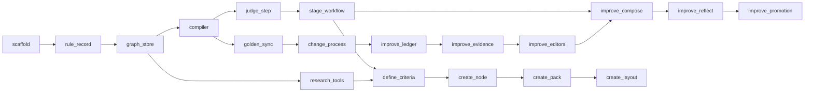

# Harness plan `plan`

Status. Plan of 2026-10-24. `plan.scaffold` shipped on 2026-10-25 in [#5](https://github.com/Ronitron007/product-eval-harness/pull/5). No other unit has started. It splits the design ([rule-graph.md](../design/rule-graph.md), [rule-enforcement.md](../design/rule-enforcement.md), [self-improvement.md](../design/self-improvement.md), [mastra-mapping.md](../design/mastra-mapping.md)) into units.

## Rules for each unit `plan.rules`

- One unit is one PR, with a check that can fail. The check runs in CI.

- Opus implements each unit. A fresh Opus reviewer, never the implementer, reviews it. A unit merges only when its checks pass and no review finding is open (`rules.agents`).

- Each code PR gets a docs PR that updates the design docs and the board.

- Tests use recorded or mocked model output. A test never calls a real model. A real model call is a paid run and needs a yes for its prompt, model, and cost (`rules.gates`).

- Before a unit writes Mastra code, it reads the embedded docs of the pinned version (`rules.mastra`).

## Order `plan.order`

## Units `plan.units`

| Unit | What it adds | The check that can fail |
|---|---|---|
| `plan.scaffold` | A TypeScript project from the official `create-mastra --empty` boilerplate, with ES2022 modules, exact pins of the `@mastra/*` packages that the code uses (`@mastra/core` 1.79.0, `@mastra/libsql` 1.27.0), Vitest, and a Mastra instance with LibSQL storage. Each later unit adds its own packages with exact pins. A CI job runs the type check and the tests. | CI runs `tsc --noEmit` and `vitest run`. A test builds the Mastra instance on an in-memory database. |
| `plan.rule_record` | The Zod schema of `RuleRecord`, a loader for the YAML rule files in `rules/`, the version hash, and a `rules:check` command | Tests with valid and invalid rule files. An invalid file must make `rules:check` exit 1. CI runs `rules:check` over `rules/`. |
| `plan.graph_store` | Drizzle tables for nodes, criteria, node criteria, additions, attributes, records, derived rules, stage runs, outputs, and verdicts. Append-only writes. The tree walk: path to the root, descendants, siblings. | Tests on a temporary database. An update of an accepted output must fail. The tree walk must return the expected paths for a fixture tree. |
| `plan.compiler` | Scope resolution with inheritance, the hash of a resolved rule set, the output schema from the `shape` rules, the instruction text, and one scorer for each check rule | Tests. A child rule that weakens an inherited rule must be refused. A change to a shared parameter of a rule record, such as an allowed unit, must change both its instruction and its check. A compiled schema must reject a bad output. |
| `plan.judge_step` | The ruleset judge step: code checks first, then judge scorers, `VerdictRow` writes, the three bindings, and "cannot verify" | Tests with mocked judges, one for each binding and each verdict. A judge with no result must give "cannot verify", never pass. |
| `plan.stage_workflow` | The stage workflow: context, research, draft, judge, the repair loop with a budget of 3 rounds, the person step, assimilate. Register each stage workflow in `src/mastra/index.ts` too, so that Studio sees it. | Tests with mocked agents: a pass on the first round, a pass after a repair, a spent budget that suspends, and a resume with accept and with reject |
| `plan.research_tools` | `get_node_context`, `search_records` with a filter that code sets, `web_fetch`, and `web_search` over one search API | Tests with recorded HTTP replies. No live call in CI. The search API needs an account and a key that Rohan creates. |
| `plan.define_criteria` | The stage rules of `define_criteria` as YAML files, its output shape, and its golden examples, for the domain node `skincare` | `rules:check`, and a test of the stage on recorded model output. A first real run is a paid run that needs Rohan's yes. |
| `plan.create_node` | The stage rules and the output shape of `create_node`: relevance, meaning, additions, attributes, records | Same kind of checks as `plan.define_criteria`, on the child node `sunscreen` |
| `plan.create_pack` | The stage rules of `create_pack`, the pack shape, and the person gate before a pack grades products | Same kind of checks. A pack without the person gate must not reach the store. |
| `plan.create_layout` | The stage rules of `create_layout` and the layout shape | Same kind of checks. A layout that shows an attribute outside its pack must fail. |
| `plan.golden_sync` | A sync of the visible examples of each rule into one Mastra dataset for each rule, and a CI gate that runs each code-check rule over them with `runEvals`, a pass-through target, and a scorer that compares the verdict with the expected verdict | CI fails when a code check gives the wrong verdict on a golden example. |
| `plan.change_process` | Two experiments for a candidate and a current rule version, the change report, and the promotion step that suspends for Rohan's yes | Tests on stored experiment rows. The promotion step must stay suspended without a yes. |
| `plan.improve_ledger` | `budget_ledger` and `run_identity`: the expected counts, the cost estimate, the paid-run yes, and the hashes | Tests. A run with a duplicate label or a wrong count must fail. A resume with a changed rule set hash must re-run. |
| `plan.improve_evidence` | `evidence_pack` and `measurement_firewall` | Tests. A pack that holds a held-out path or a held-out verdict string must be refused. |
| `plan.improve_editors` | `rule_surface`, `edit_proposal`, `proposal_validator`, and the process and domain editors | Tests with mocked editors. A change outside the surface, such as a changed `judge` field, must be refused. |
| `plan.improve_compose` | `stage_rollout` with a rule set override, `composer`, and `blind_selector` | Tests with mocked agents. The selector must not see which rule set made an output. |
| `plan.improve_reflect` | `reflector`, `lesson_library`, and `improvement_stream` | Tests. A lesson with no evidence must not enter the library. A node must not see a lesson of a later item. |
| `plan.improve_promotion` | `held_out_measurement` and `promotion_gate` over the subtree of the rule owner | Tests. A draft that regresses on any node of that subtree, a sibling included, must not be published. |

## What needs Rohan `plan.needs_rohan`

| Item | Why |
|---|---|
| Each paid run: the first real run of each stage, each judge golden run, each improvement run, each rule trial | `rules.gates`: show the exact prompt, the model, and the cost first |
| The account and key of the search API for `plan.research_tools` | Claude never creates accounts or enters keys for Rohan. |
| A private database for the held-out suite | The held-out cases must stay out of this public repo (`improve.boundaries.firewall`). |
| Each promotion of a rule version out of watch | `rules.gates` |
