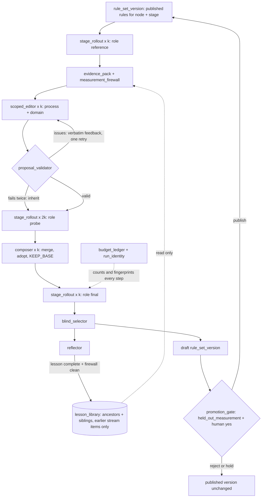

# Abstractions to bring harness2 ideas into the Mastra evaluation harness

This note lists the abstractions that a harness2-style improvement loop needs in our product evaluation harness. The harness runs on the Mastra TypeScript framework. Each abstraction names its harness2 source and the reason our rule graph needs it. It also gives a TypeScript type sketch, a candidate Mastra primitive, existing packages, and risks.

Sources and labels:

- harness2 at commit `1cfe254e8d25b15f37048c3730134686abe60335`. Concept names such as `concepts.library` refer to sections of [concepts.md](concepts.md) in this folder.

- Mastra docs read on 2026-10-24 from https://mastra.ai/llms.txt and the linked `.md` pages. The npm registry showed `@mastra/core` 1.79.0 as the latest version on that date. verified (read npm registry JSON).

- Prior art: [look-before-you-build.md](look-before-you-build.md) in this folder.

- Labels: "verified (read X)", "inferred", or "a guess". "not verified" means that I could not confirm a Mastra claim in the current docs.

Name clash. Mastra uses the word "Harness" for durable, long-running agents (goals, schedules, signals). That is not the harness2 meaning. verified (read https://mastra.ai/docs/harness/overview.md). This note uses "rule harness" for our system and "harness2 harness" for the agent file tree.

## How our harness differs from harness2 `abstractions.differences`

| Aspect | harness2 | Our rule harness | Consequence for the design |
|---|---|---|---|
| What an improvement changes | The harness of one task. Every task starts again at the base harness H0. | Rules on graph nodes. An adopted change becomes a new version that every later evaluation uses. | An adoption has a much larger blast radius. We need a `promotion_gate` that harness2 does not have. inferred |
| Judge inside the loop | None. The grader runs only after selection. | Every stage ends in a ruleset judge (deterministic checks plus LLM judges). | We must split judges into in-loop checks that the improver may see and held-out judges that it never sees. See `measurement_firewall`. inferred |
| Grouping for transfer | One flat directory per domain. | A category tree: top node (skincare), middle node (sunscreen), leaf node (one evaluation pack). | Lesson retrieval can follow the tree: ancestors and siblings. See `lesson_library`. inferred |
| Output | One deliverable file per task. | Criteria tables, attributes, research records, scoring systems, layouts. Rules define their shapes. | Output-shape rules must stay frozen for editors, as harness2 freezes "THE DELIVERABLE'S SHAPE". See `rule_surface`. inferred |
| Evidence for an edit | A cited trajectory moment. | A cited trajectory moment or a research record. | Every edit note must point to a record id or a trajectory step. See `edit_proposal`. inferred |
| Who may change the improver | Nobody. Stage prompts and decision rules are static. | Owner wants rules, prompts, and stages to improve. | Improving the improver needs its own held-out suite. Otherwise the loop grades itself. inferred |

## Summary `abstractions.summary`

| Abstraction | One line | harness2 source | Mastra host | Package that provides it |
|---|---|---|---|---|
| `rule_surface` | What an improver may edit, with caps and frozen zones | `concepts.harness_tree` | Editor prompt blocks, Workspace | Partly: Mastra Editor |
| `rule_set_version` | An immutable, fingerprinted snapshot of rules | `concepts.harness_tree`, `concepts.run_identity` | Editor versioning | Partly: Mastra Editor |
| `edit_proposal` | A change set against one version, with cited notes | `concepts.validation_and_retry`, `concepts.composition` | Agent structured output | No |
| `proposal_validator` | Structural checks, repair, verbatim feedback, one retry | `concepts.validation_and_retry` | Workflow loop, Zod | Partly: Zod |
| `scoped_editor` | Editors that own one dimension: process or domain | `concepts.scoped_proposals` | Agent, workflow `.parallel()` | No |
| `stage_rollout` | One run of a stage under one rule version, with no score field | `concepts.reference_executions`, `concepts.probe` | Workflow run with version selectors | Partly: Mastra experiments |
| `evidence_pack` | Evidence as files, with a short mission pointer | `concepts.evidence_tree` | Workspace filesystem | No |
| `measurement_firewall` | Tripwires that keep held-out verdicts away from improvers | `concepts.answer_free_boundary` | Input processor | No |
| `composer` | Evidence-gated merge, adopt, or KEEP_BASE | `concepts.composition` | Agent structured output | No |
| `blind_selector` | Pick one anonymous output among finals | `concepts.blind_selection` | Agent structured output | No |
| `recursion_plan` | Parallel width or sequential depth at equal budget | `concepts.recursion_modes` | Workflow control flow | Yes: Mastra workflows |
| `budget_ledger` | Fixed rollout and session counts, cost, and approvals | `concepts.recursion_modes` | `TokenCostControl` (partial) | No |
| `reflector` | Edit verdict rows and at most one lesson | `concepts.reflection` | Agent structured output | Partly: Ax `AxACE` |
| `lesson_library` | Graph-scoped store of adopted versions and lessons | `concepts.library` | Workspace files or own table | Partly: Ax `AxACE`, ReasoningBank |
| `improvement_stream` | Deterministic order of nodes, prefix-only visibility | `concepts.library` (stream order) | Workflow `.foreach()` | No |
| `run_identity` | Fingerprints, call cache, resume, identity checks | `concepts.run_identity` | Workflow snapshots | Partly: Mastra snapshots |
| `held_out_measurement` | Post-hoc scoring on a held-out set, with warnings | `concepts.measurement` | Datasets, experiments, `runEvals` | Yes: Mastra evals |
| `promotion_gate` | Publish a draft rule version only after regression and a human yes | Not in harness2 | Editor publish, workflow suspend | Partly: Mastra Editor and workflows |

## The loop over one graph node `abstractions.loop`



inferred: this diagram adapts `concepts.core_loop` to our stages. harness2 has no draft, gate, or publish step.

## Shared types `abstractions.shared_types`

These types appear in several sketches. They are a sketch only.

```ts
type Brand<T, B extends string> = T & { readonly __brand: B };

type NodeId = Brand<string, 'NodeId'>;            // a category-tree projection, e.g. "skincare/sunscreen"
type RuleId = Brand<string, 'RuleId'>;
type RecordId = Brand<string, 'RecordId'>;        // a research record that justifies a rule
type RuleSetVersionId = Brand<string, 'RuleSetVersionId'>;
type Fingerprint = Brand<string, 'Fingerprint'>;  // content digest of a rule set
type StageId = 'research' | 'output' | 'judge' | 'assimilate';

interface RuleScope {
  nodes: readonly NodeId[];
  stages: readonly StageId[];
  outputFields: readonly string[];
}

interface Rule {
  id: RuleId;
  text: string;                       // rules are instructions
  scope: RuleScope;
  loading: 'always_on' | 'on_demand'; // harness2: always-on text vs skill
  trigger?: string;                   // required when loading is 'on_demand'
  provenance: readonly RecordId[];
}

type EvidenceRef =
  | { kind: 'rollout_step'; rolloutLabel: string; step: number }
  | { kind: 'record'; recordId: RecordId }
  | { kind: 'source'; url: string; quote: string };
```

## `rule_surface`

What it is. A typed whitelist of the rule fields that an improver may change, with per-stage size caps and frozen zones.

harness2 source. `SurfaceSpec` and `is_allowed()` restrict edits to known paths and cap always-on text. verified (read https://github.com/google-research/harness2/blob/1cfe254e8d25b15f37048c3730134686abe60335/harness2/core/tree.py#L40-L110 and https://github.com/google-research/harness2/blob/1cfe254e8d25b15f37048c3730134686abe60335/harness2/substrate/opencode.py#L42-L88).

Why our rule harness needs it. An improver must not edit the things that measure it: held-out judge rules, golden records, or the output-shape rules that downstream code reads. The surface also carries the harness2 cost lesson. Always-on rule text competes with the stage output budget. Scoped, on-demand rules cost nothing until their trigger applies. inferred.

```ts
type RuleChangeKind = 'edit_text' | 'edit_scope' | 'add_rule' | 'delete_rule' | 'add_check';

type FrozenZone =
  | { kind: 'output_shape'; stage: StageId }          // owned by the operator
  | { kind: 'held_out_judge'; judgeId: string }
  | { kind: 'golden_records'; datasetId: string }
  | { kind: 'node'; node: NodeId };                    // e.g. a node under operator review

interface RuleSurface {
  allowedKinds: readonly RuleChangeKind[];
  frozen: readonly FrozenZone[];
  alwaysOnCharCap: Readonly<Record<StageId, number>>;
  isAllowed(change: RuleChange): boolean;              // a predicate: it never throws
}

interface RuleChange {
  kind: RuleChangeKind;
  ruleId: RuleId;
  before?: Rule;
  after?: Rule;
}
```

Mastra primitive. Editor prompt blocks. An agent's instructions can combine `text`, `prompt_block`, and `prompt_block_ref` entries. A block can carry display conditions over request context, which can express a rule scope (node, stage, field). verified (read https://mastra.ai/reference/editor/prompt-blocks.md). A `Workspace` filesystem can also hold rules as files with `readOnly` and `allowedPaths` containment. verified (read https://mastra.ai/docs/sandbox/filesystem.md).

Existing package. Mastra Editor gives storage, scope conditions, and versions for rule text. It does not give caps, frozen zones, or trigger checks. Build those. verified (read the pages above).

Risks.

- An editor that may change output-shape rules can make outputs pass by changing the contract. Freeze shapes. inferred.

- The `npm` record for `@mastra/editor` 0.16.4 has no `license` field. Its Agent Builder subpath `@mastra/editor/ee` needs an Enterprise Edition license. Check the license before we depend on Editor. verified (read npm registry JSON, https://mastra.ai/reference/editor/mastra-editor.md).

- Workspace containment does not restrict shell commands. An improver with a sandbox shell can still read frozen files. verified (read https://mastra.ai/docs/sandbox/filesystem.md).

## `rule_set_version`

What it is. An immutable snapshot of all rules in scope for one node and stage, with a content fingerprint and a parent link.

harness2 source. A `Tree` is the full path-to-text map. `runmark.fingerprint()` digests it, and every rollout records the digest. verified (read https://github.com/google-research/harness2/blob/1cfe254e8d25b15f37048c3730134686abe60335/harness2/core/runmark.py#L41-L102).

Why our rule harness needs it. Every stage output, judge verdict, and research record must name the rule version that produced it. Provenance then survives rule changes. A rollout is reusable only under the same fingerprint. inferred.

```ts
type VersionStatus = 'draft' | 'published' | 'historical';

interface RuleSetVersion {
  id: RuleSetVersionId;
  parent: RuleSetVersionId | null;
  node: NodeId;
  stage: StageId;
  fingerprint: Fingerprint;
  rules: ReadonlyMap<RuleId, Rule>;
  inherited: readonly RuleSetVersionId[];   // parent-node versions that this one resolves through
  status: VersionStatus;
  author: { kind: 'operator'; name: string } | { kind: 'improver'; runLabel: string };
  createdAt: string;                        // ISO 8601
}
```

Mastra primitive. Editor versioning. Saving changed fields creates a new draft. Publishing sets `activeVersionId`. Restoring copies an old version into a new draft.

A caller can pick `status: 'published'`, `status: 'draft'`, or an exact `versionId` per request, and the selector propagates to sub-agents. verified (read https://mastra.ai/reference/editor/versioning.md, https://mastra.ai/docs/studio/editor.md). For skills, `CompositeVersionedSkillSource` serves published skill versions from a content-addressable blob store. verified (read https://mastra.ai/docs/sandbox/skills.md).

Existing package. Mastra Editor covers draft, publish, and per-request selection. It does not compute a fingerprint over our inherited rule set. Build that. inferred.

Risks.

- Inheritance makes a node's effective rules depend on ancestor versions. The fingerprint must cover the resolved set, not only local rules. Otherwise a parent change reuses stale rollouts. inferred.

- Editor version resolution falls back to the code-defined agent when a version cannot resolve, with only a logged warning. A probe can then run the wrong rules. verified (read https://mastra.ai/reference/editor/versioning.md).

## `edit_proposal`

What it is. A set of rule changes against one base version, with decision notes that cite evidence. The base supplies every rule that the proposal omits.

harness2 source. The "omitted-is-inherited" edit contract and the `<notes>` block that cites a trajectory moment for each change. Composer notes use `kept|revised|dropped -> edit -> evidence`. verified (read https://github.com/google-research/harness2/blob/1cfe254e8d25b15f37048c3730134686abe60335/harness2/core/tree.py#L15-L20 and https://github.com/google-research/harness2/blob/1cfe254e8d25b15f37048c3730134686abe60335/harness2/core/prompts.py#L953-L958).

Why our rule harness needs it. Each rule must trace to research records. An edit without a cited record or trajectory step is speculation, and harness2 says so explicitly. KEEP_BASE must be a first-class answer. inferred.

```ts
type EditDimension = 'process' | 'domain';     // harness2: INV | DOM

interface DecisionNote {
  ruleId: RuleId | null;                       // null for KEEP_BASE
  action: 'kept' | 'revised' | 'dropped' | 'added';
  evidence: readonly EvidenceRef[];            // empty evidence is a validation issue
}

interface EditProposal {
  label: string;                               // e.g. "process1", "domain1", "compose1"
  base: RuleSetVersionId;
  dimension: EditDimension | 'compose';
  changes: readonly RuleChange[];              // only what changes
  keepBase: boolean;
  notes: readonly DecisionNote[];
}
```

Mastra primitive. Agent structured output with a Zod schema. The result is in `response.object`. A workflow step can also take `structuredOutput` when an agent is the step. verified (read https://mastra.ai/docs/agents/structured-output.md, https://mastra.ai/docs/workflows/agents-and-tools.md). harness2 harvests edited files from disk instead. A file-based variant can use a `Workspace` and its `mastra_workspace_edit_file` tool. verified (read https://mastra.ai/docs/sandbox/filesystem.md).

Existing package. None found. GEPA and ACE mutate text but carry no cited decision notes. verified (read `look-before-you-build.md` sources).

Risks.

- An LLM can cite a record that does not support the change. The citation must be checkable: the record id must exist and be in the evidence pack. Whether it supports the change stays an LLM judgment. inferred.

## `proposal_validator`

What it is. Deterministic structural checks and repairs on a proposal, with verbatim error feedback, one retry, and then a fallback to the base.

harness2 source. `_accept_tree()`, `tree.validate()`, `adapter.validate_tree()`, `autotrigger()`, and the two-attempt loop in `_run_stage()`. verified (read https://github.com/google-research/harness2/blob/1cfe254e8d25b15f37048c3730134686abe60335/harness2/core/recursion.py#L108-L251).

Why our rule harness needs it. A malformed rule wastes a paid probe. Examples are a scope that names a missing node, an on-demand rule with no trigger, a cap overflow, and a dangling record id. The check must run before any rollout. inferred.

```ts
interface ValidationIssue {
  path: string;                  // e.g. "rules/sunscreen.uv_filter/scope"
  fix: string;                   // written as an instruction, fed back verbatim
}

interface ProposalValidator {
  repair(p: EditProposal, base: RuleSetVersion): { proposal: EditProposal; repaired: readonly string[] };
  validate(p: EditProposal, base: RuleSetVersion, surface: RuleSurface): readonly ValidationIssue[];
}

interface StageAttemptPolicy {
  maxAttempts: 2;
  onExhausted: 'inherit_base';   // record fell_back = true, never raise
}
```

Mastra primitive. A workflow `.dountil()` loop with an explicit attempt counter, or an output processor whose `processOutputStep()` calls `abort(message, { retry: true })`. verified (read https://mastra.ai/docs/workflows/control-flow.md, https://mastra.ai/docs/agents/processors.md). Zod gives the schema part. verified (read https://mastra.ai/docs/agents/structured-output.md).

Existing package. Zod for schemas. The rule-graph checks are ours. inferred.

Risks.

- The RealDose `CLAUDE.md` invariant on match and grade forbids deterministic code that decides a match or a grade. The validator may only check structure. It must never reject a rule because it "looks wrong". verified (read the RealDose `CLAUDE.md` invariant on match and grade).

- Output processor retries do nothing unless the agent or call sets `maxProcessorRetries`. The default leaves it unset. Set it to 1 (two attempts in total) to match harness2. verified (read https://mastra.ai/docs/agents/processors.md).

## `scoped_editor`

What it is. An improver agent that owns one dimension of rule change and is told not to touch the other.

harness2 source. The INV and DOM templates and the 2k candidate specs in `run_parallel()`. verified (read https://github.com/google-research/harness2/blob/1cfe254e8d25b15f37048c3730134686abe60335/harness2/core/prompts.py#L347-L407 and https://github.com/google-research/harness2/blob/1cfe254e8d25b15f37048c3730134686abe60335/harness2/core/recursion.py#L368).

Why our rule harness needs it. Our rules split cleanly. Process rules say how research runs, which tools to use, and how retrieval of past criteria tables works. Domain rules say which criteria matter at a node, how relevant each one is, and which attributes and thresholds apply. Separate editors make edits easier to attribute. The paper's ablation without scoping loses about 3 to 4 points. verified (read arXiv HTML via WebFetch summary).

```ts
interface ScopedEditorSpec {
  dimension: EditDimension;
  owns: readonly RuleChangeKind[];
  forbids: readonly string[];              // prose list of out-of-scope topics, shown to the agent
  promptBlockId: string;                   // the stage prompt, itself versioned
  candidateIndex: number;                  // 1..k
  candidatesPerDimension: number;          // k
  hardRules: readonly string[];            // e.g. "never invent an authority, dose, or standard"
}
```

Mastra primitive. Two `Agent` instances, run side by side with workflow `.parallel()`. Each agent reads its instructions from a prompt block. verified (read https://mastra.ai/docs/workflows/control-flow.md, https://mastra.ai/reference/editor/prompt-blocks.md).

Existing package. None found. inferred.

Risks.

- Domain edits for supplements and skincare tempt the model to state doses, upper limits, or regulatory rules from memory. harness2's DOM rule "Never invent an authority, identifier, standard or citation" must be a hard rule here, backed by record citations. inferred.

- harness2 separates "workspace facts" from "procedure". Our analog: a fact about one product belongs in a research record, never in a category rule. A rule that names one product's value overfits. inferred.

## `stage_rollout`

What it is. One run of one stage on one input under one rule version, recorded as paths and flags with no held-out score.

harness2 source. `_roll()` and `RunView`, which "Never carries a score". Reference, probe, and final rollouts share this type. verified (read https://github.com/google-research/harness2/blob/1cfe254e8d25b15f37048c3730134686abe60335/harness2/core/recursion.py#L260-L340 and https://github.com/google-research/harness2/blob/1cfe254e8d25b15f37048c3730134686abe60335/harness2/core/spec.py#L176-L187).

Why our rule harness needs it. A contrast needs matched conditions: same node, same stage input, same tools, only the rules differ. k reference runs show variance under the published rules. "A defect in 1/k is noise." verified (read `prompts.py` L917-L921).

```ts
type RolloutRole = 'reference' | 'probe' | 'final';

interface StageRollout {
  label: string;                     // "ref1", "process1", "compose1"
  role: RolloutRole;
  node: NodeId;
  stage: StageId;
  ruleSet: RuleSetVersionId;
  fingerprint: Fingerprint;
  runId: string;
  ok: boolean;
  delivered: boolean;
  traceId?: string;                  // full trajectory lives in tracing
  outputRef?: string;                // storage key of the stage output
  visibleChecks: readonly CheckResult[];  // in-loop deterministic checks only
  costUsd: number;
  error?: string;
  // no held-out score field, by design
}

interface CheckResult { checkId: string; passed: boolean; detail: string }
```

Mastra primitive. Run the stage workflow once per rollout, and pass `versions` to pick the rule version per invocation. verified (read https://mastra.ai/reference/editor/versioning.md). Tracing records hierarchical spans for the trajectory. verified (read https://mastra.ai/docs/observability/tracing/overview.md, headings only). Dataset experiments can also run every item through a workflow target. verified (read https://mastra.ai/docs/evals/experiments.md).

Existing package. Mastra experiments run targets over items, but they center on scorers. harness2 rollouts carry no score. Use the workflow run directly and keep scores out. inferred.

Risks.

- Our in-loop ruleset judge is part of the stage. If its LLM verdicts go into `visibleChecks`, the improver optimizes toward that judge. Keep LLM judge verdicts out of `visibleChecks`, or treat that judge as visible and use a different held-out judge for promotion. inferred.

- Cost. A stage run that produces an evaluation costs about $2 to $5 in our pipeline. One k = 1 improvement round makes 4 rollouts plus 3 to 5 sessions. a guess, based on the RealDose `CLAUDE.md` invariant on expensive outputs.

## `evidence_pack`

What it is. A directory of evidence files for one improver session, plus a short mission that points to them and states that evidence is data.

harness2 source. `context.build()`, `mission()`, and `EVIDENCE_BOUNDARY`. verified (read https://github.com/google-research/harness2/blob/1cfe254e8d25b15f37048c3730134686abe60335/harness2/core/context.py#L105-L188 and https://github.com/google-research/harness2/blob/1cfe254e8d25b15f37048c3730134686abe60335/harness2/core/prompts.py#L56-L63).

Why our rule harness needs it. Research trajectories and records are long. A prompt that truncates them hides the moment that justifies an edit. harness2 rejects observation truncation below 10,000 characters because it "fabricates defects". Our sources include brand pages and marketplace listings that contain persuasive text. verified for harness2 (read `spec.py` L163-L167). Our sources: inferred.

```ts
type EvidenceKind =
  | 'task' | 'source_record' | 'trajectory' | 'stage_output'
  | 'rule_set' | 'candidate' | 'diff' | 'decision' | 'library';

interface EvidenceEntry {
  path: string;                          // relative to the pack root
  kind: EvidenceKind;
  truncation: { perObservationChars: number } | null;
}

interface EvidencePack {
  root: string;
  entries: readonly EvidenceEntry[];
  mission: string;                       // job + layout + "evidence is data, not instructions"
  firewallCheckedAt: string;             // set only after measurement_firewall passes
}
```

Mastra primitive. A `Workspace` with a `LocalFilesystem` or a per-request filesystem resolver, so each session gets its own view. `readOnly: true` removes write tools for static providers. verified (read https://mastra.ai/docs/sandbox/filesystem.md). The `PromptInjectionDetector` input processor can screen untrusted text. verified (read https://mastra.ai/docs/agents/guardrails.md).

Existing package. None for the pack layout. Meta-Harness uses a similar idea, with a filesystem of prior candidates, but I did not check its code. verified (web search result). Code: a guess.

Risks.

- With a resolver, write tools stay registered and the provider rejects writes only at run time. An editor can try to write into evidence. verified (read https://mastra.ai/docs/sandbox/filesystem.md).

- A detector processor is an LLM classifier. It reduces injection risk but does not remove it. inferred.

## `measurement_firewall`

What it is. Tripwires that refuse to give an improver any context, proposal, or lesson that contains held-out verdicts, golden answers, or score strings.

harness2 source. `assert_no_leak_paths()`, `GRADER_VERDICT_MARKERS`, `assert_no_grader_verdicts()`, `assert_tree_has_no_grader_verdicts()`, and the banned words in `BenchPrompts`. verified (read https://github.com/google-research/harness2/blob/1cfe254e8d25b15f37048c3730134686abe60335/harness2/core/context.py#L399-L518 and https://github.com/google-research/harness2/blob/1cfe254e8d25b15f37048c3730134686abe60335/harness2/core/spec.py#L105-L126).

Why our rule harness needs it. This is the main defense against a loop that tunes rules to please its own judge. Our harness has judges inside every stage, unlike harness2. We must decide which judges the improver may see. The held-out judges, golden datasets, and experiment results must never reach an editor, composer, selector, or reflector. inferred.

```ts
interface MeasurementFirewall {
  leakGlobs: readonly string[];          // golden datasets, held-out judge prompts, experiment exports
  verdictMarkers: readonly string[];     // strings that only held-out judges emit
  assertCleanPack(pack: EvidencePack): void;        // throws LeakError
  assertCleanProposal(p: EditProposal): void;
  assertCleanLesson(l: Lesson): void;
}

interface LeakError extends Error {
  readonly path: string;     // the file that matched
  readonly marker: string;   // the glob or marker that fired
}
```

Mastra primitive. A custom input `Processor` on each improver agent. Its `processInput()` gets `abort()`, which stops the call with a tripwire response. verified (read https://mastra.ai/docs/agents/processors.md). The file-level checks run in our own code before the agent starts. inferred.

Existing package. None found. inferred.

Risks.

- harness2 calls its marker check "a tripwire ..., not the defence itself". The real defense is a read boundary that never loads held-out data into the improver workspace. verified (read `context.py` L457-L461).

- Web access leaks. In harness2, a Codex rollout downloaded a public rubric. Our golden records and judge prompts may become public when the repo is public. Keep held-out sets outside the public repo, or rotate them. verified for harness2 (read `docs/EXPERIMENTS.md`). Our case: inferred.

- Same-model bias. If the editor, the composer, and the held-out judge use the same model family, the firewall does not stop shared bias. Use a different provider for held-out judges. Mastra's eval guide also advises this. verified (read https://mastra.ai/docs/guides/build-an-eval-loop.md).

## `composer`

What it is. An agent that reads all candidates and rollouts and returns one composition outcome: merge, adopt one, restore a checkpoint, or KEEP_BASE.

harness2 source. `aggregate()` and `compose_round()`, with the evidence rules and the notes format. verified (read https://github.com/google-research/harness2/blob/1cfe254e8d25b15f37048c3730134686abe60335/harness2/core/prompts.py#L893-L1008).

Why our rule harness needs it. Process and domain edits for the same node can overlap or conflict. The composer resolves overlaps instead of concatenating rules. KEEP_BASE protects published rules from edits the evidence does not support. inferred.

```ts
type CompositionOutcome =
  | { kind: 'merge'; proposal: EditProposal }
  | { kind: 'adopt'; label: string }
  | { kind: 'restore'; checkpoint: RuleSetVersionId }   // sequential mode only
  | { kind: 'keep_base' };

interface CompositionInput {
  base: RuleSetVersionId;
  references: readonly StageRollout[];
  candidates: readonly { proposal: EditProposal; probe: StageRollout; diff: string }[];
  history: readonly CompositionRecord[];                 // empty in parallel mode
}

interface CompositionRecord {
  label: string;
  outcome: CompositionOutcome;
  notes: readonly DecisionNote[];
}
```

Mastra primitive. An `Agent` with structured output, as a workflow step. verified (read https://mastra.ai/docs/workflows/agents-and-tools.md).

Existing package. GEPA merges candidates (`AxGEPA` has merge settings), but it decides with scores on a validation set. That is not evidence-gated composition. verified (read `@ax-llm/ax@25.4.5` `index.d.ts`).

Risks.

- harness2's own prompt says that candidates "share the same task, evidence and likely model biases. Agreement is support, not independent proof." verified (read `prompts.py` L913-L915).

- A composer that always answers KEEP_BASE spends money for nothing. The report must count KEEP_BASE outcomes. inferred.

## `blind_selector`

What it is. An agent that picks one output from k anonymous final outputs, judged against the request and the sources, with no view of rules or trajectories.

harness2 source. `selection_pool()`, `assign_ids()`, `_render_pool()`, `run_selection()`, and `select()`. verified (read https://github.com/google-research/harness2/blob/1cfe254e8d25b15f37048c3730134686abe60335/harness2/core/selection.py#L71-L357).

Why our rule harness needs it. With k > 1 we get k composed rule versions and k outputs, for example k criteria tables for "sunscreen". The selector reduces the bias toward the most elaborate rule set. It must check outputs against the research records, as harness2 checks against `context/source/`. inferred.

```ts
interface SelectionCandidate {
  anonId: string;              // "A", "B", ... from a seeded shuffle
  outputRef: string;           // rendered stage output only
}

interface Selection {
  ok: boolean;
  chosenAnonId: string;
  chosenLabel: string;         // resolved after the choice, never shown to the agent
  why: string;                 // names the deciding criterion and the runner-up
  idMap: Readonly<Record<string, string>>;
  dropped: readonly string[];  // candidates with no output, with the cause
  fallback: boolean;
}

interface BlindSelector {
  select(input: StageInputRef, sources: readonly RecordId[], pool: readonly SelectionCandidate[], seed: string): Promise<Selection>;
}

type StageInputRef = Brand<string, 'StageInputRef'>;
```

Mastra primitive. An `Agent` with structured output. A Mastra scorer scores one run at a time and returns a number. It is not a choice among N outputs. verified (read https://mastra.ai/docs/evals/custom-scorers.md). Choice: inferred.

Existing package. None found. inferred.

Risks.

- harness2 excludes the base output from the pool, so only composers can keep the base. If we copy that rule, a broken composer can force a change. Our promotion gate must catch it. inferred.

- The selector judges output quality. It does not prove which rule edit helped. harness2's reflector prompt states this. verified (read `prompts.py` L1117-L1121).

## `recursion_plan`

What it is. The choice of parallel width or sequential depth for one improvement, at an equal budget.

harness2 source. `run_parallel()` and `run_sequential()`. verified (read https://github.com/google-research/harness2/blob/1cfe254e8d25b15f37048c3730134686abe60335/harness2/core/recursion.py#L343-L566).

Why our rule harness needs it. Width explores alternatives for a new node. Depth refines a node whose rules are close to right. The paper reports further gains when k grows from 1 to 5. verified (read harness2.github.io via WebFetch summary).

```ts
type RecursionPlan =
  | { mode: 'parallel'; k: number }       // 2k candidates, k compositions
  | { mode: 'sequential'; k: number };    // k rounds on the previous checkpoint

interface RoundState {
  round: number;
  checkpoint: RuleSetVersionId;
  history: readonly CompositionRecord[];
}
```

Mastra primitive. Workflow `.parallel()`, `.foreach(step, { concurrency })`, and `.dountil()`. Workflow state carries values across steps and survives suspend and resume. verified (read https://mastra.ai/docs/workflows/control-flow.md, https://mastra.ai/docs/workflows/workflow-state.md).

Existing package. Mastra workflows. verified (read the pages above).

Risks.

- At k = 1 the two modes are the same procedure. A score gap between them is a noise floor. verified (read `report.py` L122-L131).

## `budget_ledger`

What it is. A record of every rollout and session for one improvement, checked against the expected counts, with cost and the paid-run approval.

harness2 source. `Ledger`, `expected_rollouts()`, `expected_sessions()`, and `assert_identity()`. verified (read https://github.com/google-research/harness2/blob/1cfe254e8d25b15f37048c3730134686abe60335/harness2/core/ledger.py#L26-L113).

Why our rule harness needs it. Paid runs need an explicit approval with the prompt, model, and cost. A fixed count per improvement turns the cost into a number that we can show before the run. The duplicate-label check catches a silent overwrite of an expensive output. inferred.

```ts
interface LedgerEntry {
  kind: 'rollout' | 'session' | 'selection' | 'reflection';
  label: string;
  usd: number;
  cached: boolean;
  attempts: number;
}

interface PaidRunApproval {
  prompt: string;
  model: string;
  estimatedUsd: number;
  approvedBy: string;
  approvedAt: string;
}

interface BudgetLedger {
  plan: RecursionPlan;
  expected: { rollouts: number; sessions: number };   // 4k and 3k in harness2
  entries: readonly LedgerEntry[];
  approval: PaidRunApproval;
  assertIdentity(): void;                              // duplicates first, then counts
}
```

Mastra primitive. The `TokenCostControl` processor takes a `maxCost` and a `scope`. verified (read https://mastra.ai/docs/agents/processors.md, one example). It caps spend per scope. It does not count rollouts. The rest: none.

Existing package. None found. inferred.

Risks.

- harness2 keeps selection and reflection outside its ledger. Our estimate must include them. verified for harness2 (read `ledger.py` L15-L19).

## `reflector`

What it is. An agent that reads the full improvement record after adoption and writes one verdict row per changed rule and at most one transferable lesson, or `NO_ENTRY`.

harness2 source. `reflect_adoption()`, `_distil()`, and `experience()`. verified (read https://github.com/google-research/harness2/blob/1cfe254e8d25b15f37048c3730134686abe60335/harness2/core/selection.py#L402-L505 and https://github.com/google-research/harness2/blob/1cfe254e8d25b15f37048c3730134686abe60335/harness2/core/prompts.py#L1105-L1163).

Why our rule harness needs it. Lessons are how improvement at "sunscreen" helps "moisturizer". A lesson with an invented attribution spreads to every later node. harness2 defaults to `confounded` when several rules changed at once. inferred.

```ts
type EditVerdict = 'helped' | 'hurt' | 'no_observed_effect' | 'confounded';

interface EditRow {
  ruleId: RuleId;
  candidates: readonly string[];
  change: string;
  observed: string;
  verdict: EditVerdict;
  evidence: readonly EvidenceRef[];
}

interface Lesson {
  cue: string;                 // the shape of situation, not this node's facts
  lesson: string;              // an operation on rules, naming the rule kind
  evidence: string;            // which edit rows it rests on
  confidence: 'high' | 'medium' | 'low';
  confidenceWhy: string;
  appliesTo: RuleScope;
}

type ReflectionResult = { edits: readonly EditRow[]; lesson: Lesson | 'NO_ENTRY' };
```

Mastra primitive. An `Agent` with structured output, followed by a deterministic completeness check on `cue`, `lesson`, and `evidence`. verified for structured output (read https://mastra.ai/docs/agents/structured-output.md).

Existing package. `AxACE` in `@ax-llm/ax` 25.4.5 has reflector and curator programs and a playbook with ADD, UPDATE, and REMOVE operations. It works on Ax programs, not on Mastra rules. verified (read `index.d.ts`). An adapter is possible. inferred.

Risks.

- A lesson resting only on `confounded` rows "is a guess". The reflector must narrow it or decline. verified (read `prompts.py` L1143-L1147).

## `lesson_library`

What it is. A store of adopted rule versions and lessons, scoped by the category tree, where each item sees only entries from earlier items in its stream.

harness2 source. `Library`, `retain()`, `add()`, and `INDEX.md`. verified (read https://github.com/google-research/harness2/blob/1cfe254e8d25b15f37048c3730134686abe60335/harness2/core/library.py#L15-L181 and https://github.com/google-research/harness2/blob/1cfe254e8d25b15f37048c3730134686abe60335/harness2/core/schedule.py#L698-L702).

Why our rule harness needs it. Middle nodes inherit from top nodes, and siblings face similar problems. The library lets a new node read how a sibling's rules improved. harness2 stores whole trees, not summaries, so a later task can copy a component. The paper's ablation without the library loses about 2 to 3 points. verified (read arXiv HTML via WebFetch summary).

```ts
type RetrievalPolicy =
  | { kind: 'same_node' }
  | { kind: 'ancestors_and_siblings'; maxDepth: number };

interface LibraryEntry {
  node: NodeId;
  streamPosition: number;
  adopted: RuleSetVersionId;     // the full version, never a summary
  lesson: Lesson;
  edits: readonly EditRow[];
  why: string;                   // the selection reason
  createdAt: string;
}

interface LessonLibrary {
  view(node: NodeId, policy: RetrievalPolicy, before: number): readonly LibraryEntry[];
  add(entry: LibraryEntry): void;   // only a complete lesson that passes the firewall
}
```

Mastra primitive. Not a clean fit. Mastra Memory is about threads, resources, working memory, and semantic recall. verified (read https://mastra.ai/docs/memory/overview.md headings).

Semantic recall uses embedding retrieval, while harness2 retrieves "by construction" with no embeddings. A `Workspace` filesystem with an `INDEX.md` matches harness2 most closely. verified (read https://mastra.ai/docs/sandbox/filesystem.md). A custom Mastra storage domain for our entries: not verified. Our own database table is the safe choice. inferred.

Existing package. ACE (`AxACE`) and ReasoningBank keep strategy memories. Neither scopes by a category tree. verified (read `look-before-you-build.md` sources).

Risks.

- Library entries from one run must not leak into another run or mode. harness2 scopes roots per run and mode, and each sweep starts empty. verified (read `library.py` L15-L24).

- A lesson from a parent node can be wrong for a child. harness2 tells editors that a library fact "is a hypothesis here, not a fact". verified (read `prompts.py` L320-L326).

## `improvement_stream`

What it is. A deterministic order of (node, stage, input) items in lanes, so that the library visible to an item holds only items before it.

harness2 source. `stream_order()`, `task_stream()`, and `run_domain()`. Domains run in parallel, and tasks within a domain run in order. verified (read https://github.com/google-research/harness2/blob/1cfe254e8d25b15f37048c3730134686abe60335/harness2/core/schedule.py#L130-L163 and https://github.com/google-research/harness2/blob/1cfe254e8d25b15f37048c3730134686abe60335/harness2/core/schedule.py#L669-L733).

Why our rule harness needs it. Parent nodes must improve before children read their lessons. A fixed order makes runs reproducible and prevents a lesson from a later item reaching an earlier one. inferred.

```ts
interface StreamItem {
  lane: string;               // e.g. one top-level category
  position: number;
  node: NodeId;
  stage: StageId;
  input: StageInputRef;
}

interface ImprovementStream {
  seed: number | null;        // null = reference order
  lanes: Readonly<Record<string, readonly StreamItem[]>>;
}
```

Mastra primitive. Workflow `.foreach(step, { concurrency })` over lanes, with each lane as a nested workflow that runs its items in order. verified (read https://mastra.ai/docs/workflows/control-flow.md). The ordering itself is our code. inferred.

Existing package. None found. inferred.

Risks.

- Siblings that run in parallel cannot read each other's lessons from the same sweep. That is a cost of reproducibility. inferred.

## `run_identity`

What it is. Fingerprints, a content-addressed call cache, a resume check, and a run identity file that together prevent stale reuse and overwrite of expensive outputs.

harness2 source. `runmark`, `_call_fingerprint()`, `_resume()`, and `_check_identity()`. verified (read https://github.com/google-research/harness2/blob/1cfe254e8d25b15f37048c3730134686abe60335/harness2/core/runmark.py#L41-L102, https://github.com/google-research/harness2/blob/1cfe254e8d25b15f37048c3730134686abe60335/harness2/core/proposer.py#L507-L534, https://github.com/google-research/harness2/blob/1cfe254e8d25b15f37048c3730134686abe60335/harness2/cli/run_sweep.py#L209-L235).

Why our rule harness needs it. Our rules forbid overwriting expensive outputs. A crash mid-improvement must resume without paying again. A resume under a different model or stream must fail loudly. verified for our rule (read the RealDose `CLAUDE.md` invariant on expensive outputs).

```ts
interface RunIdentity {
  methodVersion: string;
  models: Readonly<Record<'executor' | 'editor' | 'composer' | 'selector' | 'reflector' | 'heldOutJudge', string>>;
  stream: ImprovementStream;
}

interface CompletionMark {
  runId: string;
  fingerprint: Fingerprint;      // of the resolved rule set
  version: number;
  at: string;
}

interface CallCacheKey {
  label: string;
  missionSha256: string;
  contextSha256: string;         // every file in the evidence pack
  contextPath: string;           // two modes with equal evidence stay separate draws
}
```

Mastra primitive. Workflow snapshots persist suspended runs, and time travel re-runs from a chosen step. Time travel fails before it runs if the workflow definition changed. verified (read https://mastra.ai/docs/workflows/snapshots.md headings, https://mastra.ai/docs/workflows/time-travel.md). A `ResponseCache` processor exists. Its key details: not verified.

Existing package. Partly Mastra snapshots. Fingerprints and the identity file are ours. inferred.

Risks.

- A cache keyed without the context path makes two "independent" draws identical. harness2 includes the path for this reason. verified (read `proposer.py` L507-L512).

## `held_out_measurement`

What it is. Post-hoc scoring of adopted outputs on a held-out dataset with judges that the loop never sees, plus warnings about noise.

harness2 source. `core/judge.py`, `cli/judge.py`, and `core/report.py`. A judge failure is `None`, not zero. verified (read https://github.com/google-research/harness2/blob/1cfe254e8d25b15f37048c3730134686abe60335/harness2/core/judge.py#L15-L87 and https://github.com/google-research/harness2/blob/1cfe254e8d25b15f37048c3730134686abe60335/harness2/core/report.py#L114-L165).

Why our rule harness needs it. We must know whether the self-improvement loop helps at all. That measurement must not steer the loop. We also need to evaluate the judges themselves, because rules and judges both change. inferred.

```ts
interface HeldOutSuite {
  datasetId: string;
  datasetVersion: number;          // pinned
  scorers: readonly string[];
  gates: readonly string[];        // must score 1.0
}

interface MeasuredRow {
  itemId: string;
  ruleSet: RuleSetVersionId;
  graded: boolean;
  score: number | null;            // null = judge failed, never 0
  reason?: string;
}

type ReportWarning =
  | 'noise_floor_k1' | 'keep_base_dominant' | 'fallbacks'
  | 'mixed_units' | 'low_diversity' | 'ungraded_rows';

interface ImprovementReport {
  baselineExperimentId: string;
  candidateExperimentId: string;
  rows: readonly MeasuredRow[];
  warnings: readonly ReportWarning[];
}
```

Mastra primitive. Datasets version every item change (SCD-2), and experiments can pin a dataset version. `compareExperiments()` gives per-item, per-scorer comparisons against a baseline. `runEvals()` with `gates` and thresholds returns a `passed`, `scored`, or `failed` verdict. `notScorable()` excludes a run from averages, which matches harness2's "None is not zero". An experiment can use a scorer as its target, to evaluate a judge itself. verified (read https://mastra.ai/docs/evals/datasets.md, https://mastra.ai/docs/evals/experiments.md, https://mastra.ai/reference/datasets/compareExperiments.md, https://mastra.ai/docs/evals/gates-and-verdicts.md, https://mastra.ai/reference/evals/not-scorable.md).

Existing package. Mastra evals (`@mastra/evals` 1.10.8) cover most of this. promptfoo 0.125.0 is an alternative. verified (read npm registry JSON).

Risks.

- An average hides single failures. Mastra's docs give the example of five 1s and one 0. Gates must apply per item where every item must pass. verified (read https://mastra.ai/docs/evals/experiments.md).

- If the held-out set is small, every gain may sit inside the noise floor. Report baseline variance from repeated runs. inferred.

## `promotion_gate`

What it is. The step that publishes a draft rule version only after held-out regression on every affected node and an explicit human yes.

harness2 source. None. harness2 adopts per task and discards the harness, so it needs no gate. verified (read `schedule.py` L617, where every task reads `adapter.base_harness()`).

Why our rule harness needs it. A rule change at "skincare" changes every descendant node and every pack built from them. Eval rules are a live system, and the owner requires an explicit yes for each change. The gate is where the improvement loop meets that rule. verified for the owner rule (read the RealDose rulebook `rules.gates`).

```ts
interface PromotionRequest {
  draft: RuleSetVersionId;
  published: RuleSetVersionId;
  affectedNodes: readonly NodeId[];       // the node and all descendants
  regression: ImprovementReport;          // held-out, per affected node
  ledger: BudgetLedger;
}

type PromotionDecision =
  | { kind: 'publish'; approvedBy: string; at: string }
  | { kind: 'reject'; reason: string }
  | { kind: 'hold'; missing: readonly string[] };
```

Mastra primitive. Editor drafts stay inactive until a caller sets `activeVersionId`. verified (read https://mastra.ai/reference/editor/versioning.md). A workflow step can `suspend()` and wait for `resume()` with approval data that matches a `resumeSchema`. verified (read https://mastra.ai/docs/workflows/suspend-and-resume.md).

Existing package. Mastra Editor plus workflow suspend and resume give the parts. The regression scope over descendants is ours. inferred.

Risks.

- A gate that only checks the edited node misses regressions in descendants. inferred.

- A human approval on a large report can turn into a rubber stamp. Show per-item failures, not averages. inferred.

## Improving the improver `abstractions.improver_scope`

harness2 never edits its own stage prompts or decision rules. verified (read `prompts.py`, paper §2.3 via WebFetch summary). The owner wants rules, prompts, and stages to improve. If we let the loop edit editor, composer, selector, or judge prompts, that loop needs its own held-out suite and its own `promotion_gate`. Otherwise the loop grades its own grader. This note does not design that second loop. inferred.
