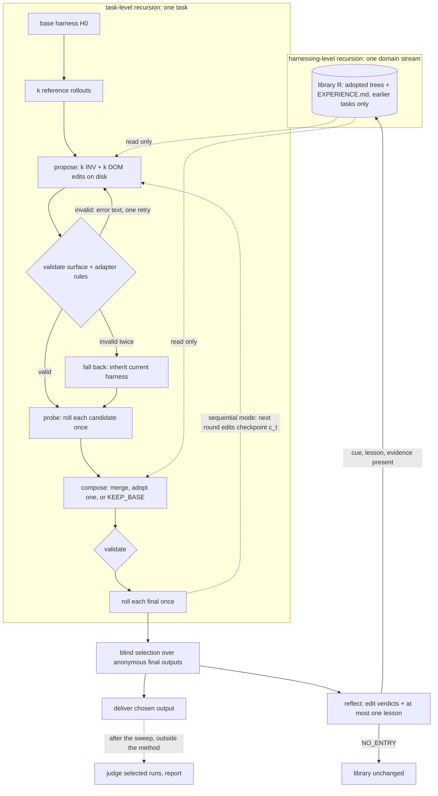

# harness2: core concepts `concepts`

Status. Research of 2026-10-24 by a research agent for this repo. The harness design reads it in [../../design/self-improvement.md](../../design/self-improvement.md).

Source: https://github.com/google-research/harness2, commit `1cfe254e8d25b15f37048c3730134686abe60335` (2026-10-13, "Fix arXiv link"). The repository has three commits. License: Apache 2.0 for the harness2 code. Code under `third_party/` keeps its upstream licenses. verified (read `LICENSE`, `README.md`, `git log`).

Paper: "Harness^2: Recursive Agent Harnessing for an Open World", arXiv 2610.14224, submitted 2026-10-09. I read the paper through WebFetch, which returns a model summary of the page. Paper claims in this note are therefore "verified (read arXiv HTML via WebFetch summary)". They are not checked word for word.

Coverage. I read these files in full: every file in `harness2/core/`, `harness2/config.py`, `harness2/demo.py`, `harness2/substrate/base.py`, `tests/test_workflow.py`, `harness2/cli/run_sweep.py`, the docs, and the baseline harness files. I read parts of `harness2/benchmarks/lab.py`, `jobbench.py`, `workbuddy.py`, `harness2/substrate/opencode.py`, `codex.py`, and `harness2/cli/judge.py`. I did not read `install.py`, `preflight.py`, `wb_render.py`, `jb_opencode_runner.py`, or most of `third_party/`. I ran no code from the clone.

## What harness2 is `concepts.summary`

harness2 is a Python framework that improves the "harness" of an LLM agent while the model weights stay fixed. A harness is the set of files around the model. These files hold the system prompt, rules, memory, tool guidance, skills, subagents, helper scripts, and plugins. For each new task, an LLM "improver" reads full execution traces of the agent on that task. The improver proposes edits to the harness files and runs the edited harnesses on the same task. It then composes one refined harness from the behavior differences.

No score or answer key enters this loop. After the task, a reflection step stores the adopted harness and at most one lesson in a per-domain library. Each lesson must cite execution evidence. Later tasks in the same domain read that library. The repository ships adapters for three public benchmarks (LAB, JobBench, WorkBuddy-Bench) and two agent runtimes (OpenCode, Codex). verified (read `README.md`, `harness2/core/`).

## Glossary `concepts.glossary`

| Term | Meaning in harness2 | Code anchor |
|---|---|---|
| model, M | The frozen LLM. Its weights never change. | paper §2.1 |
| harness, execution harness, H | The editable file tree around the model for one solver run. It has up to eight components. | `harness2/core/tree.py` |
| harnessing | The process of improving a harness. | `README.md` |
| component, c1 to c8 | One kind of harness file: system prompt, guardrails, memory, tool guidance, subagents, skills, scripts, plugins. The c-numbers in `harness.yaml` skip c2 and use c6 twice. | `third_party/jb_runner/harness_baseline_oc/harness.yaml` |
| surface, `SurfaceSpec` | The whitelist of editable paths, size caps, and frontmatter rules for one runtime. | `tree.py` L40-L60 |
| always-on text | Harness files that the runtime loads into every turn, for example `systemprompt.md`. A character cap applies. | `opencode.py` L42-L53 |
| skill | An on-demand instruction file (`SKILL.md`). The agent loads it only when the always-on text names it. | `tree.py` L267-L298 |
| trigger line | A line in always-on text that names a skill, for example "When X, load the `y` skill." | `tree.py` L192-L213 |
| substrate | The agent runtime that runs a harness: OpenCode or Codex. | `harness2/substrate/base.py` |
| benchmark adapter | The object that supplies tasks, runs rollouts, reads trajectories and deliverables, and scores runs. | `spec.py` L200-L250 |
| task | One work item, for example one legal assignment. | `spec.py` L207-L214 |
| domain | The grouping unit for the library: practice area, occupation, role, or category. | `spec.py` L210-L211 |
| rollout, execution | One solver run of one harness on one task. | `recursion.py` L260-L300 |
| reference execution, base rollout | A rollout of the unmodified base harness. Each task gets k of them. | `schedule.py` L619-L626 |
| trajectory | The rendered action and observation log of a rollout. | `spec.py` L230-L231 |
| deliverable | The artifact that a rollout produces, as text. | `spec.py` L236-L237 |
| improver, proposer, editor | An agentic LLM session (Claude Code CLI or OpenCode) that edits harness files on disk. | `proposer.py` L90-L208 |
| stage | One improver session plus its retry and its decision notes. | `recursion.py` L41-L55 |
| INV dimension | The "invariant" editor scope: how the agent works (procedure, tools, completion). | `prompts.py` L347-L370 |
| DOM dimension | The "domain" editor scope: what a practitioner knows. | `prompts.py` L372-L407 |
| candidate | A harness that one INV or DOM stage proposed. | `recursion.py` L368 |
| probe | One rollout of a candidate on the same task. | `recursion.py` L392-L402 |
| compose, aggregate | One stage that merges candidates into one harness. | `prompts.py` L893-L961 |
| checkpoint, c_t | The composed harness after round t of sequential mode. | `recursion.py` L534-L562 |
| KEEP_BASE | A valid composer or editor answer that leaves the current harness unchanged. | `prompts.py` L333-L335 |
| final | A composed harness whose output the selector can pick: `agg1..aggk` or `c1..ck`. | `selection.py` L93-L111 |
| selector | An LLM session that picks one final output from anonymous candidates. | `selection.py` L268-L357 |
| adoption | The selector's choice. The paper says it "indicates adoption rather than verified optimality". | paper §2.2.2 |
| reflection, reflector | The post-adoption LLM session that writes edit verdicts and at most one lesson. | `selection.py` L402-L505 |
| experience, lesson | A record with fields `cue`, `lesson`, `evidence`, `confidence`. | `prompts.py` L1105-L1163 |
| edit verdict | One of `helped`, `hurt`, `no observed effect`, `confounded`. | `prompts.py` L1126-L1132 |
| library, improvement harness, R | The per-run, per-mode, per-domain store of adopted harnesses and `EXPERIENCE.md` files. | `library.py` L15-L24 |
| recursion budget, k | The width (parallel) or depth (sequential) of task-level recursion. | `recursion.py` L15-L19 |
| parallel mode, `agg` | 2k candidates from the same evidence, then k independent compositions. | `recursion.py` L343-L449 |
| sequential mode, `seq` | k rounds of propose, probe, compose, each round on the previous checkpoint. | `recursion.py` L452-L566 |
| ledger, R and P | Budget accounting: R = 4k rollouts, P = 3k improver stages per mode and task. R here is not the library. | `ledger.py` L15-L33 |
| judge | The benchmark grader. It runs only after selection, outside the method. | `judge.py` L15-L19 |
| leak glob | A path pattern of answer-key files that must never reach an improver. | `spec.py` L142 |
| grader verdict marker | A string, such as `"pass_rate"`, whose presence in improver context is a leak. | `context.py` L419-L427 |
| mission | The short prompt that points the session to evidence files on disk. | `context.py` L521-L546 |
| evidence tree, context tree | The directory of task, trajectories, deliverables, harness, pool, and library files for one session. | `context.py` L15-L27 |
| namespace | The run identity string `<bench>-<substrate>-<mode><k>[-s<seed>][-<tag>]`. | `schedule.py` L15-L18 |
| run mark, fingerprint | A completion marker that records a digest of the harness that produced a rollout. | `runmark.py` L15-L20 |
| fall back | A stage that failed twice inherits the current harness unchanged. | `recursion.py` L242-L251 |
| stream order | The deterministic order of tasks within each domain. | `schedule.py` L130-L163 |

## The core loop `concepts.core_loop`

The loop has two levels. Task-level recursion improves the harness for one task. Harnessing-level recursion carries lessons to later tasks in the same domain. The steps below describe one domain stream. verified (read `schedule.py`, `recursion.py`, `selection.py`, `library.py`).

1. `loop.order`: Order the tasks of each domain with `stream_order()`. Run domains in parallel and tasks within a domain in order.

2. `loop.retain`: Before each task, delete library entries that do not come from earlier tasks in this stream.

3. `loop.reset`: Load the base harness H0. Every task starts at H0, not at the harness of the previous task.

4. `loop.reference`: Run k reference executions of H0 on the task.

5. `loop.propose`: Start k INV and k DOM improver stages. Each stage reads the reference trajectories, the current harness, and the library. Each stage edits a copy of the harness on disk.

6. `loop.validate`: Check each proposed tree against the surface and the adapter rules. If a check fails, send the error text back and give the stage one more attempt. If it fails again, inherit the current harness.

7. `loop.probe`: Run each candidate once on the same task.

8. `loop.compose`: Start k composer stages. Each composer reads the reference rollouts, every candidate with its diff, rollout, and output, and the decision notes. Each composer merges, adopts one candidate, or answers KEEP_BASE. Validation applies again.

9. `loop.final_roll`: Run each final harness once.

10. `loop.sequential_variant`: In sequential mode, repeat `loop.propose` to `loop.final_roll` for k rounds. Each round edits the previous checkpoint and reads all earlier rounds.

11. `loop.select`: Build a pool of the k finals only. At k = 1, deliver the single final. For k > 1, a blind selector picks one anonymous output.

12. `loop.reflect`: A reflector reads the complete improvement record. It writes edit verdict rows and at most one lesson, or `NO_ENTRY`.

13. `loop.assimilate`: If the lesson has `cue`, `lesson`, and `evidence`, store the adopted tree and `EXPERIENCE.md` in the library. Rebuild `INDEX.md`.

14. `loop.measure`: After the sweep, a separate command (`harness2-judge`) scores only the selected runs. `harness2-report` aggregates the scores. Nothing feeds back into the loop.



### Answers to the design questions `concepts.core_loop.answers`

| Question | harness2 answer | Label |
|---|---|---|
| What improves? | Within a task: the execution harness files. Across tasks: only the library. The improver's own prompts and decision rules do not change. | verified (read `prompts.py`, `library.py`). Paper §2.3 says "model weights, stage instructions, and the decision rule remain fixed, while the library evolves" (WebFetch summary) |
| What measures improvement inside the loop? | No number. LLM sessions read behavior contrasts between reference rollouts and probe rollouts. | verified (read `spec.py` `RunView`, `judge.py` docstring) |
| What decides keep or reject? | Deterministic validation rejects malformed trees. The composer LLM decides merge, adopt, or KEEP_BASE. The selector LLM picks the delivered output. The reflector LLM plus a field check decides library entry. | verified (read `recursion.py`, `selection.py`) |
| What stops runaway? | A fixed budget (R = 4k, P = 3k) with an identity check, two attempts per stage, an always-on character cap, a restart at H0 for each task, and KEEP_BASE as a valid answer. | verified (read `ledger.py`, `recursion.py`, `tree.py`, `schedule.py`) |
| What stops reward hacking? | The loop is "answer-free". Leak globs, grader-verdict tripwires, banned measurement words in prompt slots, criteria stripped from tasks, and a judge that runs only after selection. Web access is not restricted. | verified (read `context.py`, `spec.py`, `lab.py`, `docs/EXPERIMENTS.md`) |
| What state persists between rounds? | Within a task: one harness directory per label, rollout directories, decision notes, and the sequential history pool. Between tasks: the library directory. For resume: `summary.json`, `selection.json`, run marks, the improver call cache, and `config.json`. | verified (read `recursion.py`, `schedule.py`, `runmark.py`, `proposer.py`, `cli/run_sweep.py`) |
| How does it change its own instructions, tools, or code? | An agentic session edits a copied harness directory with normal file tools. The framework harvests that directory. Scripts are Python and plugins are TypeScript, so the improver writes code too. It never edits the improver prompts or `harness2/` itself. | verified (read `proposer.py` L313-L325, `prompts.py`) |

## Editable harness tree `concepts.harness_tree`

What it is. A harness is a map from relative path to file text (`Tree = dict[str, str]`). A `SurfaceSpec` lists the paths that an improver may write and the always-on files. It also sets the always-on character cap: 24,000 for OpenCode and 8,000 for Codex. The edit contract is "omitted-is-inherited": a proposal changes only the files it touches. verified (read `tree.py`, `opencode.py`, `codex.py`).

Why it exists. A whitelist keeps the improver inside files that the runtime actually loads. The cap keeps always-on prompt text from growing without limit. The prompts call always-on prose "the expensive option". They tell the improver to prefer on-demand skills, scripts, subagents, and plugins. verified (read `prompts.py` L129-L146).

Code:

- https://github.com/google-research/harness2/blob/1cfe254e8d25b15f37048c3730134686abe60335/harness2/core/tree.py#L15-L20

- https://github.com/google-research/harness2/blob/1cfe254e8d25b15f37048c3730134686abe60335/harness2/core/tree.py#L92-L110

- https://github.com/google-research/harness2/blob/1cfe254e8d25b15f37048c3730134686abe60335/harness2/substrate/opencode.py#L42-L88

```python
OPENCODE_SURFACE = SurfaceSpec(
    name="opencode",
    always_on=(
        "systemprompt.md",
        "guardrails.md",
        "LongTermMEMORY.md",
        "tool_descriptions/tool_guidance.md",
    ),
    always_on_max=24_000,
    always_on_cap_reason="every token here competes with the agent's own output budget",
    skill_dir="skills",
    skill_name_rule="must_match",
```

## Validation, repair, and retry `concepts.validation_and_retry`

What it is. Every proposed tree goes through three gates before any rollout spends money:

- The repair function `autotrigger()` adds a missing skill trigger line when the cap allows.

- The check `validate()` covers the cap, skill frontmatter, trigger lines, subagent rules, Python compilation, hook schema, and script references.

- The adapter check `adapter.validate_tree()` adds benchmark rules. For example, LAB requires the rendered prompt to name `output/` and `read_doc.py`.

A failed check sends the full error text back to the same stage once. A second failure falls back to the current harness. verified (read `recursion.py`, `tree.py`, `lab.py` L845-L884).

Why it exists. A malformed harness wastes a paid rollout and can make a runtime drop a skill silently. The validator messages are written as fix instructions, because the code feeds them back verbatim (`spec.py` L242-L245). The validators check structure only. They never judge whether an edit is good. verified (read `tree.py` L336-L390).

Code:

- https://github.com/google-research/harness2/blob/1cfe254e8d25b15f37048c3730134686abe60335/harness2/core/recursion.py#L108-L132

- https://github.com/google-research/harness2/blob/1cfe254e8d25b15f37048c3730134686abe60335/harness2/core/recursion.py#L180-L251

- https://github.com/google-research/harness2/blob/1cfe254e8d25b15f37048c3730134686abe60335/harness2/core/tree.py#L336-L390

```python
    for attempt in range(1, STAGE_ATTEMPTS + 1):
        try:
            reply = prop.call(
                mission
                + (
                    f"\n\n# YOUR PREVIOUS ATTEMPT WAS REJECTED\n\n{err}\n\n"
                    f"Fix it in `context/harness/` and reply again."
                    if err
                    else ""
                ),
                tree.root,
                f"{label}.a{attempt}",
                harvest="context/harness",
                max_attempts=TRANSPORT_ATTEMPTS,
            )
```

## Reference executions `concepts.reference_executions`

What it is. Before any edit, the framework runs the base harness k times on the task. Both modes share these k rollouts. If no reference rollout produces anything, the task stops with status `base-failed`. verified (read `schedule.py` L616-L633).

Why it exists. The reference rollouts show how the current harness behaves. They do not show whether its output is correct (paper §2.2.1, WebFetch summary). The prompts treat variance between replicates as the signal: where rollouts diverge, the harness leaves a decision to chance. A defect in one of k rollouts is "noise". verified (read `prompts.py` L589-L604, L917-L921).

Code:

- https://github.com/google-research/harness2/blob/1cfe254e8d25b15f37048c3730134686abe60335/harness2/core/schedule.py#L616-L633

- https://github.com/google-research/harness2/blob/1cfe254e8d25b15f37048c3730134686abe60335/harness2/core/prompts.py#L589-L604

```python
_TTS_HOW = """\
# HOW TO READ THE EVIDENCE

Variance between replicates is the signal. Where all rollouts did the same thing, the harness is
already determining behavior. Where they diverged -- one wrote a file the others did not, one
burned its budget on retries, one stopped before writing its deliverables -- the harness is
leaving a decision to chance. Those divergence points are what to fix. Ask, for each one:
```

## Scoped proposals `concepts.scoped_proposals`

What it is. Each proposal stage owns one dimension. The INV editor changes how the agent works: procedure, tool errors, scripts, triggered workflows. The DOM editor changes what a practitioner knows: artifact contracts, decision rules, domain skills. Each prompt forbids the other dimension. In parallel mode, the framework draws k independent candidates per dimension. verified (read `prompts.py` L347-L407, `recursion.py` L368).

Why it exists. Separate scopes produce distinct candidates and make each edit easier to attribute. The paper reports an ablation "without scoping" at k = 1. The WorkBuddy score goes from 77.5 to 74.6. The JobBench score goes from 36.0 to 32.3. verified (read arXiv HTML via WebFetch summary, Table 3).

Code:

- https://github.com/google-research/harness2/blob/1cfe254e8d25b15f37048c3730134686abe60335/harness2/core/prompts.py#L347-L407

- https://github.com/google-research/harness2/blob/1cfe254e8d25b15f37048c3730134686abe60335/harness2/core/prompts.py#L824-L890

```python
_INV_TEMPLATE = """\
# YOUR DIMENSION: INV -- how the agent WORKS

You own procedure, tool use and completion -- not subject matter. Trace the workflow, fix its
earliest observed divergence, and match each failure to the cheapest effective component:

- TOOL ERROR: distinguish bad input from timeout, missing capability, permission, or unread output.
  Give one bounded fallback and stop condition; never prescribe blind repetition.
- MECHANICAL REPETITION: use `scripts/<name>.py` for repeated deterministic extraction,
  conversion or checking, with clear inputs, outputs and failure behavior.
- TRIGGERED WORKFLOW: use an on-demand skill for a narrow multi-step procedure, name its trigger
  in always-on text, and carry any helper it requires.
- IGNORED INVARIANT: only repeated evidence that clear prose is skipped can justify a defensive
  __LOOP_LEVER__. It must not block valid completion.
- ORDINARY SEQUENCING: prefer concise always-on guidance. Do not add code for a one-off mistake
```

The DOM prompt adds two hard rules: "Never invent an authority, identifier, standard or citation" and "State knowledge the agent can APPLY and CHECK". The `GENERALIZE` block separates two kinds of content. A "workspace fact" holds only for this task and carries a label that says so. A "procedure" must hold for the whole domain. verified (read `prompts.py` L295-L330, L397-L401).

## Evidence tree and mission `concepts.evidence_tree`

What it is. The function `context.build()` writes all evidence for one session as files. The files hold these items:

- the task and its source material

- full trajectories and deliverables

- the harness under edit

- the candidate pool with unified diffs

- earlier decision notes and the library

The prompt from `mission()` is a short pointer to these files. Every prompt also says that evidence is data, not instructions. verified (read `context.py`, `prompts.py` L56-L63).

Why it exists. Files avoid truncation of long trajectories. The mission tells the session to inspect every rollout. It also tells the session to cite "the specific trajectory moment behind every change". The spec class `BenchSpec` rejects an `obs_trunc` value below 10,000 characters, because short truncation "fabricates defects". verified (read `context.py` L539-L544, `spec.py` L163-L167).

Code:

- https://github.com/google-research/harness2/blob/1cfe254e8d25b15f37048c3730134686abe60335/harness2/core/context.py#L105-L188

- https://github.com/google-research/harness2/blob/1cfe254e8d25b15f37048c3730134686abe60335/harness2/core/context.py#L521-L546

- https://github.com/google-research/harness2/blob/1cfe254e8d25b15f37048c3730134686abe60335/harness2/core/prompts.py#L56-L63

```python
"""The evidence tree an agentic proposer reads. The only way evidence reaches a model.

    context/task.md                  the task as the agent received it
    context/rollouts/<label>.md      full trajectory -- no prompt-budget truncation
    context/deliverables/<label>.md  the artifact, via the judge's own extractor
    context/harness/<rel>            the c1..c8 tree being edited
    context/library/INDEX.md         earlier tasks in this domain + their full harnesses
    context/pool/<label>/            candidate harness + its rollout (aggregate / select only)
    MISSION.md                       what to do with all of it

Evidence is served as files and the prompt is a short pointer, so nothing is truncated to fit
a prompt. `mission()` builds that pointer.
"""
```

## Probe `concepts.probe`

What it is. The framework writes each candidate tree to its own directory and runs it once on the same task. A failed rollout becomes a `RunView` with `ok=False`. It never raises. `RunView` holds paths, flags, cost, and errors. It never holds a score. verified (read `recursion.py` L260-L340, `spec.py` L176-L187).

Why it exists. The probe gives on-policy evidence of what an edit actually does. The composer compares the probe trajectory with the reference trajectories. The paper calls this a "behavioral contrast". It says that the contrast does not "verify task correctness". verified (read arXiv HTML via WebFetch summary, §2.2.1).

Code:

- https://github.com/google-research/harness2/blob/1cfe254e8d25b15f37048c3730134686abe60335/harness2/core/recursion.py#L260-L340

- https://github.com/google-research/harness2/blob/1cfe254e8d25b15f37048c3730134686abe60335/harness2/core/spec.py#L176-L187

```python
@dataclass
class RunView:
    """What the method knows about one finished rollout. Never carries a score."""

    label: str
    run_id: str
    run_dir: Path
    ok: bool
    delivered: bool
    cost_usd: float = 0.0
    wall_s: float = 0.0
    error: str = ""
```

## Evidence-gated composition `concepts.composition`

What it is. A composer stage reads all candidates and all rollouts, then writes one harness. It may merge, adopt one candidate, or answer KEEP_BASE. In sequential mode it may also restore an earlier checkpoint or revive a rejected candidate. Its notes must use the shape `kept|revised|dropped -> <edit> -> <evidence>`. verified (read `prompts.py` L893-L1008).

Why it exists. The composer is "the last gate" before the method adopts an edit. Its prompt sets these evidence rules:

- A failure that repeats across the reference set is real.

- One rollout is weak evidence.

- An edit tied to an empty output is unsafe.

KEEP_BASE exists because "adaptation that the evidence does not argue for is a regression". In the paper's ablation "without composition", the WorkBuddy score goes from 77.5 to 75.9. verified (read `prompts.py` L333-L335, L916-L931). Ablation: verified (read arXiv HTML via WebFetch summary).

Code:

- https://github.com/google-research/harness2/blob/1cfe254e8d25b15f37048c3730134686abe60335/harness2/core/prompts.py#L893-L961

- https://github.com/google-research/harness2/blob/1cfe254e8d25b15f37048c3730134686abe60335/harness2/core/prompts.py#L964-L1008

```python
                f"The {k} base rollout{'s are' if k > 1 else ' is'} draws from ONE distribution -- "
                f"read them as a set, not as {k} separate stories.\n\n"
                f"- A failure that repeats across the base set is a real property of the base harness "
                f"and the strongest thing you can act on. A defect in 1/{k} is noise, and an edit "
                f"aimed at it is overfitting to one sample.\n"
                f"- Each candidate has ONE rollout, so a single good or bad outcome is weak evidence "
                f"either way. An edit earns its place when a SPECIFIC MOMENT in a trajectory shows "
                f"the mechanism -- 'this looks like good practice' is not evidence; name the moment.\n"
                f"- Judge the downside as heavily as the upside. The costliest failure on this work "
                f"is a run that produces nothing; an edit that helps one rollout and risks emptiness "
                f"elsewhere is a bad edit.\n"
                f"- IF ANY ROLLOUT ASSOCIATED WITH AN EDIT PRODUCED NOTHING, say so explicitly in "
                f"your notes and treat that edit as UNSAFE unless the rest of the evidence is "
                f"overwhelming. Never merge an edit from a non-delivering rollout without stating "
                f"why.",
```

## Recursion modes and the budget ledger `concepts.recursion_modes`

What it is. Parallel mode (`agg`) explores width: 2k candidates from the same evidence, then k independent compositions. Sequential mode (`seq`) explores depth: k rounds. Each round edits the previous checkpoint and reads every earlier round. Both modes spend the same budget per task: R = 4k rollouts and P = 3k improver stages.

The check `Ledger.assert_identity()` raises an error when the counts differ or a label repeats. Selection and reflection sessions sit outside this ledger. verified (read `recursion.py`, `ledger.py`).

Why it exists. An equal budget makes the two modes comparable. The duplicate-label check catches a stage that silently overwrote another. At k = 1 both modes run the same procedure, so the report labels their score gap a "NOISE FLOOR". The function `diversity()` records the pairwise line-Jaccard similarity of the finals. A collapse to one harness is then visible. verified (read `ledger.py` L89-L113, `report.py` L122-L131, `tree.py` L407-L427).

Code:

- https://github.com/google-research/harness2/blob/1cfe254e8d25b15f37048c3730134686abe60335/harness2/core/recursion.py#L343-L449

- https://github.com/google-research/harness2/blob/1cfe254e8d25b15f37048c3730134686abe60335/harness2/core/recursion.py#L452-L566

- https://github.com/google-research/harness2/blob/1cfe254e8d25b15f37048c3730134686abe60335/harness2/core/ledger.py#L26-L113

```python
def expected_rollouts(k: int) -> int:
    """R = 4k: k shared base + 2k candidates + k finals."""
    return 4 * int(k)


def expected_sessions(k: int) -> int:
    """P = 3k: k INV + k DOM + k compositions (parallel: agg1..aggk; sequential: c1..ck)."""
    return 3 * int(k)
```

## Blind selection `concepts.blind_selection`

What it is. The selection pool holds only the k composed finals. Reference outputs are not in the pool, so the selector cannot pick the base output. A composer can still deliver base behavior through KEEP_BASE. The code drops candidates that delivered nothing. It gives the rest anonymous ids through a seeded shuffle and writes one complete file per candidate. verified (read `selection.py` L71-L357).

The selector sees the task, the source material, and the outputs. It does not see harnesses or trajectories. It must return a `choice` block with one id. On selector failure, the record names the first final as a neutral stand-in but keeps `ok=False`. The task then has an error, reflection does not run, and the judge skips the task. At k = 1 there is no selector session. verified (read `selection.py` L237-L399, `prompts.py` L1040-L1102).

Why it exists. Anonymity removes the bias toward elaborate or "final" candidates. The prompt says "Length and polish are not merits in themselves". The selection criteria are delivery, conformance to the requested shape, fidelity to the source, internal consistency, operational fitness, and finish. The selector picks an existing output. It never writes a new one (paper §2.2.2, WebFetch summary). verified (read `prompts.py` L1064-L1091).

Code:

- https://github.com/google-research/harness2/blob/1cfe254e8d25b15f37048c3730134686abe60335/harness2/core/selection.py#L93-L111

- https://github.com/google-research/harness2/blob/1cfe254e8d25b15f37048c3730134686abe60335/harness2/core/selection.py#L268-L357

```python
def assign_ids(labels: Sequence[str], *, task_id: str, k: int, mode: str) -> dict[str, str]:
    """anon id -> label, by canonical sort then a seeded shuffle: stable across reruns."""
    seed = int(hashlib.sha1(f"{task_id}|{k}|{mode}".encode()).hexdigest()[:12], 16)
    ordered = sorted(labels)
    random.Random(seed).shuffle(ordered)
    return {_anon_id(i): lbl for i, lbl in enumerate(ordered)}
```

```python
    del base
    labels = (
        [f"agg{i}" for i in range(1, int(k) + 1)]
        if mode == "agg"
        else [f"c{t}" for t in range(1, int(k) + 1)]
    )
    return {lbl: rollouts[lbl] for lbl in labels if lbl in rollouts}
```

## Reflection and experience `concepts.reflection`

What it is. After adoption, the function `reflect_adoption()` builds a new evidence tree. It holds all rollouts, the chosen harness, the base harness, every non-base candidate with its diff, the decision notes, and `adoption.json`.

A reflector session then writes two records. The first is one `<edits>` row per changed component, with a verdict. The second is at most one `<experience>` entry with `cue`, `lesson`, `evidence`, and `confidence`, or the line `NO_ENTRY`. The code keeps the entry only when `cue`, `lesson`, and `evidence` are all present. verified (read `selection.py` L402-L505, `prompts.py` L1105-L1163).

Why it exists. Selection compared outputs blind, so adoption does not prove which edit worked. The prompt tells the reflector to prefer `confounded` when several components changed at once or one rollout is the only support. It warns that "an invented attribution poisons the library for every later task". verified (read `prompts.py` L1117-L1132).

Code:

- https://github.com/google-research/harness2/blob/1cfe254e8d25b15f37048c3730134686abe60335/harness2/core/selection.py#L402-L505

- https://github.com/google-research/harness2/blob/1cfe254e8d25b15f37048c3730134686abe60335/harness2/core/prompts.py#L1105-L1163

```python
    out: dict = {}
    for line in m.group(1).strip().splitlines():
        if ":" in line:
            key, _, val = line.partition(":")
            key = key.strip().lower()
            if key in ("cue", "lesson", "evidence", "confidence"):
                out[key] = val.strip()
    if not all(out.get(key) for key in ("cue", "lesson", "evidence")):
        return {}
    if edits:
        out["edits"] = edits.group(1).strip()
    context.assert_tree_has_no_grader_verdicts({"EXPERIENCE.md": json.dumps(out)})
    return out
```

## Experience library `concepts.library`

What it is. The library is a directory per run, mode, and domain. Each entry holds the full adopted harness tree and one `EXPERIENCE.md` file. That file holds the selection reason, the edit rows, and the lesson. The `INDEX.md` file lists the entries with their cues and a component census.

Before each task, the method `retain()` keeps only entries from earlier tasks in the stream. Each sweep starts every domain empty. Proposers and composers read the library. The prompts tell them that a fact from an earlier task "is a hypothesis here, not a fact". verified (read `library.py`, `schedule.py` L669-L733, `prompts.py` L320-L326).

Why it exists. The library is the harnessing-level memory. It stores whole trees, not summaries, so a later task can copy a proven component. Retrieval is "by construction": a domain directory holds only same-domain entries. There is no embedding search. verified (read `library.py` L15-L24).

The paper reports an ablation "without the library". The WorkBuddy score goes from 77.5 to 74.4. The JobBench score goes from 36.0 to 34.2. verified (read arXiv HTML via WebFetch summary).

Code:

- https://github.com/google-research/harness2/blob/1cfe254e8d25b15f37048c3730134686abe60335/harness2/core/library.py#L57-L181

- https://github.com/google-research/harness2/blob/1cfe254e8d25b15f37048c3730134686abe60335/harness2/core/schedule.py#L698-L702

- https://github.com/google-research/harness2/blob/1cfe254e8d25b15f37048c3730134686abe60335/harness2/core/schedule.py#L555-L563

```python
"""The per-domain experience library R: what earlier tasks in this domain produced.

    <root>/<run-tag>/<mode>/<domain>/INDEX.md
    <root>/<run-tag>/<mode>/<domain>/harnesses/<task>/harness/<rel>   the full adopted tree
    <root>/<run-tag>/<mode>/<domain>/harnesses/<task>/EXPERIENCE.md   why picked + lesson

`<mode>` is the on-disk recursion token, `agg` or `seq`. Retrieval is by construction: a
domain's directory only ever holds same-domain entries. The whole tree is carried, never a
summary. Roots are scoped per run and mode, so each sweep starts every domain empty.
"""
```

## Answer-free boundary `concepts.answer_free_boundary`

What it is. A set of defenses keeps grading information away from every model session in the loop:

- Adapters strip criteria at the read boundary. For example, LAB pops `criteria` from `task.json` (`lab.py` L552-L557).

- `leak_globs` name answer-key paths. `assert_no_leak_paths()` refuses a context tree that contains them (`context.py` L399-L416).

- The marker list `GRADER_VERDICT_MARKERS` holds strings such as `"pass_rate"`. The check `assert_no_grader_verdicts()` refuses a context tree whose file names or bodies contain a marker. The check `assert_tree_has_no_grader_verdicts()` applies the same test to proposed harnesses and library entries (`context.py` L419-L518).

- The class `BenchPrompts` rejects benchmark prompt text that contains "benchmark", "evaluation", "grader", "rubric", or "score" (`spec.py` L105-L126).

- Every stage prompt includes the `ANSWER_FREE` block. It says that no rubric or score is in context. It tells the session not to guess "what the grader wants" (`prompts.py` L38-L53).

- The method code never imports `core/judge.py`. The adapter calls `adapter.score()` only after selection (`judge.py` L15-L19, `spec.py` L247-L250).

verified (read the files named above).

Why it exists. The method claims to work "without ground-truth feedback". Without these guards, an improver could tune the harness to the grader. The docstring calls the marker check "a tripwire on the adapters' read boundary, not the defence itself". verified (read `context.py` L457-L461).

The docs admit one gap. Executor network access is unrestricted. In one validation run, "a Codex rollout on JobBench downloaded its task's rubric without being instructed to". verified (read `docs/EXPERIMENTS.md`).

Code:

- https://github.com/google-research/harness2/blob/1cfe254e8d25b15f37048c3730134686abe60335/harness2/core/context.py#L399-L518

- https://github.com/google-research/harness2/blob/1cfe254e8d25b15f37048c3730134686abe60335/harness2/core/spec.py#L105-L126

- https://github.com/google-research/harness2/blob/1cfe254e8d25b15f37048c3730134686abe60335/harness2/core/prompts.py#L38-L53

```python
        for field_name, value in visible.items():
            low = value.lower()
            for bad in ("benchmark", "evaluation", "grader", "rubric", "score"):
                if bad in low:
                    raise ValueError(
                        f"BenchPrompts.{field_name} must describe the WORK, not its "
                        f"measurement (found {bad!r}). Say what the practitioner needs."
                    )
```

## Post-hoc measurement and report `concepts.measurement`

What it is. The command `harness2-judge` scores only the run that the selector chose, through `adapter.score()`. A judge failure is `None`, never zero. The report excludes ungraded rows from the denominator. A re-judge that fails never replaces an earlier graded row. The flag `--bases` scores the reference rollouts for a baseline comparison. verified (read `judge.py`, `cli/judge.py` L65-L147).

The report prints a warning in these cases:

- k = 1, where the gap between modes is a noise floor

- the mode's own final was chosen on 25 percent of tasks or fewer

- a reference output was chosen on 80 percent of tasks or more

- some stages fell back

- the graded rows mix scoring units

verified (read `report.py`).

Why it exists. Measurement stays outside the loop, so the loop cannot optimize the measurement. The warnings stop a reader from reporting noise as a result. verified (read `report.py` L114-L165).

Code:

- https://github.com/google-research/harness2/blob/1cfe254e8d25b15f37048c3730134686abe60335/harness2/core/judge.py#L15-L87

- https://github.com/google-research/harness2/blob/1cfe254e8d25b15f37048c3730134686abe60335/harness2/core/report.py#L114-L165

- https://github.com/google-research/harness2/blob/1cfe254e8d25b15f37048c3730134686abe60335/harness2/cli/judge.py#L65-L81

```python
    at1 = {s.mode: s for s in summaries if s.k == 1 and s.score is not None}
    if len(at1) == 2:
        gap = abs(at1["agg"].score - at1["seq"].score)
        lines += [
            "",
            "  NOTE  at k=1 the parallel and sequential modes are the same procedure "
            "(one INVARIANT draw, one DOMAIN draw, one composition).",
            f"        The {gap:.2f} pt between them is therefore a NOISE FLOOR, not a "
            f"result -- an effect at k>=2 has to clear it.",
        ]
```

## Run identity, cache, and resume `concepts.run_identity`

What it is. Four mechanisms make paid work reusable and safe to resume:

- A run mark (`.adapt_complete`) records the run id and a digest of the harness that produced the rollout. A rollout is reusable only when the digest matches (`runmark.py`).

- The improver cache key is a SHA-256 digest. It covers the label, the mission, the system text, the context path, and every context file (`proposer.py` L507-L534).

- The function `_resume()` skips a task only when three conditions hold. Every requested mode has an ok selection. The chosen output still exists. The harness fingerprint did not change (`schedule.py` L350-L421).

- The file `config.json` records the models, endpoints, and task stream. A resume with a different identity fails (`cli/run_sweep.py` L209-L235).

verified (read the files named above).

Why it exists. Rollouts and improver sessions cost money. A stale or mixed cache would silently reuse output from another configuration. The test suite checks that a resume makes no new rollouts or sessions. It also checks that an edit to a chosen harness forces a re-run. verified (read `tests/test_workflow.py` L50-L106).

Code:

- https://github.com/google-research/harness2/blob/1cfe254e8d25b15f37048c3730134686abe60335/harness2/core/runmark.py#L41-L102

- https://github.com/google-research/harness2/blob/1cfe254e8d25b15f37048c3730134686abe60335/harness2/core/proposer.py#L507-L534

- https://github.com/google-research/harness2/blob/1cfe254e8d25b15f37048c3730134686abe60335/harness2/cli/run_sweep.py#L209-L235

```python
def is_complete(
    where: Path, *, harness_dir: Path | None = None, match_harness: bool = True
) -> bool:
    """Whether the artifacts at `where` may be reused: a current marker naming the same
    harness, unless `match_harness` is off.
    """
    m = read_mark(where)
    if not m or m.get("version") != VERSION:
        return False
    if not match_harness:
        return True
    return m.get("harness") == fingerprint(harness_dir)
```

## What is not in the repo `concepts.gaps`

| Claim or reference | What the code shows | Label |
|---|---|---|
| The README tells the user to run `cp .env.example .env`. `MANIFEST.in`, `docs/SETUP.md`, and `config.py` also name `.env.example`. | The file is not in the repository. `git ls-files` lists no env file. | verified (ran `git ls-files`) |
| The paper and README report gains for GLM-5 and Gemini 3.5 Flash (for example +11.5 on WorkBuddy-Bench). | The repo has no run outputs, result tables, or scripts that rebuild the paper tables. `dependencies/PINNED.md` says "Historical paper runs may have used different tasks, model deployments, and additional local tooling". The repo gives no way to check the numbers. | verified (read repo file list, `PINNED.md`) |
| The paper compares against ReasoningBank, Meta-Harness, and Harness Scaling, and runs ablations (without library, scoping, composition, prompt, skills, scripts). | No baseline or ablation code exists. A grep for these names finds nothing outside the README. | verified (ran grep) |
| The README calls the library update an update to the "improvement harness". | The only update is a library append. The improver prompts (`prompts.py`, `VERSION = "harness2-1"`) and the decision rules are static. The harness does not improve its own improver. | verified (read `prompts.py`, `library.py`) |
| "without ground-truth feedback" | True for the code paths I read. The executor has unrestricted web access, and the docs report one rubric download. The code does not prevent this. | verified (read `docs/EXPERIMENTS.md`) |
| A "mixed" selection pool that includes reference outputs. | `POOL_MIXED_SELECT` and `pool_kind="mixed"` exist, but `run_task()` refuses every `pool_policy` except `"finals"`. The mixed path cannot run from the public entry points. | verified (read `schedule.py` L595-L599, `selection.py` L93-L111) |
| "plug-and-play framework" | The core is generic through the `BenchmarkAdapter` protocol. The improver channels are only `claude_cli` and `opencode`, and the setup assumes Vertex AI credentials. | verified (read `spec.py` L33, `proposer.py` L105-L124) |
| `PINNED.md` says derived runner files belong in `harness2/third_party/{jb,lab,wb}_runner/`. | They are at the root `third_party/`. | verified (read `git ls-files`) |
| Test coverage | One test file exercises the method with a deterministic demo adapter. No test covers the real benchmark adapters. I did not run the tests. | verified (read `tests/test_workflow.py`) |

## Open questions `concepts.open_questions`

- Two prompt packs exist: `adapt` and `tts`. JobBench uses `tts`. The repo does not define "tts". A guess: "test-time scaling", from the `third_party/lab_runner/tts_lab` path.

- In sequential mode with k > 1, `propose()` ignores the `tts` pack and `compose_round()` has no `tts` variant. I could not tell whether the authors intend this. verified (read `prompts.py` L838-L839, L964-L1008).

- Appendix F of the paper names two limitations. The first is cost. The second is the reliance on "behavioral contrasts and model judgment", which share model biases. The repo has no mechanism that measures this bias. verified (read arXiv HTML via WebFetch summary).
