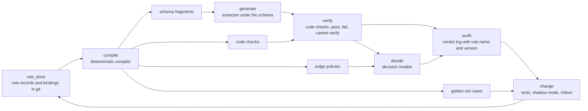

# How other systems make a model follow rules `rule_prior_art`

Status. Research of 2026-10-24. Claude made it for the Kyaloon eval vocabulary redesign, and this repo keeps a copy because the harness design ([rule-enforcement.md](../design/rule-enforcement.md)) builds on it. It changes no code and decides nothing. It answers the question in `rule_prior_art.question`.

Base. The Kyaloon RealDose repo (private), commit `e95ead79` on branch `rohan/eval-vocabulary-plan`. This research read public papers and documentation only. It ran no paid model call. The copy here changes the Status line, this Base line, and the links into the private repo, which now name the file in plain text.

Labels. Four labels mark each claim.

- "Verified (read X)" means that this research fetched the page X and read its text through a page reader tool. The reader summarizes long pages, so check the source before a decision uses a number.

- "Abstract (X)" means that this research read only the abstract of the paper X.

- "Excerpt (X)" means that this research read only a search excerpt of X. The page refused the fetch or the fetch failed.

- "Inferred" means a conclusion from verified facts that nobody tested.

## The question `rule_prior_art.question`

Rohan asked on 2026-10-24 for strict rules on how the system makes each attribute. The system must enforce the rules, and a person must be able to change them later. He named four parts:

- A ruleset.

- How the ruleset becomes verifiable instructions.

- How the system enforces each rule.

- The split between decision models and deterministic code.

This file uses four example rules from the brief. The rule names are drafts.

- `rules.claim_wording`. If a claim uses treatment or cure wording, the flag is true and it carries the quoted phrase.

- `rules.canonical_unit`. An amount uses the canonical unit of its attribute.

- `rules.no_reference_values`. A reference value, such as an RDA or an upper limit, is never a product fact.

- `rules.llm_grades`. The final grade is always an LLM judgement. Code only measures and verifies. This is the invariant on match and grade in the Kyaloon RealDose `CLAUDE.md`, and `rules.harness` in this repo.

## Terms `rule_prior_art.terms`

| Term | Meaning in this doc |
|---|---|
| Rule | One statement about what a model output must hold or must not hold. A rule has a name, a version and a kind. |
| Ruleset | The set of rules that applies to one attribute or to one step. |
| Check | A test that code runs on a model output. It gives pass, fail, or "cannot verify". |
| Decision model | A model that answers a judgement question under a written rule. A safety classifier and an LLM judge are decision models. |
| Enforcement point | The moment where a system applies a rule. It is before generation, during decoding, after generation, or at action time. |
| On-fail action | What a system does when a rule fails. It can refuse, repair, retry, flag, or escalate to a person. |
| Golden set | A set of inputs with answers that people labeled. A rule change must pass it. |
| Shadow mode | A state where a rule runs and logs its verdict but blocks nothing. |
| Span | A quoted part of the source text, with its start and end positions. |
| Binding | A record that attaches a rule to a scope and sets its action. The term comes from Kubernetes (`rule_prior_art.policy_code`). |

## Comparison `rule_prior_art.comparison`

| System | Rule format | Enforcement point | Deterministic or model | Change process | Fit for us (inferred) |
|---|---|---|---|---|---|
| Claude Code permission rules and hooks | `Tool(pattern)` strings in allow, ask and deny lists, in scoped settings files | Action time, before the tool runs | Deterministic | Edit a settings file. A deny from any scope wins. | High for explicit precedence and scopes |
| Claude Code auto mode | A prompt template with three slots (environment, block rules, allow exceptions) | Action time, before the tool runs | Model, a two-stage classifier | Edit the slots. Fixed test sets measure each change. | High for the cascade and the retry budget |
| Constitutional AI and constitutional classifiers | A natural-language constitution | Training (CAI). Input and output at serve time (classifiers). | Model trained on synthetic data from the constitution | Edit the constitution, make new data, train again | Low. We do not train models. |
| Llama Guard, ShieldGemma | A category list, or one principle per call, inside the prompt | Input or output | Model, a fine-tuned classifier | Swap categories in the prompt, or fine-tune | Medium. Pattern only. |
| gpt-oss-safeguard | A written policy of 400 to 600 tokens with definitions, criteria and examples | Any point that the caller picks | Model, reasoning over the policy at inference | Edit the policy text. No retraining. | High for judgement rules |
| OpenAI moderation | Fixed categories that OpenAI owns | Input or output | Model | OpenAI upgrades the model. Scores drift. | Low. Fixed taxonomy. |
| JSON Schema structured outputs (Anthropic, OpenAI) | A subset of JSON Schema | During decoding | Deterministic mask on a model | Edit the schema. A new grammar compiles. | High for shape and enums |
| Outlines, XGrammar, llguidance, LMQL | Regex, grammar, JSON Schema, query constraints | During decoding | Deterministic mask | Edit the grammar | Low. We call hosted APIs. |
| Instructor, Pydantic and Zod validators | Validators in code next to the schema | After generation, with a reask | Deterministic, or an LLM validator | Edit code and run tests | High. Zod is in our stack. |
| Guardrails AI | Validators, each with an `on_fail` action | After generation | Both | Edit validators | Medium for the on-fail list |
| NeMo Guardrails | Colang flows and self-check prompts | Input, dialog, output | Mostly model | Edit flows and prompts | Low. Built for chat. |
| DSPy assertions, now `Refine` | `Assert` and `Suggest` in code, now a reward function with a threshold | After a module, with retry and feedback | Deterministic or model reward | Edit code | Medium for the hard and soft split |
| LLM judges with checklists (TICK, RBR, PoLL) | Yes or no questions per rule (propositions) | After generation | Model | Tune prompts on a golden set | High for judgement rules |
| OPA and Gatekeeper | Rego rules in bundles with a revision | Admission, or an API query | Deterministic | `opa test` with coverage. Dry run and warn modes. | High for tests, logs and shadow mode |
| AWS Cedar | Permit and forbid policies with ids, checked against a schema | Each authorization request | Deterministic | Schema validation at write time. Proofs and differential tests. | Medium. Ideas only. |
| Kubernetes ValidatingAdmissionPolicy | CEL expressions with a message, plus a binding | Admission | Deterministic | Deny, Warn or Audit per binding | High for the rule and binding split |
| Citations API, LangExtract, Instructor exact citations | Each value carries a source span | Generation, then a code check | Deterministic span check | Edit the check | High. Evidence is a project rule. |
| Bedrock Automated Reasoning checks | Rules and typed variables made from a policy document | After generation | An LLM translates, a solver decides | Test cases with expected results. A person approves each refinement. | High for the "cannot verify" outcomes |
| Policy compilers (Policy-as-Prompt, IBM policy guards, VEPA, SPADE) | A document compiled into prompts, guard code or assertions | Build time, then runtime | Both | An LLM proposes. A verifier or a person accepts. | Medium. Research stage. |

## Claude Code permission rules and hooks `rule_prior_art.cc_rules`

| Aspect | Finding | Label |
|---|---|---|
| Rule format | A rule is a string such as `Bash(npm run test *)` in an `allow`, `ask` or `deny` list. Settings files exist at managed, user, project and local scope. | Verified (read [permissions doc][cc-perm]) |
| Precedence | Claude Code evaluates deny, then ask, then allow. The first match decides, and specificity does not change the order. A deny in one scope blocks an allow in another scope. Managed settings override all other levels. | Verified (read [cc-perm]) |
| Hooks | A PreToolUse hook that exits with code 2 stops the call before Claude Code evaluates the permission rules. A hook that returns "allow" cannot override a deny rule. | Verified (read [cc-perm]) |
| Gaps | A deny rule for `curl` does not match the same program by its path or inside `sh -c`. The doc tells users to add the OS sandbox when a restriction must hold. | Verified (read [cc-perm]) |
| Lesson for us | Write precedence as data and make deny win. Pattern rules leave gaps, so a second layer must cover what a pattern cannot express. | Inferred |

## Claude Code auto mode `rule_prior_art.cc_auto`

| Aspect | Finding | Label |
|---|---|---|
| Tiers | Tier one is an allowlist of safe tools plus narrow user allow rules. Auto mode drops broad rules, such as blanket shell access. Tier two lets edits inside the project skip review. Tier three sends all other actions to a classifier. | Verified (read [auto mode post][cc-auto]) |
| Policy text | The classifier prompt is a fixed template with three slots. The slots are the environment (the trust boundary), the block rules (more than twenty defaults in four groups), and the allow exceptions. `claude auto-mode defaults` prints the baseline. | Verified (read [cc-auto]) |
| Model and stages | The classifier is Sonnet 4.6. Stage one is a single-token yes or no filter that leans to block. Stage two runs only on a flag and reasons step by step. The two prompts differ only in the last instruction, so stage two reuses the cache. | Verified (read [cc-auto]) |
| Input | The classifier sees the user messages and the tool calls only. It does not see the prose of the agent or the tool outputs. The post says that more context made results worse on its overeager test set. | Verified (read [cc-auto]) |
| On fail | A denial goes back to the agent as a tool result that tells it to find a safer path. After 3 denials in a row or 20 in total, the agent stops and asks the person. In `claude -p`, the process ends. | Verified (read [cc-auto]) |
| Failure modes | Most misses are consent gaps. The classifier sees the danger but misjudges whether the approval of the user covers it. It sees no tool output, so it cannot tell if an identifier came from a query or if the agent invented it. | Verified (read [cc-auto]) |
| Lesson for us | Use a cheap stage with high recall, then a careful second stage. Give the judge the source and the claim, not the reasoning of the writer. Cap retries, then escalate. Measure each change on fixed sets that include real failures. | Inferred |

The post reports these rates. FPR is the share of benign actions that the classifier blocked. FNR is the share of dangerous actions that it allowed. Verified (read [cc-auto]).

| Stage | Real traffic, n=10,000, FPR | Real overeager actions, n=52, FNR | Synthetic exfiltration, n=1,000, FNR |
|---|---|---|---|
| Stage one only | 8.5% | 6.6% | 1.8% |
| Full pipeline | 0.4% | 17% | 5.7% |

## Constitutional AI and constitutional classifiers `rule_prior_art.constitutional`

| Aspect | Finding | Label |
|---|---|---|
| Rule format | A constitution is a list of natural-language principles. | Abstract ([CAI][cai]) |
| Constitutional AI | The model critiques and revises its own answers under the principles, then trains on the revisions. Next, a model compares pairs of answers, and the preferences train a reward model for RL from AI feedback. | Abstract ([cai]) |
| Classifiers | The constitution defines the allowed and the disallowed classes of content. Claude makes synthetic prompts and completions for each class. The pipeline translates the data and rewrites it in known jailbreak styles. Classifiers train on this data. | Verified (read [classifiers post][cc-cls]) |
| Change | The post says that the constitution "can rapidly be adapted to cover novel attacks". A change needs new data and a new classifier. | Verified (read [cc-cls]) |
| First results | Jailbreak success fell from 86% to 4.4%. Refusals rose by 0.38%, which was not significant in 5,000 conversations. Compute rose by 23.7%. | Verified (read [cc-cls]) |
| Next generation | One exchange classifier sees the input and the output together. A cheap first stage escalates flagged exchanges to a stronger stage. Linear probes read the activations of the model. | Verified (read [second classifiers post][cc-cls-next]) |
| Next results | Refusals on harmless traffic were 0.05% in one month. The overhead was about 1%. Red teams found one high-risk gap in 198,000 attempts. | Verified (read [cc-cls-next]) |
| Rules or judgement | The 2026 constitution prefers explained judgement and keeps hard constraints for high-stakes behavior. It says that rules make actions "more predictable, transparent, and testable" but can fail in situations that nobody expected. | Verified (read [constitution post][constitution]) |
| Related work | OpenAI deliberative alignment trains models to recall the specification text and reason over it before an answer. | Abstract ([delib]) |
| Lesson for us | Keep hard constraints few and absolute, and give the judge the reason for each rule. The text of a rule can also seed golden set cases. A run that makes cases with a model is a paid run and needs the gate. | Inferred |

## Policy-as-prompt safety classifiers `rule_prior_art.policy_classifiers`

| Aspect | Finding | Label |
|---|---|---|
| Llama Guard format | The prompt holds numbered categories with safe and unsafe descriptions, the task type, the conversation and the output format. The model writes "safe" or "unsafe" as its first token, then the codes of the violated categories. The probability of the first token is the score. | Verified (read [Llama Guard paper][llamaguard]) |
| Llama Guard adaptation | The test set is the OpenAI moderation set. AUPRC was 0.837 with no change and 0.847 zero-shot with the OpenAI categories. With 2 to 4 examples per category, it was 0.872. The OpenAI API scored 0.856. | Verified (read [llamaguard]) |
| Llama Guard 4 | It trains on the MLCommons hazard list S1 to S14. | Excerpt ([llamaguard4]) |
| ShieldGemma | Each call holds one principle in a fixed template. The answer starts with Yes or No. A formula turns the token likelihoods into a score, and each client sets its own threshold. Sizes are 2B, 9B and 27B. | Verified (read [ShieldGemma paper][shieldgemma]) |
| gpt-oss-safeguard format | A policy has four sections, which are instructions, definitions, criteria and examples. The guide says that 400 to 600 tokens works best. It tells authors to avoid hedge words such as "generally", to state precedence, and to give an escalation path. | Verified (read [safeguard guide][safeguard]) |
| gpt-oss-safeguard output | The output is a binary 0 or 1, or JSON with `violation` and `policy_category`. A third form adds `rule_ids`, `confidence` and a short rationale. | Verified (read [safeguard]) |
| gpt-oss-safeguard change | An author edits the policy text, with no retraining. The guide says to run new policies on test data before rollout and to A/B test definitions in production. More policies in one prompt cause "small but meaningful degradations in accuracy". | Verified (read [safeguard]) |
| gpt-oss-safeguard limits | A classifier trained on thousands of labeled examples will likely do better on one task. The guide suggests a small filter with high recall in front. | Verified (read [safeguard]) |
| OpenAI moderation | OpenAI fixes the categories. The guide says to treat scores as signals, not as an automatic block. Scores may need recalibration because OpenAI upgrades the model. | Excerpt ([oai-mod]) |
| Lesson for us | Write each judgement rule as a short policy with definitions, criteria and boundary examples. Ask the judge to return the ids of the rules that it applied. Prefer one rule per call. | Inferred |

## Structured output and constrained decoding `rule_prior_art.constrained_decoding`

| Aspect | Finding | Label |
|---|---|---|
| Mechanism | Anthropic compiles a JSON Schema into a grammar that constrains decoding. The first use of a schema adds latency. The compiled grammar stays in a cache for 24 hours after its last use. | Verified (read [Anthropic structured outputs][ant-so]) |
| Unsupported keywords | The API rejects numeric limits (`minimum`, `maximum`), string length limits, recursion, `minItems` above 1, and `additionalProperties` other than false. Most SDK helpers move these into the description and validate the response in code. | Verified (read [ant-so]) |
| Not guaranteed | A refusal or a `max_tokens` stop can break the schema. The casing of `enum` values is not guaranteed. A request allows at most 20 strict tools, 24 optional parameters and 16 union-type parameters. | Verified (read [ant-so]) |
| OpenAI | OpenAI reported 100% on its complex-schema eval for gpt-4o-2024-08-06 with Structured Outputs, against less than 40% for gpt-4-0613. | Excerpt ([oai-so]) |
| Engines | Outlines indexes the vocabulary against a finite-state machine. XGrammar precomputes the tokens that do not depend on context and claims up to 100x speed. LMQL reports 26% to 85% cost savings. | Abstract ([outlines], [xgrammar], [lmql]) |
| llguidance | It uses an Earley parser at about 50 µs of CPU per token. Its README says that it powers OpenAI Structured Output for JSON Schema, and that it runs in llama.cpp, vLLM, SGLang and Chromium. | Verified (read [llguidance]) |
| Coverage | JSONSchemaBench ran 10,000 real schemas. On its hardest set, coverage was 0.41 for Guidance, 0.28 for XGrammar, 0.09 for OpenAI and 0.03 for Outlines. XGrammar accepted invalid output in 38 test categories. | Verified (read [JSONSchemaBench][jsbench]) |
| Quality | "Let Me Speak Freely" reported weaker reasoning under format limits. The Outlines team found flaws in its prompts and parser, and got equal or better scores with structure. JSONSchemaBench saw small gains, such as GSM8K from 80.1% to 83.8% with Guidance. | Abstract ([speakfreely]). Verified (read [saywhat], [jsbench]) |
| Lesson for us | Use decoding constraints for shape, such as keys, types and the unit enum. Do not trust them for ranges or for rules across fields. Run the full validator after decoding. | Inferred |

## Validation and repair loops `rule_prior_art.validate_repair`

| Aspect | Finding | Label |
|---|---|---|
| Instructor | Pydantic validators check the output. On a failure, Instructor adds the failed answer and the errors to the messages. Then it asks again, up to `max_retries`. `llm_validator` checks a field against a plain-language rule with a model. | Verified (read [Instructor reask][instructor]) |
| Validator context | A validator can read runtime data, such as the source text, through `context`. | Verified (read [instructor]) |
| Exact citations | In the example, each fact carries `substring_quote`. A validator looks for each quote in the source with an escaped literal regex. It drops each quote with no match, then drops each fact with no quote left. | Verified (read [Instructor citations][instructor-cite]) |
| Zod | `.refine()` and `.superRefine()` add custom checks with a path and a message. Zod 4 converts a schema to JSON Schema. A check with no JSON Schema form throws an error, or the converter drops it if an option says so. | Verified (read [zod-refine], [zod-json]) |
| Guardrails AI | Each validator has an `on_fail` action. `noop` logs only. `exception` raises. `reask` asks again. `fix` corrects in code. `filter` removes the field. `refrain` returns nothing. `fix_reask` fixes, validates again, then asks again. | Verified (read [Guardrails on-fail][guardrails]) |
| NeMo Guardrails | Colang flows drive topical rails. Self-check rails send the input or the output to an LLM with a policy prompt, and "yes" blocks. With input and output rails, text-davinci-003 blocked 97% of harmful and 5% of helpful prompts, on 200 prompts. | Verified (read [NeMo paper][nemo], [nemo-self]) |
| NeMo limits | The fact-check rail reached about 80% accuracy. The chained prompts cost about 3 times the latency and the price. The docs say that self-check quality "is strongly dependent on the capability of the LLM". | Verified (read [nemo], [nemo-self]) |
| DSPy | `Assert` retries with the error message in the prompt and halts after the retry limit. `Suggest` retries, then logs and continues. Suggestions raised citation faithfulness from 76.0% to 88.7% zero-shot. | Verified (read [DSPy assertions paper][dspy-paper]) |
| DSPy now | The DSPy docs mark assertions as deprecated. `Refine` and `BestOfN`, each with a reward function and a threshold, replace them. | Excerpt ([dspy-assert]) |
| Lesson for us | Keep two failure grades. A hard rule halts or gives "cannot verify". A soft rule logs and continues. On retry, send the exact error, with a budget. A silent drop, such as `filter` or the citations example, rejects without a surfaced outcome, which the project invariant forbids. | Inferred |

## LLM judges and rubric verification `rule_prior_art.judges`

| Aspect | Finding | Label |
|---|---|---|
| Agreement | GPT-4 as a judge agreed with human preferences more than 80% of the time, about the same as humans with each other. The paper names position, verbosity and self-enhancement bias. | Abstract ([MT-Bench][mtbench]) |
| Limits | Only the largest judges aligned reasonably with humans, and still below agreement between humans. Scores differed by up to 5 points. Judges tended to be lenient. Percent agreement alone hid these gaps. | Abstract ([Judging the Judges][judges]) |
| Checklists | TICK has an LLM write yes or no questions for each instruction. Exact agreement with humans rose from 46.4% to 52.2%, compared with direct scores. | Abstract ([tick]) |
| Propositions | OpenAI Rule-Based Rewards (RBR) split a policy into binary propositions, such as "refuses" or "judgmental". A grader LLM answers each one. Weights that a fit on synthetic comparisons sets combine the answers. | Verified (read [RBR paper][rbr]) |
| RBR gold set | 518 hand-labeled completions tuned the grader prompts. Grader accuracy rose with model size, from 43.78% to 93.63%. The paper says that a fixed grader prompt takes effect at once on all data, while a fix to human data needs new labels. | Verified (read [rbr]) |
| Panels | A panel of smaller judges from different model families beat one GPT-4 judge, with less self-bias, at more than seven times less cost. | Abstract ([PoLL][poll]) |
| Criteria drift | EvalGen found that people define criteria while they grade outputs, and some criteria depend on the outputs that they see. The tool picks the code or LLM assertions that best match the grades of a person. | Abstract ([evalgen]) |
| Anthropic guidance | Prefer deterministic graders where possible. Calibrate LLM judges with human experts. Give the judge an "Unknown" answer. Grade each dimension with an isolated judge. Read the transcripts. | Verified (read [Anthropic evals post][ant-evals]) |
| Lesson for us | Split each judgement rule into yes or no propositions, each with its own judge call and an "unknown" answer. Keep a frozen, versioned golden set per rule, and run it again after each model or prompt change. RBR combines the answers with fixed weights. For a grade, that conflicts with `rules.llm_grades`, so the grade model must read the answers and judge. | Inferred |

## Policy as code `rule_prior_art.policy_code`

| Aspect | Finding | Label |
|---|---|---|
| OPA tests | A test is a Rego rule whose name starts with `test_`. The `with` keyword replaces data or functions with mocks. `opa test --coverage` reports the covered lines. `--fail-on-empty` fails when no test runs. | Verified (read [OPA testing][opa-test]) |
| OPA decision logs | Each decision records a `decision_id`, the input, the result, the policy path, a timestamp and the revision of each policy bundle. | Verified (read [OPA decision logs][opa-log]) |
| Gatekeeper | `enforcementAction` is `deny` (the default), `dryrun` (record violations and block nothing) or `warn` (record and tell the client). | Verified (read [Gatekeeper][gatekeeper]) |
| Kubernetes | A ValidatingAdmissionPolicy holds CEL expressions. A separate binding sets `validationActions` to Deny, Warn or Audit. Parameters come from a separate resource. | Verified (read [ValidatingAdmissionPolicy][k8s-vap]) |
| CEL | CEL is not Turing complete, reads only data that the host gives it, and runs in nanoseconds to microseconds. | Verified (read [cel.dev][cel]) |
| Cedar semantics | A satisfied `forbid` gives Deny. Else a satisfied `permit` gives Allow. Else the result is Deny. The response names the determining policies and the policies with errors. | Verified (read [Cedar authorization][cedar-auth]) |
| Cedar validation | Cedar validates policies against a schema when a person creates or updates them, not at request time. | Verified (read [Cedar docs][cedar-docs]) |
| Cedar proofs | The team proves properties of a formal model and runs differential tests of the Rust engine against it. The nightly run covers about 100 million tests. The 2024 paper reports 4 validator bugs from proofs and 21 more from tests. | Verified (read [Cedar blog][cedar-blog]). Excerpt ([cedar-vgd]) |
| Lesson for us | Split each rule from its binding. The rule holds the logic. The binding holds the scope and the action, which is enforce, warn or audit. Log each verdict with the rule version. Test each rule in CI with coverage. Validate each rule against the attribute registry when a person writes it. | Inferred |

## Provenance and evidence `rule_prior_art.provenance`

| Aspect | Finding | Label |
|---|---|---|
| Citations API | Plain text gets sentence chunks with character indices. A PDF gets page numbers. Custom content keeps the blocks of the caller. The API extracts `cited_text` itself, so citations "are guaranteed to contain valid pointers to the provided documents". | Verified (read [Anthropic citations][ant-cite]) |
| Citations limits | Citations and structured outputs are incompatible, and the API returns a 400 error. Images in a PDF are not citable, so a scanned PDF with no text has no citations. | Verified (read [ant-cite]) |
| Citations results | Anthropic reported up to 15% better recall than most custom setups. Endex reported that source hallucinations and format errors fell from 10% to 0%. | Excerpt ([ant-cite-launch]) |
| LangExtract | Each extraction maps to character offsets (`char_interval`). An extraction that it cannot locate gets `None`, so code can keep grounded results only. The README warns that models sometimes copy text from the few-shot examples, and the grounding check catches this. | Verified (read [LangExtract][langextract]) |
| ALCE | On ELI5, even the best models lacked full citation support half of the time. | Abstract ([alce]) |
| Lesson for us | Make a span a required field of each fact. Verify the span in code against the exact text that the model read. Our labels are images, so the span must point into the OCR text of the label union. A span with no match gives "cannot verify", not a drop. | Inferred |

## Compiling a natural-language ruleset `rule_prior_art.compile`

| Aspect | Finding | Label |
|---|---|---|
| Bedrock policy | A person uploads a policy document. The service makes rules (each with an id), variables and custom types. | Verified (read [Bedrock Automated Reasoning post][bedrock-ar]) |
| Bedrock check | The service translates each question and answer into logic with a confidence threshold. Then it checks the logic against the rules. Results include Valid, Invalid and Satisfiable. | Verified (read [bedrock-ar]) |
| Bedrock outcomes | Other findings are TRANSLATION_AMBIGUOUS (stop before the validity check), IMPOSSIBLE, TOO_COMPLEX and NO_TRANSLATIONS (the policy has no variable for the input). | Excerpt ([bedrock-ar-results]) |
| Bedrock tests | A test case holds an input, an output, an expected result and a threshold. A failed test shows the rules in the contradiction. Saved tests run again after each policy change. AWS reports "up to 99%" verification accuracy. | Verified (read [bedrock-ar]) |
| Policy-as-Prompt | It builds a policy tree with source links from design documents and compiles the tree into prompt classifiers. The abstract gives no metrics. | Abstract ([pap]) |
| IBM policy guards | An offline step compiles policy documents into guard code for tool calls. The guards check each action before it runs, on τ-bench Airlines. The abstract gives no numbers. | Abstract ([ibm-guard]) |
| VEPA | The policy is a set of executable symbolic rules. An LLM proposes patches. A deterministic verifier accepts only valid updates with no conflict. A new rule becomes active only after enough evidence. | Abstract ([vepa]) |
| SPADE | It reads the history of prompt versions, proposes assertions, and keeps a small set. It gave about 14% fewer assertions and 21% fewer false failures. LangSmith uses it in more than 2,000 pipelines. | Abstract ([spade]) |
| Lesson for us | Compile in one direction, from the rule record to its artifacts, with a deterministic compiler. An LLM may draft a rule or its tests, and a person approves. Keep "ambiguous" and "cannot translate" as named outcomes. | Inferred |

## Synthesis `rule_prior_art.synthesis`

This research inferred all of this section from the sections above, unless a row names a source.

### Layers of a ruleset system `rule_prior_art.layers`

The diagram shows the seven layers and the artifacts that move between them.

| Layer | Job | Prior art | Fit for us |
|---|---|---|---|
| `rule_store` | Hold each rule as a record with a name, a version, a kind, a scope (an attribute key), the text, examples and an owner. A separate binding holds the enforcement point, the on-fail action and the state (shadow or enforce). | Cedar policy ids, OPA bundle revisions, Bedrock rule ids, the Kubernetes policy and binding split | Typed records in git, validated against the attribute registry. The Kyaloon repo already keeps Jev questions with a version and a code made from the words. Verified (read the Kyaloon `docs/practices/jev.md`). |
| `compile` | Turn each rule into its artifacts. These are a schema fragment, a code check, a judge policy and golden set cases. Refuse a rule whose kind does not fit its target. | Anthropic grammar compilation, Zod JSON Schema export, Bedrock policy from a document, IBM policy guards, VEPA verifier | A deterministic compiler in code. An LLM may draft, and a person approves each change. |
| `generate` | The extractor writes values under the schema. | Anthropic structured outputs and strict tool use | One enum per unit field, a required span field, and no free keys. |
| `verify` | Run code checks after generation. Each check gives pass, fail or "cannot verify". | Zod refinements, Instructor validators, LangExtract offsets, CEL | Unit, type, key in the registry, span is a substring of the label text. |
| `decide` | Ask decision models the judgement questions, one rule per call, each with an "unknown" answer. | gpt-oss-safeguard policy format, RBR propositions, TICK checklists, the auto mode cascade | Claim wording, product amount or reference amount, and the grade. |
| `audit` | Log each verdict with the rule name, the rule version, the input, the evidence and the outcome. | OPA decision logs, Cedar determining policies, safeguard `rule_ids` and rationale | One verdict row per rule and per fact. |
| `change` | Test each rule on its golden set. Run a new rule in shadow mode first. Run the golden set again after each model or prompt change. | `opa test` coverage, Bedrock test cases, Gatekeeper `dryrun`, Kubernetes Warn and Audit, RBR gold set | Golden set per rule in git. Shadow, then enforce, per binding. |

### The example rules through the layers `rule_prior_art.examples`

| Rule | Kind | `generate` | `verify` (code) | `decide` (model) | Outcome on fail |
|---|---|---|---|---|---|
| `rules.claim_wording` | Judgement | The schema asks for `flag`, and for `quote` when the flag is true. | The quote is a literal substring of the label text. A true flag has a quote. | A judge with a short policy decides if the phrase is treatment or cure wording. | No match gives "cannot verify" and one reask. The pipeline surfaces an "unknown" from the judge. |
| `rules.canonical_unit` | Shape | The unit field is an enum with one value, the canonical unit of the key. | The unit equals the registry unit, and the number parses. | None. | Reask with the error. A second failure gives "cannot verify". |
| `rules.no_reference_values` | Judgement plus shape | Product facts and reference values go to separate fields. | Each product fact has a span in the label text, not in pack or rubric text. | A judge decides if a span states the product amount or a reference amount, such as a %RDA. | A "reference" verdict moves the value to the reference field, with a log row. The pipeline surfaces an "unknown". |
| `rules.llm_grades` | Meta rule | None. | The compiler refuses a code check of the kind `judge`. A lint fails when code writes a grade. | The grade model. | The build fails. |

### Ideas worth adopting `rule_prior_art.ideas`

- Split each rule from its binding. The binding sets enforce, warn or audit, so each new rule starts in shadow mode. Source is Kubernetes and Gatekeeper.

- Give each rule a stable dotted name, a version and a code made from its words. Log them with each verdict. Source is OPA, Cedar, gpt-oss-safeguard and our Jev questions.

- Use three outcomes, not two. The outcomes are pass, fail and "cannot verify". A required span that code verifies backs each fact. Source is Bedrock findings, the Anthropic "Unknown" advice and the project invariant.

- Write each judgement rule as a short policy with definitions, criteria and boundary examples. Use one rule per isolated judge call, with a cheap first stage and a careful second stage. Source is gpt-oss-safeguard, auto mode and constitutional classifiers.

- Constrain shape at decode time, then verify everything again in code. Repair with the exact error under a retry budget, then escalate. Source is Anthropic structured outputs, Instructor and the auto mode budget.

### Risks `rule_prior_art.risks`

- Judge drift. A model upgrade changes verdicts with no code change. OpenAI warns that moderation scores need recalibration, and judges tend to be lenient ([oai-mod], [judges]).

- Gaps in constrained decoding. The Anthropic API rejects range keywords and does not guarantee enum casing. Schemas have size limits, and some engines accept invalid output ([ant-so], [jsbench]).

- No ready-made citations. The Citations API does not work with structured outputs or with images ([ant-cite]). We must build the span check on OCR text. OCR errors can turn true quotes into "cannot verify".

- Cost per rule. One judge call per rule grows with the ruleset, and many rules in one prompt lower accuracy ([safeguard]).

- Context gaps. A judge that lacks the context a rule needs misses cases, as in the 17% auto mode misses ([cc-auto]).

- Fixed-weight combination. RBR-style weights would make code set the grade, which breaks `rules.llm_grades` ([rbr]).

- Criteria drift. People change rules while they grade, so each verdict must keep the rule version ([evalgen]).

[cc-perm]: https://code.claude.com/docs/en/permissions
[cc-auto]: https://www.anthropic.com/engineering/claude-code-auto-mode
[cai]: https://arxiv.org/abs/2212.08073
[cc-cls]: https://www.anthropic.com/research/constitutional-classifiers
[cc-cls-next]: https://www.anthropic.com/research/next-generation-constitutional-classifiers
[constitution]: https://www.anthropic.com/news/claude-new-constitution
[delib]: https://arxiv.org/abs/2412.16339
[llamaguard]: https://arxiv.org/html/2312.06674
[llamaguard4]: https://docs.api.nvidia.com/nim/reference/meta-llama-guard-4-12b
[shieldgemma]: https://arxiv.org/html/2407.21772
[safeguard]: https://developers.openai.com/cookbook/articles/gpt-oss-safeguard-guide
[oai-mod]: https://developers.openai.com/api/docs/guides/moderation
[ant-so]: https://platform.claude.com/docs/en/build-with-claude/structured-outputs
[oai-so]: https://openai.com/index/introducing-structured-outputs-in-the-api/
[outlines]: https://arxiv.org/abs/2307.09702
[xgrammar]: https://arxiv.org/abs/2411.15100
[lmql]: https://arxiv.org/abs/2212.06094
[llguidance]: https://github.com/guidance-ai/llguidance
[jsbench]: https://arxiv.org/html/2501.10868v3
[speakfreely]: https://arxiv.org/abs/2408.02442
[saywhat]: https://blog.dottxt.ai/say-what-you-mean.html
[instructor]: https://python.useinstructor.com/concepts/reask_validation/
[instructor-cite]: https://python.useinstructor.com/examples/exact_citations/
[zod-refine]: https://zod.dev/api?id=refinements
[zod-json]: https://zod.dev/json-schema
[guardrails]: https://www.guardrailsai.com/docs/concepts/validator_on_fail_actions
[nemo]: https://arxiv.org/html/2310.10501
[nemo-self]: https://docs.nvidia.com/nemo/guardrails/configure-guardrails/guardrail-catalog/self-check.md
[dspy-paper]: https://arxiv.org/html/2312.13382v1
[dspy-assert]: https://dspy.ai/learn/programming/7-assertions/
[mtbench]: https://arxiv.org/abs/2306.05685
[judges]: https://arxiv.org/abs/2406.12624
[tick]: https://arxiv.org/abs/2410.03608
[rbr]: https://arxiv.org/html/2411.01111v1
[poll]: https://arxiv.org/abs/2404.18796
[evalgen]: https://arxiv.org/abs/2404.12272
[ant-evals]: https://www.anthropic.com/engineering/demystifying-evals-for-ai-agents
[opa-test]: https://www.openpolicyagent.org/docs/policy-testing
[opa-log]: https://www.openpolicyagent.org/docs/management-decision-logs
[gatekeeper]: https://open-policy-agent.github.io/gatekeeper/website/docs/violations/
[k8s-vap]: https://kubernetes.io/docs/reference/access-authn-authz/validating-admission-policy/
[cel]: https://cel.dev/
[cedar-auth]: https://docs.cedarpolicy.com/auth/authorization.html
[cedar-docs]: https://docs.cedarpolicy.com/
[cedar-blog]: https://www.amazon.science/blog/how-we-built-cedar-with-automated-reasoning-and-differential-testing
[cedar-vgd]: https://arxiv.org/abs/2407.01688
[ant-cite]: https://platform.claude.com/docs/en/build-with-claude/citations
[ant-cite-launch]: https://claude.com/resources/articles/introducing-citations-api
[langextract]: https://github.com/google/langextract
[alce]: https://arxiv.org/abs/2305.14627
[bedrock-ar]: https://aws.amazon.com/blogs/aws/minimize-ai-hallucinations-and-deliver-up-to-99-verification-accuracy-with-automated-reasoning-checks-now-available/
[bedrock-ar-results]: https://docs.aws.amazon.com/bedrock/latest/userguide/validate-automated-reasoning-policy-results.html
[pap]: https://arxiv.org/abs/2509.23994
[ibm-guard]: https://arxiv.org/abs/2507.16459
[vepa]: https://arxiv.org/abs/2610.12813
[spade]: https://arxiv.org/abs/2401.03038
