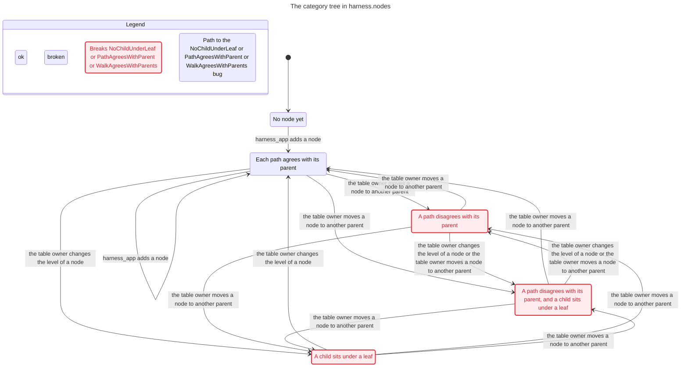
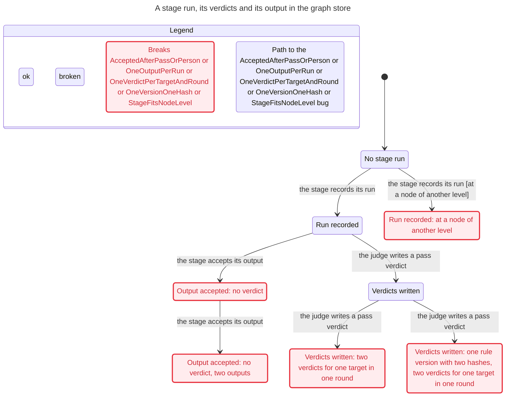
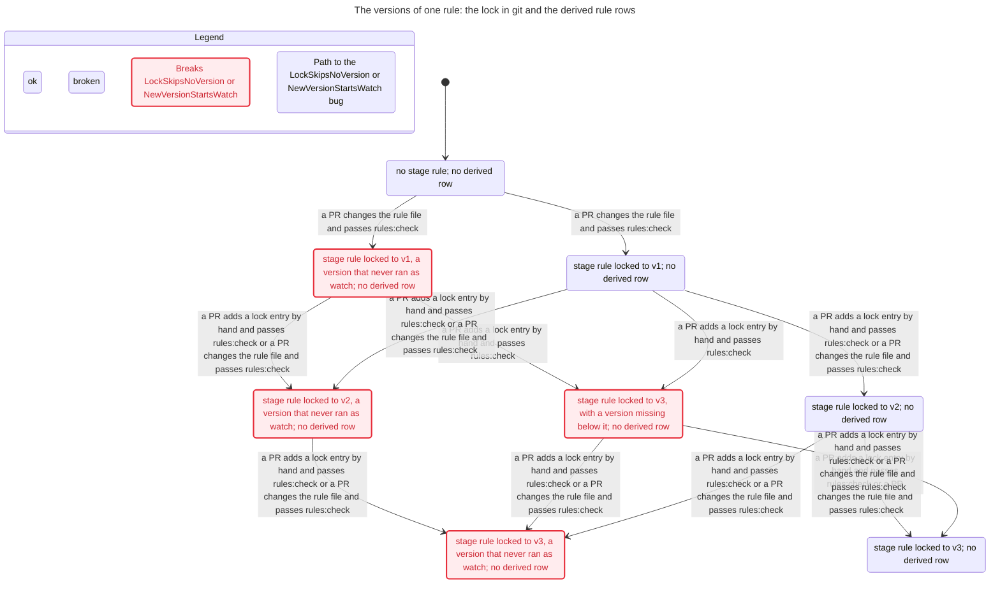
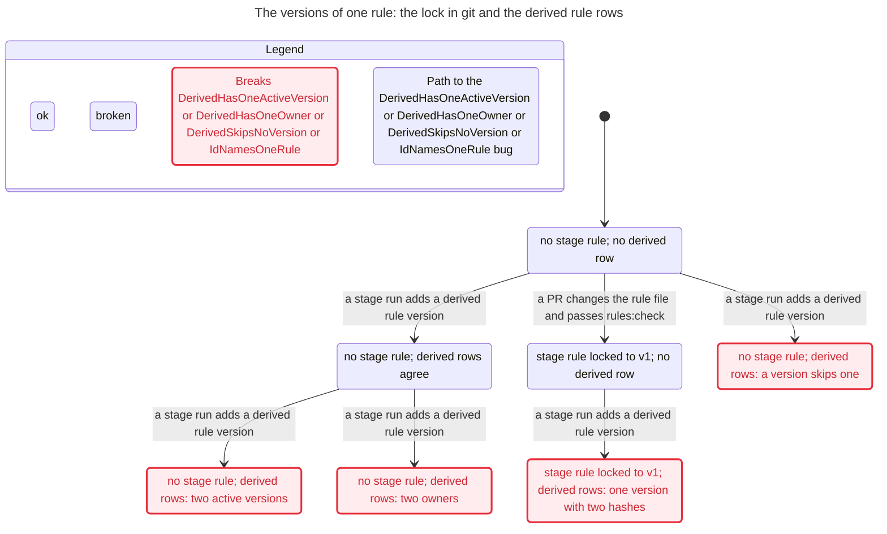
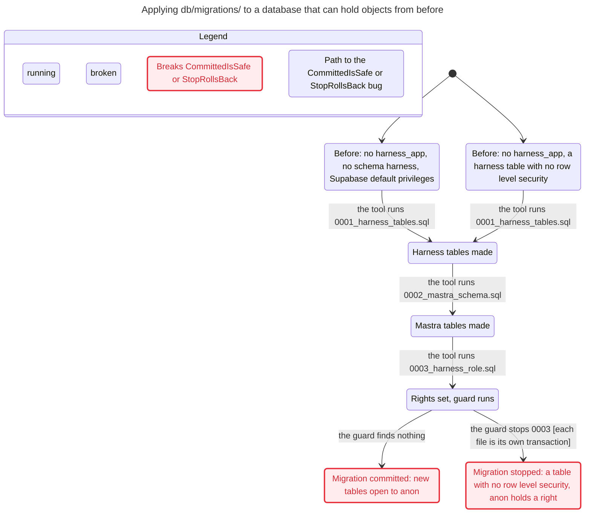

# The formal check of 2026-11-02 `formal_check`

Status. Research of 2026-11-02, on `main` at `803301a`, before [#17](https://github.com/Ronitron007/product-eval-harness/pull/17). The checks are in [design/formal-checks.md](../design/formal-checks.md). Rohan asked for an independent, formal check of the code before `plan.compiler` starts.

This doc records the method, the results, and the findings. It fixes nothing. Rohan rules on each fix, and each fix is its own plan unit.

## What already existed `formal_check.prior_art`

| Candidate | Result |
|---|---|
| TLA+ and TLC 1.7.4 | Used for the models. TLC is not on npm or on Maven Central, so the runner downloads the pinned release and checks its sha256. |
| Apalache | Not used. The models are small and finite, so TLC is enough. |
| Quint | Not used. Its `run` command samples at random, and its `verify` command needs Apalache. |
| fast-check | Not used. The pre-states of the migrations are few, so the sweep tries each of them. |
| pgTAP | Not used. It needs a system install, and Vitest with `pg` already makes the same assertions. |
| supabase/splinter | Read as prior art for the oracle. It checks the schemas that the API shows, not `harness` and `mastra`. |
| `has_table_privilege()` and `pg_has_role()` | Used for the oracle. They count owners and members, and the guard does not. |

## Results `formal_check.results`

Each row is one rule. "Verified (ran)" means that TLC found the result, and a replay or the sweep showed it on the real code.

| Model and config | Rule | Result | Finding |
|---|---|---|---|
| `NodeTree` | `DomainIsRoot`, `PathAgreesWithParent`, `NoChildUnderLeaf`, `WalkAgreesWithParents` | Holds, verified (ran) | none |
| `NodeTree_owner` | `DomainIsRoot` | Holds, verified (ran) | none |
| `NodeTree_owner` | `PathAgreesWithParent`, `NoChildUnderLeaf`, `WalkAgreesWithParents` | Breaks, verified (ran) | `nodes.owner_update` |
| `VerdictLog` | `OutputAgreesWithRun` | Holds, verified (ran) | none |
| `VerdictLog` | `StageFitsNodeLevel` | Breaks, verified (ran) | `verdicts.stage_level` |
| `VerdictLog` | `OneVersionOneHash` | Breaks, verified (ran) | `verdicts.hash_per_version` |
| `VerdictLog` | `AcceptedAfterPassOrPerson` | Breaks, verified (ran) | `verdicts.accept_without_pass` |
| `VerdictLog` | `OneVerdictPerTargetAndRound` | Breaks, verified (ran) | `verdicts.no_round` |
| `VerdictLog` | `OneOutputPerRun` | Breaks, verified (ran). The rule is inferred. | `verdicts.outputs_per_run` |
| `RuleVersions` | `FileMatchesLock`, `LockOnlyGrows` | Holds, verified (ran). `LockOnlyGrows` restates the CI `--base` check. | none |
| `RuleVersions` | `LockSkipsNoVersion` | Breaks, verified (ran) | `rules.lock_hand_entry` |
| `RuleVersions` | `NewVersionStartsWatch` | Breaks, verified (ran) | `rules.watch_first` |
| `RuleVersions_derived` | `DerivedSkipsNoVersion` | Breaks, verified (ran) | `derived_rules.skip_version` |
| `RuleVersions_derived` | `DerivedHasOneOwner` | Breaks, verified (ran) | `derived_rules.two_owners` |
| `RuleVersions_derived` | `DerivedHasOneActiveVersion` | Breaks, verified (ran) | `derived_rules.two_active` |
| `RuleVersions_derived` | `IdNamesOneRule` | Breaks, verified (ran) | `derived_rules.id_collision` |
| `MigrationApply` | `CommittedPassesTheGuard` | Holds, verified (ran) | none |
| `MigrationApply` | `CommittedIsSafe` | Breaks, verified (ran) | `migration.guard_gaps` |
| `MigrationApply` | `StopRollsBack` | Breaks, verified (ran) | `migration.per_file_stop` |

The sweep has 72 pre-states, and it runs each in 2 ways, so it has 144 cases. It also checked `SecondApplyChangesNothing` and `GuardStopsNamedCases` in each case. Both hold, verified (ran).

Some rules hold because the model copies a guard of the code, such as `OutputAgreesWithRun` and `LockOnlyGrows`. A code change does not change those TLC results. The sweep and the replays check the real code.

## The findings `formal_check.findings`

Each finding gives the rule, the shortest path, and the harm.

- `nodes.owner_update`. Rule: a node path agrees with its parent, and a leaf has no child (`store.safety`). Path: add `a`, add `b` under `a`, then the table owner sets the parent of `b` to `b`. The trigger fires on insert only, and `harness.nodes` has no append-only trigger. `harness_app` cannot update a node.

  Harm: `subtree()` walks the path, so a rule can miss a node with no error.

- `verdicts.stage_level`. Rule: each stage runs at a node of its level (`graph.stages`). Path: record a `create_pack` run at a domain node.

  Harm: a pack can exist outside a leaf.

- `verdicts.hash_per_version`. Rule: one version always means the same words (`enforce.rule_record`). Path: write a verdict of a rule version with one hash, then one with another hash. No check compares the hash with the lock or with `harness.derived_rules`.

  Harm: a query by rule version mixes two sets of words.

- `verdicts.accept_without_pass`. Rule: the graph accepts an output when each strict rule gives pass (`enforce.binding`). After a spent repair budget, a person decides. Path: record a run, then accept its output. `acceptOutput()` reads no verdict, and no table records the decision of a person.

  Harm: the store gives no last line of defense. `plan.judge_step` must hold this rule.

- `verdicts.no_round`. Rule: the log has one row for each output item and each rule (`enforce.audit`). Path: write a fail verdict, then a pass verdict for the same target, as a repair round does. No column names the round or the output.

  Harm: the log cannot say which verdict decided which draft, except by its time.

- `verdicts.outputs_per_run`. Rule, inferred: one run accepts one output. Path: accept two outputs for one run.

  Harm: the verdicts of the run cannot name their output.

- `rules.lock_hand_entry`. Rule: each new version supersedes the version before it (`enforce.rule_record`). Path: the lock holds version 1, and a PR adds an entry for version 3 by hand. `rules:check --base` passes, because the loader checks only the version of the file and its supersedes entry.

  Harm: the lock can hold a hash that no rule file ever had.

- `rules.watch_first`. Rule: a new rule version starts as watch only (`rules.harness`). Path: a PR adds version 1 with binding `strict`, and `rules:check` passes. The hash covers the binding. So a promotion out of watch is a new version too, and that version cannot start as watch.

  Harm: the code does not hold the rule, and the rule and the hash disagree.

- `derived_rules.skip_version`. Rule: each new version supersedes the version before it (`enforce.rule_record`). Path: add version 2 of a derived rule with no version 1. The loader refuses this for a stage rule.

- `derived_rules.two_owners`. Rule: one rule has one owner (`graph.scope`). Path: add version 1 at `skincare`, then version 2 at `sunscreen`.

- `derived_rules.two_active`. Rule: readers see the active rules only (`enforce.rule_record`). Path: add two versions with status `active`. Rows only grow, so version 1 can never retire.

  Harm: a reader that takes each active row applies two versions of one rule.

- `derived_rules.id_collision`. Rule: one id names one rule. Path: the lock holds version 1 of a stage rule. Then a stage run adds a derived rule with that id and version, and with other words.

- `migration.guard_gaps`. Rule: after the migration, no role but `harness_app` reaches the two schemas (`store.safety`). Also, `harness_app` has no right on a Kyaloon table. The guard reads ACL entries only.

  Path: the Supabase default privileges exist, and the migration commits. A table that a later migration makes in `harness` then opens to PUBLIC and `anon`. The existing migration test applies each file under these defaults. So it catches a later file that does not revoke again.

  The sweep found more unsafe pre-states that commit. In them, `anon` is a member of `harness_app`, or owns the schema or a harness table. In others, `harness_app` holds a right on a Kyaloon table, or schema `harness` has a default privilege for `anon`.

  Harm: each other gap needs an object from before the migration. The read-only pre-check in `db/audit-public-grants.sql` shows the role and the schemas, if a person reads it.

- `migration.per_file_stop`. Rule: the guard stops the migration "and rolls it back" (`0003_harness_role.sql`).

  Path: `harness_app` exists with a system attribute. Each file runs in its own transaction, as `applyMigrations()` of `tests/db.ts` runs them. The guard stops `0003`, but the tables of `0001` and `0002` stay. They have no row level security, and PUBLIC can execute their trigger functions.

  With the Supabase default privileges, `anon` can also use all 45 tables. In one transaction, the stop rolls back all.

  Harm: the live apply used one RealDose migration file. Whether the Supabase CLI runs a file in one transaction is a guess, not verified.

## The charts `formal_check.charts`

The pstack `/statechart` skill drew these charts from TLC. A chart above 500 states shows the bug paths only.

### `NodeTree_owner`

### `VerdictLog`

### `RuleVersions`

### `RuleVersions_derived`

### `MigrationApply`

## What the check leaves out `formal_check.limits`

- The models are small, and TLC covers each order of steps within their bounds only ([design/formal-checks.md](../design/formal-checks.md), `formal.bounds`).

- No model covers two transactions at the same time. A fix of `nodes.owner_update` can add an update trigger. Then that trigger must lock the parent row. If not, two transactions can still put a child under a leaf. This is inferred, not checked.

- The sweep covers 72 pre-states, not each possible database.

- `main` has no branch protection. The models assume that each merge waits for its CI check.
